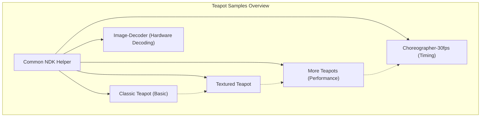
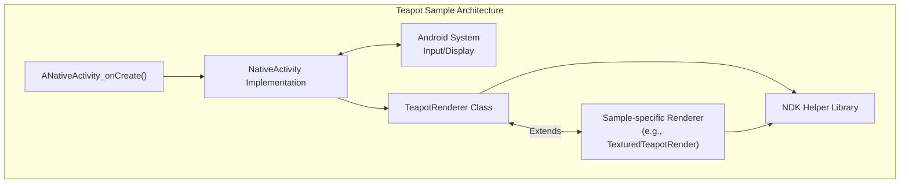
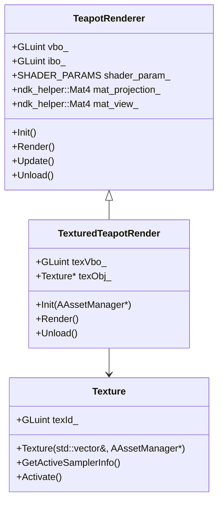
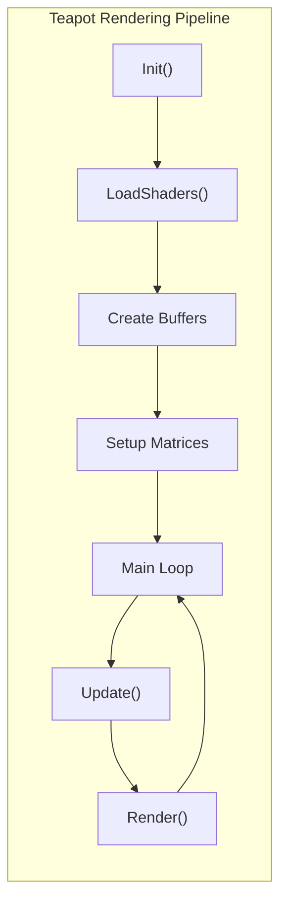

<!-- source: DeepWiki mcp.deepwiki.com · repo android/ndk-samples · page 5.1 Teapot Samples · fetched 2026-10-23 -->

# Teapot Samples

<details>
<summary>Relevant source files</summary>

The following files were used as context for generating this wiki page:

- [hello-jniCallback/app/build.gradle](hello-jniCallback/app/build.gradle)
- [hello-neon/app/build.gradle](hello-neon/app/build.gradle)
- [native-plasma/app/src/main/cpp/CMakeLists.txt](native-plasma/app/src/main/cpp/CMakeLists.txt)
- [nn-samples/basic/build.gradle](nn-samples/basic/build.gradle)
- [nn-samples/basic/src/main/res/layout/activity_main.xml](nn-samples/basic/src/main/res/layout/activity_main.xml)
- [nn-samples/sequence/build.gradle](nn-samples/sequence/build.gradle)
- [nn-samples/sequence/src/main/res/layout/activity_main.xml](nn-samples/sequence/src/main/res/layout/activity_main.xml)
- [prefab/curl-ssl/app/src/main/cpp/CMakeLists.txt](prefab/curl-ssl/app/src/main/cpp/CMakeLists.txt)
- [prefab/prefab-dependency/app/src/main/cpp/CMakeLists.txt](prefab/prefab-dependency/app/src/main/cpp/CMakeLists.txt)
- [teapots/choreographer-30fps/build.gradle](teapots/choreographer-30fps/build.gradle)
- [teapots/choreographer-30fps/src/main/cpp/CMakeLists.txt](teapots/choreographer-30fps/src/main/cpp/CMakeLists.txt)
- [teapots/classic-teapot/build.gradle](teapots/classic-teapot/build.gradle)
- [teapots/classic-teapot/src/main/cpp/CMakeLists.txt](teapots/classic-teapot/src/main/cpp/CMakeLists.txt)
- [teapots/common/ndk_helper/CMakeLists.txt](teapots/common/ndk_helper/CMakeLists.txt)
- [teapots/image-decoder/build.gradle](teapots/image-decoder/build.gradle)
- [teapots/more-teapots/build.gradle](teapots/more-teapots/build.gradle)
- [teapots/more-teapots/src/main/cpp/CMakeLists.txt](teapots/more-teapots/src/main/cpp/CMakeLists.txt)
- [teapots/textured-teapot/README.md](teapots/textured-teapot/README.md)
- [teapots/textured-teapot/build.gradle](teapots/textured-teapot/build.gradle)
- [teapots/textured-teapot/screenshot.png](teapots/textured-teapot/screenshot.png)
- [teapots/textured-teapot/src/main/assets/Shaders/ShaderPlain.fsh](teapots/textured-teapot/src/main/assets/Shaders/ShaderPlain.fsh)
- [teapots/textured-teapot/src/main/cpp/CMakeLists.txt](teapots/textured-teapot/src/main/cpp/CMakeLists.txt)
- [teapots/textured-teapot/src/main/cpp/TeapotRenderer.cpp](teapots/textured-teapot/src/main/cpp/TeapotRenderer.cpp)
- [teapots/textured-teapot/src/main/cpp/TeapotRenderer.h](teapots/textured-teapot/src/main/cpp/TeapotRenderer.h)
- [teapots/textured-teapot/src/main/cpp/Texture.cpp](teapots/textured-teapot/src/main/cpp/Texture.cpp)
- [teapots/textured-teapot/src/main/cpp/Texture.h](teapots/textured-teapot/src/main/cpp/Texture.h)
- [teapots/textured-teapot/src/main/cpp/TexturedTeapotRender.cpp](teapots/textured-teapot/src/main/cpp/TexturedTeapotRender.cpp)
- [teapots/textured-teapot/src/main/cpp/TexturedTeapotRender.h](teapots/textured-teapot/src/main/cpp/TexturedTeapotRender.h)
- [teapots/textured-teapot/src/main/cpp/android_debug.h](teapots/textured-teapot/src/main/cpp/android_debug.h)

</details>


This document provides a detailed explanation of the Teapot rendering samples included in the Android NDK samples repository. These samples demonstrate various techniques for rendering 3D graphics using OpenGL ES with the Android Native Development Kit (NDK), focusing on different rendering capabilities and performance optimization strategies. For information about other graphics samples, see [Graphics Samples](#5).

## Overview

The Teapot samples use the classic 3D teapot model (a standard test model in computer graphics) to showcase different rendering techniques and Android graphics capabilities. Each sample builds upon core rendering concepts while demonstrating specific features:



Sources: teapots/classic-teapot/build.gradle, teapots/textured-teapot/build.gradle, teapots/more-teapots/build.gradle, teapots/choreographer-30fps/build.gradle, teapots/image-decoder/build.gradle, teapots/common/ndk_helper/CMakeLists.txt

## Architecture

All teapot samples follow a similar architecture pattern using NativeActivity, which allows implementing an Android activity entirely in native code:



Sources: teapots/classic-teapot/src/main/cpp/CMakeLists.txt, teapots/textured-teapot/src/main/cpp/CMakeLists.txt, teapots/textured-teapot/src/main/cpp/TeapotRenderer.h, teapots/textured-teapot/src/main/cpp/TexturedTeapotRender.h

### Common Components

All samples share these core components:

1. **NativeActivity** - Implements the Android activity lifecycle in native code
2. **TeapotRenderer** - Base rendering class that handles OpenGL setup and basic rendering
3. **NDK Helper** - Common utilities for shader compilation, touch input, and other functionality

The samples are built using CMake, with similar configuration patterns across all variants:

```
// Common CMake configuration pattern
cmake_minimum_required(VERSION 3.22.1)
project([SampleName]NativeActivity LANGUAGES C CXX)

// Build NDK helper library
add_subdirectory(${ndkHelperSrc} ...)

// Build sample's shared library
add_library(${PROJECT_NAME}
  SHARED
    TeapotNativeActivity.cpp
    TeapotRenderer.cpp
    [Sample-specific cpp files]
)

// Export ANativeActivity_onCreate()
set_target_properties(${PROJECT_NAME}
  PROPERTIES LINK_FLAGS "-u ANativeActivity_onCreate")

// Link against NDK Helper
target_link_libraries(${PROJECT_NAME} PRIVATE NdkHelper)
```

Sources: teapots/classic-teapot/src/main/cpp/CMakeLists.txt, teapots/textured-teapot/src/main/cpp/CMakeLists.txt, teapots/choreographer-30fps/src/main/cpp/CMakeLists.txt, teapots/more-teapots/src/main/cpp/CMakeLists.txt

## Sample Variants

### Classic Teapot

The foundation sample that demonstrates basic 3D rendering with OpenGL ES. It implements:
- Vertex and fragment shaders for basic lighting
- Model-View-Projection matrix handling
- Basic material properties

Sources: teapots/classic-teapot/build.gradle, teapots/classic-teapot/src/main/cpp/CMakeLists.txt

### Textured Teapot

Extends the classic teapot by adding texture mapping capabilities:



Key features:
- Loads textures from APK assets folder
- Supports cube mapping for environment reflection
- Demonstrates texture coordinate handling

The `TexturedTeapotRender` class extends the base `TeapotRenderer` and adds:
- Texture buffer creation and management
- Texture coordinate handling
- Shader uniform setup for texturing

The `Texture` class handles:
- Loading texture images (using stb_image library)
- Creating OpenGL texture objects
- Managing texture parameters and binding

Sources: teapots/textured-teapot/src/main/cpp/TexturedTeapotRender.cpp, teapots/textured-teapot/src/main/cpp/Texture.cpp, teapots/textured-teapot/src/main/cpp/Texture.h, teapots/textured-teapot/README.md

### More Teapots

Demonstrates performance optimization when rendering multiple objects:
- Renders many teapots simultaneously
- Focuses on efficient batch rendering
- Shows techniques for handling many transforms

Sources: teapots/more-teapots/build.gradle, teapots/more-teapots/src/main/cpp/CMakeLists.txt

### Choreographer-30fps

Shows how to integrate with Android's Choreographer for frame timing control:
- Maintains consistent 30fps rendering
- Demonstrates synchronization with display refresh rate
- Shows proper timing for animations

Sources: teapots/choreographer-30fps/build.gradle, teapots/choreographer-30fps/src/main/cpp/CMakeLists.txt

### Image-Decoder

Demonstrates using Android's Image Decoder API with OpenGL:
- Hardware-accelerated image decoding
- Integration of decoded images as textures
- Efficient texture loading for graphics applications

Sources: teapots/image-decoder/build.gradle

## Implementation Details

### Rendering Pipeline

The teapot rendering pipeline functions as follows:



1. **Initialization** - Sets up OpenGL context, shaders, and buffers
2. **Shader Loading** - Compiles and links vertex and fragment shaders
3. **Buffer Creation** - Generates vertex and index buffers for the teapot model
4. **Matrix Setup** - Creates projection, view, and model matrices
5. **Rendering Loop** - Updates matrices based on animation and touch input, then renders the scene

Sources: teapots/textured-teapot/src/main/cpp/TeapotRenderer.cpp

### Texture Management

In the textured teapot sample, textures are managed as follows:

1. **Loading** - Textures are loaded from assets using the Asset Manager
2. **Creation** - OpenGL texture objects are created and configured
3. **Binding** - Textures are bound to texture units for use in shaders
4. **Sampling** - Shader samplers are set up to access the textures

```
// Texture loading process in TexturedTeapotRender::Init
std::vector<std::string> textures{
    std::string("Textures/right.tga"),   // GL_TEXTURE_CUBE_MAP_POSITIVE_X
    std::string("Textures/left.tga"),    // GL_TEXTURE_CUBE_MAP_NEGATIVE_X
    std::string("Textures/bottom.tga"),  // GL_TEXTURE_CUBE_MAP_NEGATIVE_Y
    std::string("Textures/top.tga"),     // GL_TEXTURE_CUBE_MAP_POSITIVE_Y
    std::string("Textures/front.tga"),   // GL_TEXTURE_CUBE_MAP_POSITIVE_Z
    std::string("Textures/back.tga")     // GL_TEXTURE_CUBE_MAP_NEGATIVE_Z
};

texObj_ = new Texture(textures, assetMgr);
```

Sources: teapots/textured-teapot/src/main/cpp/TexturedTeapotRender.cpp, teapots/textured-teapot/src/main/cpp/Texture.cpp

### Shaders

The samples use GLSL shaders for rendering the teapot:

1. **Vertex Shader** - Transforms vertices and calculates lighting vectors
2. **Fragment Shader** - Computes final color based on lighting and textures

For example, in the textured teapot's fragment shader:

```
// Fragment shader excerpt
#define USE_PHONG (1)

// Apply Phong lighting model
mediump vec3 halfVector = normalize(-vLight0 + position);
mediump float NdotH = max(dot(normalize(normal), halfVector), 0.0);
mediump float fPower = vMaterialSpecular.w;
mediump float specular = pow(NdotH, fPower);

lowp vec4 colorSpecular = vec4( vMaterialSpecular.xyz * specular, 1 );
gl_FragColor = colorDiffuse + colorSpecular;
```

Sources: teapots/textured-teapot/src/main/assets/Shaders/ShaderPlain.fsh

### NDK Helper Library

All samples use a common NDK helper library that provides:

1. **Shader Utilities** - Compilation and linking
2. **Matrix Math** - Transformation matrices and vector operations
3. **Touch Input** - Gesture detection for camera control
4. **Timing** - Frame rate calculation and monitoring

The helper library is built as a static library and linked into each sample:

```
// NDK Helper CMake configuration
add_library(NdkHelper
  STATIC
    gestureDetector.cpp
    gl3stub.cpp
    GLContext.cpp
    interpolator.cpp
    JNIHelper.cpp
    perfMonitor.cpp
    sensorManager.cpp
    shader.cpp
    tapCamera.cpp
    vecmath.cpp
)
```

Sources: teapots/common/ndk_helper/CMakeLists.txt

## Project Structure

The teapot samples follow a standard Android project structure with native code:

```
teapots/
├── common/
│   └── ndk_helper/     # Shared utilities used by all samples
├── classic-teapot/     # Basic teapot rendering
├── textured-teapot/    # Teapot with texturing
│   ├── src/
│   │   ├── main/
│   │   │   ├── assets/
│   │   │   │   ├── Shaders/   # GLSL shaders
│   │   │   │   └── Textures/  # Texture files
│   │   │   ├── cpp/          # Native code
│   │   │   │   ├── TeapotRenderer.cpp
│   │   │   │   ├── TexturedTeapotRender.cpp
│   │   │   │   ├── Texture.cpp
│   │   │   │   └── CMakeLists.txt
│   │   │   └── java/         # Java wrapper
│   └── build.gradle          # Build configuration
├── more-teapots/             # Multiple teapots sample
├── choreographer-30fps/      # Frame timing sample
└── image-decoder/            # Image decoding sample
```

Sources: teapots/textured-teapot/build.gradle, teapots/classic-teapot/build.gradle, teapots/more-teapots/build.gradle, teapots/choreographer-30fps/build.gradle, teapots/image-decoder/build.gradle

## Conclusion

The Teapot samples provide a comprehensive demonstration of 3D graphics programming with Android NDK. From basic rendering to advanced features like texture mapping and frame timing, these samples illustrate best practices for developing high-performance OpenGL ES applications on Android using native code.

---

