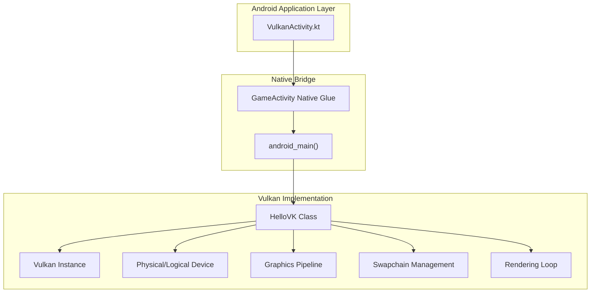
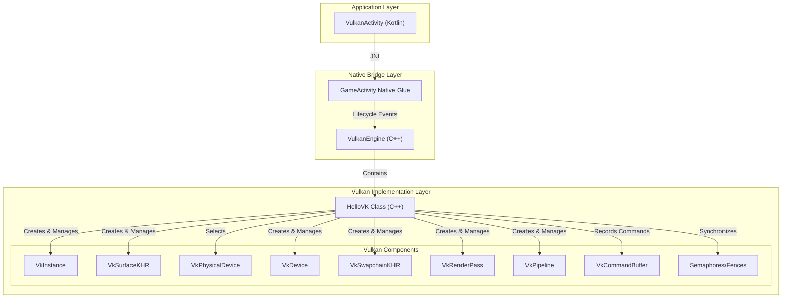
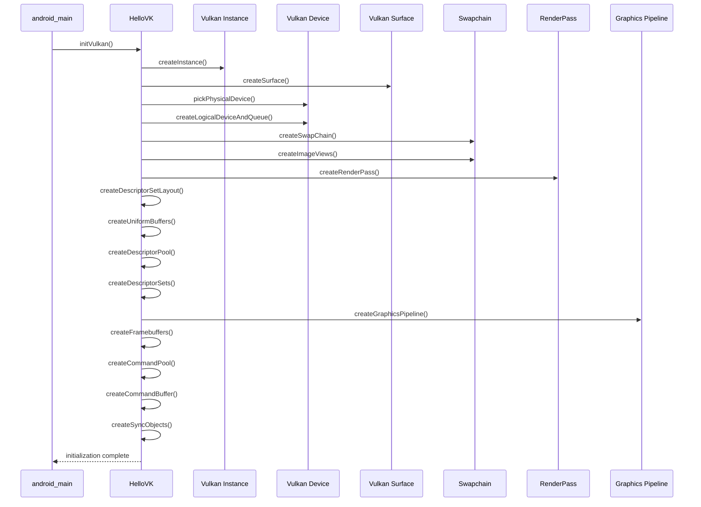
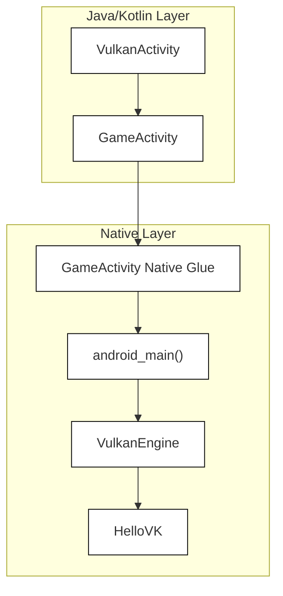

<!-- source: DeepWiki mcp.deepwiki.com · repo android/ndk-samples · page 5.2 Vulkan Rendering · fetched 2026-10-23 -->

# Vulkan Rendering

<details>
<summary>Relevant source files</summary>

The following files were used as context for generating this wiki page:

- [audio-echo/README.md](audio-echo/README.md)
- [bitmap-plasma/README.md](bitmap-plasma/README.md)
- [endless-tunnel/README.md](endless-tunnel/README.md)
- [gles3jni/README.md](gles3jni/README.md)
- [hello-gl2/README.md](hello-gl2/README.md)
- [hello-jni/README.md](hello-jni/README.md)
- [hello-vulkan/app/build.gradle](hello-vulkan/app/build.gradle)
- [hello-vulkan/app/src/main/AndroidManifest.xml](hello-vulkan/app/src/main/AndroidManifest.xml)
- [hello-vulkan/app/src/main/cpp/hellovk.h](hello-vulkan/app/src/main/cpp/hellovk.h)
- [hello-vulkan/app/src/main/cpp/vk_main.cpp](hello-vulkan/app/src/main/cpp/vk_main.cpp)
- [hello-vulkan/app/src/main/java/com/android/hellovk/VulkanActivity.kt](hello-vulkan/app/src/main/java/com/android/hellovk/VulkanActivity.kt)
- [hello-vulkan/app/src/main/res/mipmap-hdpi/ic_launcher.png](hello-vulkan/app/src/main/res/mipmap-hdpi/ic_launcher.png)
- [hello-vulkan/app/src/main/res/mipmap-mdpi/ic_launcher.png](hello-vulkan/app/src/main/res/mipmap-mdpi/ic_launcher.png)
- [hello-vulkan/app/src/main/res/mipmap-xhdpi/ic_launcher.png](hello-vulkan/app/src/main/res/mipmap-xhdpi/ic_launcher.png)
- [native-activity/README.md](native-activity/README.md)
- [native-audio/README.md](native-audio/README.md)
- [native-codec/README.md](native-codec/README.md)
- [native-media/README.md](native-media/README.md)
- [native-plasma/README.md](native-plasma/README.md)
- [san-angeles/README.md](san-angeles/README.md)

</details>


## Purpose and Scope

This document explains the implementation of Vulkan graphics rendering in the Android NDK Samples repository, specifically focusing on the `hello-vulkan` sample. It illustrates how to set up a Vulkan graphics pipeline on Android, handle device orientation changes, and integrate with Android's GameActivity.

For information about OpenGL ES graphics samples, see [Graphics Samples](#5) and [Teapot Samples](#5.1).

## Overview of the Hello Vulkan Sample

The `hello-vulkan` sample demonstrates a minimal implementation of Vulkan rendering on Android. It renders a simple triangle with a changing background color to illustrate Vulkan's core concepts. The sample showcases:

- Setting up a Vulkan instance, device, and swapchain
- Creating render passes, graphics pipelines, and framebuffers
- Managing descriptor sets and uniform buffers
- Handling device orientation changes
- Integration with AndroidX GameActivity



Sources: [hello-vulkan/app/src/main/cpp/hellovk.h](), [hello-vulkan/app/src/main/cpp/vk_main.cpp](), [hello-vulkan/app/src/main/java/com/android/hellovk/VulkanActivity.kt]()

## Application Architecture

The `hello-vulkan` sample follows a layered architecture that spans from Java/Kotlin code down to native Vulkan implementation:



Sources: [hello-vulkan/app/src/main/cpp/vk_main.cpp:42-46](), [hello-vulkan/app/src/main/cpp/hellovk.h:176-300]()

## Native Entry Point and Lifecycle

The entry point for the native code is the `android_main()` function in `vk_main.cpp`. This function sets up the Android application structure and handles application lifecycle events.

### VulkanEngine Structure

```cpp
struct VulkanEngine {
  struct android_app *app;
  vkt::HelloVK *app_backend;
  bool canRender = false;
};
```

This structure holds the state of the application, including:
- A pointer to the Android application structure
- A pointer to the Vulkan implementation (`HelloVK`)
- A flag indicating whether rendering is permitted

### Command Handling

The `HandleCmd()` function processes Android lifecycle events:

- `APP_CMD_START`: Initial application start
- `APP_CMD_INIT_WINDOW`: Window creation/recreation
- `APP_CMD_TERM_WINDOW`: Window destruction
- `APP_CMD_DESTROY`: Application destruction

When the window is created (`APP_CMD_INIT_WINDOW`), it initializes the Vulkan renderer and enables rendering.

Sources: [hello-vulkan/app/src/main/cpp/vk_main.cpp:52-85](), [hello-vulkan/app/src/main/cpp/vk_main.cpp:124-154]()

## Vulkan Implementation

The core Vulkan implementation is contained in the `HelloVK` class, which manages the entire Vulkan pipeline.

### Initialization Process

The Vulkan initialization process follows this sequence:



Sources: [hello-vulkan/app/src/main/cpp/hellovk.h:280-300]()

### Key Components

#### 1. Instance and Surface Creation

The Vulkan instance is created with Android-specific extensions:
- `VK_KHR_surface`
- `VK_KHR_android_surface`

The surface is created from the Android native window to enable rendering to the screen.

Sources: [hello-vulkan/app/src/main/cpp/hellovk.h:687-729](), [hello-vulkan/app/src/main/cpp/hellovk.h:740-750]()

#### 2. Device Selection and Queue Families

The sample selects a suitable physical device by checking:
- Queue family support for graphics operations
- Surface presentation capability
- Required extension support (e.g., VK_KHR_swapchain)
- Swapchain adequacy

It then creates a logical device and obtains queues for graphics and presentation operations.

Sources: [hello-vulkan/app/src/main/cpp/hellovk.h:755-903]()

#### 3. Swapchain Creation

The swapchain is essential for rendering to the screen in Vulkan. The implementation handles:
- Surface format selection
- Present mode selection
- Image extent determination
- Image count configuration
- Image sharing mode

A special consideration for Android is handling device orientation changes, which requires swapchain recreation.

Sources: [hello-vulkan/app/src/main/cpp/hellovk.h:394-400]()

#### 4. Rendering Pipeline

The graphics pipeline in the sample is configured for rendering a simple triangle:
- Vertex input (hard-coded triangle vertices)
- Shader stages (vertex and fragment shaders)
- Viewport and scissor state
- Rasterization settings
- Multisampling configuration
- Color blending setup
- Pipeline layout with descriptor set layout

Sources: [hello-vulkan/app/src/main/cpp/hellovk.h:550-597]()

### Rendering Loop

The rendering loop in the `render()` method follows the standard Vulkan pattern:

1. Wait for previous frame to complete (fence)
2. Acquire next swapchain image
3. Record command buffer
4. Submit command buffer to the graphics queue
5. Present the rendered image

Special handling is in place for swapchain recreation when:
- The surface changes (device orientation)
- The swapchain becomes outdated or suboptimal

Sources: [hello-vulkan/app/src/main/cpp/hellovk.h:402-465]()

## Android Integration

### GameActivity Integration

The sample uses AndroidX's GameActivity for improved game performance:

1. The Kotlin `VulkanActivity` extends `GameActivity`
2. Native code integrates with GameActivity's native glue
3. Input events are handled via GameActivity's event system



Sources: [hello-vulkan/app/src/main/java/com/android/hellovk/VulkanActivity.kt:31-84](), [hello-vulkan/app/src/main/cpp/vk_main.cpp:124-154]()

### Handling Device Orientation

The sample handles device orientation changes through:

1. Android manifest configuration allowing orientation changes
2. Detecting orientation changes via surface capabilities
3. Recreating the swapchain when orientation changes
4. Applying pre-rotation matrices to the rendering to match the new orientation

```xml
<activity android:configChanges="orientation|screenSize|keyboardHidden">
```

The sample includes a `getPrerotationMatrix()` function that generates appropriate transformation matrices for different screen orientations.

Sources: [hello-vulkan/app/src/main/AndroidManifest.xml:7-16](), [hello-vulkan/app/src/main/cpp/hellovk.h:471-485]()

## Memory Management

Proper resource allocation and deallocation is critical in Vulkan applications. The sample demonstrates:

### Resource Creation Pattern

Most Vulkan resources follow this creation pattern:
1. Prepare create info structure with appropriate configuration
2. Call Vulkan creation function
3. Store handle for later use

### Cleanup Process

The cleanup process ensures all resources are properly freed:
1. Wait for device idle to ensure no operations are in progress
2. Free resources in approximately reverse order of creation
3. Special handling for swapchain cleanup (separate method for recreation)

Sources: [hello-vulkan/app/src/main/cpp/hellovk.h:599-639]()

### Uniform Buffer Management

The sample creates uniform buffers for passing transformation matrices to shaders:
1. Create buffers with `VK_BUFFER_USAGE_UNIFORM_BUFFER_BIT`
2. Allocate memory with `VK_MEMORY_PROPERTY_HOST_VISIBLE_BIT | VK_MEMORY_PROPERTY_HOST_COHERENT_BIT`
3. Update buffer contents each frame using memory mapping

Sources: [hello-vulkan/app/src/main/cpp/hellovk.h:354-366](), [hello-vulkan/app/src/main/cpp/hellovk.h:532-543]()

## Best Practices Demonstrated

The `hello-vulkan` sample demonstrates several Vulkan best practices:

1. **Double-buffering** with `MAX_FRAMES_IN_FLIGHT = 2` to allow concurrent frame preparation
2. **Proper synchronization** using semaphores and fences to coordinate operations
3. **Resource cleanup** in the correct order to avoid validation errors
4. **Error checking** with the `VK_CHECK` macro for all Vulkan function calls
5. **Adapting to screen orientation** changes through swapchain recreation
6. **Memory type selection** based on device capabilities and requirements

Sources: [hello-vulkan/app/src/main/cpp/hellovk.h:44-52](), [hello-vulkan/app/src/main/cpp/hellovk.h:338-352]()

## Summary

The `hello-vulkan` sample provides a foundation for understanding Vulkan implementation on Android. It demonstrates:

1. Setting up the complete Vulkan rendering pipeline
2. Integrating with AndroidX GameActivity for improved performance
3. Handling Android-specific considerations like orientation changes
4. Proper resource management and synchronization

Developers can use this sample as a starting point for more complex Vulkan applications on Android, building upon the patterns and practices it demonstrates.

---

