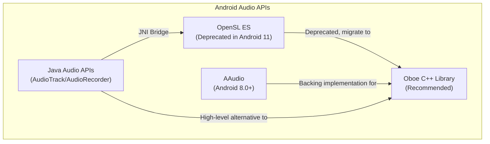
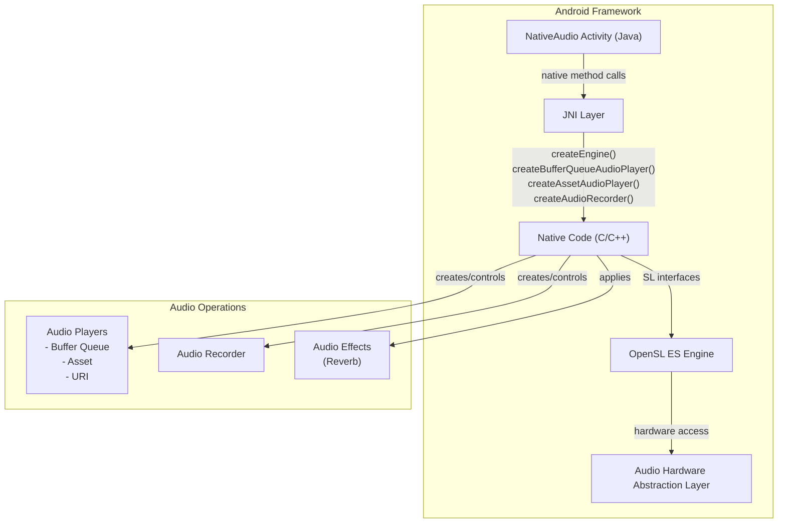
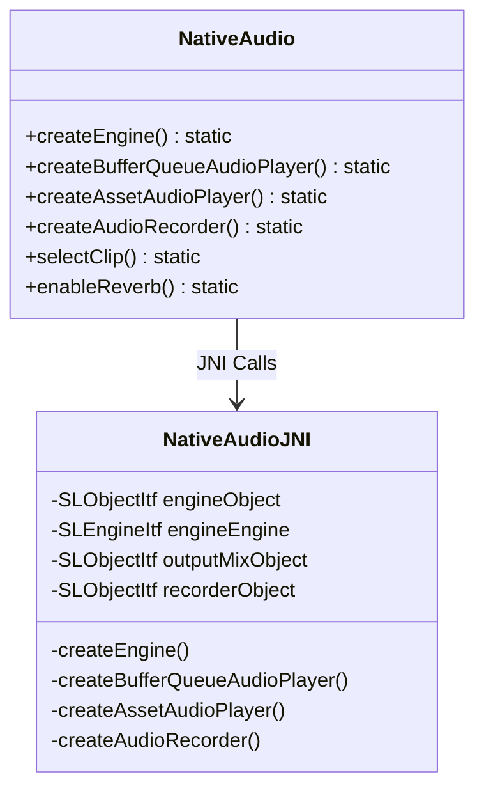
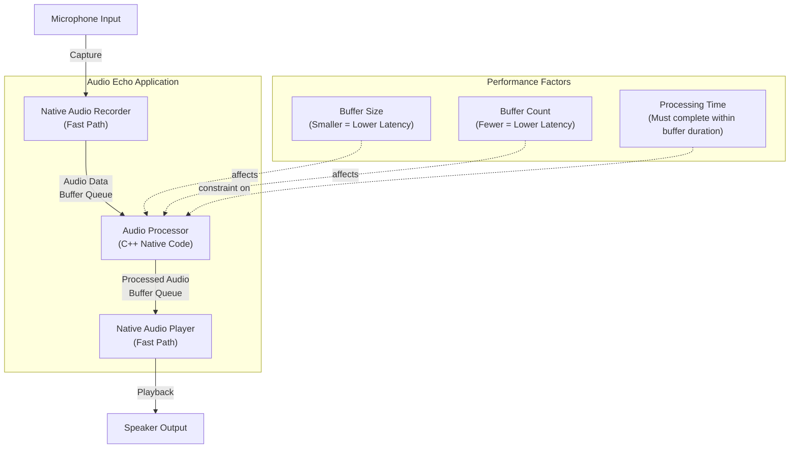
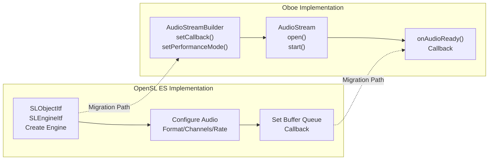

<!-- source: DeepWiki mcp.deepwiki.com · repo android/ndk-samples · page 6 Audio Samples · fetched 2026-10-23 -->

# Audio Samples

Relevant source files

The following files were used as context for generating this wiki page:

- [audio-echo/README.md](audio-echo/README.md)
- [bitmap-plasma/README.md](bitmap-plasma/README.md)
- [endless-tunnel/README.md](endless-tunnel/README.md)
- [gles3jni/README.md](gles3jni/README.md)
- [hello-gl2/README.md](hello-gl2/README.md)
- [hello-jni/README.md](hello-jni/README.md)
- [native-activity/README.md](native-activity/README.md)
- [native-audio/README.md](native-audio/README.md)
- [native-audio/app/src/main/AndroidManifest.xml](native-audio/app/src/main/AndroidManifest.xml)
- [native-audio/app/src/main/java/com/example/nativeaudio/NativeAudio.java](native-audio/app/src/main/java/com/example/nativeaudio/NativeAudio.java)
- [native-codec/README.md](native-codec/README.md)
- [native-media/README.md](native-media/README.md)
- [native-plasma/README.md](native-plasma/README.md)
- [san-angeles/README.md](san-angeles/README.md)

This document provides an overview of the audio processing and playback samples in the Android NDK Samples repository. These samples demonstrate how to use native code for audio operations in Android applications, focusing on performance-critical audio tasks that benefit from C/C++ implementation.

## Overview of Audio Samples

The repository contains several samples demonstrating different aspects of audio implementation using the Android NDK:

1. **Native Audio** - Demonstrates basic audio playback and recording using the OpenSL ES API
2. **Audio Echo** - Shows how to achieve low-latency audio processing using the Fast Audio Path
3. **Hello Oboe** - Illustrates the use of the modern Oboe C++ audio library, which is the recommended replacement for OpenSL ES

### Audio API Evolution in Android

Sources: [native-audio/README.md:11-14](), [audio-echo/README.md:18-21]()

## Native Audio Sample

The Native Audio sample demonstrates how to use OpenSL ES to play and record audio through native code. It shows how to create audio players and recorders, handle audio buffers, control playback parameters, and apply effects.

> **Note:** OpenSL ES is deprecated from Android 11. Developers are recommended to use the Oboe library instead.

### Architecture Overview

Sources: [native-audio/app/src/main/java/com/example/nativeaudio/NativeAudio.java:376-397]()

### Key Features

The Native Audio sample demonstrates:

1. **Multiple Audio Source Types:**
   - Playing audio from application assets
   - Buffer queue audio player for generated sounds
   - URI-based audio player

2. **Audio Capture:**
   - Recording from device microphone
   - Playback of recorded audio

3. **Audio Control:**
   - Volume control
   - Channel muting and solo
   - Stereo positioning
   - Audio effects (reverb)

Sources: [native-audio/app/src/main/java/com/example/nativeaudio/NativeAudio.java:109-323]()

### Implementation Details

The sample implements a Java activity that interfaces with native code through JNI:

The sample requires several permissions to function properly:

| Permission | Purpose |
|------------|---------|
| `RECORD_AUDIO` | Required to create an audio recorder |
| `MODIFY_AUDIO_SETTINGS` | Needed to use audio effects such as reverb |
| `INTERNET` | Required for URI-based audio playback |

Sources: [native-audio/app/src/main/AndroidManifest.xml:6-11]()

## Audio Echo Sample

The Audio Echo sample demonstrates how to use OpenSL ES to create a player and recorder in Android's Fast Audio Path, optimized for low latency. It creates an audio loopback by connecting the microphone input directly to the audio output.

### Fast Audio Path Concept

Sources: [audio-echo/README.md:3-10](), [audio-echo/README.md:82-100]()

### Tuning for Low Latency

The Audio Echo sample includes several tuning parameters that affect latency:

1. **Buffer Size**: Smaller buffers reduce latency but require faster processing
2. **Buffer Count**: Fewer buffers in the queue reduce latency but increase the risk of audio glitches
3. **Callback Timing**: The irregularity of buffer queue callbacks adds uncertainty, requiring more buffering

To verify that your application is using the Fast Audio Path:

1. Run `adb shell dumpsys media.audio_flinger` to see running audio processes
2. Check for an "F" flag in front of your application's process ID
3. For audio capture, verify that there are no "AUDIO_INPUT_FLAG_FAST denied" warnings in logcat

Sources: [audio-echo/README.md:52-78](), [audio-echo/README.md:82-100]()

## Native Media and Codec Samples

While primarily focused on video playback, the Native Media and Native Codec samples also demonstrate audio processing within multimedia contexts:

1. **Native Media**: Uses OpenMAX AL to play audio in video content
2. **Native Codec**: Demonstrates the Native Media Codec API for both video and audio playback

These samples illustrate how to handle synchronized audio-video playback in native code.

Sources: [native-media/README.md:1-11](), [native-codec/README.md:1-13]()

## Best Practices for Native Audio Development

### Migration from OpenSL ES to Oboe

Since OpenSL ES is deprecated from Android 11, developers should consider migrating to the Oboe library. Oboe provides several advantages:

1. Higher-level API with simplified error handling
2. Automatic backend selection between AAudio (Android 8.0+) and OpenSL ES
3. Built-in support for the Fast Audio Path
4. More consistent behavior across different Android versions

For more details on specific audio implementations, see [Native Audio](#6.1) and [Oboe Audio](#6.2).

Sources: [native-audio/README.md:11-14](), [audio-echo/README.md:18-21]()

---

