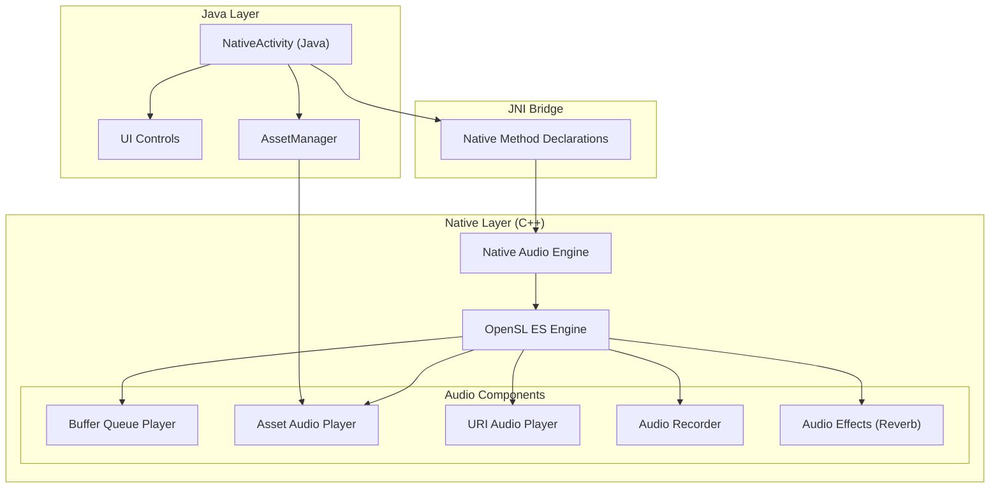
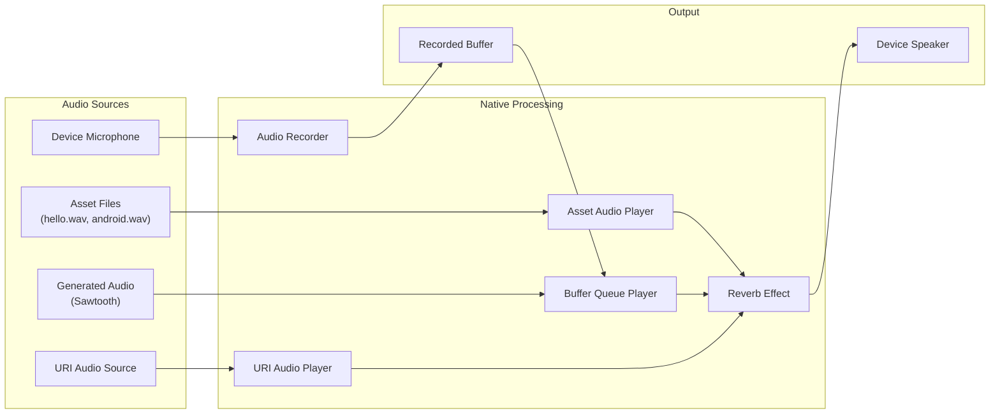
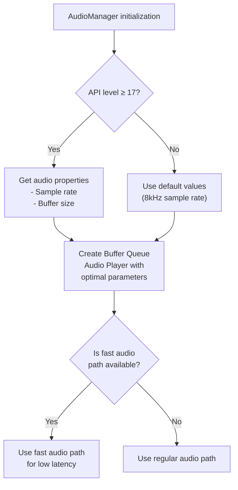
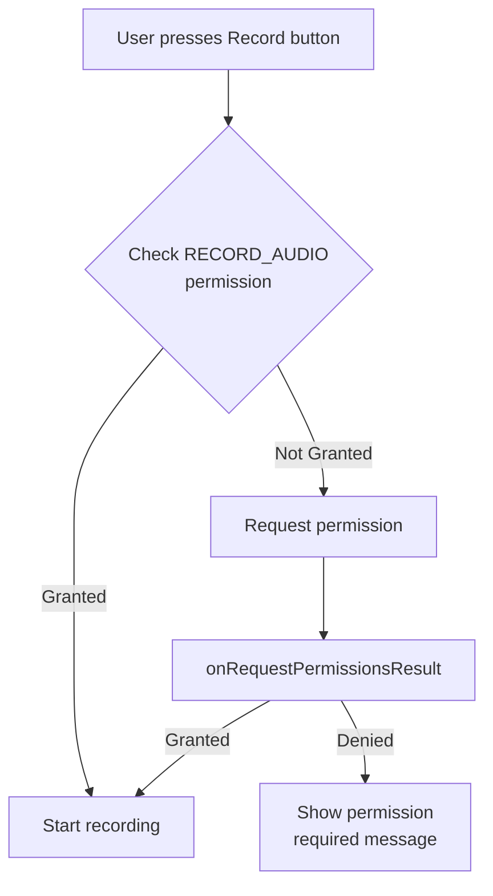

<!-- source: DeepWiki mcp.deepwiki.com · repo android/ndk-samples · page 6.1 Native Audio · fetched 2026-10-23 -->

# Native Audio

Relevant source files

The following files were used as context for generating this wiki page:

- [audio-echo/README.md](audio-echo/README.md)
- [bitmap-plasma/README.md](bitmap-plasma/README.md)
- [endless-tunnel/README.md](endless-tunnel/README.md)
- [gles3jni/README.md](gles3jni/README.md)
- [hello-gl2/README.md](hello-gl2/README.md)
- [hello-jni/README.md](hello-jni/README.md)
- [native-activity/README.md](native-activity/README.md)
- [native-audio/README.md](native-audio/README.md)
- [native-audio/app/src/main/AndroidManifest.xml](native-audio/app/src/main/AndroidManifest.xml)
- [native-audio/app/src/main/java/com/example/nativeaudio/NativeAudio.java](native-audio/app/src/main/java/com/example/nativeaudio/NativeAudio.java)
- [native-codec/README.md](native-codec/README.md)
- [native-media/README.md](native-media/README.md)
- [native-plasma/README.md](native-plasma/README.md)
- [san-angeles/README.md](san-angeles/README.md)

## Purpose and Scope

This document provides a comprehensive explanation of the Native Audio sample in the Android NDK samples repository. The sample demonstrates how to implement audio playback and recording in native C++ code using the OpenSL ES API via JNI. It showcases various audio features including playback of pre-recorded sounds, streaming audio from assets, recording, and applying effects like reverb.

> **Note**: OpenSL ES is [deprecated from Android 11](https://developer.android.com/preview/features#deprecate-opensl). Developers are recommended to use the [Oboe library](https://github.com/google/oboe) instead. For Oboe audio samples, see [Hello Oboe](#6.2).

Sources: [native-audio/README.md:1-14](), [native-audio/README.md:11-14]()

## Architecture Overview

The Native Audio sample follows a hybrid architecture where UI components and high-level control are implemented in Java, while the core audio processing is handled by native C++ code through JNI.

### System Architecture

The diagram above illustrates the layered architecture of the Native Audio sample. The Java layer handles UI interactions and permission management, while the native C++ layer performs the actual audio processing using OpenSL ES.

Sources: [native-audio/app/src/main/java/com/example/nativeaudio/NativeAudio.java:16-404](), [native-audio/README.md:3-5]()

### Audio Signal Flow

This diagram shows how audio signals flow through the system, from various sources through native processing components to outputs.

Sources: [native-audio/app/src/main/java/com/example/nativeaudio/NativeAudio.java:47-51](), [native-audio/app/src/main/java/com/example/nativeaudio/NativeAudio.java:109-139]()

## Key Components

### Java Activity (NativeAudio)

The `NativeAudio` class extends `Activity` and serves as the main entry point for the application. It:

1. Initializes the OpenSL ES audio engine
2. Creates and manages UI controls for audio playback and recording
3. Handles audio permissions
4. Declares native methods that are implemented in C++
5. Manages audio asset resources

The activity creates different types of audio players:
- Buffer Queue Audio Player - for playing simple sounds and recorded audio
- Asset Audio Player - for playing audio files from app assets
- URI Audio Player - for streaming audio from a URI

Sources: [native-audio/app/src/main/java/com/example/nativeaudio/NativeAudio.java:40-404]()

### Native Methods

The sample defines several native methods in Java that are implemented in C++ through JNI:

| Native Method | Purpose |
|---------------|---------|
| `createEngine()` | Initializes the OpenSL ES audio engine |
| `createBufferQueueAudioPlayer()` | Creates an audio player for buffer queue playback |
| `createAssetAudioPlayer()` | Creates an audio player for asset playback |
| `createUriAudioPlayer()` | Creates an audio player for URI streaming |
| `createAudioRecorder()` | Creates an audio recorder |
| `selectClip()` | Selects a specific audio clip to play |
| `enableReverb()` | Enables/disables reverb effect |
| `startRecording()` | Starts audio recording |
| `shutdown()` | Releases all audio resources |

Sources: [native-audio/app/src/main/java/com/example/nativeaudio/NativeAudio.java:377-397]()

### Audio Clips

The sample includes predefined audio clips that can be played:

| Clip ID | Constant | Description |
|---------|----------|-------------|
| 0 | `CLIP_NONE` | No clip selected |
| 1 | `CLIP_HELLO` | "Hello" voice clip |
| 2 | `CLIP_ANDROID` | "Android" voice clip |
| 3 | `CLIP_SAWTOOTH` | Generated sawtooth waveform |
| 4 | `CLIP_PLAYBACK` | Recorded audio playback |

Sources: [native-audio/app/src/main/java/com/example/nativeaudio/NativeAudio.java:47-51]()

## Implementation Details

### Fast Audio Path Detection

The sample attempts to use the fast audio path for low-latency playback if available on the device:

The sample checks if the device supports the fast audio path by querying the `AudioManager` for optimal sample rate and buffer size values. These values are then passed to the native code to create an optimized audio player.

Sources: [native-audio/app/src/main/java/com/example/nativeaudio/NativeAudio.java:73-88]()

### Permission Handling

The application requires several permissions for full functionality:

1. `RECORD_AUDIO` - For audio recording functionality
2. `MODIFY_AUDIO_SETTINGS` - For audio effects like reverb
3. `INTERNET` - For URI-based audio playback

When the user attempts to record audio, the app checks and requests the necessary permissions at runtime:

Sources: [native-audio/app/src/main/AndroidManifest.xml:6-11](), [native-audio/app/src/main/java/com/example/nativeaudio/NativeAudio.java:290-375]()

## Audio Player Controls

The sample provides UI controls for various audio functions:

### Basic Clip Playback
- Hello clip playback
- Android clip playback
- Sawtooth waveform playback
- Reverb effect toggle

### Asset Audio Player
- Play/pause embedded soundtrack from assets

### URI Audio Player
- Play/pause URI audio source
- Loop toggle
- Channel mute/solo controls
- Volume control
- Stereo position control

### Recording
- Record audio from microphone
- Play back recorded audio

Sources: [native-audio/app/src/main/java/com/example/nativeaudio/NativeAudio.java:108-310]()

## Lifecycle Management

The sample properly handles activity lifecycle events to manage audio resources:

- **onPause()**: Stops all audio playback
- **onDestroy()**: Calls the native `shutdown()` method to release all audio resources

This ensures that audio resources are properly released when the app is no longer in the foreground.

Sources: [native-audio/app/src/main/java/com/example/nativeaudio/NativeAudio.java:325-344]()

## Known Issues and Limitations

1. The URI player is broken on Android 21 and higher (internal bug id: b/29321867)
2. OpenSL ES is deprecated from Android 11, developers should use Oboe library instead
3. When switching between external headphone and internal speaker, the volume might be very low/muted

Sources: [native-audio/app/src/main/java/com/example/nativeaudio/NativeAudio.java:155-156](), [native-audio/README.md:11-14](), [native-audio/README.md:37-39]()

## Conclusion

The Native Audio sample demonstrates how to implement audio playback and recording functionality using the OpenSL ES API through JNI. It showcases different types of audio players and various controls for audio manipulation. While the sample provides a good foundation for understanding native audio on Android, developers should consider using the Oboe library for new projects, as OpenSL ES is deprecated from Android 11.

Sources: [native-audio/README.md:1-14]()

---

