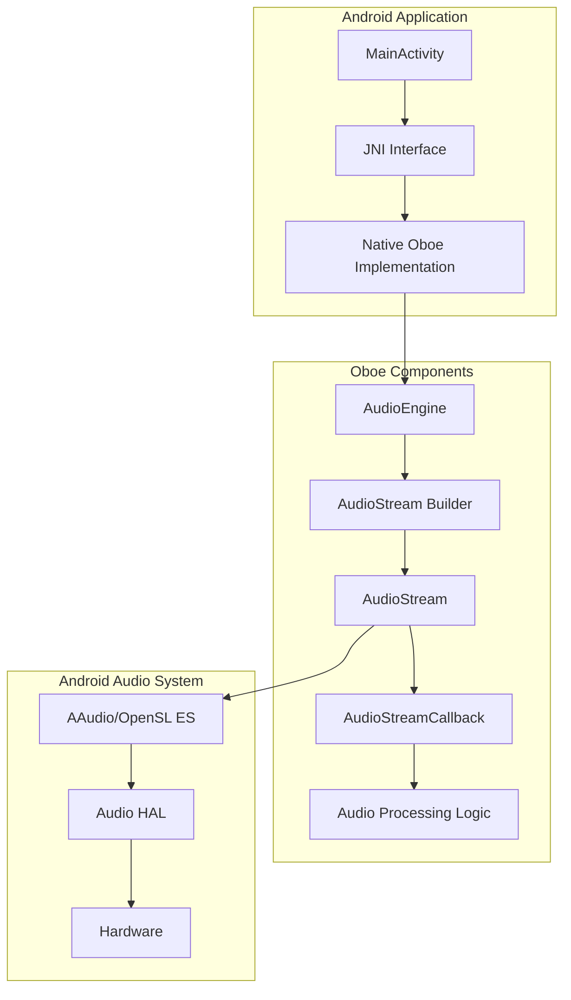
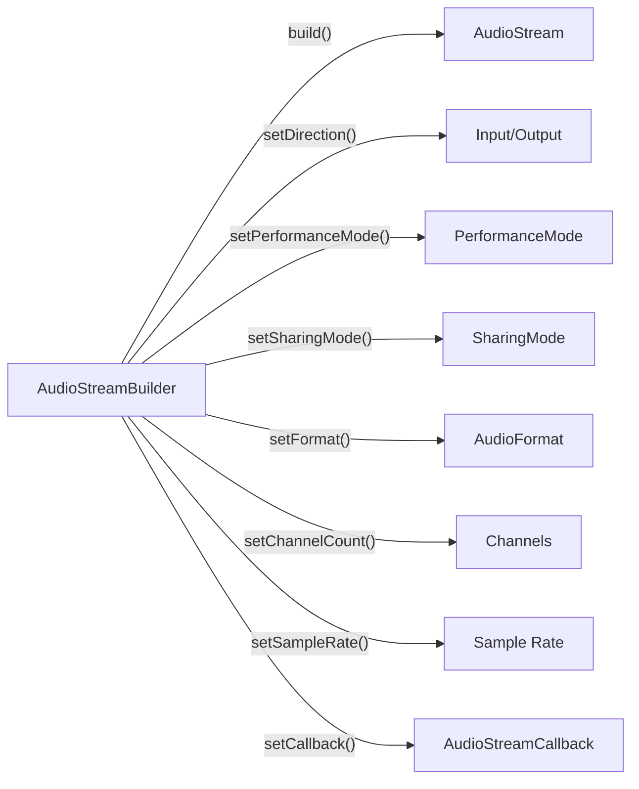
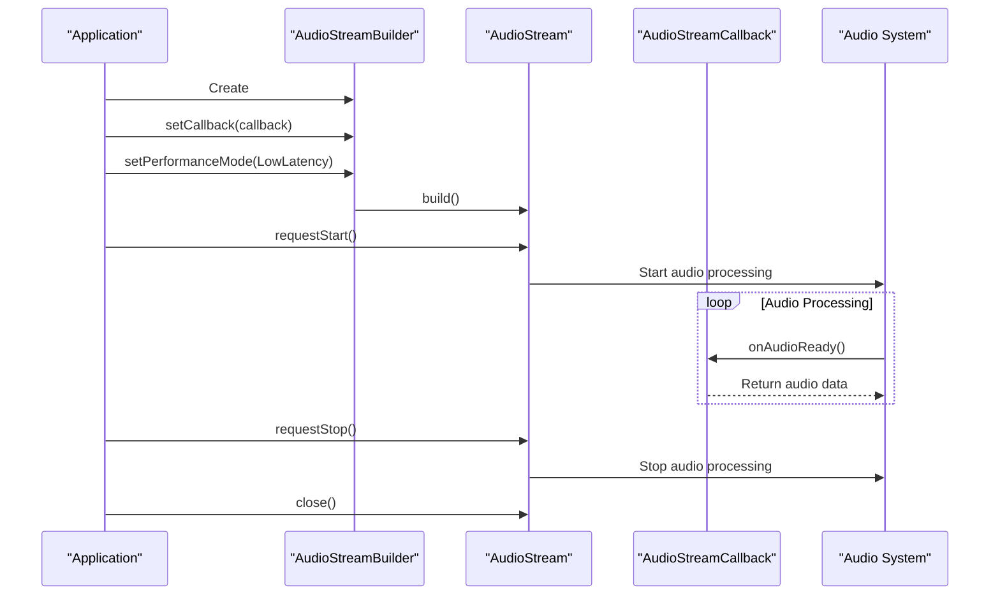
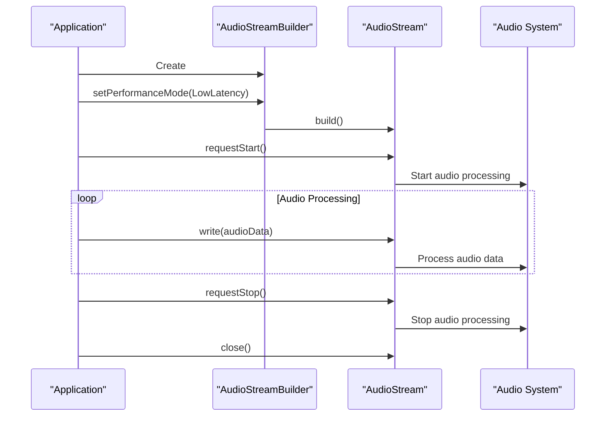
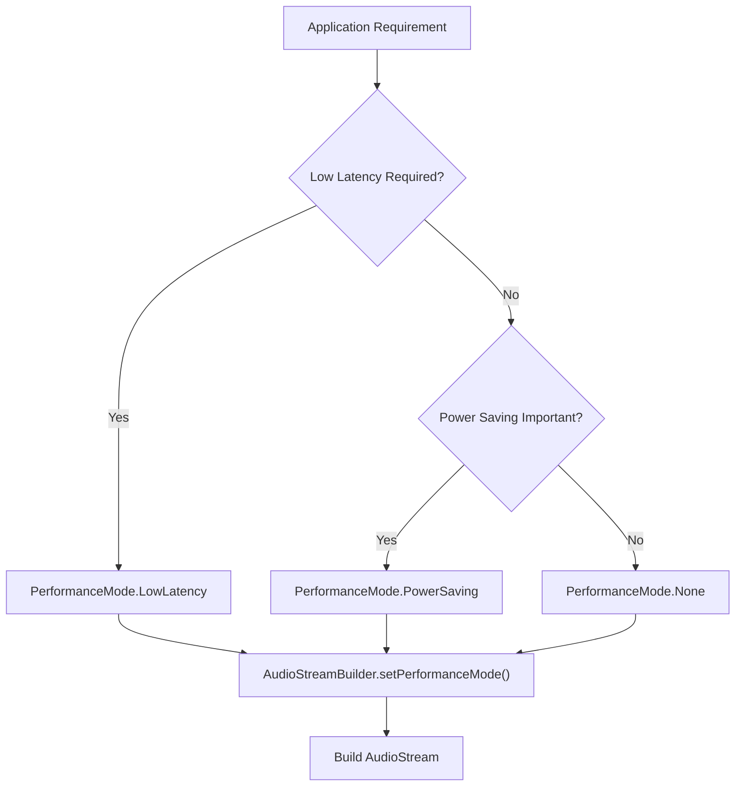

<!-- source: DeepWiki mcp.deepwiki.com · repo android/ndk-samples · page 6.2 Oboe Audio · fetched 2026-10-23 -->

# Oboe Audio

Relevant source files

The following files were used as context for generating this wiki page:

- [audio-echo/README.md](audio-echo/README.md)
- [bitmap-plasma/README.md](bitmap-plasma/README.md)
- [endless-tunnel/README.md](endless-tunnel/README.md)
- [gles3jni/README.md](gles3jni/README.md)
- [hello-gl2/README.md](hello-gl2/README.md)
- [hello-jni/README.md](hello-jni/README.md)
- [native-activity/README.md](native-activity/README.md)
- [native-audio/README.md](native-audio/README.md)
- [native-codec/README.md](native-codec/README.md)
- [native-media/README.md](native-media/README.md)
- [native-plasma/README.md](native-plasma/README.md)
- [san-angeles/README.md](san-angeles/README.md)

This document provides a detailed explanation of the Oboe audio library as demonstrated in the hello-oboe sample in the Android NDK Samples repository. Oboe is the recommended modern audio library for Android applications requiring low-latency audio. For information about the older OpenSL ES audio implementation, see [Native Audio](#6.1).

## What is Oboe?

Oboe is a C++ library that provides a high-performance, low-latency audio API for Android applications. It was developed as a replacement for OpenSL ES, which has been deprecated as of Android 11. Oboe provides a simpler interface with better performance characteristics and automatic API selection (OpenSL ES or AAudio) based on the device's capabilities.

Key features of Oboe include:
- Low-latency audio input and output
- Dynamic performance tuning
- Automatic background processing pause
- Modern C++ interface
- Callback or stream-based audio processing
- Seamless use of the best available audio API (AAudio on newer devices, OpenSL ES on older devices)

Sources: native-audio/README.md, audio-echo/README.md

## Hello-Oboe Sample Architecture

The hello-oboe sample demonstrates how to implement audio playback and recording using the Oboe library. Below is a high-level overview of the sample's architecture:

This diagram illustrates how the sample creates an audio processing pipeline from the Java layer through JNI to the native Oboe implementation, which then connects to the Android audio system.

Sources: native-audio/README.md, audio-echo/README.md

## Oboe Core Components

The Oboe library consists of several key components demonstrated in the hello-oboe sample:

### AudioStreamBuilder

`AudioStreamBuilder` is used to configure and create an `AudioStream`. It allows developers to specify parameters such as:

- Direction (input or output)
- Performance mode (low latency, power saving, etc.)
- Sharing mode (exclusive or shared access)
- Format (PCM format, channels, sample rate)
- Callback handler

### AudioStream

`AudioStream` represents an active audio stream that can be used for playback or recording. It provides methods for:

- Starting and stopping the stream
- Reading audio data (for input streams)
- Writing audio data (for output streams)
- Querying stream state and properties

### AudioStreamCallback

`AudioStreamCallback` is an interface that provides a callback-based approach to audio processing. It has two main methods:

- `onAudioReady`: Called when the stream is ready for audio processing
- `onErrorBeforeClose`: Called when an error occurs before the stream closes

This pattern is especially useful for applications requiring low-latency audio processing, as it allows the audio processing to happen in a high-priority thread.

Sources: audio-echo/README.md

## Usage Patterns

The hello-oboe sample demonstrates two common usage patterns for Oboe:

### Callback-Based Audio Processing

### Stream-Based Audio Processing

Sources: native-audio/README.md, audio-echo/README.md

## Comparison with OpenSL ES

Oboe offers several advantages over the deprecated OpenSL ES API:

| Feature | Oboe | OpenSL ES |
|---------|------|-----------|
| API Design | Modern C++ | C with verbose object creation |
| Low Latency | Automatic tuning | Manual configuration |
| API Selection | Automatic (AAudio or OpenSL ES) | Manual |
| Error Handling | Robust error callbacks | Manual error checking |
| Background Behavior | Automatic management | Manual management |
| Maintenance Status | Actively maintained | Deprecated in Android 11 |

The hello-oboe sample demonstrates these advantages by providing a simpler implementation compared to the equivalent OpenSL ES implementations in the native-audio and audio-echo samples.

Sources: native-audio/README.md, audio-echo/README.md

## Oboe Performance Modes

Oboe offers different performance modes that can be selected based on the application's requirements:

### Performance Mode Selection

Oboe's performance modes allow developers to optimize for different use cases:

- **LowLatency**: Minimizes audio latency at the cost of higher CPU usage and battery consumption. Ideal for interactive audio applications like games or music creation apps.
- **PowerSaving**: Optimizes for power efficiency at the cost of higher latency. Suitable for background audio playback.
- **None**: Lets the system decide the appropriate balance between latency and power consumption.

The hello-oboe sample demonstrates how to select the appropriate performance mode based on the application's requirements.

Sources: audio-echo/README.md

## Best Practices for Using Oboe

When using Oboe for Android audio applications, consider the following best practices demonstrated in the hello-oboe sample:

1. **Error Handling**: Implement proper error handling in the `onErrorBeforeClose` callback to handle audio stream errors gracefully.

2. **Buffer Size Management**: Use appropriate buffer sizes to balance between latency and stability. Smaller buffers reduce latency but increase the risk of audio glitches.

3. **Device Compatibility**: Test on a range of devices, as audio capabilities vary significantly across Android devices.

4. **Background Behavior**: Properly handle audio stream state during application lifecycle events (pause, resume).

5. **Performance Tuning**: Start with default settings and tune performance parameters based on real-world testing.

6. **Dynamic Adaptation**: Use Oboe's capabilities to adapt to changing device conditions like device rotation or connecting/disconnecting headphones.

7. **Audio Focus**: Respect Android's audio focus system to properly handle interruptions from other apps.

Sources: native-audio/README.md, audio-echo/README.md

## Conclusion

The hello-oboe sample in the Android NDK Samples repository demonstrates how to use the Oboe library to implement high-performance, low-latency audio applications on Android. Oboe provides a modern C++ interface that simplifies audio development compared to the deprecated OpenSL ES API, while offering better performance and automatic adaptation to device capabilities.

By following the patterns demonstrated in the hello-oboe sample and adhering to the best practices outlined in this document, developers can create audio applications that deliver consistent, high-quality audio experiences across the Android ecosystem.

Sources: native-audio/README.md, audio-echo/README.md

---

