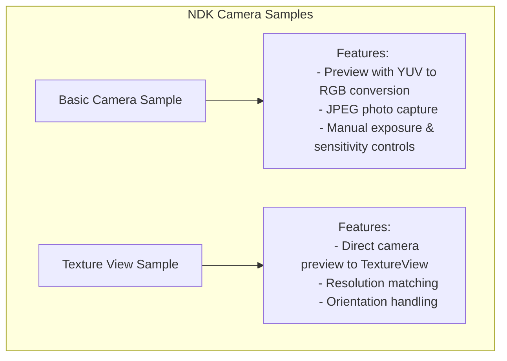
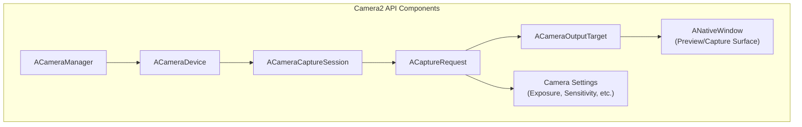
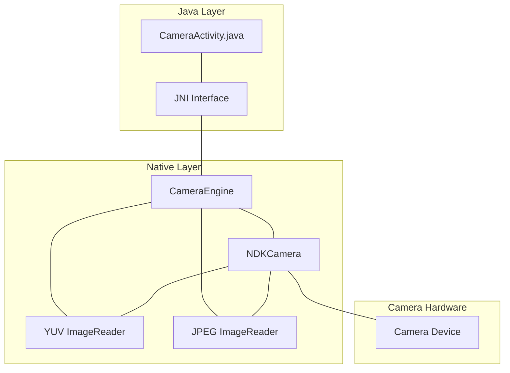
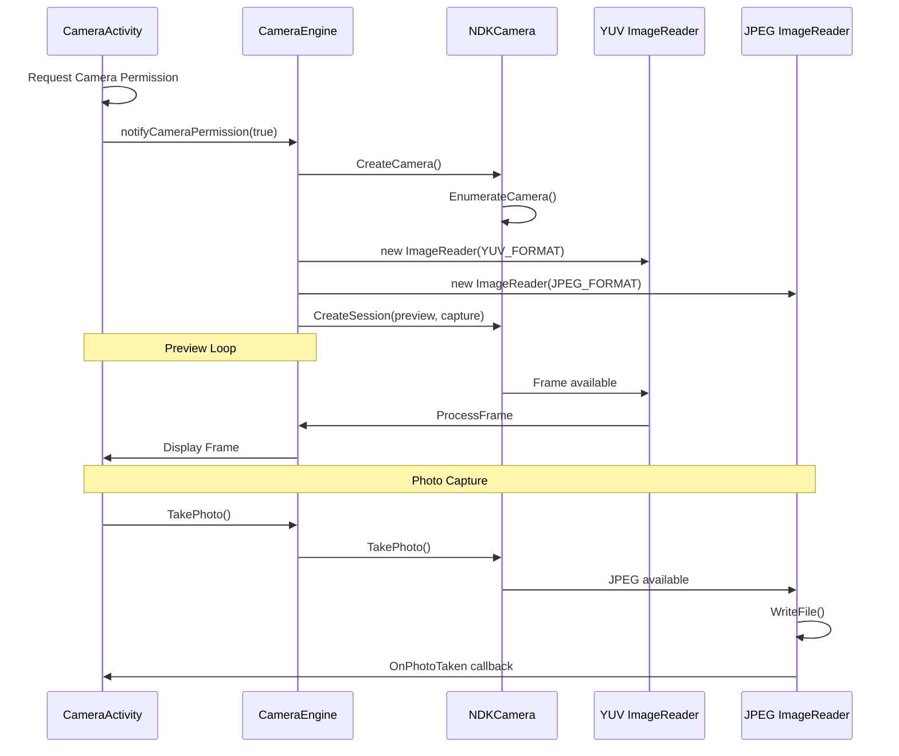
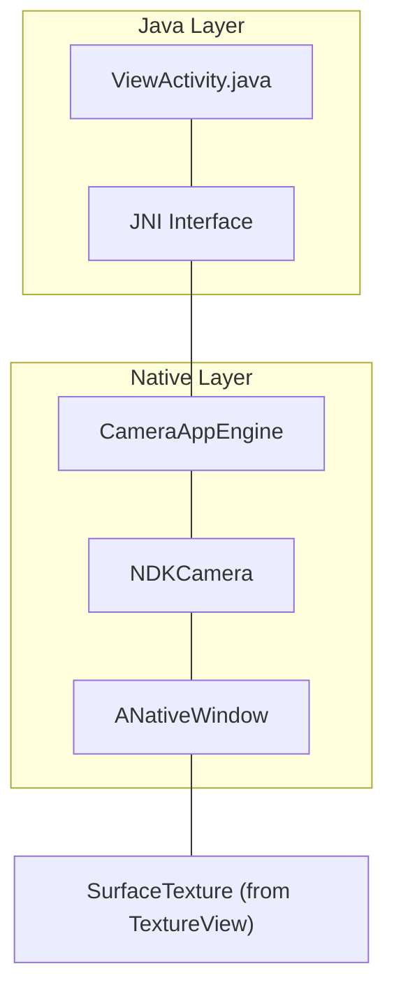
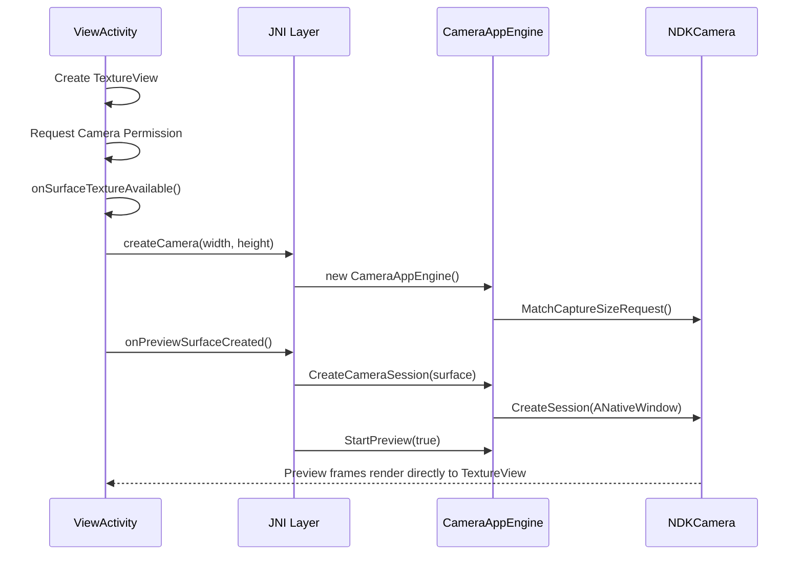
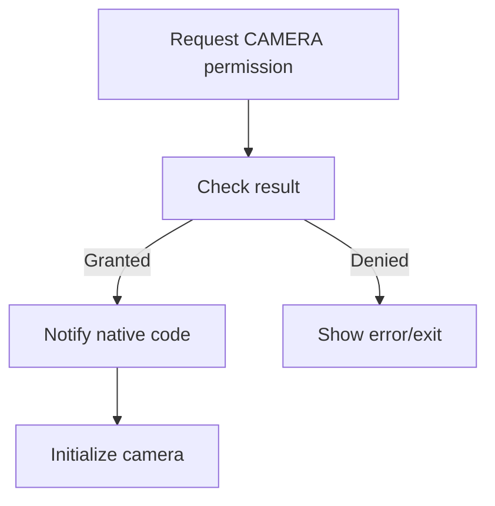
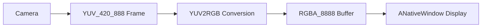

<!-- source: DeepWiki mcp.deepwiki.com · repo android/ndk-samples · page 7 Camera Samples · fetched 2026-10-23 -->

# Camera Samples

Relevant source files

The following files were used as context for generating this wiki page:

- [camera/Camera2ProgrammingModel.png](camera/Camera2ProgrammingModel.png)
- [camera/README.md](camera/README.md)
- [camera/basic/build.gradle](camera/basic/build.gradle)
- [camera/basic/src/main/AndroidManifest.xml](camera/basic/src/main/AndroidManifest.xml)
- [camera/basic/src/main/cpp/camera_engine.cpp](camera/basic/src/main/cpp/camera_engine.cpp)
- [camera/basic/src/main/cpp/camera_engine.h](camera/basic/src/main/cpp/camera_engine.h)
- [camera/basic/src/main/cpp/camera_manager.h](camera/basic/src/main/cpp/camera_manager.h)
- [camera/basic/src/main/cpp/camera_ui.cpp](camera/basic/src/main/cpp/camera_ui.cpp)
- [camera/basic/src/main/cpp/image_reader.cpp](camera/basic/src/main/cpp/image_reader.cpp)
- [camera/basic/src/main/cpp/image_reader.h](camera/basic/src/main/cpp/image_reader.h)
- [camera/basic/src/main/java/com/sample/camera/basic/CameraActivity.java](camera/basic/src/main/java/com/sample/camera/basic/CameraActivity.java)
- [camera/basic/src/main/res/layout/widgets.xml](camera/basic/src/main/res/layout/widgets.xml)
- [camera/common/utils/camera_utils.cpp](camera/common/utils/camera_utils.cpp)
- [camera/texture-view/build.gradle](camera/texture-view/build.gradle)
- [camera/texture-view/src/main/AndroidManifest.xml](camera/texture-view/src/main/AndroidManifest.xml)
- [camera/texture-view/src/main/cpp/android_main.cpp](camera/texture-view/src/main/cpp/android_main.cpp)
- [camera/texture-view/src/main/cpp/camera_engine.cpp](camera/texture-view/src/main/cpp/camera_engine.cpp)
- [camera/texture-view/src/main/cpp/camera_engine.h](camera/texture-view/src/main/cpp/camera_engine.h)
- [camera/texture-view/src/main/cpp/camera_manager.cpp](camera/texture-view/src/main/cpp/camera_manager.cpp)
- [camera/texture-view/src/main/cpp/camera_manager.h](camera/texture-view/src/main/cpp/camera_manager.h)
- [camera/texture-view/src/main/java/com/sample/textureview/ViewActivity.java](camera/texture-view/src/main/java/com/sample/textureview/ViewActivity.java)
- [gles3jni/app/src/main/cpp/gles3jni.cpp](gles3jni/app/src/main/cpp/gles3jni.cpp)
- [native-activity/app/src/main/cpp/main.cpp](native-activity/app/src/main/cpp/main.cpp)

The Camera Samples demonstrate how to integrate camera functionality in Android applications using the NDK (Native Development Kit). These samples showcase how to implement camera preview, capture images, and control camera parameters using native C++ code rather than Java. This page covers the architecture, components, and implementation details of the camera samples in the NDK Samples repository.

## Overview of Camera Samples

The NDK Samples repository includes two camera sample applications:

1. **Basic Camera Sample** - Demonstrates camera preview, JPEG photo capture, and manual camera parameter adjustments (exposure and sensitivity)
2. **Texture View Sample** - Shows how to render camera preview directly to an Android TextureView

Both samples illustrate different approaches to camera integration with Android applications, with a focus on native code implementation.

Sources: [camera/README.md:2-10]()

## Camera2 API Model

The samples are built upon the Android Camera2 API, exposed through the NDK. Understanding the relationship between key Camera2 components is essential for working with these samples:

The Camera2 programming model follows this workflow:
1. Create and use ACameraManager to enumerate camera devices
2. Open an ACameraDevice for the selected camera
3. Create an ACameraCaptureSession with one or more output targets
4. Create and submit ACaptureRequests to control the camera and capture images

Sources: [camera/README.md:14-16](), [camera/texture-view/src/main/cpp/camera_manager.h:16-155](), [camera/basic/src/main/cpp/camera_manager.h:16-140]()

## Basic Camera Sample

### Architecture

The Basic Camera Sample implements a complete camera application with preview and photo capture capabilities:

Sources: [camera/basic/src/main/cpp/camera_engine.h:18-81](), [camera/basic/src/main/cpp/camera_manager.h:16-140](), [camera/basic/src/main/cpp/image_reader.h:16-118]()

### Key Components

#### CameraActivity (Java)
The `CameraActivity` class is the entry point of the application, responsible for:
- Handling camera permissions
- Providing UI controls (exposure/sensitivity sliders, capture button)
- JNI communication with native code
- Device rotation detection

Sources: [camera/basic/src/main/java/com/sample/camera/basic/CameraActivity.java:16-378]()

#### CameraEngine (C++)
Core native class that:
- Initializes and manages the NDKCamera instance
- Creates and manages ImageReader instances for preview and capture
- Processes camera frames for display
- Handles photo capture requests
- Communicates with the Java UI layer

Sources: [camera/basic/src/main/cpp/camera_engine.cpp:16-174](), [camera/basic/src/main/cpp/camera_engine.h:18-81]()

#### NDKCamera (C++)
Handles camera device interaction:
- Camera device enumeration and selection
- Camera characteristics retrieval
- Capture session creation and management
- Camera request configuration
- Exposure and sensitivity range management

Sources: [camera/basic/src/main/cpp/camera_manager.h:16-140]()

#### ImageReader (C++)
Processes camera image data:
- YUV to RGB conversion for preview display
- JPEG capture handling and file saving
- Image rotation based on device orientation

Sources: [camera/basic/src/main/cpp/image_reader.cpp:16-459](), [camera/basic/src/main/cpp/image_reader.h:16-118]()

### Camera Operation Sequence

The typical operation sequence in the Basic Camera Sample:

Sources: [camera/basic/src/main/cpp/camera_engine.cpp:52-173](), [camera/basic/src/main/cpp/image_reader.cpp:87-121](), [camera/basic/src/main/cpp/image_reader.cpp:414-459]()

## Texture View Camera Sample

### Architecture

The Texture View sample demonstrates a direct camera preview to an Android TextureView:

Sources: [camera/texture-view/src/main/cpp/camera_engine.h:18-54](), [camera/texture-view/src/main/cpp/camera_manager.h:16-154](), [camera/texture-view/src/main/java/com/sample/textureview/ViewActivity.java:16-263]()

### Key Components

#### ViewActivity (Java)
Manages the TextureView and handles:
- Camera permission requests
- TextureView creation and lifecycle
- Surface availability callbacks to native code
- Device orientation changes
- Preview size adjustments

Sources: [camera/texture-view/src/main/java/com/sample/textureview/ViewActivity.java:16-263]()

#### CameraAppEngine (C++)
A lightweight native engine that:
- Creates and manages the NDKCamera instance
- Configures camera session with the TextureView surface
- Handles preview start/stop

Sources: [camera/texture-view/src/main/cpp/camera_engine.cpp:16-94](), [camera/texture-view/src/main/cpp/camera_engine.h:18-54]()

#### NDKCamera (C++)
Similar to the Basic sample's NDKCamera, focused on preview only.

Sources: [camera/texture-view/src/main/cpp/camera_manager.cpp:16-501](), [camera/texture-view/src/main/cpp/camera_manager.h:16-154]()

### Preview Operation Sequence

The preview operation in the Texture View sample follows this sequence:

Sources: [camera/texture-view/src/main/java/com/sample/textureview/ViewActivity.java:106-115](), [camera/texture-view/src/main/cpp/android_main.cpp:126-134]()

## Common Implementation Patterns

Both camera samples share several implementation patterns:

### Permission Handling

Camera permission is requested at runtime:
1. Java code requests the `CAMERA` permission
2. Permission result is passed to native code via JNI
3. Camera initialization proceeds only after permission is granted

Sources: [camera/basic/src/main/java/com/sample/camera/basic/CameraActivity.java:186-257](), [camera/texture-view/src/main/java/com/sample/textureview/ViewActivity.java:189-229]()

### Resolution Matching

Both samples implement logic to find optimal preview resolution:
1. Query device screen dimensions
2. Retrieve camera's supported resolutions
3. Find the best matching resolution that:
   - Maintains the same aspect ratio as the display
   - Minimizes unnecessary scaling
   - Works efficiently with the camera

Sources: [camera/texture-view/src/main/cpp/camera_manager.cpp:171-234](), [camera/basic/src/main/cpp/camera_manager.h:98-101]()

### Camera Parameter Controls

The Basic sample demonstrates camera parameter adjustment:

| Parameter | Description | Control Range |
|-----------|-------------|---------------|
| Exposure Time | Controls how long the sensor collects light | Min: 1,000,000ns (1ms) Max: 250,000,000ns (250ms) |
| Sensitivity | Controls sensor gain (ISO equivalent) | Camera-dependent range |

Sources: [camera/basic/src/main/cpp/camera_ui.cpp:56-82](), [camera/basic/src/main/java/com/sample/camera/basic/CameraActivity.java:313-349]()

## Implementation Details

### YUV to RGB Conversion

The Basic sample converts YUV_420_888 camera frames to RGBA_8888 for display:

The conversion handles different device orientations (0°, 90°, 180°, 270°) with appropriate matrix transformations.

Sources: [camera/basic/src/main/cpp/image_reader.cpp:244-406]()

### JPEG Capture

The Basic sample implements JPEG capture with:
1. Camera request with TEMPLATE_STILL_CAPTURE
2. JPEG output target configuration
3. Single capture request (vs. repeating preview requests)
4. Orientation metadata based on device rotation
5. File saving with timestamp-based naming

Sources: [camera/basic/src/main/cpp/image_reader.cpp:414-459]()

## Conclusion

The NDK Camera Samples demonstrate two approaches to integrating camera functionality in Android applications using native code:

1. **Basic Camera Sample**: A full-featured implementation with preview processing, photo capture, and camera parameter controls.

2. **Texture View Sample**: A lightweight implementation focusing on efficient camera preview using TextureView.

Both samples illustrate proper camera permission handling, lifecycle management, and orientation support.

For developers looking to integrate camera functionality in NDK applications, these samples provide reusable patterns that can be adapted to various use cases from simple camera previews to more complex applications with custom camera controls and image processing.

Sources: [camera/README.md:2-74]()

---

