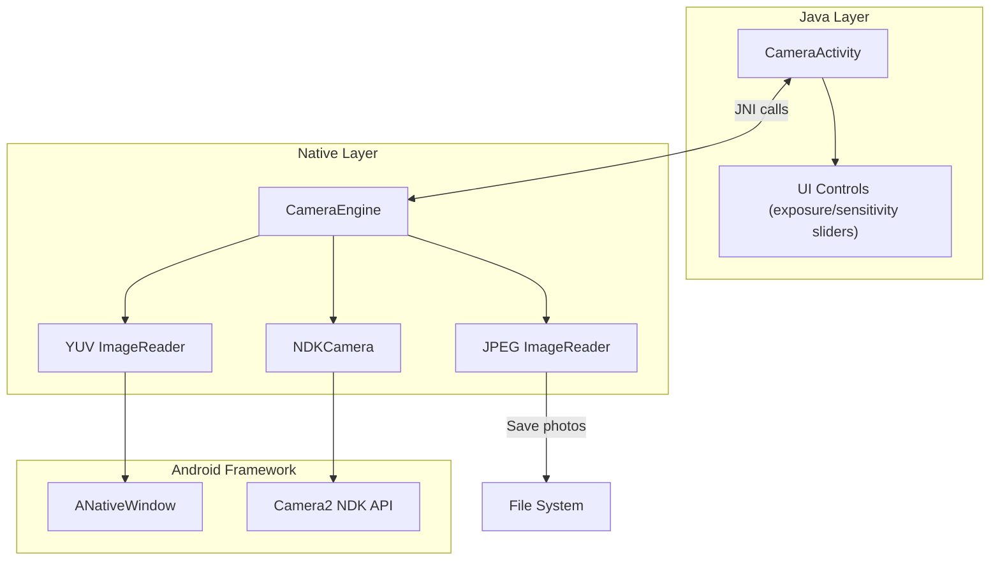
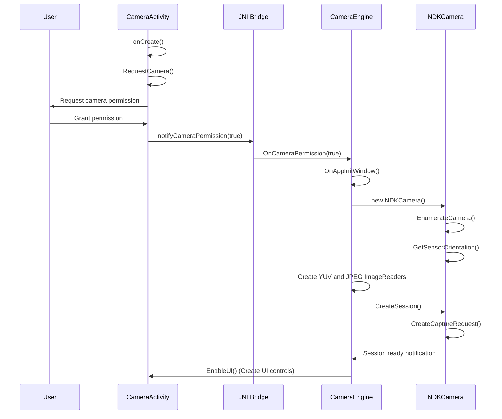
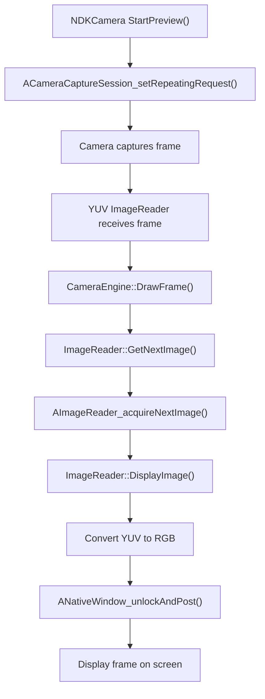
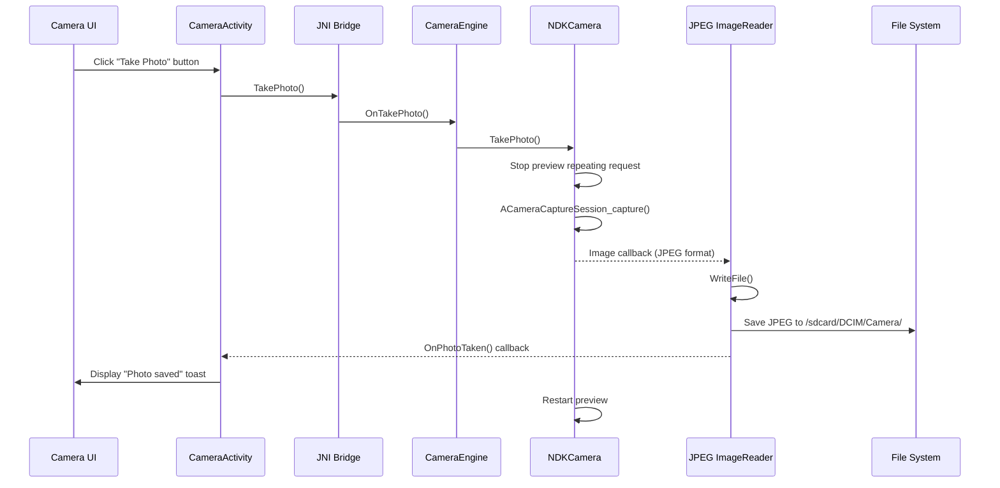
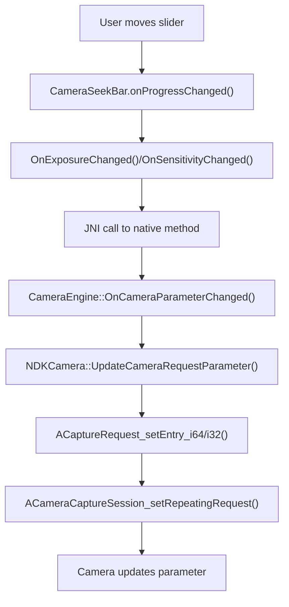

<!-- source: DeepWiki mcp.deepwiki.com · repo android/ndk-samples · page 7.1 Basic Camera · fetched 2026-10-23 -->

# Basic Camera

<details>
<summary>Relevant source files</summary>

The following files were used as context for generating this wiki page:

- [camera/Camera2ProgrammingModel.png](camera/Camera2ProgrammingModel.png)
- [camera/README.md](camera/README.md)
- [camera/basic/build.gradle](camera/basic/build.gradle)
- [camera/basic/src/main/AndroidManifest.xml](camera/basic/src/main/AndroidManifest.xml)
- [camera/basic/src/main/cpp/camera_engine.cpp](camera/basic/src/main/cpp/camera_engine.cpp)
- [camera/basic/src/main/cpp/camera_engine.h](camera/basic/src/main/cpp/camera_engine.h)
- [camera/basic/src/main/cpp/camera_manager.h](camera/basic/src/main/cpp/camera_manager.h)
- [camera/basic/src/main/cpp/camera_ui.cpp](camera/basic/src/main/cpp/camera_ui.cpp)
- [camera/basic/src/main/cpp/image_reader.cpp](camera/basic/src/main/cpp/image_reader.cpp)
- [camera/basic/src/main/cpp/image_reader.h](camera/basic/src/main/cpp/image_reader.h)
- [camera/basic/src/main/java/com/sample/camera/basic/CameraActivity.java](camera/basic/src/main/java/com/sample/camera/basic/CameraActivity.java)
- [camera/basic/src/main/res/layout/widgets.xml](camera/basic/src/main/res/layout/widgets.xml)
- [camera/common/utils/camera_utils.cpp](camera/common/utils/camera_utils.cpp)
- [camera/texture-view/build.gradle](camera/texture-view/build.gradle)
- [camera/texture-view/src/main/AndroidManifest.xml](camera/texture-view/src/main/AndroidManifest.xml)
- [camera/texture-view/src/main/cpp/android_main.cpp](camera/texture-view/src/main/cpp/android_main.cpp)
- [camera/texture-view/src/main/cpp/camera_engine.cpp](camera/texture-view/src/main/cpp/camera_engine.cpp)
- [camera/texture-view/src/main/cpp/camera_engine.h](camera/texture-view/src/main/cpp/camera_engine.h)
- [camera/texture-view/src/main/cpp/camera_manager.cpp](camera/texture-view/src/main/cpp/camera_manager.cpp)
- [camera/texture-view/src/main/cpp/camera_manager.h](camera/texture-view/src/main/cpp/camera_manager.h)
- [camera/texture-view/src/main/java/com/sample/textureview/ViewActivity.java](camera/texture-view/src/main/java/com/sample/textureview/ViewActivity.java)
- [gles3jni/app/src/main/cpp/gles3jni.cpp](gles3jni/app/src/main/cpp/gles3jni.cpp)
- [native-activity/app/src/main/cpp/main.cpp](native-activity/app/src/main/cpp/main.cpp)

</details>


This document describes the "Basic Camera" sample in the Android NDK Samples repository, which demonstrates how to use the NDK Camera API to preview camera frames and capture photos with manual camera controls (exposure and sensitivity). For a texture-based camera implementation, see the companion texture-view sample.

## Overview

The Basic Camera sample provides a native implementation of camera functionality using the NDK Camera API. It demonstrates:

- Camera permissions handling
- Preview frame display with direct rendering
- Manual camera controls (exposure time and sensitivity)
- Photo capture with JPEG saving to external storage

The sample uses a combination of Java code for UI and permissions handling, with C++ code for the core camera functionality.



Sources:
- [camera/basic/src/main/java/com/sample/camera/basic/CameraActivity.java:100-269]()
- [camera/basic/src/main/cpp/camera_engine.cpp:32-173]()
- [camera/basic/src/main/cpp/image_reader.cpp:60-96]()

## Architecture and Components

The sample is structured around several key components that work together to provide the camera functionality.

### Main Components

```mermaid
classDiagram
    class CameraActivity {
        -CameraSeekBar exposure
        -CameraSeekBar sensitivity
        -RequestCamera()
        -EnableUI()
        -OnPhotoTaken()
        -notifyCameraPermission() native
        -TakePhoto() native
    }
    
    class CameraEngine {
        -NDKCamera* camera
        -ImageReader* yuvReader
        -ImageReader* jpgReader
        -CreateCamera()
        -DeleteCamera()
        -DrawFrame()
        -OnTakePhoto()
        -OnCameraPermission()
    }
    
    class NDKCamera {
        -ACameraManager* cameraMgr
        -ACameraDevice* device
        -ACameraCaptureSession* captureSession
        -EnumerateCamera()
        -CreateSession()
        -StartPreview()
        -TakePhoto()
        -UpdateCameraRequestParameter()
    }
    
    class ImageReader {
        -AImageReader* reader
        -ANativeWindow* GetNativeWindow()
        -DisplayImage()
        -WriteFile()
        -GetNextImage()
    }
    
    CameraActivity --> CameraEngine : JNI calls
    CameraEngine --> NDKCamera : manages
    CameraEngine --> ImageReader : for preview
    CameraEngine --> "ImageReader" : for capture
```

Sources:
- [camera/basic/src/main/java/com/sample/camera/basic/CameraActivity.java:100-185]()
- [camera/basic/src/main/cpp/camera_engine.h:32-73]()
- [camera/basic/src/main/cpp/camera_manager.h:69-118]()
- [camera/basic/src/main/cpp/image_reader.h:34-115]()

### Java Component

The Java layer is primarily responsible for:
1. Handling camera permissions
2. Providing UI controls for camera settings
3. Bridging between Android framework and native code

`CameraActivity` extends `NativeActivity` and manages the UI elements including the exposure and sensitivity sliders, and the "Take Photo" button.

Sources:
- [camera/basic/src/main/java/com/sample/camera/basic/CameraActivity.java:100-377]()

### Native Components

The native layer consists of several C++ classes:

1. **CameraEngine**: Acts as the main coordinator between the Java UI and native camera components
   - Manages camera lifecycle
   - Handles frame rendering
   - Processes camera parameters
   
2. **NDKCamera**: Interfaces with the NDK Camera API
   - Enumerates available cameras
   - Creates capture sessions
   - Manages capture requests
   - Updates camera parameters
   
3. **ImageReader**: Processes camera frames
   - Handles YUV format preview frames
   - Converts YUV to RGB for display
   - Saves JPEG images to storage

Sources:
- [camera/basic/src/main/cpp/camera_engine.cpp:32-173]()
- [camera/texture-view/src/main/cpp/camera_manager.cpp:39-501]()
- [camera/basic/src/main/cpp/image_reader.cpp:60-459]()

## Camera Initialization and Permission Flow

The camera initialization follows a specific sequence to ensure proper permission handling and initialization of native components.



Key permission handling:
- Camera permission is requested using `ActivityCompat.requestPermissions()`
- Once granted, `notifyCameraPermission()` is called which triggers camera initialization
- If permission is denied, the application shows appropriate messages and cannot proceed

Sources:
- [camera/basic/src/main/java/com/sample/camera/basic/CameraActivity.java:185-236]()
- [camera/basic/src/main/cpp/camera_ui.cpp:115-121]()
- [camera/basic/src/main/cpp/camera_engine.cpp:53-102]()

## Camera Preview Processing

Camera preview is implemented using direct rendering of camera frames to a native window.

### Preview Flow



The preview processing includes:
1. Starting a repeating capture request for preview frames
2. Receiving YUV_420_888 format frames from the camera
3. Converting YUV to RGB format for display
4. Handling rotation based on device orientation
5. Posting the processed frame to the display buffer

Sources:
- [camera/basic/src/main/cpp/camera_engine.cpp:155-173]()
- [camera/basic/src/main/cpp/image_reader.cpp:210-242]()
- [camera/texture-view/src/main/cpp/camera_manager.cpp:409-418]()

### YUV to RGB Conversion

The sample includes a YUV to RGB conversion function to transform camera preview frames to a displayable format. The conversion handles different rotation angles (0°, 90°, 180°, 270°) to account for device orientation.

Sources:
- [camera/basic/src/main/cpp/image_reader.cpp:168-198]() - YUV2RGB function
- [camera/basic/src/main/cpp/image_reader.cpp:251-406]() - Rotation-specific conversions

## Photo Capture

The photo capture process follows a different path from preview:



Key aspects of photo capture:
1. The preview is paused during capture
2. A separate JPEG image reader processes the captured photo
3. Photos are saved to external storage in the DCIM/Camera directory
4. A notification is shown to the user when the photo is saved

Sources:
- [camera/basic/src/main/java/com/sample/camera/basic/CameraActivity.java:358-368]()
- [camera/basic/src/main/cpp/camera_ui.cpp:88-92]()
- [camera/basic/src/main/cpp/image_reader.cpp:414-459]()
- [camera/texture-view/src/main/cpp/camera_manager.cpp:425-434]()

## Camera Controls

The sample demonstrates manual camera control through two parameters:

1. **Exposure Time**: Controls how long light is collected by the sensor (in nanoseconds)
2. **Sensitivity (ISO)**: Controls the sensor's sensitivity to light

### Control Implementation

The UI provides sliders for these parameters using `CameraSeekBar` class, which maps the user's slider position to the actual camera parameter values. The native code retrieves the camera's supported ranges and maps the percentage values from the UI to actual camera settings.

When a parameter is changed:
1. The slider change is detected in Java
2. The value is passed to native code via JNI
3. The camera parameter is updated using `ACaptureRequest_setEntry_*`
4. A new capture request is submitted with the updated parameters



The exposure range is limited to reasonable values (1ms to 250ms) to ensure the preview remains visible, even though actual camera capabilities might support a wider range.

Sources:
- [camera/basic/src/main/java/com/sample/camera/basic/CameraActivity.java:46-98]() - CameraSeekBar class
- [camera/basic/src/main/java/com/sample/camera/basic/CameraActivity.java:312-350]() - Slider implementation
- [camera/basic/src/main/cpp/camera_ui.cpp:144-156]() - JNI callbacks
- [camera/texture-view/src/main/cpp/camera_manager.cpp:436-461]() - Parameter update implementation
- [camera/texture-view/src/main/cpp/camera_manager.cpp:36-38]() - Exposure time limits

## Usage Example

To use the Basic Camera sample:

1. Install and launch the application
2. Grant camera permission when prompted
3. The camera preview will start automatically
4. Adjust exposure and sensitivity using the sliders at the bottom of the screen
5. Tap the camera button to capture a photo
6. A toast message will appear when the photo is saved
7. Photos are stored in the DCIM/Camera directory

## Camera API Integration

The sample uses the NDK Camera API introduced in Android API level 24 (Android 7.0). Key API components include:

| NDK Component | Description |
|---------------|-------------|
| ACameraManager | Camera system service interface to enumerate cameras |
| ACameraDevice | Represents a single camera device |
| ACaptureRequest | Describes the settings for a capture |
| ACameraCaptureSession | Coordinates capture requests to the camera |
| AImageReader | Processes images from the camera |

The sample ensures compatibility by checking for Camera2 API support and requesting appropriate permissions at runtime.

Sources:
- [camera/basic/src/main/java/com/sample/camera/basic/CameraActivity.java:127-148]() - Camera2 device check
- [camera/basic/src/main/cpp/image_reader.cpp:60-79]() - ImageReader implementation
- [camera/texture-view/src/main/cpp/camera_manager.cpp:333-373]() - Camera enumeration

---

