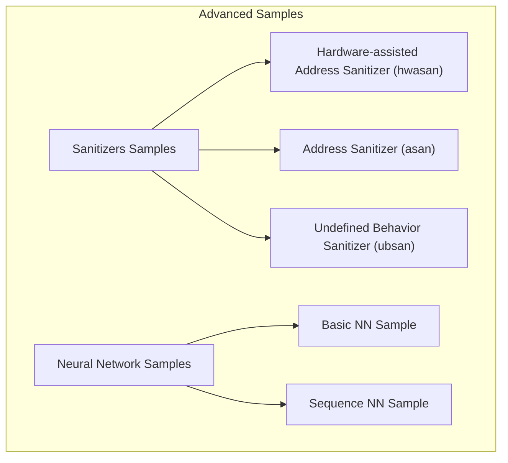
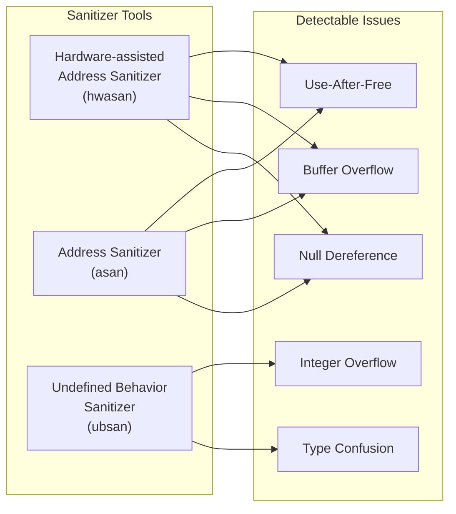
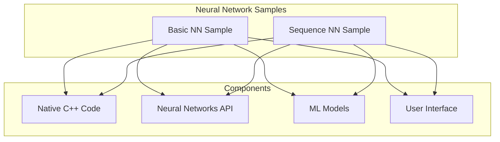
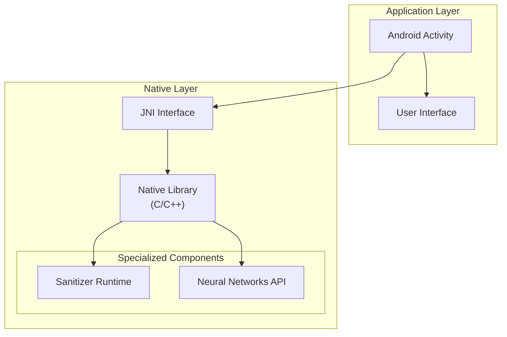
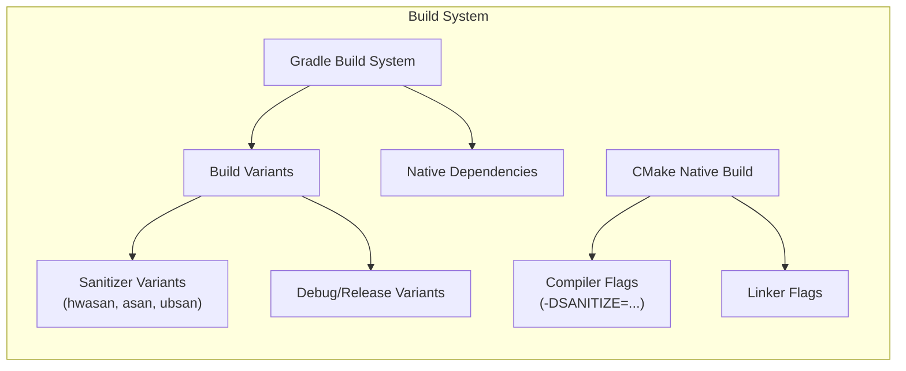

<!-- source: DeepWiki mcp.deepwiki.com · repo android/ndk-samples · page 8 Advanced Samples · fetched 2026-10-23 -->

# Advanced Samples

<details>
<summary>Relevant source files</summary>

The following files were used as context for generating this wiki page:

- [hello-jniCallback/app/build.gradle](hello-jniCallback/app/build.gradle)
- [hello-neon/app/build.gradle](hello-neon/app/build.gradle)
- [nn-samples/basic/build.gradle](nn-samples/basic/build.gradle)
- [nn-samples/basic/src/main/res/layout/activity_main.xml](nn-samples/basic/src/main/res/layout/activity_main.xml)
- [nn-samples/sequence/build.gradle](nn-samples/sequence/build.gradle)
- [nn-samples/sequence/src/main/res/layout/activity_main.xml](nn-samples/sequence/src/main/res/layout/activity_main.xml)
- [sanitizers/.gitignore](sanitizers/.gitignore)
- [sanitizers/README.md](sanitizers/README.md)
- [sanitizers/app/.gitignore](sanitizers/app/.gitignore)
- [sanitizers/app/build.gradle](sanitizers/app/build.gradle)
- [sanitizers/app/proguard-rules.pro](sanitizers/app/proguard-rules.pro)
- [sanitizers/app/src/asan/resources/.gitignore](sanitizers/app/src/asan/resources/.gitignore)
- [sanitizers/app/src/hwasan/resources/lib/arm64-v8a/wrap.sh](sanitizers/app/src/hwasan/resources/lib/arm64-v8a/wrap.sh)
- [sanitizers/app/src/main/AndroidManifest.xml](sanitizers/app/src/main/AndroidManifest.xml)
- [sanitizers/app/src/main/cpp/native-lib.cpp](sanitizers/app/src/main/cpp/native-lib.cpp)
- [teapots/choreographer-30fps/build.gradle](teapots/choreographer-30fps/build.gradle)
- [teapots/classic-teapot/build.gradle](teapots/classic-teapot/build.gradle)
- [teapots/image-decoder/build.gradle](teapots/image-decoder/build.gradle)
- [teapots/more-teapots/build.gradle](teapots/more-teapots/build.gradle)
- [teapots/textured-teapot/build.gradle](teapots/textured-teapot/build.gradle)

</details>


This document provides detailed information about the advanced samples in the Android NDK samples repository. These samples demonstrate sophisticated native code capabilities including memory error detection tools and machine learning integration. The advanced samples showcase techniques that are particularly useful for complex application development and debugging scenarios.

## Overview

The advanced samples in the NDK repository consist of two main categories:

1. **Sanitizers** - Tools for detecting and diagnosing issues in native code
2. **Neural Network Samples** - Examples of integrating Android's Neural Networks API with native code

These samples require more advanced understanding of both Android development and C/C++ programming compared to the basic samples covered in [Basic JNI Samples](#3).



Sources: [sanitizers/README.md](), [nn-samples/basic/build.gradle](), [nn-samples/sequence/build.gradle]()

## Sanitizers

The sanitizers sample demonstrates how to detect and diagnose memory errors and undefined behavior in native code. This is particularly valuable for complex applications where memory issues can be difficult to track down.



Sources: [sanitizers/README.md](), [sanitizers/app/build.gradle]()

### Build Configuration for Sanitizers

The sanitizers sample uses Gradle build variants to configure different sanitizer tools. Each sanitizer requires specific build configuration:

| Sanitizer | Minimum SDK | ABI Support | CMake Arguments | Notes |
|-----------|-------------|-------------|----------------|-------|
| hwasan | 34 (Android 14) | arm64-v8a | `-DSANITIZE=hwasan` | Requires `useLegacyPackaging=true` |
| asan | 21 | all | `-DSANITIZE=asan` | Requires `useLegacyPackaging=true` |
| ubsan | 21 | all | `-DSANITIZE=ubsan` | No special packaging requirements |

Sources: [sanitizers/app/build.gradle:22-74]()

The build configuration for hwasan specifically requires:

```gradle
hwasan {
    initWith debug
    debuggable true
    packagingOptions {
        jniLibs {
            // Needed for wrap.sh.
            useLegacyPackaging = true
        }
    }
    externalNativeBuild {
        cmake {
            arguments "-DANDROID_STL=c++_shared", "-DSANITIZE=hwasan"
        }
    }
    ndk {
        abiFilters "arm64-v8a"
    }
}
```

Sources: [sanitizers/app/build.gradle:22-41]()

### Example Memory Errors

The sanitizers sample intentionally includes example errors in the native code to demonstrate how the sanitizers detect different types of issues:

1. **Use-after-free error** - Detected by both hwasan and asan:
   ```cpp
   int* foo = new int;
   *foo = 3;
   delete foo;
   *foo = 4;  // Error: accessing memory after it's been freed
   ```

2. **Signed integer overflow** - Detected by ubsan:
   ```cpp
   int k = 0x7fffffff;
   k += 1;  // Error: signed integer overflow
   ```

Sources: [sanitizers/app/src/main/cpp/native-lib.cpp:8-16]()

## Neural Network Samples

The Neural Network samples demonstrate how to use Android's Neural Networks API (NNAPI) from native code. These samples show how to create, train, and use neural network models for inference.



Sources: [nn-samples/basic/build.gradle](), [nn-samples/sequence/build.gradle]()

### Basic Neural Network Sample

The basic neural network sample demonstrates fundamental Neural Networks API usage. This sample requires a minimum SDK version of 27 (Android 8.1) and includes Kotlin coroutines for asynchronous processing.

Key components in the UI include:
- Input fields for tensor values
- A compute button to run the neural network
- Results display

Sources: [nn-samples/basic/build.gradle](), [nn-samples/basic/src/main/res/layout/activity_main.xml]()

### Sequence Neural Network Sample

The sequence neural network sample demonstrates more advanced neural network operations, specifically working with sequence data. This sample requires a minimum SDK version of 30 (Android 11).

The UI includes:
- Input fields for initial value, ratio, and steps
- Controls for computation and reset
- Display of results and intermediate values

Sources: [nn-samples/sequence/build.gradle](), [nn-samples/sequence/src/main/res/layout/activity_main.xml]()

## Implementation Architecture

The advanced samples follow a consistent architecture pattern that integrates native code with the Android framework:



Sources: [sanitizers/app/src/main/cpp/native-lib.cpp](), [nn-samples/basic/build.gradle](), [nn-samples/sequence/build.gradle]()

## Build System Integration

The advanced samples leverage specialized Gradle configurations to properly integrate their requirements:



Sources: [sanitizers/app/build.gradle](), [nn-samples/basic/build.gradle](), [nn-samples/sequence/build.gradle]()

### Sanitizer Runtime Integration

The sanitizer tools require special runtime components to be integrated into the application. For example, hwasan uses a wrapper script:

```bash
#!/system/bin/sh
LD_HWASAN=1 exec "$@"
```

This wrapper script is included in the APK and used to launch the application with the appropriate environment variables set.

Sources: [sanitizers/app/src/hwasan/resources/lib/arm64-v8a/wrap.sh]()

## Conclusion

The advanced samples in the Android NDK repository demonstrate sophisticated techniques for working with native code on Android. The sanitizers samples provide valuable tools for detecting and diagnosing memory errors and undefined behavior, while the neural network samples show how to leverage Android's machine learning capabilities from native code.

These samples are particularly useful for developers working on complex applications where performance, stability, and advanced functionality are critical requirements.

---

