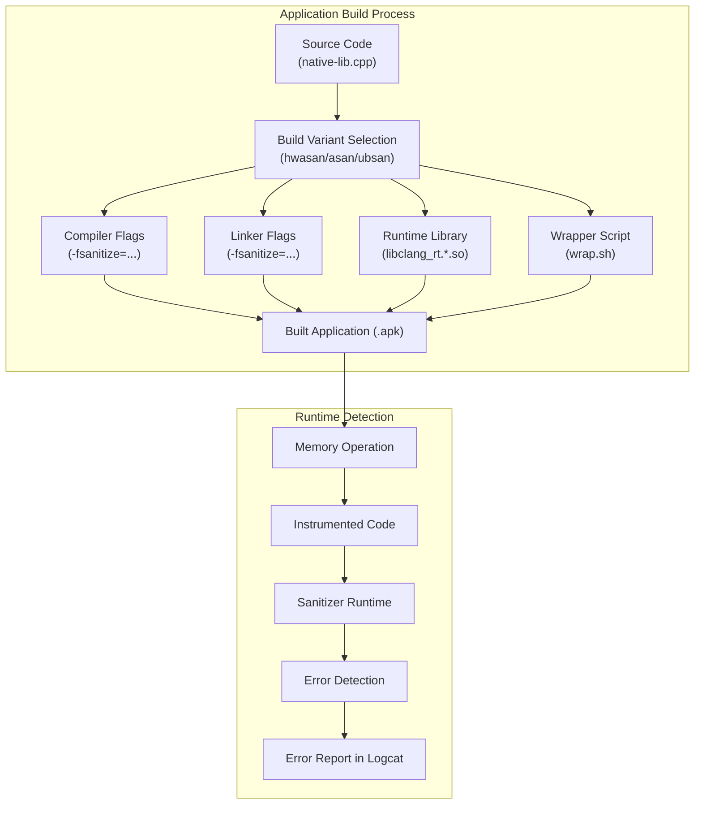
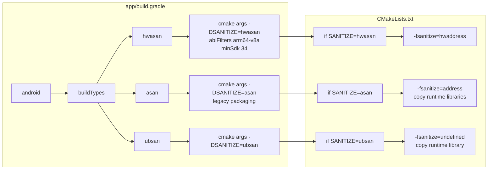

<!-- source: DeepWiki mcp.deepwiki.com · repo android/ndk-samples · page 8.1 Memory Sanitizers · fetched 2026-10-23 -->

# Memory Sanitizers

<details>
<summary>Relevant source files</summary>

The following files were used as context for generating this wiki page:

- [base/.gitignore](base/.gitignore)
- [base/build.gradle.kts](base/build.gradle.kts)
- [base/src/main/cpp/CMakeLists.txt](base/src/main/cpp/CMakeLists.txt)
- [base/src/main/cpp/include/base/errno_restorer.h](base/src/main/cpp/include/base/errno_restorer.h)
- [base/src/main/cpp/include/base/logging.h](base/src/main/cpp/include/base/logging.h)
- [base/src/main/cpp/include/base/macros.h](base/src/main/cpp/include/base/macros.h)
- [base/src/main/cpp/logging.cpp](base/src/main/cpp/logging.cpp)
- [base/src/main/cpp/logging_splitters.h](base/src/main/cpp/logging_splitters.h)
- [build-logic/src/main/java/com/android/ndk/samples/buildlogic/AndroidLibraryConventionPlugin.kt](build-logic/src/main/java/com/android/ndk/samples/buildlogic/AndroidLibraryConventionPlugin.kt)
- [sanitizers/.gitignore](sanitizers/.gitignore)
- [sanitizers/README.md](sanitizers/README.md)
- [sanitizers/app/.gitignore](sanitizers/app/.gitignore)
- [sanitizers/app/build.gradle](sanitizers/app/build.gradle)
- [sanitizers/app/proguard-rules.pro](sanitizers/app/proguard-rules.pro)
- [sanitizers/app/src/asan/resources/.gitignore](sanitizers/app/src/asan/resources/.gitignore)
- [sanitizers/app/src/hwasan/resources/lib/arm64-v8a/wrap.sh](sanitizers/app/src/hwasan/resources/lib/arm64-v8a/wrap.sh)
- [sanitizers/app/src/main/AndroidManifest.xml](sanitizers/app/src/main/AndroidManifest.xml)
- [sanitizers/app/src/main/cpp/CMakeLists.txt](sanitizers/app/src/main/cpp/CMakeLists.txt)
- [sanitizers/app/src/main/cpp/native-lib.cpp](sanitizers/app/src/main/cpp/native-lib.cpp)
- [sanitizers/app/src/ubsan/jniLibs/arm64-v8a/libclang_rt.ubsan_standalone-aarch64-android.so](sanitizers/app/src/ubsan/jniLibs/arm64-v8a/libclang_rt.ubsan_standalone-aarch64-android.so)

</details>


This document provides a comprehensive guide to memory sanitizers in the Android NDK samples. Memory sanitizers are powerful tools that help detect memory-related issues and undefined behavior in native code at runtime. This page explains how to use different sanitizer types, their integration with the Android build system, and how to interpret their output.

## Purpose and Scope

Memory sanitizers detect bugs that would otherwise be difficult to find through regular testing, such as:
- Memory leaks
- Use-after-free errors
- Buffer overflows
- Heap corruption
- Undefined behavior

The Android NDK samples repository provides examples of how to integrate three types of sanitizers with your Android application: Hardware-assisted Address Sanitizer (hwasan), Address Sanitizer (asan), and Undefined Behavior Sanitizer (ubsan).

Sources: [sanitizers/README.md:1-4]()

## Types of Sanitizers

The sanitizers sample demonstrates three main types of memory sanitizers:

| Sanitizer | Description | Best Use Case | Overhead | Requirements |
|-----------|-------------|---------------|----------|--------------|
| Hardware-assisted Address Sanitizer (hwasan) | Uses ARM hardware features to detect memory errors | 64-bit ARM devices | Low (preferred) | Android 14+ on arm64-v8a |
| Address Sanitizer (asan) | Detects memory errors without hardware assistance | All architectures | Higher | Works on older devices |
| Undefined Behavior Sanitizer (ubsan) | Detects undefined behavior in C/C++ code | All architectures | Varies | No special requirements |

### Hardware-assisted Address Sanitizer (hwasan)

HWASan is the recommended sanitizer for detecting memory errors on modern 64-bit ARM devices. It leverages hardware features to provide memory error detection with significantly less overhead than traditional ASan.

Key benefits:
- Lower memory overhead
- Better performance than ASan
- Actively supported by Android team

Requirements:
- Android 14 or higher
- arm64-v8a architecture

Sources: [sanitizers/README.md:23-33](), [sanitizers/app/build.gradle:22-41]()

### Address Sanitizer (asan)

ASan is useful for detecting memory errors on devices that don't support hwasan, including 32-bit architectures. It requires a runtime library and wrapper script that are included in the NDK.

Common issues detected:
- Use-after-free errors
- Heap buffer overflow
- Stack buffer overflow
- Memory leaks

Sources: [sanitizers/README.md:52-64](), [sanitizers/app/build.gradle:42-66]()

### Undefined Behavior Sanitizer (ubsan)

UBSan detects undefined behavior in C/C++ code, such as:
- Signed integer overflow
- Null pointer dereference
- Division by zero
- Type conversion issues

It requires a runtime library that is included in the NDK distribution.

Sources: [sanitizers/README.md:65-84](), [sanitizers/app/build.gradle:67-74]()

## Sanitizer Architecture and Workflow

The following diagram illustrates how memory sanitizers work within an Android application:



Sources: [sanitizers/app/src/main/cpp/CMakeLists.txt:42-88](), [sanitizers/app/build.gradle:22-74]()

## Build System Integration

Each sanitizer requires specific compiler and linker flags, as well as runtime components. The Android NDK samples repository demonstrates how to integrate sanitizers using build variants in Gradle and CMake configurations.

### Gradle Configuration

Build variants are defined in the application's `build.gradle` file:



The build system performs different actions depending on the selected build variant:

For hwasan:
- Sets compiler flag: `-fsanitize=hwaddress -fno-omit-frame-pointer`
- Sets linker flag: `-fsanitize=hwaddress`
- Restricts to arm64-v8a architecture
- Sets minimum SDK to Android 14 (API 34)
- Enables legacy packaging for wrapper script

For asan:
- Sets compiler flag: `-fsanitize=address -fno-omit-frame-pointer`
- Sets linker flag: `-fsanitize=address`
- Copies the runtime library (libclang_rt.asan-*-android.so) from NDK
- Copies the wrapper script (wrap.sh) from NDK
- Enables legacy packaging for the runtime library

For ubsan:
- Sets compiler flag: `-fsanitize=undefined -fno-sanitize-recover=undefined`
- Sets linker flag: `-fsanitize=undefined -fno-sanitize-recover=undefined`
- Copies the runtime library (libclang_rt.ubsan_standalone-*-android.so) from NDK

Sources: [sanitizers/app/build.gradle:22-92](), [sanitizers/app/src/main/cpp/CMakeLists.txt:42-88]()

## Runtime Components and Libraries

The sanitizers require specific runtime components to function:

### Runtime Libraries

The build system automatically copies the required runtime libraries from the NDK:

| Sanitizer | Runtime Library | Location in APK |
|-----------|-----------------|-----------------|
| asan | libclang_rt.asan-*-android.so | app/src/asan/jniLibs/<arch>/ |
| ubsan | libclang_rt.ubsan_standalone-*-android.so | app/src/ubsan/jniLibs/<arch>/ |

### Wrapper Scripts

For some sanitizers, a wrapper script is needed to set up the environment:

- HWASan wrapper (`wrap.sh`):
  ```bash
  #!/system/bin/sh
  LD_HWASAN=1 exec "$@"
  ```

- ASan wrapper (copied from NDK)

The CMake script in the sanitizers sample automates copying these files from the NDK during the build process.

Sources: [sanitizers/app/src/main/cpp/CMakeLists.txt:52-72](), [sanitizers/app/src/hwasan/resources/lib/arm64-v8a/wrap.sh:1-3]()

## Example Use Cases

The sample application demonstrates two common memory issues:

### Use-after-free Error (detected by hwasan and asan)

The following code in `native-lib.cpp` demonstrates a use-after-free error:

```cpp
int* foo = new int;
*foo = 3;
delete foo;
*foo = 4;  // BAD: Using memory after it's been freed
```

When running with hwasan or asan, this code will crash the application and produce a detailed error report in logcat showing the exact location of the error and a memory access history.

### Signed Integer Overflow (detected by ubsan)

The sample also demonstrates a signed integer overflow issue:

```cpp
int k = 0x7fffffff;  // Maximum value for signed 32-bit integer
k += 1;              // BAD: This will overflow
```

When running with ubsan, this code will trigger an error report showing that signed integer overflow occurred.

Sources: [sanitizers/app/src/main/cpp/native-lib.cpp:8-16](), [sanitizers/README.md:35-84]()

## Using Sanitizers in Your Application

To use sanitizers in your own application:

1. **Configure build variants**:
   Add build types for each sanitizer in your app's `build.gradle` file, similar to the sample application.

2. **Build and run**:
   Select the appropriate build variant (hwasan, asan, or ubsan) in Android Studio and run your application.

3. **Analyze errors**:
   Check the logcat output for detailed error reports. Sanitizers will provide specific information about the error, including:
   - Error type
   - Source file and line number
   - Stack trace
   - Memory state (for memory errors)

## Considerations and Limitations

When using sanitizers, keep in mind:

- **Performance impact**: Sanitizers add runtime overhead. HWASan has the lowest overhead, while ASan can significantly increase memory usage.
  
- **Platform compatibility**: HWASan requires Android 14+ and ARM64, while ASan and UBSan work on older versions.
  
- **Build size**: Instrumented builds are larger due to additional code and runtime libraries.
  
- **False positives**: In rare cases, sanitizers might report issues in valid code, particularly with unusual memory patterns.

Sources: [sanitizers/README.md:23-33](), [sanitizers/app/build.gradle:12-16]()

## Conclusion

Memory sanitizers are powerful tools for detecting memory-related bugs and undefined behavior in native code. The Android NDK provides comprehensive support for hwasan, asan, and ubsan through build system integration.

By using build variants and the appropriate compiler/linker flags, you can easily add sanitizer support to your Android application and catch memory errors before they affect users.

---

