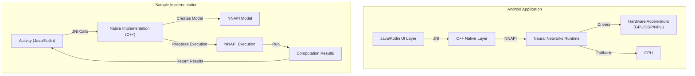
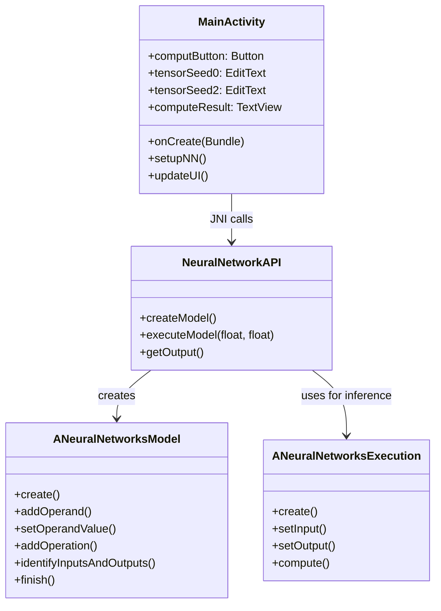
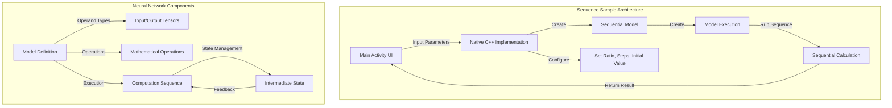
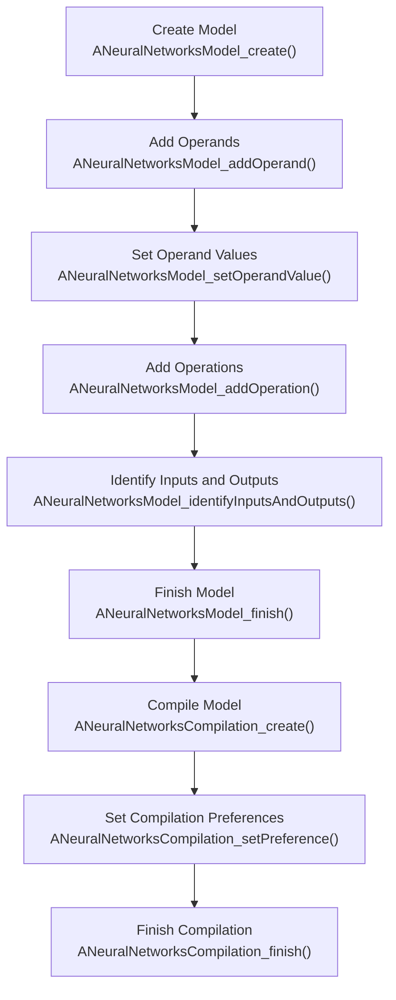
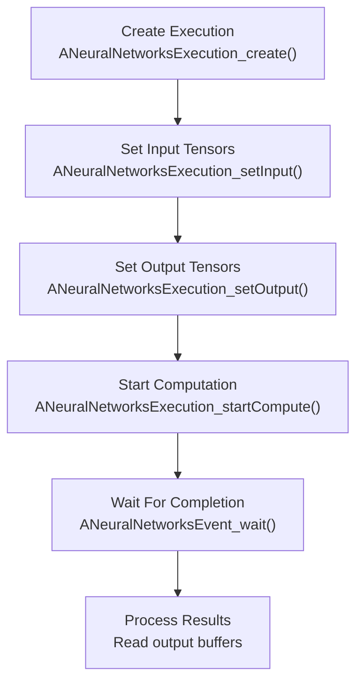

<!-- source: DeepWiki mcp.deepwiki.com · repo android/ndk-samples · page 8.2 Neural Network Samples · fetched 2026-10-23 -->

# Neural Network Samples

Relevant source files

The following files were used as context for generating this wiki page:

- [camera/basic/src/main/cpp/CMakeLists.txt](camera/basic/src/main/cpp/CMakeLists.txt)
- [camera/texture-view/src/main/cpp/CMakeLists.txt](camera/texture-view/src/main/cpp/CMakeLists.txt)
- [endless-tunnel/app/src/main/cpp/CMakeLists.txt](endless-tunnel/app/src/main/cpp/CMakeLists.txt)
- [gles3jni/app/src/main/cpp/CMakeLists.txt](gles3jni/app/src/main/cpp/CMakeLists.txt)
- [hello-gl2/app/src/main/cpp/CMakeLists.txt](hello-gl2/app/src/main/cpp/CMakeLists.txt)
- [hello-jniCallback/app/build.gradle](hello-jniCallback/app/build.gradle)
- [hello-libs/app/src/main/cpp/CMakeLists.txt](hello-libs/app/src/main/cpp/CMakeLists.txt)
- [hello-neon/app/build.gradle](hello-neon/app/build.gradle)
- [hello-vulkan/app/src/main/cpp/CMakeLists.txt](hello-vulkan/app/src/main/cpp/CMakeLists.txt)
- [native-activity/app/src/main/cpp/CMakeLists.txt](native-activity/app/src/main/cpp/CMakeLists.txt)
- [native-audio/app/src/main/cpp/CMakeLists.txt](native-audio/app/src/main/cpp/CMakeLists.txt)
- [native-codec/app/src/main/cpp/CMakeLists.txt](native-codec/app/src/main/cpp/CMakeLists.txt)
- [native-midi/app/src/main/cpp/CMakeLists.txt](native-midi/app/src/main/cpp/CMakeLists.txt)
- [nn-samples/basic/build.gradle](nn-samples/basic/build.gradle)
- [nn-samples/basic/src/main/res/layout/activity_main.xml](nn-samples/basic/src/main/res/layout/activity_main.xml)
- [nn-samples/sequence/build.gradle](nn-samples/sequence/build.gradle)
- [nn-samples/sequence/src/main/res/layout/activity_main.xml](nn-samples/sequence/src/main/res/layout/activity_main.xml)
- [sensor-graph/accelerometer/src/main/cpp/CMakeLists.txt](sensor-graph/accelerometer/src/main/cpp/CMakeLists.txt)
- [teapots/choreographer-30fps/build.gradle](teapots/choreographer-30fps/build.gradle)
- [teapots/classic-teapot/build.gradle](teapots/classic-teapot/build.gradle)
- [teapots/image-decoder/build.gradle](teapots/image-decoder/build.gradle)
- [teapots/more-teapots/build.gradle](teapots/more-teapots/build.gradle)
- [teapots/textured-teapot/build.gradle](teapots/textured-teapot/build.gradle)

This document provides an in-depth technical explanation of the neural network samples included in the Android NDK samples repository. These samples demonstrate how to use Android's Neural Networks API (NNAPI) with native C++ code to create, train, and execute neural network models on Android devices.

## Overview

The Android NDK samples repository includes two neural network samples:

1. **Basic Neural Network Sample** - Demonstrates the fundamental usage of NNAPI to create and execute a simple neural network model
2. **Sequence Neural Network Sample** - Shows how to work with sequence models and state management in NNAPI

Both samples showcase how to bridge Java/Kotlin UI components with native C++ implementations of neural network operations.

Sources: [nn-samples/basic/build.gradle](), [nn-samples/sequence/build.gradle]()

## Neural Networks API (NNAPI) Architecture

The Neural Networks API is a C API designed for running computationally intensive neural network operations on Android devices. The samples demonstrate integration between Java/Kotlin UI and C++ neural network implementations.

Sources: [nn-samples/basic/build.gradle](), [nn-samples/sequence/build.gradle]()

## Basic Neural Network Sample

The Basic Neural Network sample demonstrates creating and executing a simple feed-forward neural network that performs basic arithmetic operations. It shows the fundamental workflow for using NNAPI in native code.

### Architecture and Implementation

The Basic sample creates a simple computational graph that:
1. Takes two input tensors
2. Performs a series of operations (ADD, MUL)
3. Returns the result

Key points about this implementation:
- Minimum SDK version is 27 (Android 8.1), which introduced NNAPI
- Uses JNI to bridge between Kotlin UI and C++ neural network implementation
- Demonstrates direct memory management for tensor data

Sources: [nn-samples/basic/build.gradle](), [nn-samples/basic/src/main/res/layout/activity_main.xml]()

### User Interface and Flow

The UI allows users to:
1. Enter two float values as input tensors
2. Click "Compute" to process the data through the neural network
3. View the result of the computation

This workflow demonstrates:
- Passing data from Java/Kotlin to native code
- Creating tensors from user input
- Processing data through a neural network model
- Returning computation results to the UI

Sources: [nn-samples/basic/src/main/res/layout/activity_main.xml]()

## Sequence Neural Network Sample

The Sequence sample demonstrates more advanced neural network concepts, particularly dealing with sequential data and state maintenance between executions.

### Architecture and Implementation

The Sequence model demonstrates:
1. Creating a neural network with stateful operations
2. Executing multiple iterations while preserving state
3. Configuring execution parameters (ratio, steps, initial value)
4. Computing a sequence that depends on previous values

Key implementation details:
- Requires minimum SDK 30 (Android 11) for advanced NNAPI features
- Demonstrates state management between execution steps
- Shows how to create networks with feedback loops

Sources: [nn-samples/sequence/build.gradle](), [nn-samples/sequence/src/main/res/layout/activity_main.xml]()

### User Interface and Control Flow

The Sequence sample UI includes:
1. Input fields for ratio, initial value, and number of steps
2. Compute and Reset buttons
3. Result displays for interim and final values

The computation flow demonstrates:
- Setting up a sequence model
- Configuring the execution parameters
- Running multiple iterations
- Managing state between iterations
- Displaying progressive results

Sources: [nn-samples/sequence/src/main/res/layout/activity_main.xml]()

## Common Implementation Patterns

Both samples share some common implementation patterns for using NNAPI effectively:

### Model Creation and Compilation

### Execution Process

Sources: [nn-samples/basic/build.gradle](), [nn-samples/sequence/build.gradle]()

## Performance Considerations

The samples demonstrate several performance optimizations that should be considered when using NNAPI:

1. **Computation Type Selection** - Both samples allow configuring the execution preferences to prioritize speed, low power, or high accuracy

2. **Memory Management** - Direct memory handling for tensor data to avoid unnecessary copies

3. **Hardware Acceleration** - Automatic utilization of available accelerators (GPU, DSP, NPU) when appropriate

4. **Reusing Models** - Creating the model once and reusing for multiple executions

## Integration with Android Application

Both samples integrate neural network functionality within a standard Android application structure:

| Component | Role |
|-----------|------|
| Activity | Provides UI for user interaction and displays results |
| JNI Bridge | Connects Java/Kotlin code with native C++ implementation |
| Native C++ | Implements the NNAPI model creation and execution |
| Resource Files | Contains model definitions and configurations |

This integration pattern allows for:
- UI interactions to trigger neural network computations
- Result visualization in the standard Android UI
- Separation of concerns between UI and computation logic

## Conclusion

The Neural Network samples in the Android NDK repository demonstrate effective approaches for implementing machine learning functionality using NNAPI directly from native code. They showcase both basic and advanced neural network concepts, providing developers with implementation patterns to follow when building their own neural network applications.

These samples serve as reference implementations for developers looking to leverage NNAPI in their applications while managing the complexity of neural network creation, execution, and optimization.