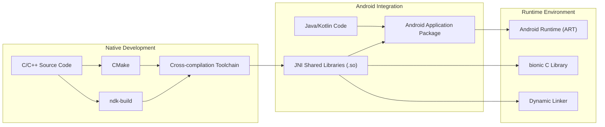
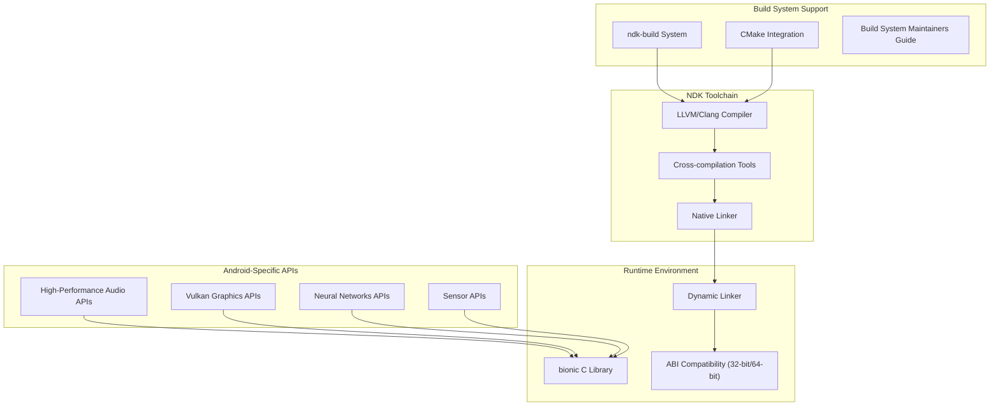

<!-- source: DeepWiki mcp.deepwiki.com · repo android/ndk · page 1 Android NDK Overview · fetched 2026-10-23 -->

# Android NDK Overview

Relevant source files

The following files were used as context for generating this wiki page:

- [README.md](README.md)

## Purpose and Scope

This document provides an overview of the Android Native Development Kit (NDK), explaining its core purpose, key capabilities, and role in the Android development ecosystem. The NDK enables Android application developers to include native C/C++ code in their applications, compiled as JNI shared libraries that integrate with the Android runtime environment.

For detailed information about specific NDK components, see [Core Components](#1.1). For build system integration details, see [Build Systems Integration](#1.2). For community support and issue management, see [Community Support and Issue Management](#4).

## What is the Android NDK

The Android NDK is a toolset that allows developers to implement parts of Android applications using native code languages such as C and C++. The NDK compiles native code into JNI (Java Native Interface) shared libraries (`.so` files) that can be called from Java or Kotlin code running on the Android Runtime (ART).

### NDK Development Workflow

**Sources:** [README.md:1-74]()

## Core NDK Components

The NDK consists of several key components that work together to enable native development on Android:

| Component | Purpose | Key Features |
|-----------|---------|-------------|
| Cross-compilation Toolchain | Compile native code for Android target architectures | LLVM/Clang-based compiler, supports ARM, x86, x86_64 |
| Build System Integration | Integrate with Android build processes | `ndk-build` and CMake support |
| Android-specific APIs | Native access to Android platform features | Audio, graphics, neural networks, sensors |
| Runtime Dependencies | Native code execution environment | `bionic` C library, dynamic linker |

### NDK Toolchain and API Architecture

**Sources:** [README.md:28-38](), [README.md:40-51](), [README.md:69-71]()

## Integration with Android Development Ecosystem

The NDK integrates seamlessly with the broader Android development ecosystem, providing native development capabilities within the standard Android build and deployment pipeline.

### Supported Build Systems

The NDK supports two primary build systems:

- **ndk-build**: The traditional NDK build system based on GNU Make
- **CMake**: Cross-platform build system with full Android Studio integration

Both build systems are supported out of the box by Android Studio and the Android Gradle Plugin, enabling developers to choose the build system that best fits their project requirements.

### Native API Categories

The NDK provides access to specialized Android APIs optimized for native development:

1. **High-Performance Audio**: Low-latency audio processing APIs for real-time audio applications
2. **Vulkan Graphics**: Low-level graphics API for high-performance rendering
3. **Neural Networks**: Hardware-accelerated machine learning inference APIs

**Sources:** [README.md:28-38](), [README.md:69-71]()

## Runtime Environment and Dependencies

The NDK relies on Android's native runtime environment, which includes several key components:

### bionic C Library

Android uses `bionic`, a custom C library implementation optimized for mobile devices. The bionic library provides:

- Standard C library functions with Android-specific optimizations
- API availability varies by Android API level
- Behavior changes documented across Android releases

### Dynamic Linker

The Android dynamic linker handles loading and linking of native shared libraries (`.so` files). Understanding dynamic linker behavior is crucial for:

- Troubleshooting library loading issues
- Managing dependencies between native libraries
- Ensuring compatibility across Android versions

### ABI Compatibility

The NDK supports multiple Application Binary Interfaces (ABIs):

- **64-bit architectures**: arm64-v8a, x86_64
- **32-bit architectures**: armeabi-v7a, x86
- **ABI-specific considerations**: 32-bit ABI has documented compatibility issues

**Sources:** [README.md:40-51]()

## Documentation and Learning Resources

The NDK ecosystem provides comprehensive documentation and learning resources:

### Official Documentation

- **NDK Guides**: Getting started tutorials and build/debug information
- **NDK API Reference**: Complete reference for Android-specific native APIs
- **Specialized Tutorials**: High-Performance Audio, Vulkan, and Neural Networks guides

### Platform Documentation

- **bionic Status Documentation**: API availability by Android release
- **Dynamic Linker Changes**: Important changes affecting native library loading
- **Crash Analysis**: Understanding tombstones and native crash dumps

### Community Resources

- **android-ndk Google Group**: Community discussions and support
- **GitHub Issues**: Bug reporting and feature requests at `https://github.com/android-ndk/ndk/issues`
- **Release Calendar**: Upcoming NDK release schedule
- **Build System Maintainers Guide**: Advanced build system integration guidance

**Sources:** [README.md:23-38](), [README.md:40-61](), [README.md:62-74]()

## Development Workflow Integration

The NDK integrates with standard Android development workflows through:

1. **Android Studio Integration**: Native debugging and profiling tools
2. **Gradle Plugin Support**: Automated native library building and packaging
3. **Crash Analysis Tools**: Native crash dump interpretation and debugging
4. **Performance Profiling**: Native code performance analysis tools

For detailed information about debugging and profiling native code, see [Debugging and Profiling](#3.2). For information about the complete developer workflow, see [Developer Workflow](#3).

**Sources:** [README.md:30-32](), [README.md:53-61]()

---

