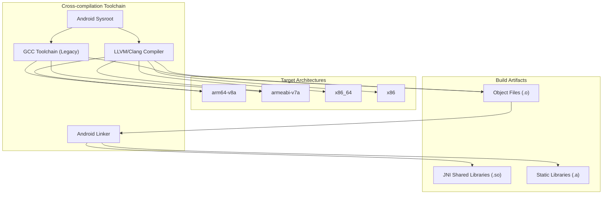
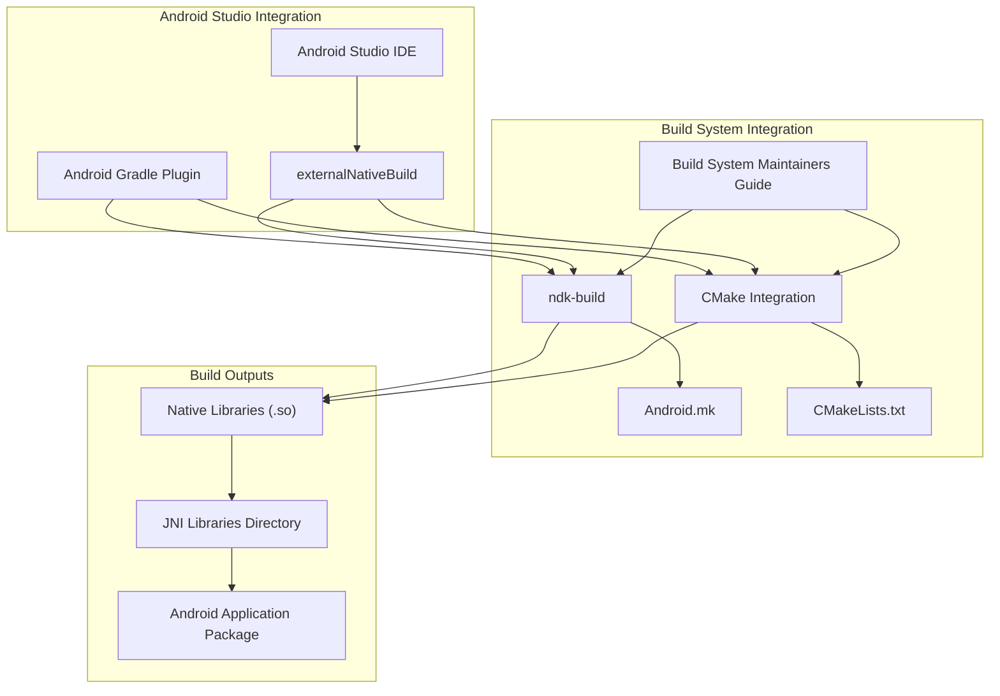
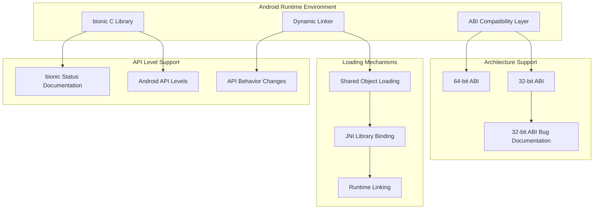
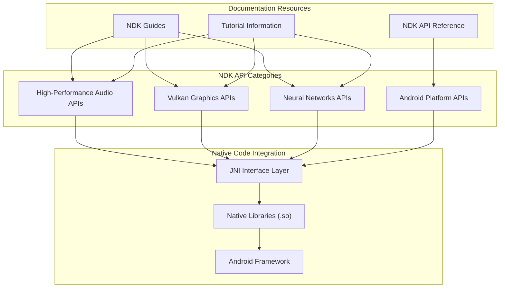
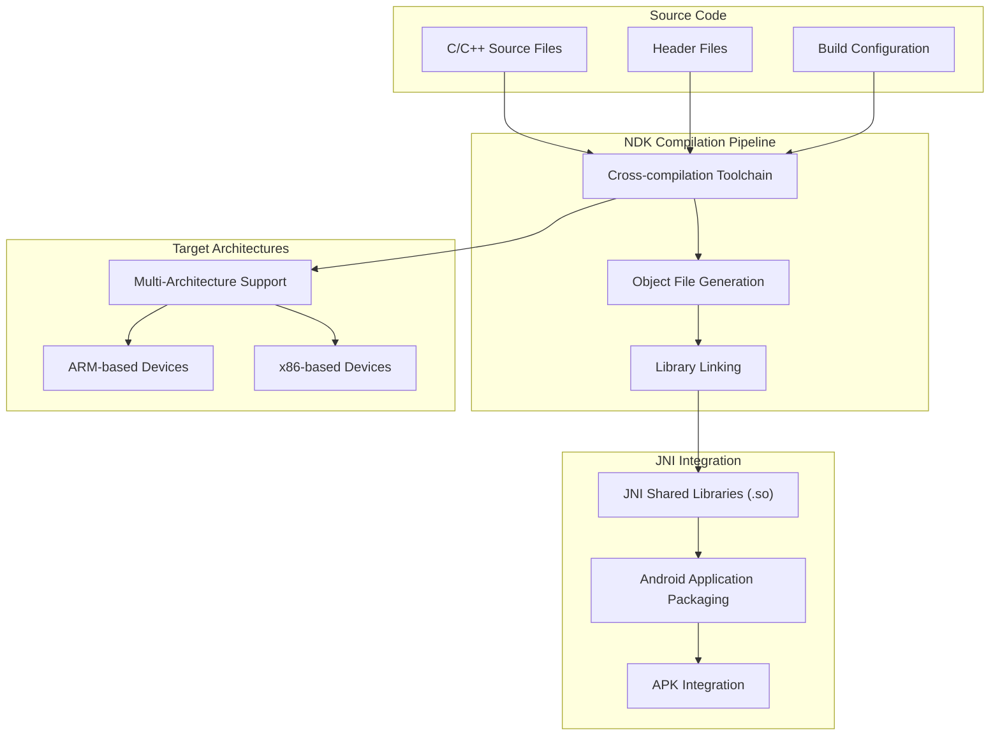
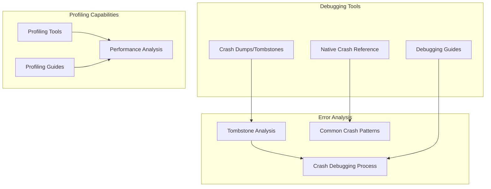

<!-- source: DeepWiki mcp.deepwiki.com · repo android/ndk · page 1.1 Core Components · fetched 2026-10-23 -->

# Core Components

Relevant source files

The following files were used as context for generating this wiki page:

- [README.md](README.md)

This document details the fundamental components that make up the Android Native Development Kit (NDK), including the cross-compilation toolchain, build system integration, runtime environment, and Android-specific APIs. These components work together to enable Android application developers to include native C/C++ code in their applications.

For information about the complete developer workflow using these components, see [Developer Workflow](#3). For details about contributing to the NDK project itself, see [Contributing to the NDK](#5).

## Cross-compilation Toolchain

The NDK provides a complete cross-compilation toolchain that enables developers to build native C/C++ code for Android's various target architectures. This toolchain is the foundation that transforms native source code into JNI shared libraries that can be loaded by Android applications.

### Toolchain Architecture

**Sources:** [README.md:1-74]()

## Build System Integration

The NDK integrates with two primary build systems to provide developers with flexible options for building native code. Both systems are supported out of the box by Android Studio.

### Build System Components

The NDK supports both `ndk-build` and `CMake` build systems, with comprehensive integration through the Android Gradle Plugin. For build system maintainers who need to integrate additional build systems, detailed guidance is available in the Build System Maintainers Guide.

**Sources:** [README.md:69-71]()

## Runtime Environment

The NDK runtime environment consists of core system libraries and components that native code depends on at runtime. These components provide the foundation for native code execution on Android devices.

### Runtime Dependencies

The `bionic` C library serves as Android's implementation of the standard C library, with comprehensive documentation covering API availability across different Android releases and behavior changes that affect NDK developers.

**Sources:** [README.md:40-51]()

## Android-Specific APIs

The NDK provides access to specialized Android-specific APIs that enable high-performance native applications. These APIs are documented in the NDK API Reference and include domain-specific functionality.

### Specialized API Categories

| API Category | Purpose | Documentation Reference |
|--------------|---------|------------------------|
| High-Performance Audio | Low-latency audio processing and OpenSL ES | NDK Audio Guides |
| Vulkan Graphics | Low-level graphics rendering API | NDK Graphics Guides |
| Neural Networks | Machine learning inference acceleration | NDK Neural Networks API |
| Standard Android APIs | Platform-specific native interfaces | NDK API Reference |

### API Integration Flow

**Sources:** [README.md:28-38]()

## Native Code Compilation Pipeline

The NDK transforms native C/C++ source code into JNI shared libraries through a comprehensive compilation pipeline that integrates with Android's application packaging system.

### Compilation Process Flow

The compilation pipeline produces JNI shared libraries that are packaged into Android applications, enabling native code execution across multiple target architectures supported by Android devices.

**Sources:** [README.md:3-4]()

## Debugging and Profiling Support

The NDK includes comprehensive debugging and profiling capabilities essential for native code development, including crash analysis and performance optimization tools.

### Debug Information Flow

The NDK provides detailed documentation for understanding crash dumps and tombstones, which are essential for debugging native code issues in production Android applications.

**Sources:** [README.md:32-33](), [README.md:53-60]()

---

