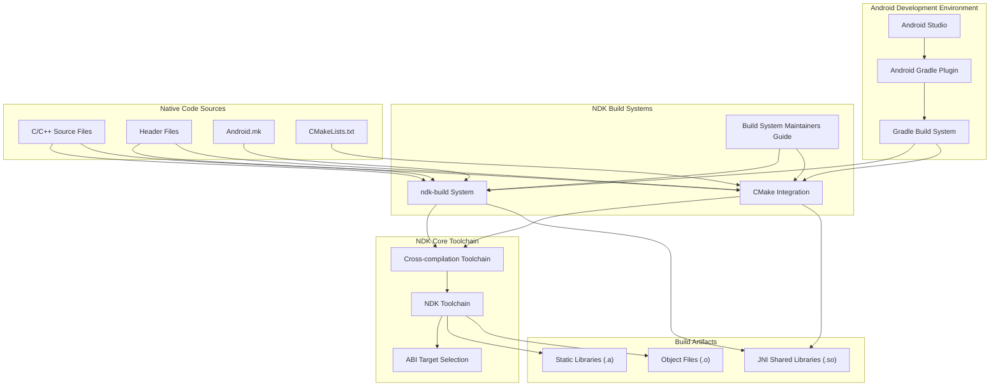
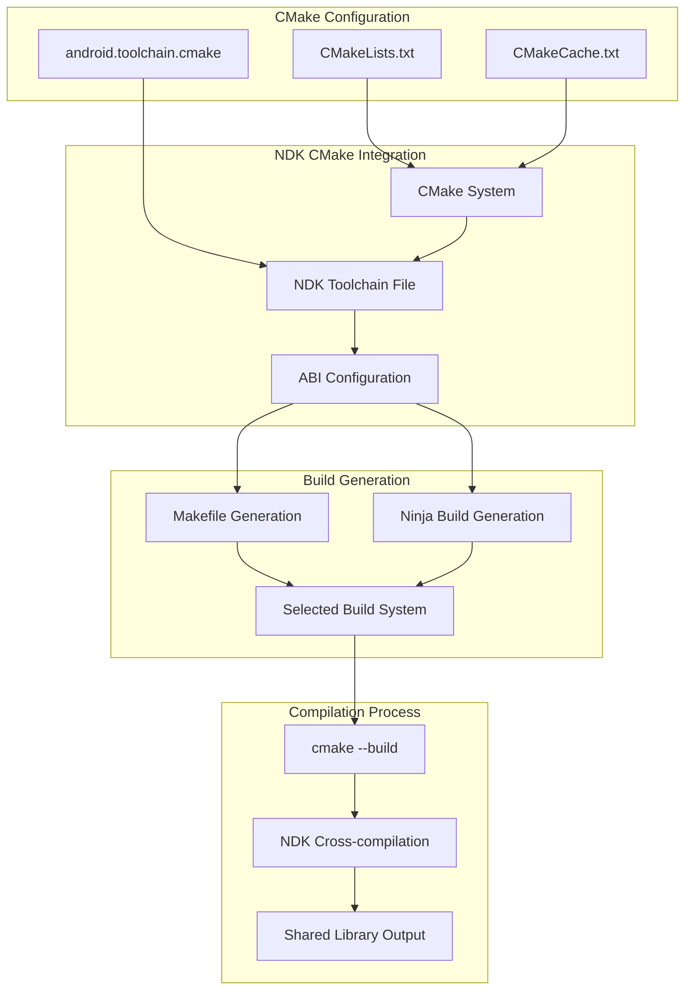
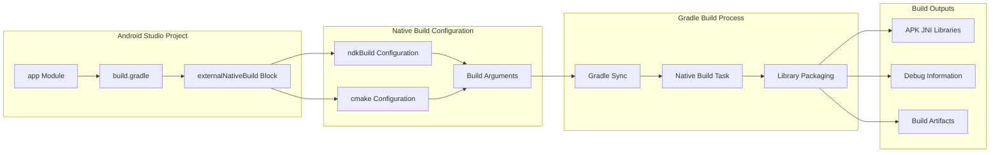

<!-- source: DeepWiki mcp.deepwiki.com · repo android/ndk · page 1.2 Build Systems Integration · fetched 2026-10-23 -->

# Build Systems Integration

Relevant source files

The following files were used as context for generating this wiki page:

- [README.md](README.md)

This document explains how the Android NDK integrates with build systems to compile native C/C++ code into JNI shared libraries for Android applications. It covers the two primary build systems supported by the NDK: `ndk-build` and CMake, along with their integration points and maintainer guidance.

The scope includes build system architecture, compilation workflows, and integration with Android development tools. For information about the core NDK components and toolchains, see [Core Components](#1.1). For details about the development workflow and getting started with native development, see [Getting Started](#3.1).

## NDK Build Systems Architecture

The NDK provides two primary build systems that handle the cross-compilation of native code for Android targets. Both systems integrate with the NDK toolchain to produce JNI shared libraries that can be packaged into Android applications.

### NDK Build System Overview

Sources: [README.md:69-71]()

## ndk-build System

The `ndk-build` system is the traditional NDK build system that uses GNU Make and Android.mk files to define build configurations. It provides direct integration with the NDK toolchain and supports all NDK features out of the box.

### ndk-build Build Process

```mermaid
graph LR
    subgraph "Build Configuration"
        AndroidMk["Android.mk"]
        ApplicationMk["Application.mk"]
        NDKBuildScript["ndk-build Script"]
    end
    
    subgraph "Make System"
        GNUMake["GNU Make"]
        NDKMakefiles["NDK Build System Makefiles"]
        TargetSelection["Target ABI Selection"]
    end
    
    subgraph "Compilation Pipeline"
        Preprocessing["C/C++ Preprocessing"]
        Compilation["Cross-compilation"]
        Linking["Shared Library Linking"]
    end
    
    subgraph "Output Artifacts"
        JNILibs["JNI Shared Libraries"]
        DebugSymbols["Debug Symbols"]
        LibsDirectory["libs/ Directory Structure"]
    end
    
    AndroidMk --> NDKBuildScript
    ApplicationMk --> NDKBuildScript
    NDKBuildScript --> GNUMake
    GNUMake --> NDKMakefiles
    NDKMakefiles --> TargetSelection
    
    TargetSelection --> Preprocessing
    Preprocessing --> Compilation
    Compilation --> Linking
    
    Linking --> JNILibs
    Linking --> DebugSymbols
    JNILibs --> LibsDirectory
    DebugSymbols --> LibsDirectory
```

The `ndk-build` system processes `Android.mk` files that define modules, source files, and build flags. The system automatically handles cross-compilation for multiple target ABIs and generates the appropriate directory structure for JNI libraries.

Sources: [README.md:69-71]()

## CMake Integration

CMake integration allows developers to use standard CMake build files (`CMakeLists.txt`) with the NDK. The integration provides a bridge between CMake's cross-platform build system and the NDK's Android-specific toolchain.

### CMake NDK Integration Architecture

CMake integration uses the NDK's toolchain file to configure cross-compilation settings, target ABIs, and Android-specific build parameters. This allows developers to use familiar CMake syntax while leveraging NDK capabilities.

Sources: [README.md:69-71]()

## Build System Integration Points

Both build systems integrate with the broader Android development ecosystem through well-defined integration points that allow seamless native code compilation within Android projects.

| Integration Point | ndk-build | CMake | Description |
|------------------|-----------|-------|-------------|
| Android Studio | Direct | Direct | IDE integration for build configuration |
| Gradle Plugin | `android.externalNativeBuild.ndkBuild` | `android.externalNativeBuild.cmake` | Gradle build system integration |
| ABI Targeting | `APP_ABI` in Application.mk | `ANDROID_ABI` CMake variable | Multi-ABI compilation support |
| NDK Toolchain | Automatic | `android.toolchain.cmake` | Cross-compilation toolchain setup |
| Debug Symbols | `NDK_DEBUG=1` | `CMAKE_BUILD_TYPE=Debug` | Debug information generation |

### Android Studio and Gradle Integration

Android Studio's Gradle plugin automatically detects and configures native build systems through the `externalNativeBuild` block, enabling seamless integration of native code compilation into the Android application build process.

Sources: [README.md:69-71]()

## Build System Maintainers Guide

The NDK provides comprehensive guidance for build system maintainers who need to integrate with or extend the NDK's build capabilities. This includes support for custom build systems and advanced build configurations.

### Build System Maintainer Resources

The Build System Maintainers Guide addresses the needs of developers who maintain build systems that need to work with the NDK, including:

- Custom build system integration patterns
- NDK toolchain configuration and usage
- Cross-compilation setup and ABI targeting
- Integration with Android development workflows
- Advanced build system features and capabilities

Key areas covered by the maintainers guide include toolchain discovery, environment setup, and proper handling of Android-specific build requirements.

Sources: [README.md:71]()

## Build System Selection and Comparison

| Aspect | ndk-build | CMake |
|--------|-----------|-------|
| Configuration Files | `Android.mk`, `Application.mk` | `CMakeLists.txt` |
| Build System | GNU Make | CMake with Make/Ninja |
| NDK Integration | Native | Toolchain file |
| Learning Curve | NDK-specific | Standard CMake |
| Feature Support | Full NDK features | Full NDK features via toolchain |
| IDE Support | Android Studio | Android Studio + other IDEs |
| Cross-platform | Android-specific | Cross-platform with Android support |

Both build systems provide complete NDK functionality and integrate seamlessly with Android Studio. The choice typically depends on existing project infrastructure, team familiarity, and cross-platform requirements.

Sources: [README.md:69-71]()

---

