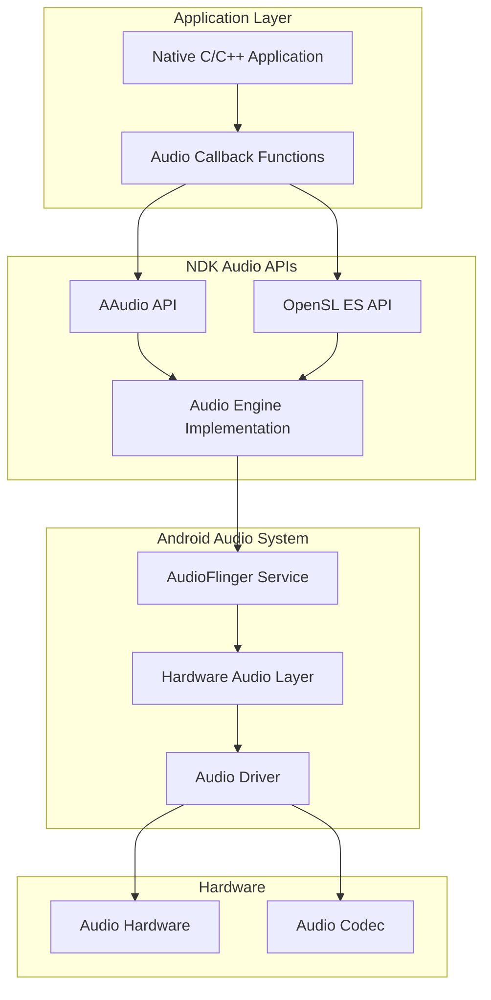
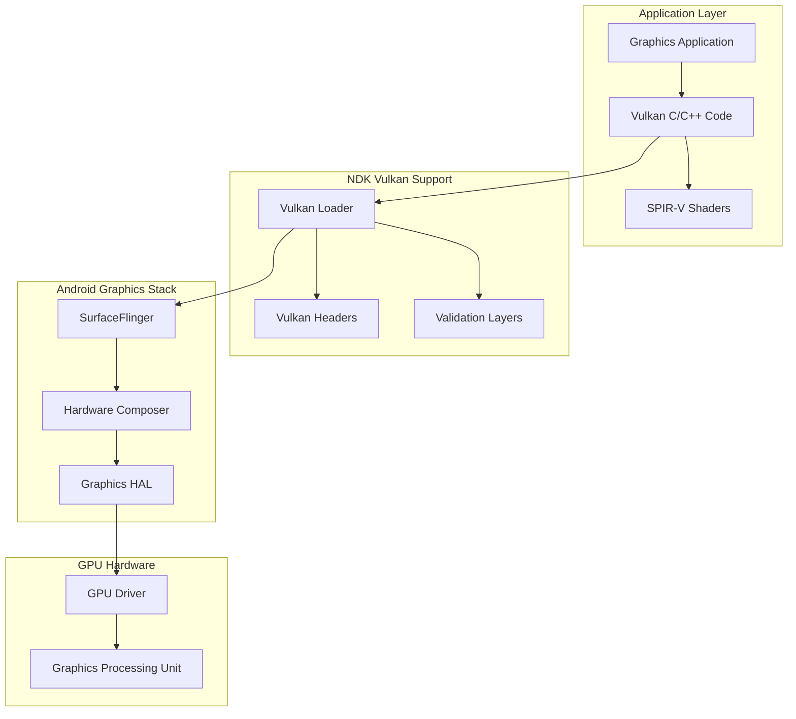
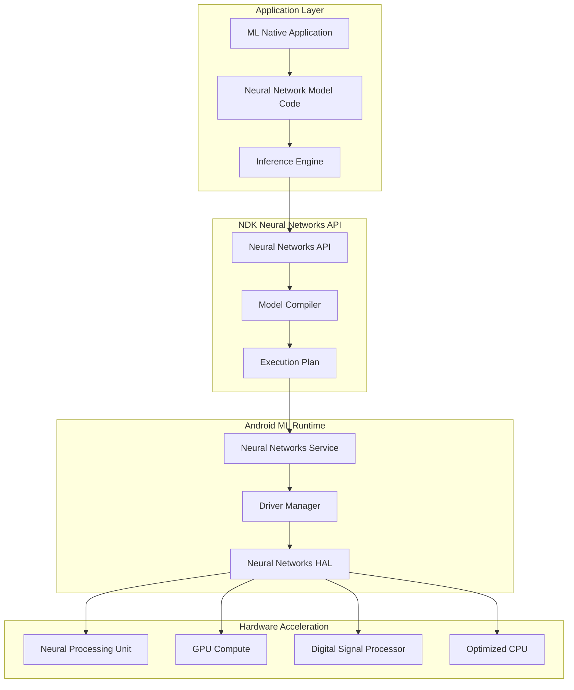
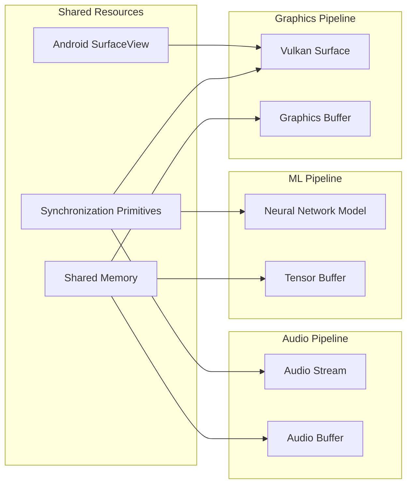

<!-- source: DeepWiki mcp.deepwiki.com · repo android/ndk · page 1.3 Specialized APIs and Features · fetched 2026-10-23 -->

# Specialized APIs and Features

Relevant source files

The following files were used as context for generating this wiki page:

- [README.md](README.md)

## Purpose and Scope

This document covers the specialized APIs and advanced features provided by the Android NDK beyond standard C/C++ library functionality. These APIs enable native code to access Android-specific hardware capabilities and platform services that require high performance or low-level system integration.

The NDK provides three primary categories of specialized APIs: High-Performance Audio, Vulkan Graphics, and Neural Networks. For general NDK components and build system integration, see [Core Components](#1.1) and [Build Systems Integration](#1.2). For runtime environment details, see [Runtime Environment](#2.1).

## High-Performance Audio API

The NDK's High-Performance Audio API provides low-latency audio capabilities for real-time audio applications, games, and music production software. This API bypasses the higher-level Java audio framework to deliver direct access to the Android audio subsystem.

### Audio API Architecture

The audio API provides direct access to audio streams with minimal buffering and processing overhead, enabling professional-grade audio applications on Android devices.

**Sources:** [README.md:34-36]()

### Key Audio API Components

| API Component | Purpose | Latency Characteristics |
|---------------|---------|------------------------|
| `AAudio` | Modern low-latency audio API | Ultra-low latency for real-time audio |
| `OpenSL ES` | Cross-platform audio API | Low latency with broader device support |
| Audio Callbacks | Real-time audio processing | Direct hardware buffer access |
| Stream Configuration | Audio format and buffer setup | Optimized for specific use cases |

**Sources:** [README.md:34-36]()

## Vulkan Graphics API

The Vulkan Graphics API in the NDK provides low-level access to GPU hardware for high-performance graphics rendering, compute operations, and parallel processing workloads.

### Vulkan Integration Architecture

Vulkan provides explicit control over GPU resources, memory management, and command submission, enabling developers to achieve maximum graphics performance on Android devices.

**Sources:** [README.md:35-36]()

### Vulkan API Features

The NDK Vulkan implementation supports:

- **Command Buffer Management**: Direct GPU command submission and synchronization
- **Memory Management**: Explicit GPU memory allocation and binding
- **Pipeline State Objects**: Pre-compiled rendering and compute pipelines  
- **Descriptor Sets**: Resource binding and shader parameter management
- **Surface Integration**: Integration with Android's surface system for display output

**Sources:** [README.md:35-36]()

## Neural Networks API

The Neural Networks API (NNAPI) provides hardware-accelerated machine learning inference capabilities through the NDK, enabling native applications to leverage specialized AI processing units and optimized CPU/GPU implementations.

### Neural Networks Architecture

The Neural Networks API abstracts hardware-specific optimization while providing consistent performance across different Android devices with varying AI acceleration capabilities.

**Sources:** [README.md:36]()

### Neural Networks API Operations

| Operation Category | Examples | Hardware Targets |
|-------------------|----------|------------------|
| Convolution | `CONV_2D`, `DEPTHWISE_CONV_2D` | NPU, GPU |
| Activation | `RELU`, `SOFTMAX`, `TANH` | All accelerators |
| Pooling | `MAX_POOL_2D`, `AVERAGE_POOL_2D` | NPU, GPU |
| Normalization | `BATCH_NORM`, `LOCAL_RESPONSE_NORM` | GPU, CPU |
| Arithmetic | `ADD`, `MUL`, `SUB` | All accelerators |

**Sources:** [README.md:36]()

## Android-Specific API Integration

These specialized APIs integrate with the broader Android NDK ecosystem through standardized patterns and interfaces that enable cross-API interoperability and resource sharing.

### Cross-API Resource Management

This integration architecture enables applications to combine multiple specialized APIs efficiently, such as using Vulkan for graphics rendering while processing audio through the high-performance audio API and running ML inference simultaneously.

**Sources:** [README.md:37-38]()

## API Documentation and References

The complete API reference for these specialized features is maintained in the official Android NDK documentation. Each API includes detailed function signatures, parameter specifications, and usage examples for integration into native applications.

For comprehensive API coverage including function definitions, constants, and data structures, developers should consult the NDK API Reference documentation which covers all Android-specific APIs available through the NDK.

**Sources:** [README.md:37-38]()

---

