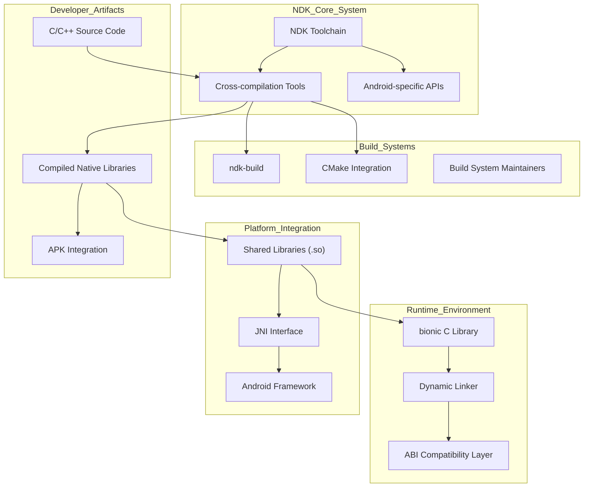
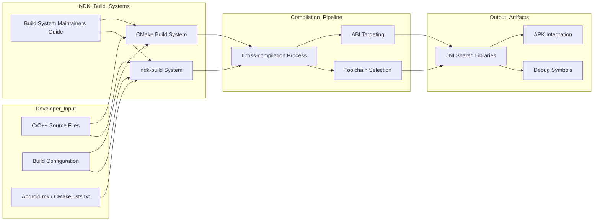
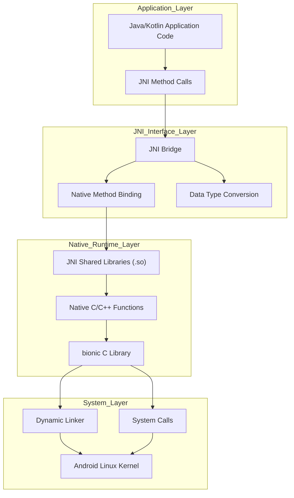
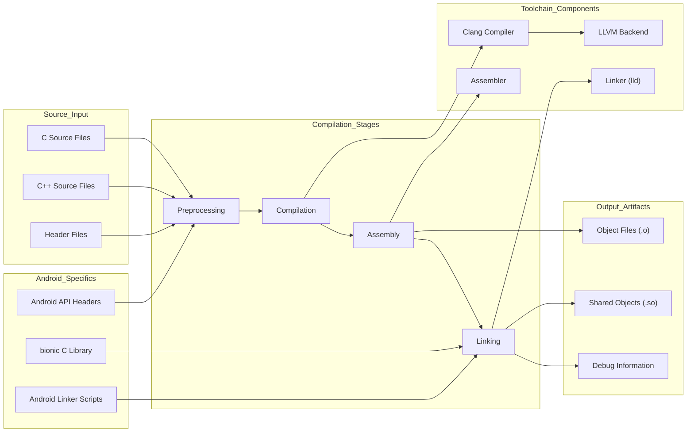
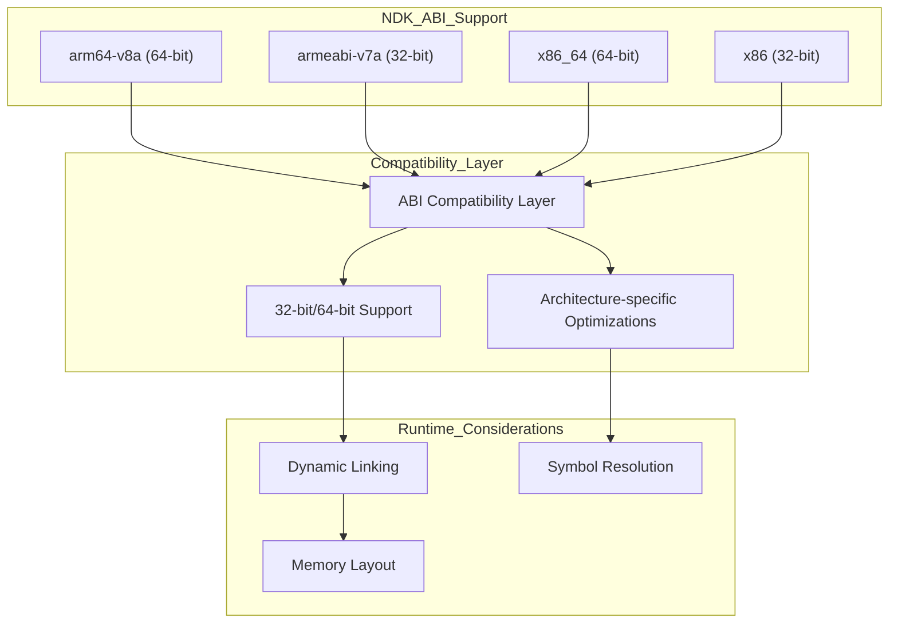

<!-- source: DeepWiki mcp.deepwiki.com · repo android/ndk · page 2 NDK Architecture · fetched 2026-10-23 -->

# NDK Architecture

Relevant source files

The following files were used as context for generating this wiki page:

- [README.md](README.md)

This document provides an in-depth examination of the Android Native Development Kit's internal architecture, covering the core system components, runtime environment, and platform integration mechanisms. The architecture encompasses the cross-compilation toolchain, build system integration, runtime environment with bionic C library, and the complete pipeline from native C/C++ code to JNI shared libraries integrated into Android applications.

For information about getting started with NDK development workflows, see [Developer Workflow](#3). For details about specific runtime components like bionic and the dynamic linker, see [Runtime Environment](#2.1). For native code compilation and integration processes, see [Native Code Integration](#2.2).

## Architectural Overview

The NDK architecture consists of several interconnected systems that enable native C/C++ development for Android applications. The architecture bridges the gap between standard POSIX development and the Android platform's unique requirements.

### Core NDK Architecture

Sources: [README.md:1-74]()

## Build System Architecture

The NDK supports multiple build systems through a unified architecture that abstracts the underlying cross-compilation complexity. The build system architecture provides flexibility while maintaining consistent toolchain integration.

### Build System Integration Points

Sources: [README.md:69-71]()

The NDK build system architecture supports both `ndk-build` and CMake integration as documented in the Build System Maintainers Guide. The architecture abstracts toolchain complexity while providing developers with familiar build system interfaces.

## Runtime Integration Architecture

The NDK runtime architecture integrates with Android's unique C library implementation and dynamic linking system. This architecture ensures native code compatibility across different Android versions and device architectures.

### Runtime Environment Components

| Component | Purpose | Integration Points |
|-----------|---------|-------------------|
| bionic C Library | Android's C library implementation | System calls, POSIX compatibility |
| Dynamic Linker | Shared library loading and symbol resolution | `.so` file loading, dependency management |
| ABI Compatibility Layer | 32-bit and 64-bit architecture support | Cross-architecture compatibility |
| JNI Interface | Java-Native code bridge | Method calls, data type conversion |

Sources: [README.md:40-51]()

## Cross-Compilation Toolchain Architecture

The NDK's cross-compilation architecture enables building native code on development machines for target Android devices. The toolchain handles architecture differences, API level targeting, and Android-specific optimizations.

### Toolchain Components and Flow

The cross-compilation process involves multiple stages that transform source code into Android-compatible native libraries:

Sources: [README.md:1-74]()

## Platform Integration Points

The NDK architecture integrates with multiple layers of the Android platform, from the application framework down to the kernel level. These integration points ensure native code operates correctly within Android's security and runtime model.

### Android Platform Integration

| Integration Layer | NDK Components | Platform Components |
|-------------------|----------------|-------------------|
| Application Framework | JNI shared libraries | Android Runtime (ART) |
| Native Framework | Android-specific APIs | Native system services |
| C Library Layer | bionic integration | System call interface |
| Kernel Interface | System calls | Linux kernel |

The integration architecture ensures that native code compiled with the NDK can interact seamlessly with Android's Java-based application framework while maintaining access to lower-level system capabilities through the bionic C library and system call interface.

## ABI and Compatibility Architecture

The NDK supports multiple Application Binary Interfaces (ABIs) to ensure compatibility across different Android device architectures. The ABI compatibility layer handles architecture-specific differences and ensures consistent behavior across 32-bit and 64-bit platforms.

### ABI Support Matrix

Sources: [README.md:50-51]()

The ABI architecture addresses 32-bit specific issues and ensures proper dynamic linking behavior across different Android releases, as documented in the bionic dynamic linker changes and 32-bit ABI documentation.

---

