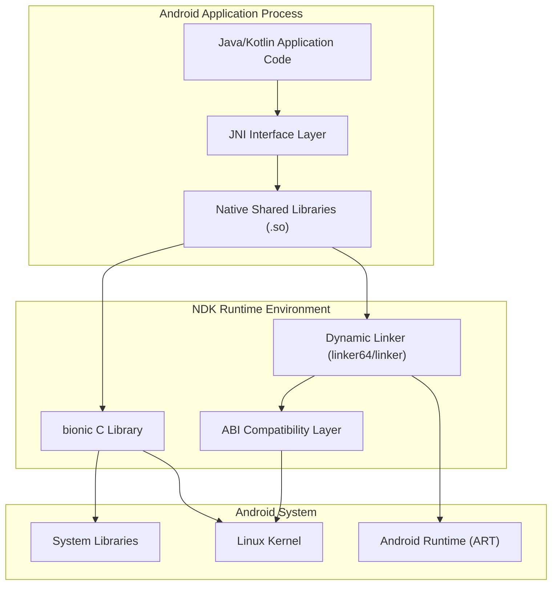
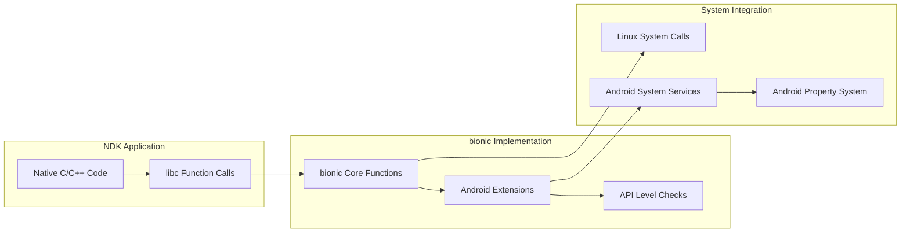
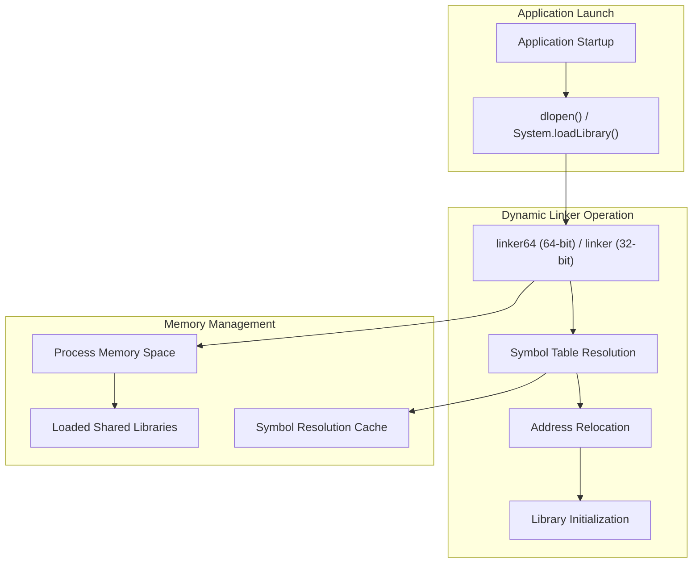
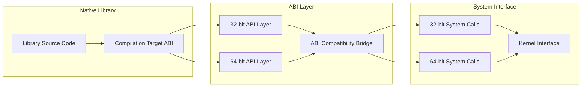
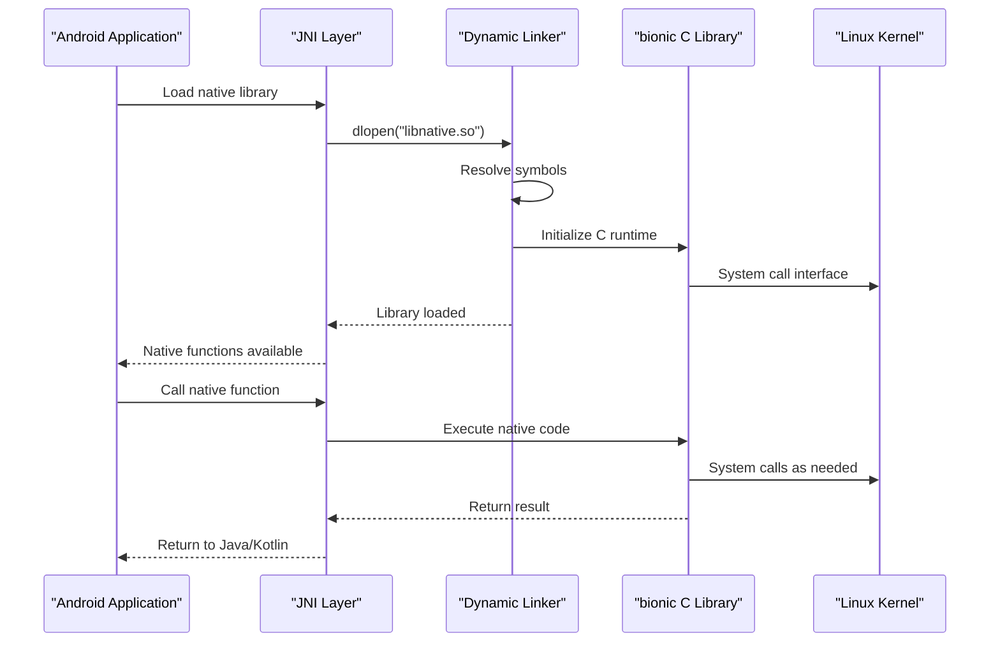

<!-- source: DeepWiki mcp.deepwiki.com · repo android/ndk · page 2.1 Runtime Environment · fetched 2026-10-23 -->

# Runtime Environment

Relevant source files

The following files were used as context for generating this wiki page:

- [README.md](README.md)

## Purpose and Scope

This document explains the Android NDK runtime environment, focusing on the core system components that execute native code at runtime on Android devices. The runtime environment encompasses the bionic C library, dynamic linker, and ABI compatibility layers that provide the execution context for NDK applications.

For information about the build-time cross-compilation toolchain, see [Cross-compilation Toolchain](#2.3). For details about how native code integrates with Android applications during development, see [Native Code Integration](#2.2).

## Runtime Environment Overview

The NDK runtime environment provides the execution foundation for native libraries compiled with the NDK. This environment consists of three primary components that work together to load, link, and execute native code on Android devices.

### Runtime Environment Architecture

Sources: [README.md:40-52]()

## Bionic C Library

The bionic C library serves as the primary system library for NDK applications, providing POSIX-compliant C standard library functions optimized for Android. Bionic replaces the standard GNU C library (glibc) found on most Linux systems.

### Bionic Characteristics

| Feature | Description |
|---------|-------------|
| **Size Optimization** | Smaller memory footprint compared to glibc |
| **Android Integration** | Native integration with Android system services |
| **API Compatibility** | POSIX compliance with Android-specific extensions |
| **Multi-ABI Support** | Supports both 32-bit and 64-bit architectures |

### API Evolution and Compatibility

Bionic APIs evolve across Android API levels, with new functions added and behaviors modified between releases. The bionic status documentation tracks which APIs are available in specific Android versions and documents behavioral changes that affect NDK developers.

Sources: [README.md:42-46]()

## Dynamic Linker

The Android dynamic linker (`linker64` for 64-bit, `linker` for 32-bit) handles loading and linking shared libraries at runtime. This component resolves symbol dependencies and manages library initialization for NDK applications.

### Dynamic Linking Process

The dynamic linker performs several critical operations when loading native libraries:

1. **Library Loading**: Loads `.so` files into process memory
2. **Symbol Resolution**: Resolves undefined symbols across library boundaries  
3. **Relocation**: Adjusts memory addresses for position-independent code
4. **Initialization**: Executes library constructors and initialization functions

### Dynamic Linker Changes

The dynamic linker behavior has evolved significantly across Android releases, particularly affecting how libraries are loaded and symbols are resolved. These changes can impact existing NDK applications, especially regarding library loading failures.

Sources: [README.md:47-49]()

## ABI Compatibility

Application Binary Interface (ABI) compatibility ensures that native libraries built for specific architectures can execute correctly on target devices. The NDK supports multiple ABIs to accommodate different Android device architectures.

### Supported ABIs

| ABI | Architecture | Description |
|-----|--------------|-------------|
| **arm64-v8a** | 64-bit ARM | Primary ABI for modern Android devices |
| **armeabi-v7a** | 32-bit ARM | Legacy ABI for older ARM devices |
| **x86_64** | 64-bit x86 | Intel/AMD 64-bit architecture |
| **x86** | 32-bit x86 | Intel/AMD 32-bit architecture |

### 32-bit ABI Considerations

The 32-bit ABIs, particularly `armeabi-v7a`, have specific behavioral differences and potential issues compared to their 64-bit counterparts. These differences can affect memory layout, pointer sizes, and system call interfaces.

Sources: [README.md:50-51]()

## Runtime Environment Integration

The runtime environment components work together to provide a complete execution context for NDK applications. The integration between bionic, the dynamic linker, and ABI compatibility layers ensures consistent behavior across different Android devices and API levels.

### Component Interaction Flow

### Runtime Dependencies

The runtime environment maintains specific dependencies and initialization orders to ensure proper operation:

- **bionic** provides the fundamental C library interface
- **Dynamic linker** manages library loading and symbol resolution
- **ABI layer** ensures architecture-specific compatibility
- **System integration** bridges native code with Android system services

Sources: [README.md:40-52]()

---

