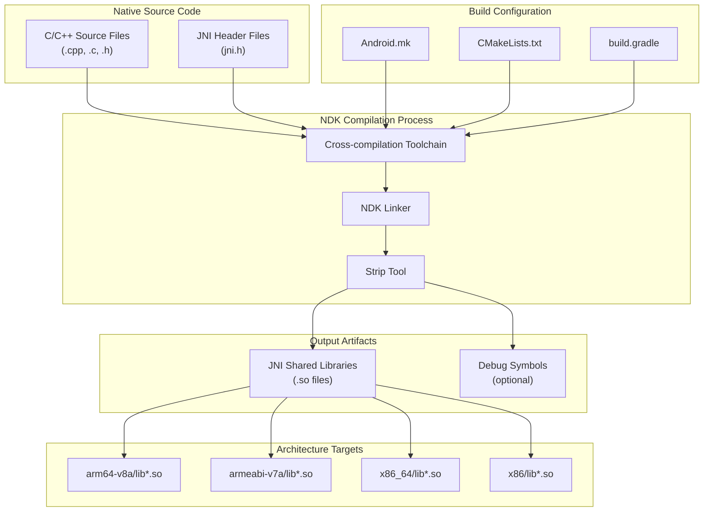
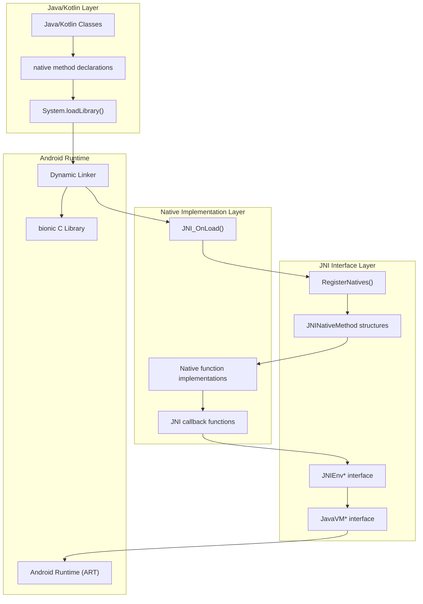
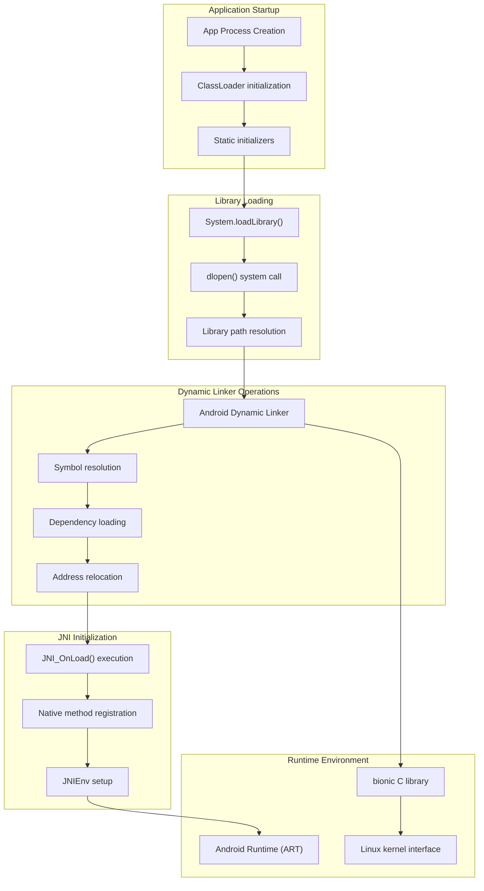
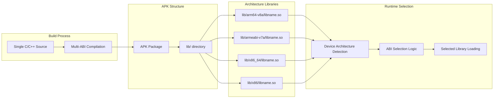

<!-- source: DeepWiki mcp.deepwiki.com · repo android/ndk · page 2.2 Native Code Integration · fetched 2026-10-23 -->

# Native Code Integration

Relevant source files

The following files were used as context for generating this wiki page:

- [README.md](README.md)

## Purpose and Scope

This document details how native C/C++ code is compiled into JNI shared libraries and integrated into Android applications. It covers the technical process from native source code compilation through APK packaging to runtime loading and execution within the Android environment.

For information about the cross-compilation toolchain architecture, see [Cross-compilation Toolchain](#2.3). For details about the runtime environment components, see [Runtime Environment](#2.1). For build system configuration and usage, see [Build Systems Integration](#1.2).

## JNI Shared Library Compilation Process

The Android NDK compiles native C/C++ code into JNI (Java Native Interface) shared libraries with `.so` extensions. These libraries serve as the bridge between Java/Kotlin application code and native implementations.

### Native Code to Shared Library Flow

The compilation process transforms native source code into architecture-specific shared libraries that can be loaded by the Android runtime. Each target architecture requires separate compilation to ensure compatibility across different device types.

Sources: [README.md:1-4]()

### JNI Interface Structure

The JNI interface provides the mechanism for Java/Kotlin code to call native functions and for native code to interact with Java objects and methods. The `JNI_OnLoad()` function serves as the entry point for library initialization.

Sources: [README.md:1-4]()

## APK Integration and Packaging

Native shared libraries are packaged into the APK's `lib/` directory, organized by target architecture. The Android build system handles this integration automatically when properly configured.

### APK Packaging Structure

| APK Component | Native Integration | Purpose |
|---------------|-------------------|---------|
| `lib/arm64-v8a/` | 64-bit ARM libraries | ARM64 device support |
| `lib/armeabi-v7a/` | 32-bit ARM libraries | ARM32 device support |
| `lib/x86_64/` | 64-bit x86 libraries | x86_64 emulator/device support |
| `lib/x86/` | 32-bit x86 libraries | x86 emulator support |
| `classes.dex` | Java bytecode with native method declarations | JNI method signatures |
| `AndroidManifest.xml` | Application metadata | No direct native integration |

The Android package manager selects the appropriate architecture-specific libraries during application installation based on the target device's CPU architecture.

Sources: [README.md:1-4]()

## Runtime Loading and Linking

At runtime, the Android system loads native libraries through the dynamic linker when `System.loadLibrary()` is called. This process involves several system components working together to resolve dependencies and establish the JNI interface.

### Runtime Loading Process

The dynamic linker resolves all symbol dependencies and performs necessary relocations before executing the library's `JNI_OnLoad()` function, which typically registers native method implementations with the Java runtime.

Sources: [README.md:40-51]()

## ABI Compatibility and Multi-Architecture Support

The NDK supports multiple Application Binary Interfaces (ABIs) to ensure compatibility across different Android device architectures. Each ABI defines calling conventions, data type sizes, and system interface specifications.

### ABI Architecture Support Matrix

| ABI Name | Architecture | Bit Width | Status | Common Devices |
|----------|-------------|-----------|--------|----------------|
| `arm64-v8a` | ARMv8-A | 64-bit | Primary | Modern ARM devices |
| `armeabi-v7a` | ARMv7-A | 32-bit | Legacy support | Older ARM devices |
| `x86_64` | x86-64 | 64-bit | Emulator primary | x86_64 emulators |
| `x86` | x86 | 32-bit | Emulator legacy | x86 emulators |

The Android system automatically selects the most appropriate ABI at installation time based on device capabilities and library availability. Applications can include multiple ABI versions to maximize device compatibility.

Sources: [README.md:50-51]()

### Multi-ABI Integration Flow

The build system compiles the same native source code for multiple target architectures, and the Android runtime selects the appropriate version during application installation and execution.

Sources: [README.md:50-51]()

## Application Lifecycle Integration

Native libraries integrate with the Android application lifecycle through JNI callbacks and system events. The integration must handle process creation, memory management, and cleanup operations correctly.

| Lifecycle Event | Native Integration Point | Required Actions |
|-----------------|-------------------------|------------------|
| Process Creation | `JNI_OnLoad()` | Library initialization, method registration |
| Activity Creation | Native method calls | Resource allocation, state setup |
| Configuration Changes | JNI callbacks | Handle orientation, locale changes |
| Memory Pressure | Native memory management | Release caches, compact data |
| Process Termination | `JNI_OnUnload()` | Cleanup resources, save state |

Native code must be designed to handle Android's process lifecycle, including potential process termination and recreation due to memory pressure or system events.

Sources: [README.md:1-4]()

---

