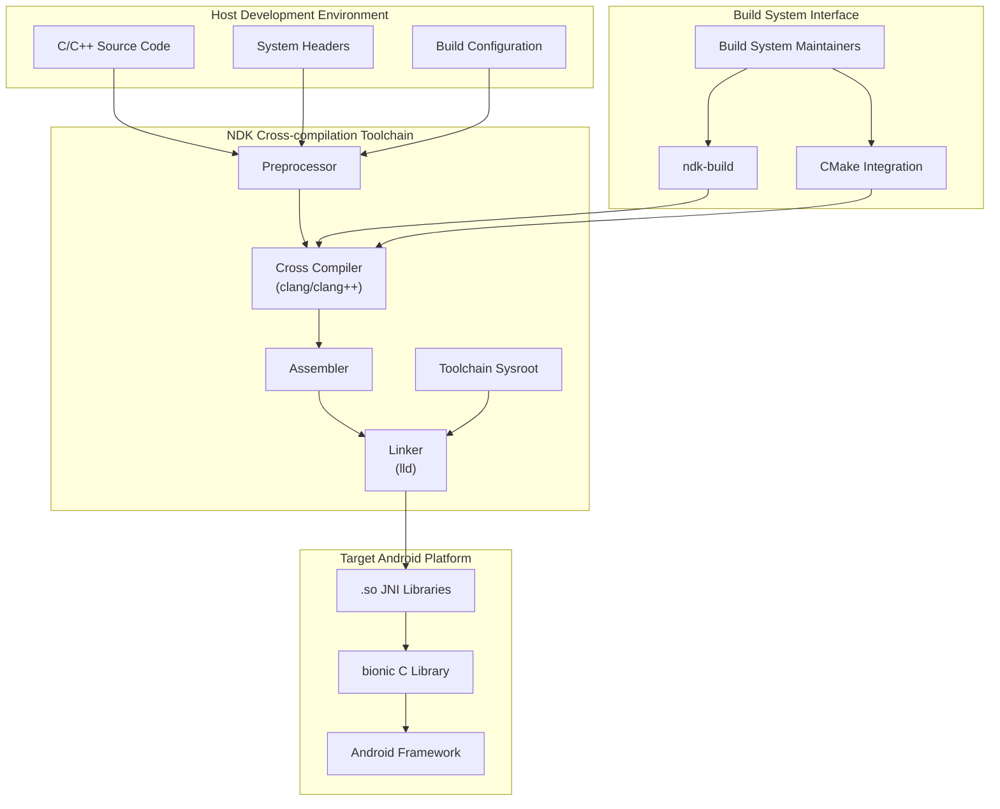
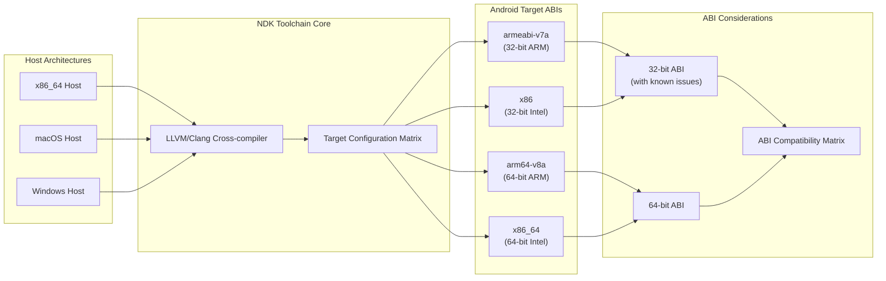
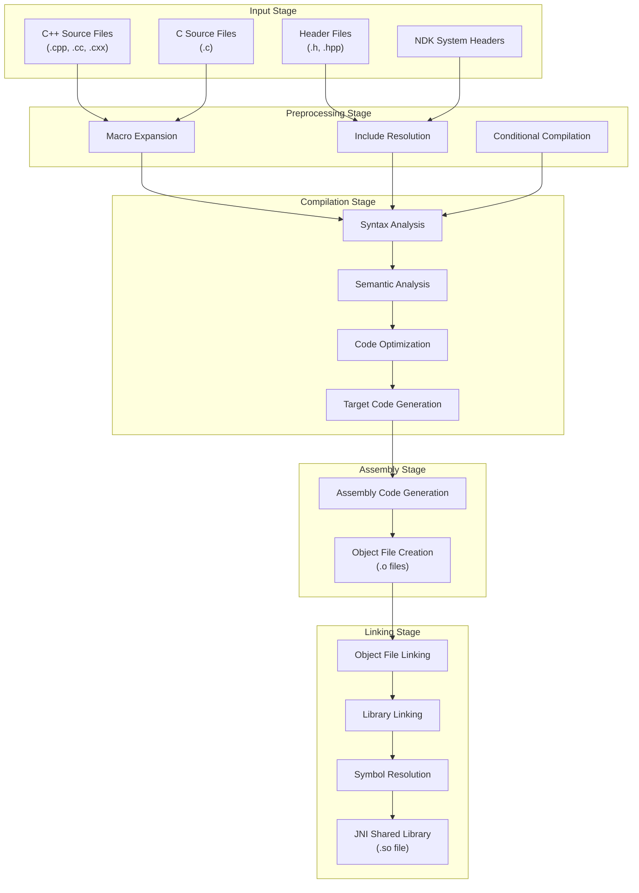
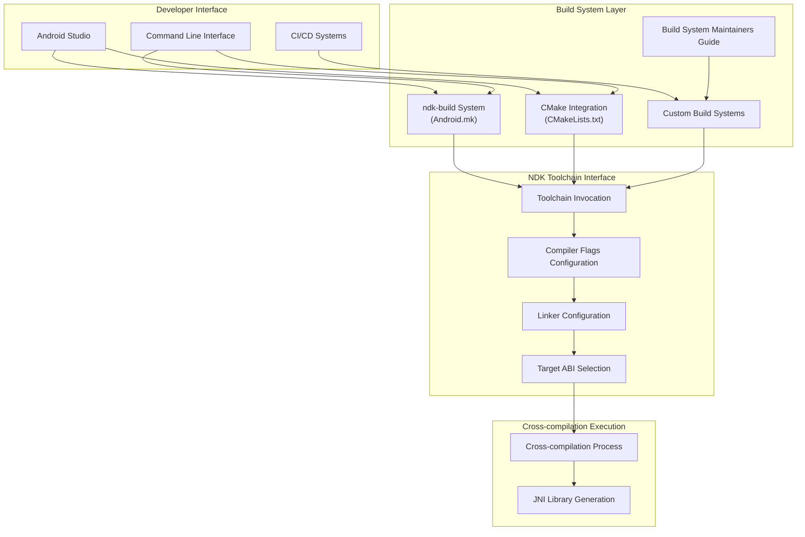
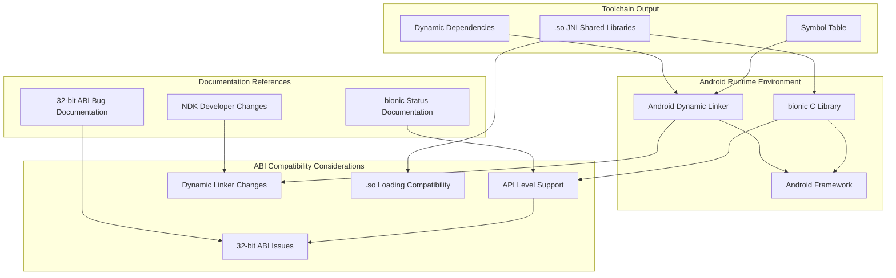

<!-- source: DeepWiki mcp.deepwiki.com · repo android/ndk · page 2.3 Cross-compilation Toolchain · fetched 2026-10-23 -->

# Cross-compilation Toolchain

Relevant source files

The following files were used as context for generating this wiki page:

- [README.md](README.md)

## Purpose and Scope

The cross-compilation toolchain is a core component of the Android NDK that enables developers to compile native C/C++ code for Android target devices from host development machines. This toolchain handles the complex process of translating native code into JNI shared libraries (`.so` files) that can be integrated into Android applications.

This document covers the architecture and operation of the NDK's cross-compilation system. For information about build system integration specifics, see [Build Systems Integration](#1.2). For runtime environment details including the bionic C library and dynamic linker, see [Runtime Environment](#2.1).

## Toolchain Architecture Overview

The NDK cross-compilation toolchain consists of multiple components that work together to transform native source code into Android-compatible binaries.

### Core Toolchain Components

Sources: [README.md:3-4](), [README.md:69-71]()

### Toolchain Target Architecture Support

The cross-compilation toolchain supports multiple Android target architectures, each requiring specific compilation configurations and ABI considerations.

Sources: [README.md:50-51]()

## Cross-compilation Process Flow

The cross-compilation process transforms native source code through multiple stages before producing Android-compatible shared libraries.

### Compilation Pipeline

Sources: [README.md:3-4]()

## Build System Integration

The cross-compilation toolchain integrates with multiple build systems to provide flexible development workflows for NDK users.

### Build System Architecture

| Build System | Integration Method | Configuration | Target Use Case |
|--------------|-------------------|---------------|-----------------|
| `ndk-build` | Native NDK build system | `Android.mk`, `Application.mk` | Traditional NDK projects |
| `CMake` | CMake NDK toolchain file | `CMakeLists.txt` | Cross-platform C++ projects |
| Custom Build Systems | Build System Maintainers Guide | Custom integration | Specialized build requirements |

Sources: [README.md:69-71]()

## Runtime Environment Integration

The cross-compilation toolchain must produce binaries compatible with Android's runtime environment, including the bionic C library and dynamic linker.

### Runtime Compatibility Matrix

Sources: [README.md:44-51]()

### Key Runtime Integration Points

The toolchain must ensure compatibility with several critical runtime components:

- **bionic C Library Compatibility**: The toolchain links against Android's bionic C library, which has specific API availability and behavior changes across Android versions
- **Dynamic Linker Integration**: Generated `.so` files must be compatible with Android's dynamic linker, which has undergone significant changes across Android releases
- **ABI Compliance**: The toolchain must generate code that adheres to Android's ABI specifications, with particular attention to 32-bit ABI issues

| Runtime Component | Documentation Reference | Key Considerations |
|-------------------|------------------------|-------------------|
| bionic C Library | Android bionic status | API availability across Android versions |
| Dynamic Linker | Android changes for NDK developers | Loading behavior changes |
| 32-bit ABI | 32-bit ABI bugs | Known compatibility issues |

Sources: [README.md:44-51]()

---

