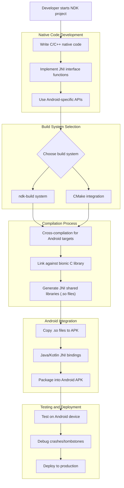
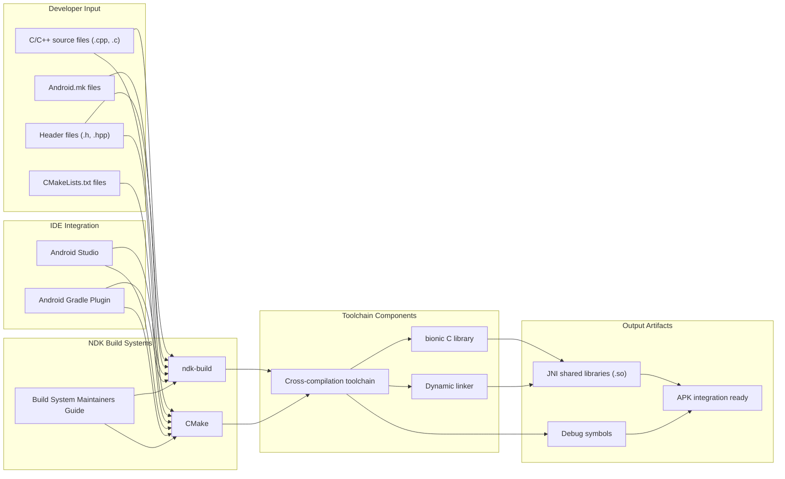

<!-- source: DeepWiki mcp.deepwiki.com · repo android/ndk · page 3 Developer Workflow · fetched 2026-10-23 -->

# Developer Workflow

Relevant source files

The following files were used as context for generating this wiki page:

- [README.md](README.md)

This document guides developers through the complete workflow of using the Android NDK for native development. It covers the practical steps from writing native C/C++ code to integrating JNI shared libraries into Android applications.

For information about the NDK's internal architecture and runtime environment, see [NDK Architecture](#2). For getting started with basic setup and initial guidance, see [Getting Started](#3.1). For debugging techniques and tools, see [Debugging and Profiling](#3.2).

## Purpose and Scope

The NDK enables Android application developers to include native code in their applications, compiled as JNI shared libraries. This workflow documentation focuses on the practical development process, build system choices, and integration steps that developers follow when incorporating native code into their Android projects.

Sources: [README.md:3-4]()

## Complete Developer Workflow

The NDK development process follows a structured workflow from native code development through final APK integration. The following diagram illustrates the complete development pipeline:

### NDK Development Pipeline

Sources: [README.md:3-4](), [README.md:69-71]()

## Build System Architecture

The NDK supports two primary build systems, each with distinct workflows and tooling integration:

### Build System Components and Integration

Sources: [README.md:69-71]()

## Build System Selection

Developers must choose between two supported build systems, each with distinct characteristics:

| Build System | Configuration Files | Integration | Use Cases |
|--------------|-------------------|-------------|-----------|
| `ndk-build` | `Android.mk`, `Application.mk` | Native NDK system | Traditional NDK projects, existing makefiles |
| `CMake` | `CMakeLists.txt` | Cross-platform | Modern projects, existing CMake codebases |

Both systems are supported out of the box by the NDK and Android Studio. The choice depends on project requirements and existing build infrastructure.

Sources: [README.md:69-70]()

## Native Code Development Process

The native code development process involves several key components and APIs:

### Core Development Components

1. **Native Code Implementation**: C/C++ source files containing application logic
2. **JNI Interface Functions**: Bridge functions enabling Java/Kotlin to native code communication  
3. **Android-Specific APIs**: Specialized APIs for platform integration

### Specialized API Categories

The NDK provides tutorial information and APIs for specialized use cases:

- **High-Performance Audio**: Low-latency audio processing and playback
- **Vulkan Graphics**: High-performance graphics rendering
- **Neural Networks**: Machine learning and AI acceleration

Sources: [README.md:33-36]()

## Compilation and Runtime Integration

The compilation process integrates with Android's runtime environment through several key components:

### Runtime Dependencies

| Component | Purpose | Documentation Reference |
|-----------|---------|------------------------|
| `bionic` C library | Android's C standard library implementation | Android bionic status |
| Dynamic linker | Loads and links `.so` files at runtime | Android changes for NDK developers |
| ABI compatibility | Ensures proper 32-bit and 64-bit support | 32-bit ABI bugs documentation |

The compilation process must account for these runtime dependencies to ensure proper library loading and execution on Android devices.

Sources: [README.md:40-51]()

## Testing and Debugging Workflow

The testing and debugging workflow includes several critical steps:

### Debugging Resources

1. **Crash Analysis**: Understanding crash dumps and tombstones for native code failures
2. **Common Crashes**: Reference documentation for typical native code crash patterns  
3. **Debugging Tools**: Profiling and debugging techniques specific to NDK development

The Android OS developer documentation provides comprehensive resources for understanding and diagnosing native code issues.

Sources: [README.md:32](), [README.md:55-60]()

## Developer Resources and Documentation

The NDK workflow relies on several key documentation and community resources:

### Essential Documentation

| Resource | Purpose | Location |
|----------|---------|----------|
| NDK Guides | Getting started and core concepts | Android Developer website |
| NDK API Reference | Complete API documentation | Android Developer website |
| Build System Maintainers Guide | Advanced build system customization | AOSP NDK documentation |

### Community Support

- **android-ndk Google Group**: Primary discussion forum for NDK-related questions
- **GitHub Issues**: Bug reporting and feature requests at `https://github.com/android-ndk/ndk/issues`
- **Release Calendar**: Upcoming NDK release schedule and milestones

### Development Planning

- **Milestones**: Current development priorities and upcoming features
- **NDK Roadmap**: Long-term development direction and planned enhancements

Sources: [README.md:6-10](), [README.md:23-38](), [README.md:64-68]()

## Integration with Android Development Ecosystem

The NDK workflow integrates seamlessly with the broader Android development ecosystem:

### IDE and Build Tool Integration

The NDK works with standard Android development tools:
- **Android Studio**: Full IDE support for NDK projects
- **Android Gradle Plugin**: Build system integration for automated compilation
- **Build system flexibility**: Support for both `ndk-build` and `CMake` workflows

This integration ensures that NDK development fits naturally into existing Android development workflows and toolchains.

Sources: [README.md:69-70]()

---

