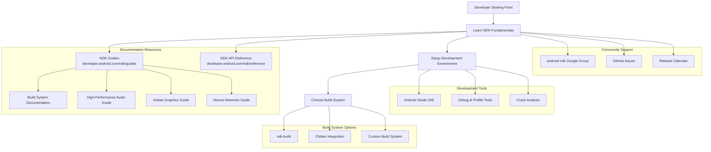
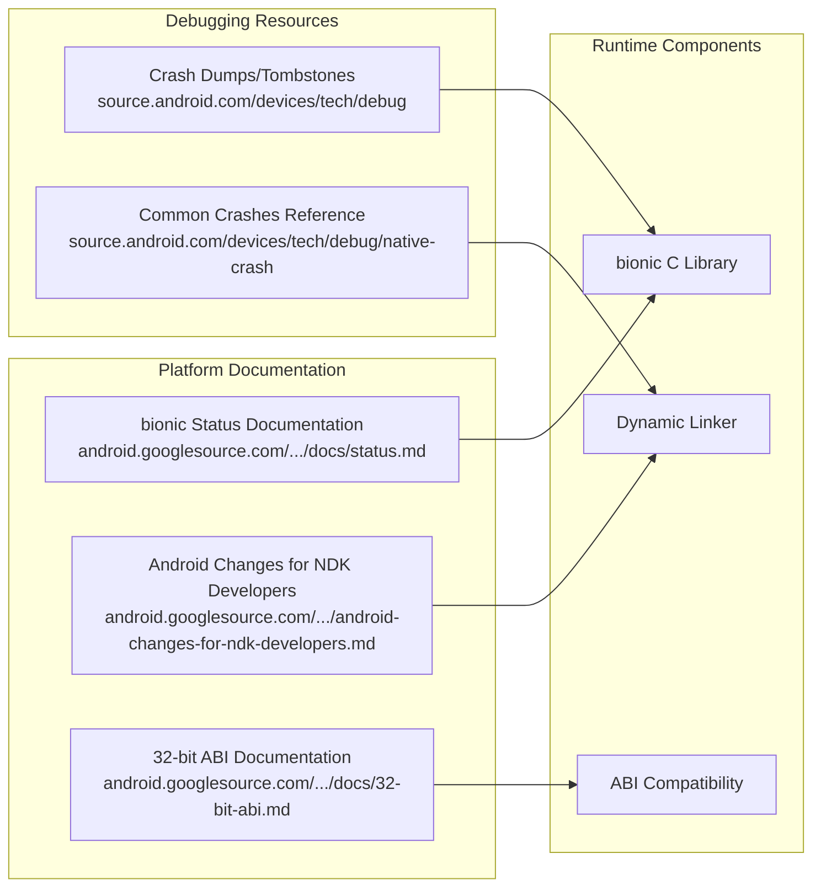
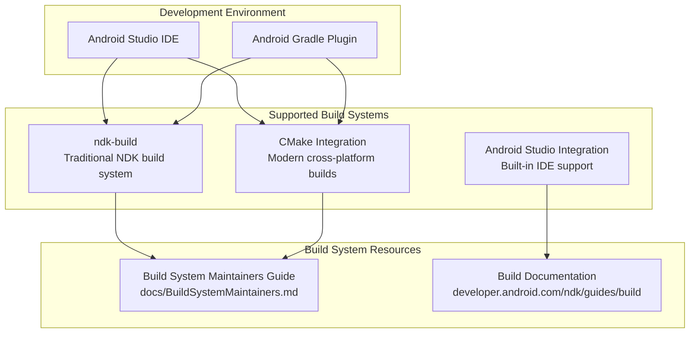
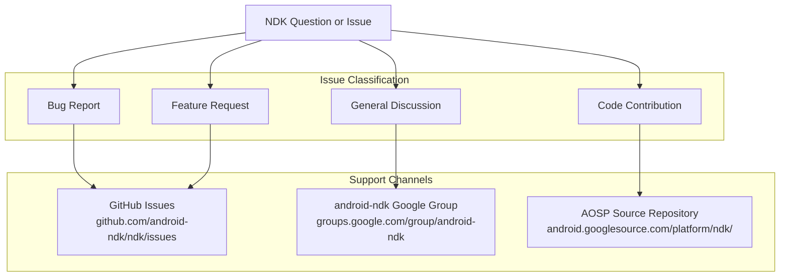

<!-- source: DeepWiki mcp.deepwiki.com · repo android/ndk · page 3.1 Getting Started · fetched 2026-10-23 -->

# Getting Started

Relevant source files

The following files were used as context for generating this wiki page:

- [README.md](README.md)

## Purpose and Scope

This document provides entry-level guidance for developers new to the Android Native Development Kit (NDK). It covers the fundamental concepts, initial setup workflow, documentation resources, and community support channels needed to begin native Android development. For detailed information about NDK architecture and runtime environment, see [NDK Architecture](#2). For advanced debugging and profiling techniques, see [Debugging and Profiling](#3.2).

## What is the Android NDK

The Android NDK allows Android application developers to include native C/C++ code in their Android application packages, compiled as JNI shared libraries. This enables developers to leverage existing C/C++ codebases, achieve performance-critical optimizations, and access platform-specific functionality not available through the Android SDK alone.

The NDK provides cross-compilation toolchains, build system integration, and Android-specific APIs that bridge native code with the Android runtime environment.

Sources: [README.md:1-4]()

## Developer Journey Overview

The following diagram illustrates the typical workflow for developers getting started with the NDK:

### NDK Developer Onboarding Workflow

Sources: [README.md:23-38, 64-73]()

## Essential Documentation Resources

The NDK documentation is organized into several key areas that new developers should explore:

### Core Documentation Structure

| Resource | Purpose | Location |
|----------|---------|----------|
| NDK Guides | Getting started tutorials and core concepts | `developer.android.com/ndk/guides/` |
| API Reference | Complete Android-specific API documentation | `developer.android.com/ndk/reference` |
| Build System Guides | Information about building native code | `developer.android.com/ndk/guides/build` |
| Debug & Profile Guides | Debugging and profiling native applications | `developer.android.com/ndk/guides/debug` |

### Specialized API Guides

The NDK provides dedicated documentation for performance-critical domains:

- **High-Performance Audio**: Tutorial information for audio applications requiring low latency
- **Vulkan Graphics**: Modern graphics API integration for high-performance rendering
- **Neural Networks**: Machine learning and AI inference capabilities

Sources: [README.md:25-38]()

## Platform Integration Documentation

Understanding the Android platform integration is crucial for NDK development:

### Runtime Environment Documentation

### Key Platform Documentation Areas

1. **bionic C Library Status**: Details available APIs across Android releases and behavioral changes between API levels
2. **Dynamic Linker Changes**: Critical information for troubleshooting shared library loading issues
3. **ABI Compatibility**: Important considerations for 32-bit code development
4. **Crash Analysis**: Understanding tombstones and common native crash patterns

Sources: [README.md:40-61]()

## Build System Integration

The NDK supports multiple build systems to accommodate different development workflows:

### Build System Support Matrix

Both `ndk-build` and CMake are supported out of the box by the NDK and Android Studio. For developers maintaining custom build systems, the Build System Maintainers Guide provides detailed integration information.

Sources: [README.md:69-72]()

## Community Support Channels

The NDK community provides multiple channels for support and collaboration:

### Support Channel Organization

| Channel | Purpose | Access |
|---------|---------|--------|
| android-ndk Google Group | General discussions and community support | `groups.google.com/group/android-ndk` |
| GitHub Issues | Bug reports and feature requests | `github.com/android-ndk/ndk/issues` |
| Release Calendar | Upcoming release information | `github.com/android-ndk/ndk/wiki` |
| AOSP Source | Contributing to NDK development | `android.googlesource.com/platform/ndk/` |

### Getting Help Workflow

For structured issue reporting and comprehensive community support processes, see [Community Support and Issue Management](#4).

Sources: [README.md:64-73]()

## Next Steps

After reviewing this getting started information, developers should:

1. **Explore the NDK Guides**: Begin with the comprehensive tutorials at `developer.android.com/ndk/guides/`
2. **Set up the development environment**: Configure Android Studio with NDK support
3. **Choose a build system**: Evaluate `ndk-build` vs CMake based on project requirements
4. **Join the community**: Subscribe to the android-ndk Google Group for ongoing support
5. **Review specialized APIs**: Investigate High-Performance Audio, Vulkan, or Neural Networks guides as needed

For detailed workflow information and advanced development practices, continue to [Debugging and Profiling](#3.2).

Sources: [README.md:1-74]()

---

