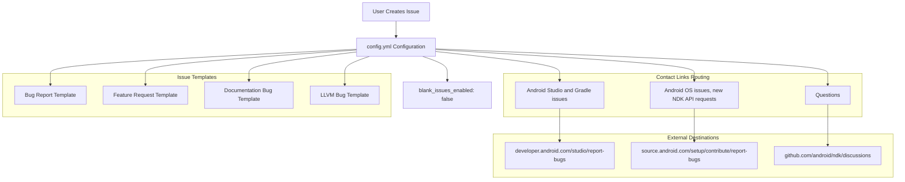
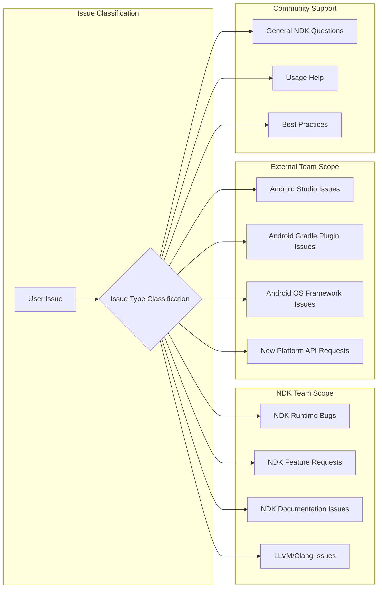
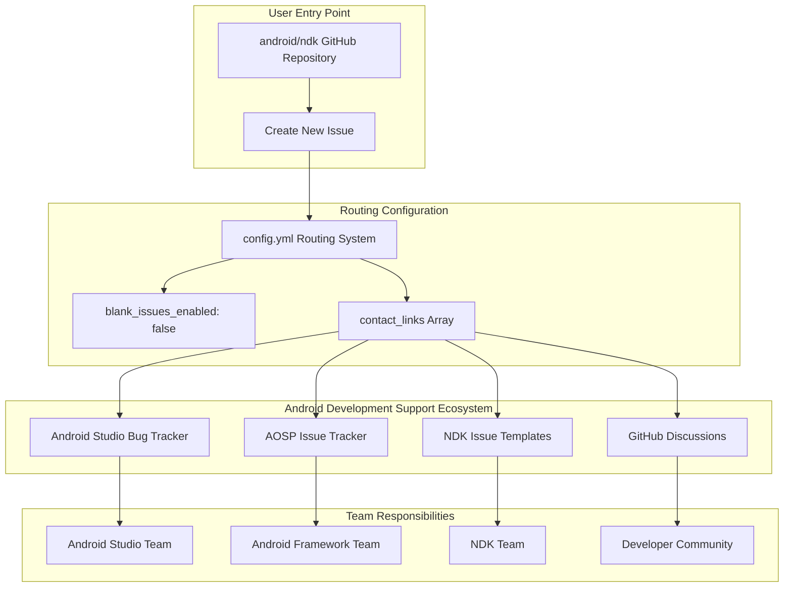

<!-- source: DeepWiki mcp.deepwiki.com · repo android/ndk · page 4 Community Support and Issue Management · fetched 2026-10-23 -->

# Community Support and Issue Management

Relevant source files

The following files were used as context for generating this wiki page:

- [.github/ISSUE_TEMPLATE/config.yml](.github/ISSUE_TEMPLATE/config.yml)

## Purpose and Scope

This document provides an overview of the comprehensive issue management system and community support channels for the Android NDK. It explains how user-submitted issues are automatically routed to appropriate teams and support channels through a sophisticated GitHub configuration system.

For detailed information about the technical implementation of issue routing, see [Issue Routing System](#4.1). For specific bug reporting processes and templates, see [Bug Reporting Process](#4.2). For feature request and documentation workflows, see [Feature Requests and Documentation Issues](#4.3).

## Issue Management Architecture

The NDK project implements a sophisticated issue management system that automatically routes user inquiries to the most appropriate support channels. This system prevents misdirected issues and ensures users receive help from the correct teams.

### GitHub Issue Routing Configuration

The core of the issue management system is implemented through GitHub's issue template configuration, which disables blank issue creation and provides structured routing options.

**Issue Routing System Configuration**

Sources: [.github/ISSUE_TEMPLATE/config.yml:1-31]()

The routing system is configured through three main contact links defined in the `config.yml` file:

| Route | URL | Purpose |
|-------|-----|---------|
| Android Studio and Gradle issues | `https://developer.android.com/studio/report-bugs` | Redirects IDE and build plugin issues to Android Studio team |
| Android OS issues, new NDK API requests | `https://source.android.com/setup/contribute/report-bugs` | Routes platform-level issues to AOSP Framework component |
| Questions | `https://github.com/android/ndk/discussions` | Directs general questions to GitHub Discussions forum |

## Issue Classification and Routing Logic

The system automatically classifies and routes issues based on their nature, preventing the NDK team from handling issues outside their scope.

**Issue Classification Matrix**

Sources: [.github/ISSUE_TEMPLATE/config.yml:4-10](), [.github/ISSUE_TEMPLATE/config.yml:11-20](), [.github/ISSUE_TEMPLATE/config.yml:21-30]()

### Android Studio and Gradle Issues

Issues related to Android Studio IDE or Android Gradle Plugin are automatically redirected because they are maintained by separate teams. The configuration explicitly states that such issues "are not handled by this team and must be filed against the Android Studio team."

**Key characteristics of redirected issues:**
- IDE functionality problems
- Build system integration issues
- Gradle plugin configuration problems
- Android Studio-specific debugging issues

### Android OS and Framework Issues

Device and OS-level issues typically cannot be fixed in the NDK itself. These are routed to the AOSP Framework component with specific guidance to avoid using the NDK component in the bug tracker.

**Routing guidance from config.yml:**
- "Do not use the NDK component. That will just bring you back here"
- Users should select the "Framework component for this type of bug"
- NDK team may add workarounds, but core fixes must come from OS team

### Community Questions and Discussions

General questions and usage inquiries are directed to GitHub Discussions to maintain separation between bug reports and community support.

## Integration with Android Development Ecosystem

The NDK issue management system integrates with the broader Android development support infrastructure, ensuring users receive appropriate help regardless of their issue's scope.

**Ecosystem Integration Points**

Sources: [.github/ISSUE_TEMPLATE/config.yml:1-31]()

The issue management system serves as a critical routing hub that connects users with the appropriate support resources across the Android development ecosystem. This prevents issue duplication and ensures efficient resource utilization across different Android development teams.

## Community Support Channels

The NDK project provides multiple support channels tailored to different types of user needs:

### GitHub Discussions Forum
Primary venue for questions, usage help, and community interaction. The forum handles:
- General NDK usage questions
- Best practices discussions
- Community-driven troubleshooting
- Feature discussion and feedback

### Structured Issue Templates
For confirmed bugs and feature requests, users can access specialized templates that gather necessary technical information for effective triage and resolution.

### Documentation and Guides
Comprehensive documentation resources help users find answers to common questions without requiring direct support interaction.

The routing system's effectiveness relies on clear communication about scope boundaries and appropriate escalation paths, ensuring users receive timely and relevant assistance from the most qualified support resources.

Sources: [.github/ISSUE_TEMPLATE/config.yml:1-31]()

---

