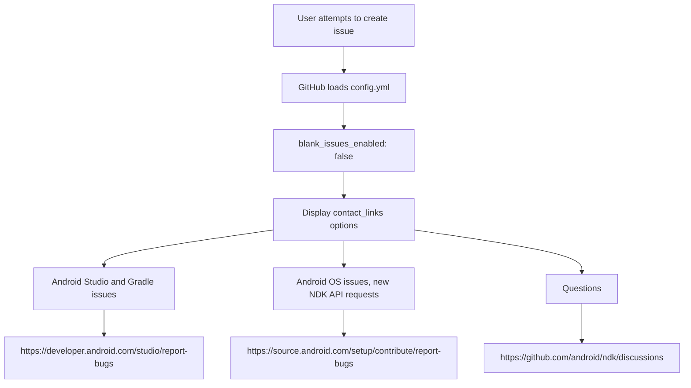
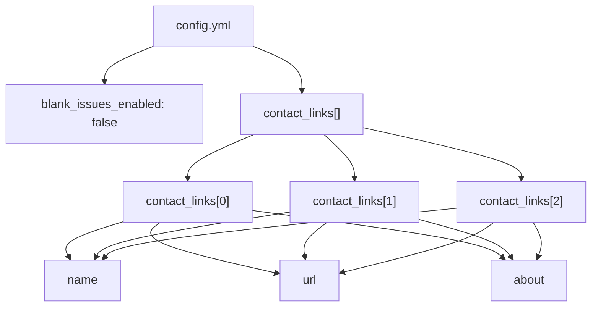
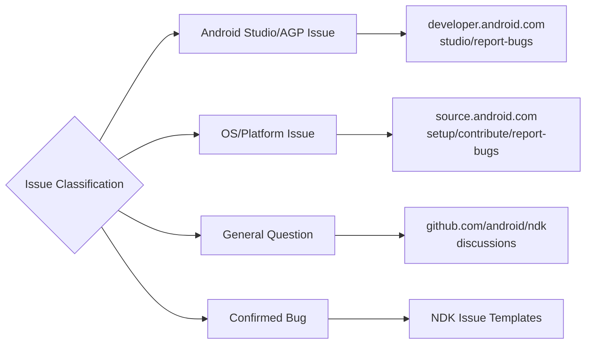

<!-- source: DeepWiki mcp.deepwiki.com · repo android/ndk · page 4.1 Issue Routing System · fetched 2026-10-23 -->

# Issue Routing System

Relevant source files

The following files were used as context for generating this wiki page:

- [.github/ISSUE_TEMPLATE/config.yml](.github/ISSUE_TEMPLATE/config.yml)

## Purpose and Scope

The Issue Routing System is a GitHub issue template configuration that automatically directs users to appropriate support channels before they can create new issues in the Android NDK repository. This system prevents inappropriate issues from being filed directly against the NDK team by routing Android Studio, Android OS, and general questions to their respective specialized support channels.

For information about the bug reporting templates that users access after being routed to the NDK repository, see [Bug Reporting Process](#4.2). For details about feature request and documentation issue templates, see [Feature Requests and Documentation Issues](#4.3).

## System Overview

The Issue Routing System operates through GitHub's issue template configuration mechanism, implemented via a single YAML configuration file that defines contact links and routing rules. When users attempt to create a new issue, they are presented with categorized options that direct them to external resources rather than allowing direct issue creation.

**Issue Routing System Flow**

Sources: [.github/ISSUE_TEMPLATE/config.yml:1-31]()

## Configuration Structure

The routing system is implemented through a YAML configuration file that defines two primary components: blank issue control and contact link routing.

| Configuration Key | Value | Purpose |
|------------------|-------|---------|
| `blank_issues_enabled` | `false` | Prevents users from creating blank issues without templates |
| `contact_links` | Array of link objects | Defines routing destinations with descriptions |

Each contact link object contains three required fields:

| Field | Type | Purpose |
|-------|------|---------|
| `name` | String | Display title for the routing option |
| `url` | String | External destination URL |
| `about` | String | Detailed explanation of when to use this route |

**YAML Configuration Structure Mapping**

Sources: [.github/ISSUE_TEMPLATE/config.yml:1-3]() [.github/ISSUE_TEMPLATE/config.yml:3-31]()

## Routing Logic and Destinations

The system implements three distinct routing paths based on issue categorization:

### Android Studio and Gradle Issues Routing

This route handles issues related to Android Studio IDE and Android Gradle Plugin integration. The configuration explicitly states these issues are not handled by the NDK team.

- **Route Name**: "Android Studio and Gradle issues"
- **Destination**: `https://developer.android.com/studio/report-bugs`
- **Trigger Conditions**: Issues involving Android Studio IDE, Android Gradle Plugin, or build integration problems
- **Warning Message**: "Android Studio and AGP bugs filed in this bug tracker will be closed and you'll be asked to refile them with Android Studio"

### Android OS and NDK API Requests Routing

This route directs platform-level issues and new API requests to the Android Open Source Project bug tracker.

- **Route Name**: "Android OS issues, new NDK API requests"
- **Destination**: `https://source.android.com/setup/contribute/report-bugs`
- **Trigger Conditions**: Device issues, OS-level bugs, requests for new NDK APIs
- **Component Warning**: "Do not use the NDK component. That will just bring you back here. You almost always want the Framework component for this type of bug"

### Questions and Discussion Routing

This route channels general questions and clarification requests to GitHub Discussions.

- **Route Name**: "Questions"
- **Destination**: `https://github.com/android/ndk/discussions`
- **Trigger Conditions**: General NDK questions not covered by bug reports
- **Exception**: "If your question is 'Can you confirm if this is a bug?', go ahead and file it as a bug"

**Issue Classification and Routing Destinations**

Sources: [.github/ISSUE_TEMPLATE/config.yml:4-10]() [.github/ISSUE_TEMPLATE/config.yml:11-20]() [.github/ISSUE_TEMPLATE/config.yml:21-31]()

## Implementation Details

### Blank Issues Prevention

The `blank_issues_enabled: false` configuration prevents users from bypassing the routing system by creating issues without using templates. This ensures all issue creation attempts are directed through the contact links system.

### Contact Link Validation

Each contact link requires all three fields (`name`, `url`, `about`) to be properly formatted. The `about` field supports multi-line YAML strings using the `>` folding operator for improved readability.

### Routing Enforcement

The system operates at the GitHub repository level and cannot be bypassed by users. When users navigate to create a new issue, GitHub's interface presents only the configured contact links, with no option to create blank issues.

### External Integration Points

The routing destinations integrate with three external systems:

1. **Android Studio Bug Tracker**: Managed by the Android Studio team for IDE and build system issues
2. **AOSP Bug Tracker**: Handles Android OS and framework-level issues using component-based classification
3. **GitHub Discussions**: Provides a community forum for questions and general discussion

Sources: [.github/ISSUE_TEMPLATE/config.yml:2]() [.github/ISSUE_TEMPLATE/config.yml:6-10]() [.github/ISSUE_TEMPLATE/config.yml:13-17]() [.github/ISSUE_TEMPLATE/config.yml:23-26]()

---

