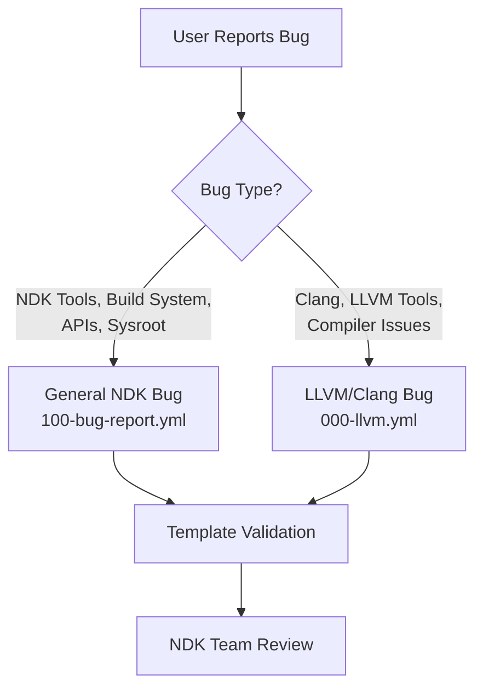
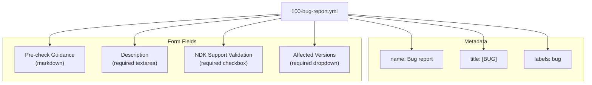
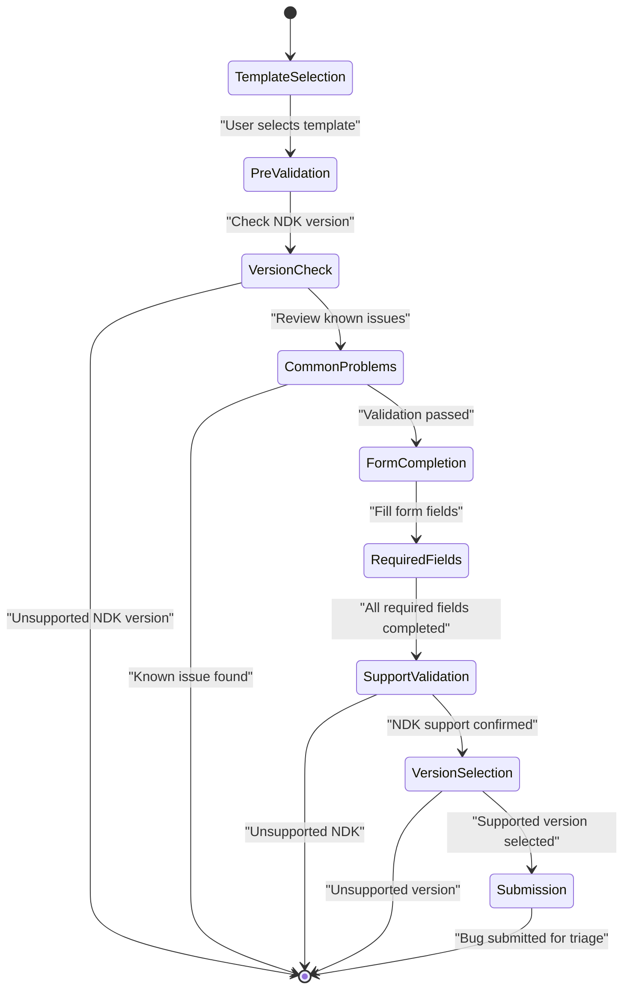

<!-- source: DeepWiki mcp.deepwiki.com · repo android/ndk · page 4.2 Bug Reporting Process · fetched 2026-10-23 -->

# Bug Reporting Process

Relevant source files

The following files were used as context for generating this wiki page:

- [.github/ISSUE_TEMPLATE/000-llvm.yml](.github/ISSUE_TEMPLATE/000-llvm.yml)
- [.github/ISSUE_TEMPLATE/100-bug-report.yml](.github/ISSUE_TEMPLATE/100-bug-report.yml)

## Purpose and Scope

This document details the structured bug reporting templates used in the Android NDK GitHub repository for collecting standardized bug reports. It covers the two primary bug report templates: general NDK bug reports and LLVM-specific bug reports, along with their validation requirements and submission processes.

For information about the broader issue routing system that directs users to these templates, see [Issue Routing System](#4.1). For details on feature requests and documentation issues, see [Feature Requests and Documentation Issues](#4.3).

## Bug Report Template Overview

The NDK uses GitHub Issue Templates to provide structured forms for bug reporting. Two specialized templates handle different categories of bugs, each with tailored fields and validation requirements.

### Bug Report Template Selection Flow

Sources: [.github/ISSUE_TEMPLATE/100-bug-report.yml:1-80](), [.github/ISSUE_TEMPLATE/000-llvm.yml:1-127]()

## General Bug Report Template

The general bug report template handles issues related to NDK core functionality, build systems, APIs, and toolchain components.

### Template Structure and Fields

Sources: [.github/ISSUE_TEMPLATE/100-bug-report.yml:1-80]()

### Pre-submission Validation Requirements

The template enforces several validation steps before bug submission:

| Validation Step | Requirement | Location |
|----------------|-------------|----------|
| Latest NDK Version | Must use current stable or preview release | [.github/ISSUE_TEMPLATE/100-bug-report.yml:11-14]() |
| Common Problems Check | Must verify issue not in known problems list | [.github/ISSUE_TEMPLATE/100-bug-report.yml:17-19]() |
| Supported NDK Confirmation | Required checkbox validation | [.github/ISSUE_TEMPLATE/100-bug-report.yml:42-51]() |
| Version Selection | Must select from supported versions only | [.github/ISSUE_TEMPLATE/100-bug-report.yml:52-80]() |

### Test Case Requirements

The template specifies detailed requirements for test cases in the description field:

- **Minimal reproduction**: Test case should be as small as possible while exposing the bug
- **Independence**: Must not require Android Studio or Gradle dependencies
- **Completeness**: Code must compile in absence of the reported bug
- **Submission methods**: Git repository links (preferred), zip attachments, gists, or inline code

Sources: [.github/ISSUE_TEMPLATE/100-bug-report.yml:20-41]()

## LLVM Bug Report Template

The LLVM bug report template handles compiler-related issues, including Clang crashes, miscompiles, and LLVM tool problems.

### Template Structure and Additional Fields

```mermaid
flowchart TB
    Template["000-llvm.yml"]
    
    subgraph "Metadata"
        Name["name: LLVM Bug"]
        Title["title: [Bug]: "]
        Labels["labels: [bug, llvm]"]
    end
    
    subgraph "Core Fields"
        PreCheck["Pre-check Guidance"]
        Description["Description<br/>(required)"]
    end
    
    subgraph "LLVM-Specific Fields"
        UpstreamBug["Upstream Bug URL<br/>(optional)"]
        CherryPick["Commit to Cherry-pick<br/>(optional)"]
    end
    
    subgraph "Environment Fields"
        SupportCheck["NDK Support Validation<br/>(required)"]
        Versions["Affected Versions<br/>(required)"]
        HostOS["Host OS<br/>(required)"]
        HostVersion["Host OS Version<br/>(required)"]
        ABIs["Affected ABIs<br/>(required)"]
    end
    
    Template --> Name
    Template --> Title
    Template --> Labels
    Template --> PreCheck
    Template --> Description
    Template --> UpstreamBug
    Template --> CherryPick
    Template --> SupportCheck
    Template --> Versions
    Template --> HostOS
    Template --> HostVersion
    Template --> ABIs
```

Sources: [.github/ISSUE_TEMPLATE/000-llvm.yml:1-127]()

### LLVM-Specific Validation and Features

The LLVM template includes additional fields and validation specific to compiler issues:

| Field | Type | Purpose | Required |
|-------|------|---------|----------|
| `upstream_bug` | input | Link to LLVM GitHub issue | No |
| `commit_cherry_pick` | input | Git SHA of upstream fix | No |
| `host_os` | dropdown | Operating system (Linux/Mac/Windows) | Yes |
| `host_os_version` | input | Specific OS version | Yes |
| `affected_abis` | dropdown | Target architectures | Yes |

The template also provides guidance for crash reproduction artifacts and upstream bug tracking:

- **Crash artifacts**: Clang generates zip files with reproduction data required for investigation
- **Upstream coordination**: Bugs can be filed directly in LLVM GitHub or through NDK for backporting
- **Environment specificity**: Host OS and target ABI combinations are tracked for compatibility issues

Sources: [.github/ISSUE_TEMPLATE/000-llvm.yml:44-127]()

## Template Validation Process

Both templates implement a multi-stage validation process to ensure bug report quality and proper routing.

### Validation Workflow

Sources: [.github/ISSUE_TEMPLATE/100-bug-report.yml:11-19](), [.github/ISSUE_TEMPLATE/000-llvm.yml:13-21]()

### Supported NDK Version Enforcement

Both templates enforce strict NDK version support through dropdown validation:

- **Current supported versions**: `r27`, `r28` (as of template creation)
- **Version detection**: Users guided to check `android.ndkVersion` in AGP projects or `$NDK/source.properties`
- **Unity-specific guidance**: Unity projects often use unsupported NDK versions and should file bugs with Unity
- **Canary build support**: Development builds accepted with build number specification

The templates automatically reject submissions for unsupported NDK versions through required validation checkboxes and restricted dropdown options.

Sources: [.github/ISSUE_TEMPLATE/100-bug-report.yml:42-80](), [.github/ISSUE_TEMPLATE/000-llvm.yml:62-99]()

---

