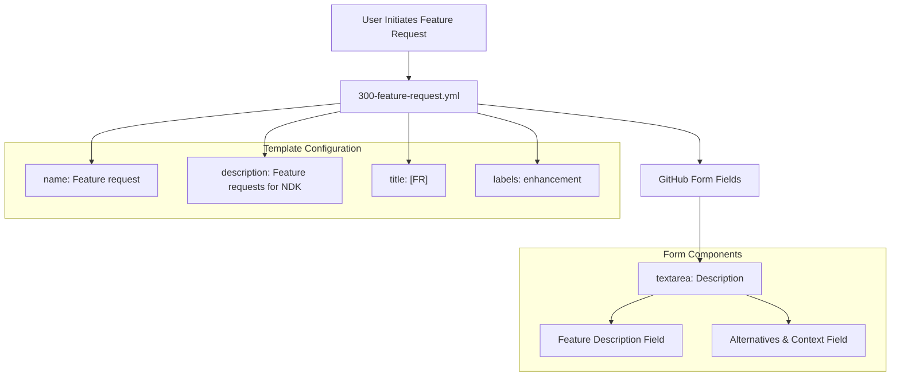
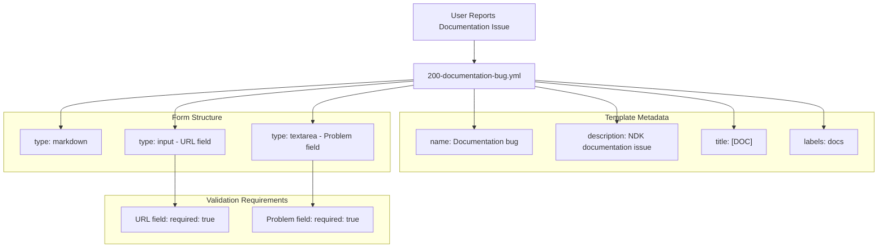
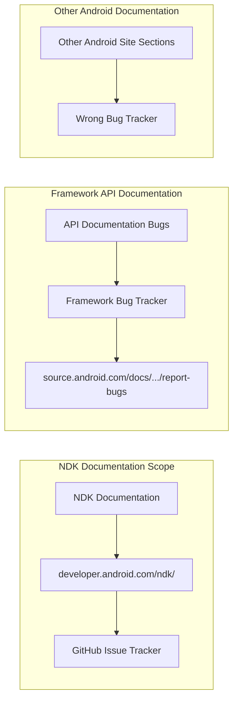

<!-- source: DeepWiki mcp.deepwiki.com · repo android/ndk · page 4.3 Feature Requests and Documentation Issues · fetched 2026-10-23 -->

# Feature Requests and Documentation Issues

<details>
<summary>Relevant source files</summary>

The following files were used as context for generating this wiki page:

- [.github/ISSUE_TEMPLATE/200-documentation-bug.yml](.github/ISSUE_TEMPLATE/200-documentation-bug.yml)
- [.github/ISSUE_TEMPLATE/300-feature-request.yml](.github/ISSUE_TEMPLATE/300-feature-request.yml)

</details>


This document covers the specific processes for submitting feature requests and reporting documentation issues for the Android NDK project through GitHub's issue template system. These templates provide structured workflows for community members to request new NDK capabilities and report problems with NDK documentation.

For general bug reporting procedures, see [Bug Reporting Process](#4.2). For the broader issue routing system that directs users to appropriate channels, see [Issue Routing System](#4.1).

## Feature Request Process

The NDK project uses a structured GitHub issue template to collect feature requests from the community. The template is specifically designed for NDK-related features and explicitly excludes requests for Android APIs, Gradle, or Android Studio functionality.

### Feature Request Template Structure

The feature request template follows a YAML-based configuration that creates a guided form for users:



**Sources:** [.github/ISSUE_TEMPLATE/300-feature-request.yml:1-15]()

### Feature Request Scope and Guidelines

The template establishes clear boundaries for what constitutes a valid NDK feature request:

| Valid NDK Feature Requests | Invalid Requests (Redirected) |
|---------------------------|--------------------------------|
| Native development tools improvements | Android Framework API changes |
| Build system enhancements | Gradle plugin features |
| Cross-compilation toolchain updates | Android Studio IDE features |
| NDK API additions | Android OS functionality |

The template description explicitly states the scope: "Feature requests for the NDK. **Not for Android APIs, Gradle, or Android Studio features.**" This helps filter requests to ensure they reach the appropriate development team.

**Sources:** [.github/ISSUE_TEMPLATE/300-feature-request.yml:3-5]()

## Documentation Bug Reporting Process

The NDK project maintains a separate template for documentation-related issues, distinguishing between NDK documentation problems and broader Android documentation issues.

### Documentation Bug Template Configuration



**Sources:** [.github/ISSUE_TEMPLATE/200-documentation-bug.yml:1-33]()

### Documentation Scope Clarification

The template includes important routing information to prevent misdirected reports:



**Sources:** [.github/ISSUE_TEMPLATE/200-documentation-bug.yml:10-16]()

## Template Field Requirements and Validation

Both templates implement validation rules to ensure complete issue reports:

### Feature Request Fields

The feature request template contains a single comprehensive textarea field:

```yaml
- type: textarea
  attributes:
    label: Description
    description: >
      Describe the new feature, and how it would help. Include any
      alternatives or additional context that might be helpful.
```

This field collects:
- Feature description
- Use case justification
- Alternative approaches considered
- Additional context

**Sources:** [.github/ISSUE_TEMPLATE/300-feature-request.yml:9-14]()

### Documentation Bug Fields

The documentation bug template requires two mandatory fields:

| Field | Type | Validation | Purpose |
|-------|------|------------|---------|
| URL | `input` | `required: true` | Location of incorrect documentation |
| Problem | `textarea` | `required: true` | Description of the issue |

**Sources:** [.github/ISSUE_TEMPLATE/200-documentation-bug.yml:17-32]()

## Template Integration with Issue Management

These templates integrate with the broader NDK issue management system through:

### Automated Labeling

Both templates automatically apply labels:
- Feature requests: `enhancement` label
- Documentation bugs: `docs` label

### Title Prefixing

Templates automatically prefix issue titles:
- Feature requests: `[FR]` prefix
- Documentation bugs: `[DOC]` prefix

This systematic labeling and prefixing enables automated filtering and routing within the issue management workflow.

**Sources:** [.github/ISSUE_TEMPLATE/300-feature-request.yml:6-7](), [.github/ISSUE_TEMPLATE/200-documentation-bug.yml:7-8]()

---

