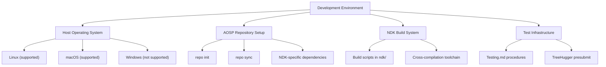
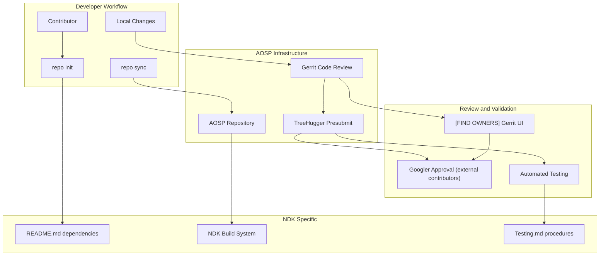
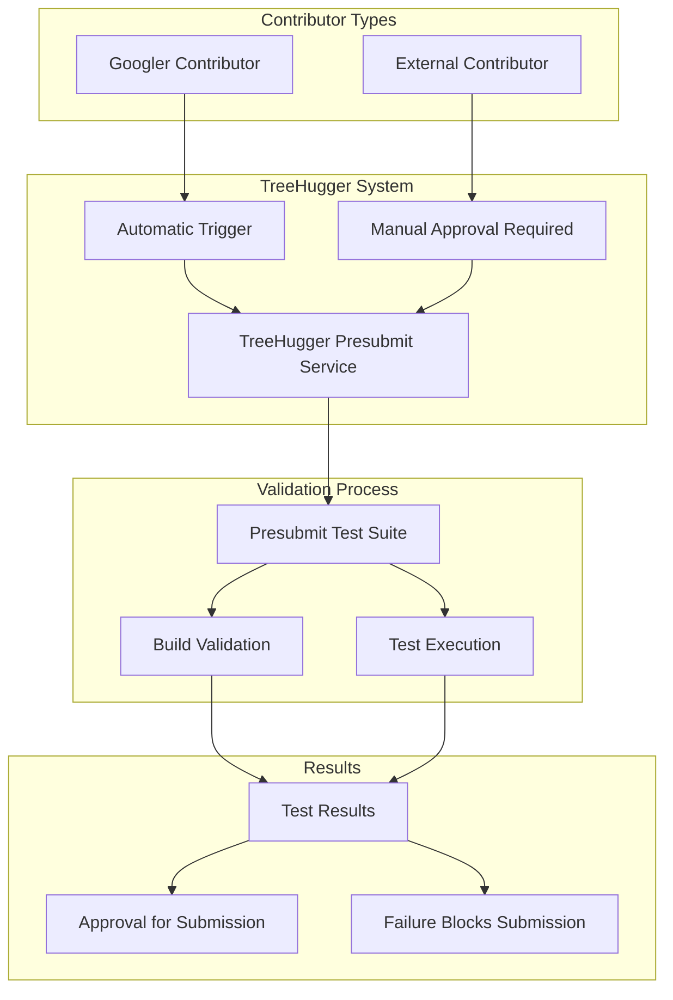

<!-- source: DeepWiki mcp.deepwiki.com · repo android/ndk · page 5 Contributing to the NDK · fetched 2026-10-23 -->

# Contributing to the NDK

<details>
<summary>Relevant source files</summary>

The following files were used as context for generating this wiki page:

- [CONTRIBUTING.md](CONTRIBUTING.md)

</details>


## Purpose and Scope

This document provides an overview of how to contribute to the Android NDK project, covering the essential processes for reporting issues, submitting patches, and participating in the development workflow. The NDK uses Android Open Source Project (AOSP) infrastructure rather than standard GitHub workflows, requiring contributors to work with Gerrit for code review and submission.

For detailed patch submission procedures, see [Patch Submission Workflow](#5.1). For testing requirements and validation processes, see [Testing and Validation](#5.2).

## Contribution Types

The NDK project accepts several types of contributions, each following specific workflows and requirements:

| Contribution Type | Platform | Process |
|------------------|----------|---------|
| Bug Reports | GitHub Issues | Template-based issue creation |
| Feature Requests | GitHub Issues | Structured feature request template |
| Code Patches | AOSP/Gerrit | Code review via Gerrit system |
| Documentation | AOSP/Gerrit | Same as code patches |
| Test Cases | AOSP/Gerrit | Integrated with patch submission |

**Note:** Bug reports for Android Studio or Gradle should be filed at the Android issue tracker, not in the NDK GitHub repository.

Sources: [CONTRIBUTING.md:1-43]()

## Development Environment Requirements

Contributing to the NDK requires a specific development environment setup that differs from typical GitHub-based projects:



**Host Platform Limitations**

The NDK build system only supports Linux and macOS (Darwin) host platforms. Windows is not supported for NDK development, though the NDK itself can target Windows applications through cross-compilation.

Sources: [CONTRIBUTING.md:32-33]()

## Contribution Workflow Overview

The NDK follows AOSP development practices, creating a workflow that integrates multiple systems for code review, testing, and submission:

```mermaid
graph LR
    subgraph "Issue Tracking"
        GitHubIssues["GitHub Issues"]
        IssueTemplates["Issue Templates"]
    end
    
    subgraph "Code Development"
        LocalDev["Local Development"]
        AOSPRepo["AOSP Repository"]
        ReadmeMd["README.md setup"]
    end
    
    subgraph "Review Process"
        GerritUpload["Gerrit Upload"]
        FindOwners["[FIND OWNERS] button"]
        CodeReview["Code Review"]
    end
    
    subgraph "Validation"
        TreeHugger["TreeHugger Presubmit"]
        TestingMd["Testing.md procedures"]
        Validation["Automated Validation"]
    end
    
    subgraph "Submission"
        GerritSubmit["Gerrit Submit"]
        AOSPIntegration["AOSP Integration"]
    end
    
    GitHubIssues --> IssueTemplates
    IssueTemplates --> LocalDev
    
    LocalDev --> AOSPRepo
    AOSPRepo --> ReadmeMd
    ReadmeMd --> GerritUpload
    
    GerritUpload --> FindOwners
    FindOwners --> CodeReview
    CodeReview --> TreeHugger
    
    TreeHugger --> TestingMd
    TestingMd --> Validation
    Validation --> GerritSubmit
    
    GerritSubmit --> AOSPIntegration
```

Sources: [CONTRIBUTING.md:19-41]()

## Key Development Systems

### AOSP Integration Architecture

The NDK's integration with AOSP infrastructure creates a multi-stage development pipeline:



### TreeHugger Presubmit System

TreeHugger serves as the automated presubmit validation system, with different access patterns based on contributor status:



Sources: [CONTRIBUTING.md:37-40]()

## Getting Started

To begin contributing to the NDK:

1. **Environment Setup**: Ensure you have a supported host platform (Linux or macOS)
2. **AOSP Checkout**: Follow AOSP contribution instructions and use NDK-specific `repo init` commands
3. **Dependency Installation**: Install NDK-specific dependencies as documented in `README.md`
4. **Build Verification**: Verify your environment can build the NDK successfully
5. **Test Execution**: Run the test suite to ensure your environment is properly configured

The NDK maintains different dependencies than standard AOSP, requiring careful attention to the setup instructions in the project's `README.md` file.

Sources: [CONTRIBUTING.md:26-33]()

---

