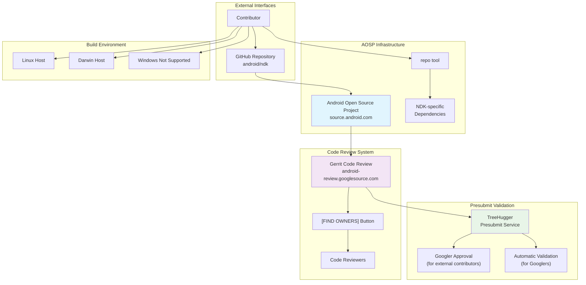
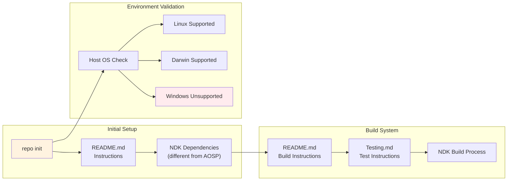
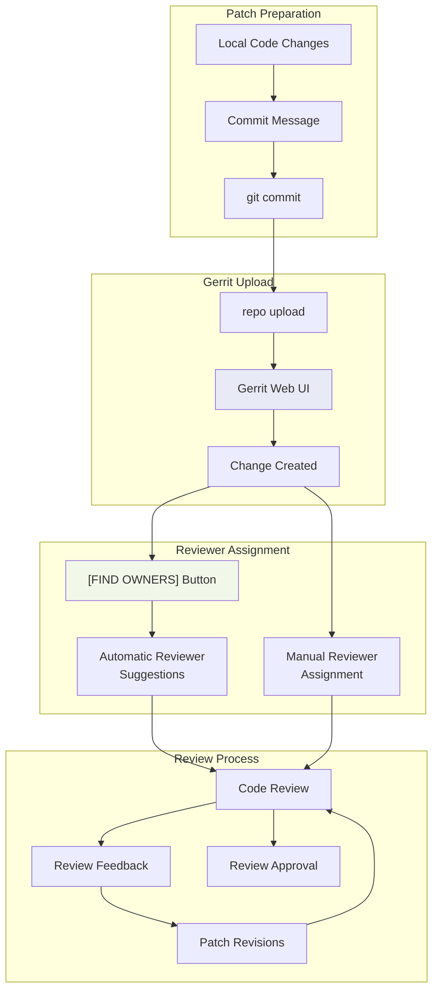
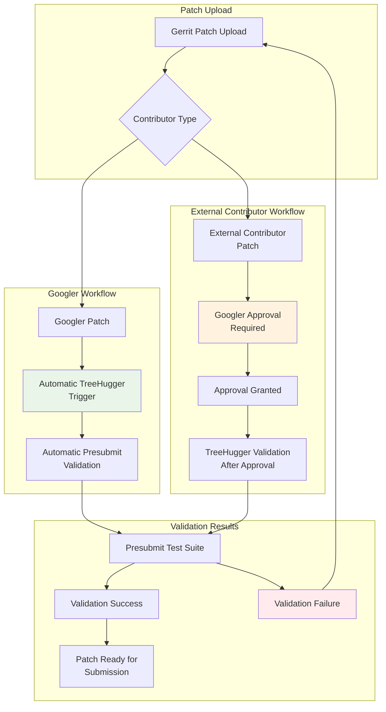
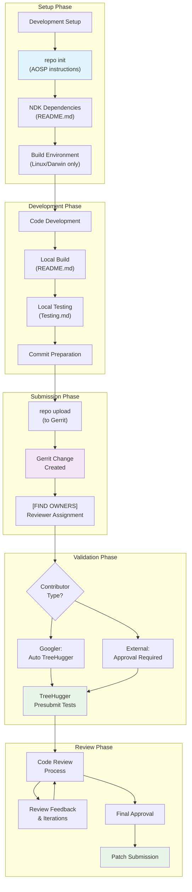

<!-- source: DeepWiki mcp.deepwiki.com · repo android/ndk · page 5.1 Patch Submission Workflow · fetched 2026-10-23 -->

# Patch Submission Workflow

Relevant source files

The following files were used as context for generating this wiki page:

- [CONTRIBUTING.md](CONTRIBUTING.md)

This document describes the complete workflow for submitting code contributions to the Android NDK project. It covers the AOSP-based development process, Gerrit code review system, and TreeHugger presubmit validation.

For information about bug reporting and issue management, see [Bug Reporting Process](#4.2). For testing requirements and validation procedures, see [Testing and Validation](#5.2).

## Overview

The Android NDK follows the Android Open Source Project (AOSP) contribution model rather than the typical GitHub pull request workflow. While the project uses GitHub for issue tracking and documentation, all code contributions must be submitted through Gerrit, Google's web-based code review system.

Sources: [CONTRIBUTING.md:22-29]()

## AOSP Integration Architecture

The NDK's contribution workflow is built on the AOSP infrastructure, requiring specific tools and processes distinct from standard GitHub-based projects.

**NDK Contribution Infrastructure**

Sources: [CONTRIBUTING.md:22-40]()

## Repository Setup Workflow

Contributors must set up their development environment using AOSP's `repo` tool rather than standard Git operations.

**Repository Initialization Process**

Sources: [CONTRIBUTING.md:27-33]()

## Gerrit Submission Process

The core patch submission workflow follows Gerrit's code review model, with specific NDK adaptations for reviewer assignment and validation.

**Patch Submission and Review Flow**

Sources: [CONTRIBUTING.md:35]()

## TreeHugger Presubmit System

TreeHugger serves as the NDK's presubmit validation service, with different workflows for Google employees versus external contributors.

**TreeHugger Validation Workflow**

Sources: [CONTRIBUTING.md:37-40]()

## Complete Contribution Pipeline

This diagram shows the end-to-end flow from initial development setup through final patch submission.

**End-to-End NDK Contribution Process**

Sources: [CONTRIBUTING.md:22-42]()

## Key Differences from GitHub Workflow

| Aspect | GitHub Workflow | NDK/AOSP Workflow |
|--------|----------------|-------------------|
| Code Hosting | GitHub repository | AOSP with Gerrit |
| Contribution Method | Pull requests | Gerrit changes |
| Repository Tool | `git clone` | `repo init` |
| Dependencies | Standard | NDK-specific (README.md) |
| Reviewer Assignment | Manual mention | `[FIND OWNERS]` button |
| Presubmit Testing | GitHub Actions/CI | TreeHugger |
| External Contributor Access | Direct | Requires Googler approval |
| Build Platforms | Any | Linux/Darwin only |

Sources: [CONTRIBUTING.md:22-33]()

## Documentation References

The patch submission workflow relies on several key documentation files within the NDK repository:

- **README.md**: Contains NDK-specific `repo init` instructions and dependency information
- **Testing.md**: Located at [docs/Testing.md](), provides comprehensive testing procedures
- **AOSP Contribution Guide**: External reference at source.android.com for general AOSP contribution procedures

Sources: [CONTRIBUTING.md:26-32]()

---

