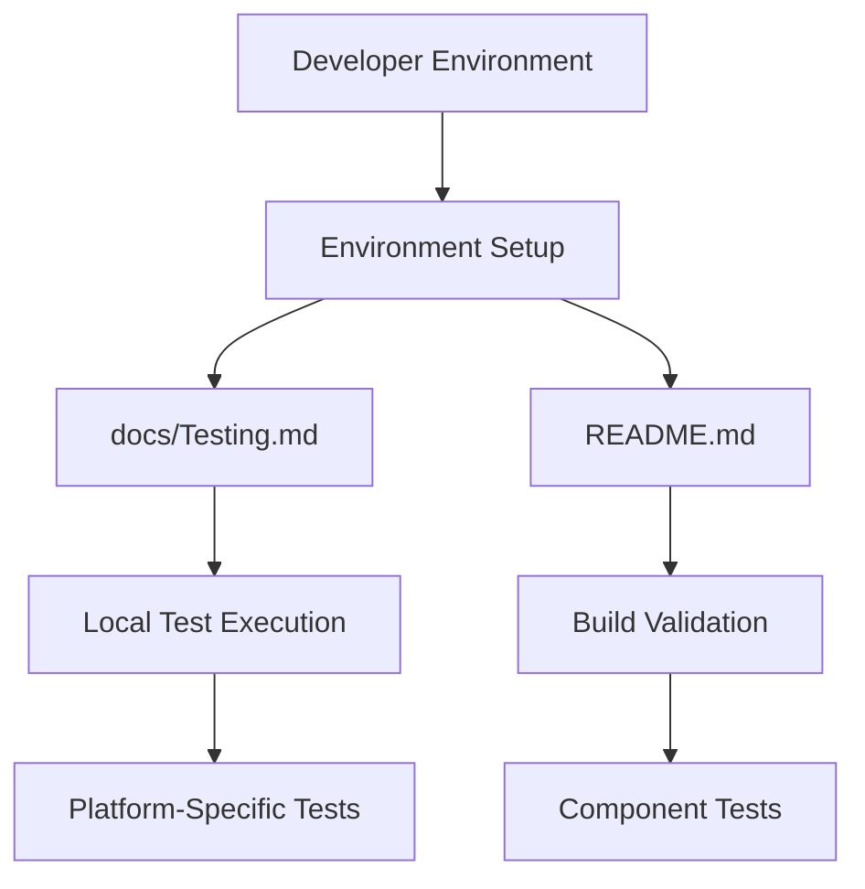
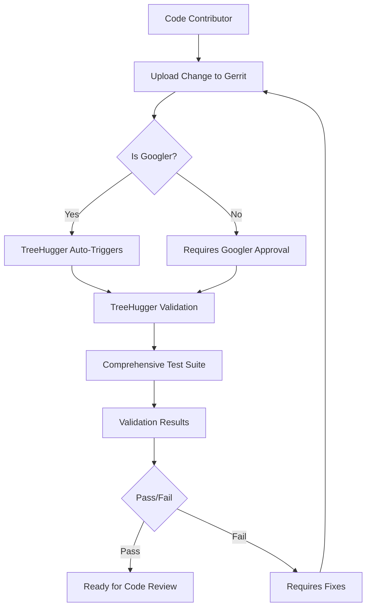
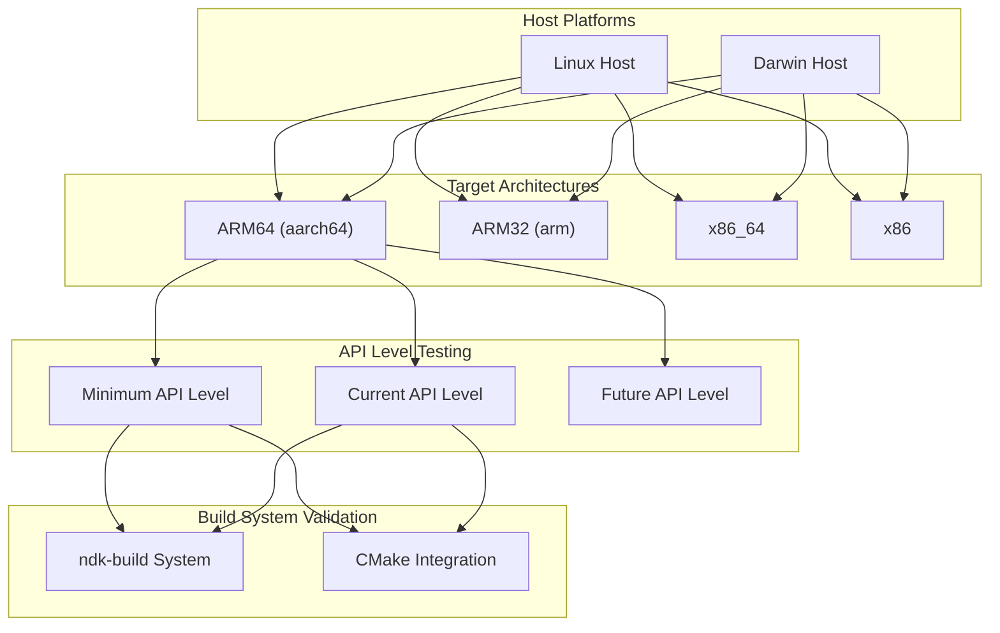
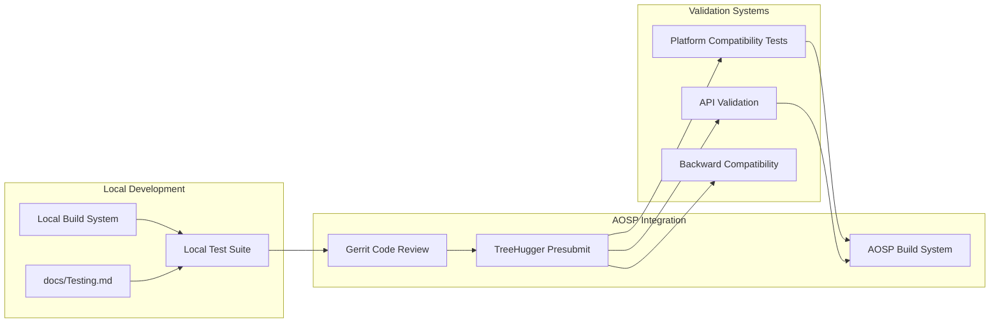
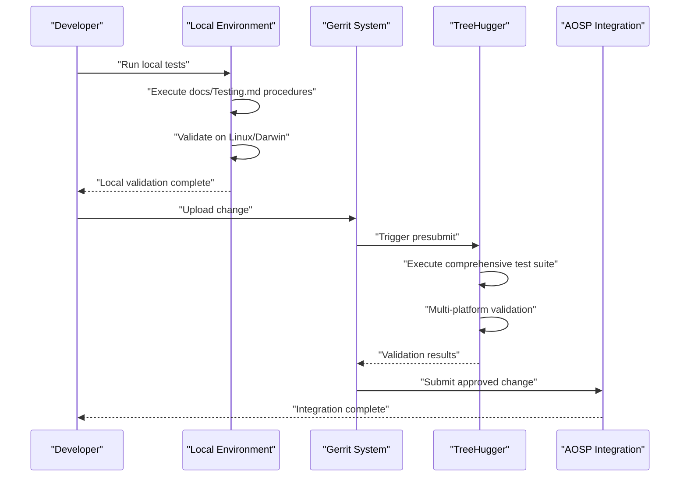

<!-- source: DeepWiki mcp.deepwiki.com · repo android/ndk · page 5.2 Testing and Validation · fetched 2026-10-23 -->

# Testing and Validation

Relevant source files

The following files were used as context for generating this wiki page:

- [CONTRIBUTING.md](CONTRIBUTING.md)

This document explains the testing requirements, validation procedures, and presubmit systems that ensure code quality and compatibility for contributions to the Android NDK. It covers local testing procedures, the TreeHugger presubmit system, and platform-specific validation requirements.

For information about the patch submission process and AOSP workflow, see [Patch Submission Workflow](#5.1).

## Local Testing Requirements

Before submitting any patches to the NDK, contributors must validate their changes locally across supported build environments. The NDK testing infrastructure requires specific host platform support and comprehensive test execution.

### Supported Build Platforms

The NDK build and testing system supports only Linux and Darwin (macOS) host platforms. Windows hosts are explicitly not supported for building or testing the NDK itself, though the NDK can target Windows applications through cross-compilation.

| Platform | Support Level | Testing Required |
|----------|---------------|------------------|
| Linux | Full Support | Mandatory |
| Darwin (macOS) | Full Support | Mandatory |
| Windows | Not Supported | N/A |

### Testing Documentation

Detailed testing procedures are documented in [docs/Testing.md]() and [README.md](). These documents provide comprehensive instructions for:

- Setting up the testing environment
- Running the complete test suite
- Validating specific components
- Platform-specific testing requirements

**Testing Environment Setup**

Sources: [CONTRIBUTING.md:31-33]()

## TreeHugger Presubmit System

The NDK uses TreeHugger as its presubmit validation service, functioning as an automated testing system integrated with Gerrit code review. TreeHugger ensures that all submitted changes pass comprehensive testing before integration into the main codebase.

### TreeHugger Workflow

The TreeHugger system operates differently based on contributor access level, with distinct workflows for Google employees and external contributors.

Sources: [CONTRIBUTING.md:37-40]()

### Access Control and Approval Process

TreeHugger implements a two-tier access control system to manage presubmit testing resources while maintaining security:

**Googler Contributors**
- Automatic TreeHugger execution upon change upload
- Direct access to presubmit validation
- No additional approval required

**External Contributors**
- Manual approval required from a Google employee
- TreeHugger execution only after approval
- Additional security review for resource access

## Platform Validation Requirements

The NDK testing system must validate functionality across multiple target architectures and API levels while ensuring compatibility with the broader Android ecosystem.

### Multi-Platform Testing Matrix

Sources: [CONTRIBUTING.md:33]()

## Testing Infrastructure Integration

The NDK testing system integrates with the broader AOSP development infrastructure, requiring coordination between multiple validation systems and ensuring compatibility with Android platform changes.

### Integration Points

Sources: [CONTRIBUTING.md:24-29](), [CONTRIBUTING.md:31-33]()

## Test Execution Workflow

The complete testing workflow encompasses both local validation and automated presubmit testing, ensuring comprehensive coverage before code integration.

### Complete Validation Pipeline

Sources: [CONTRIBUTING.md:31-40]()