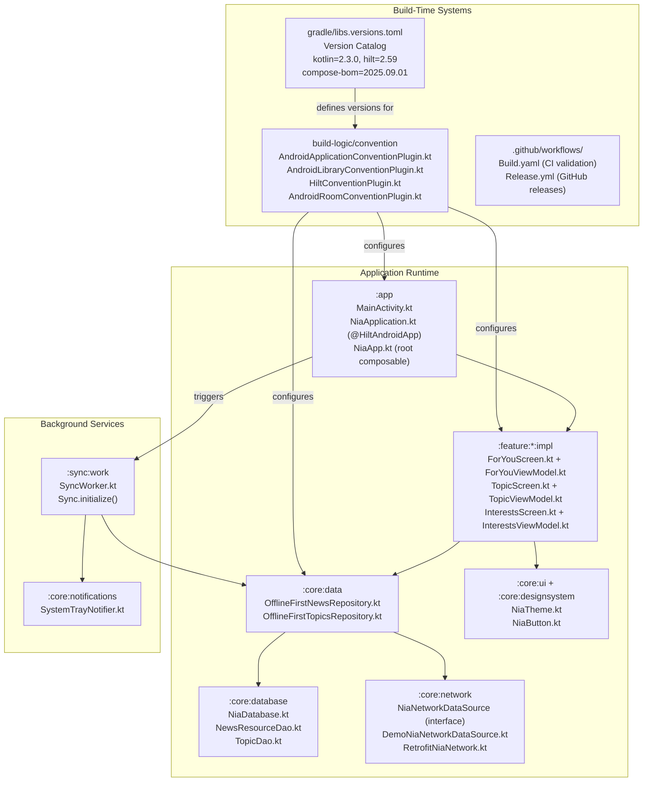
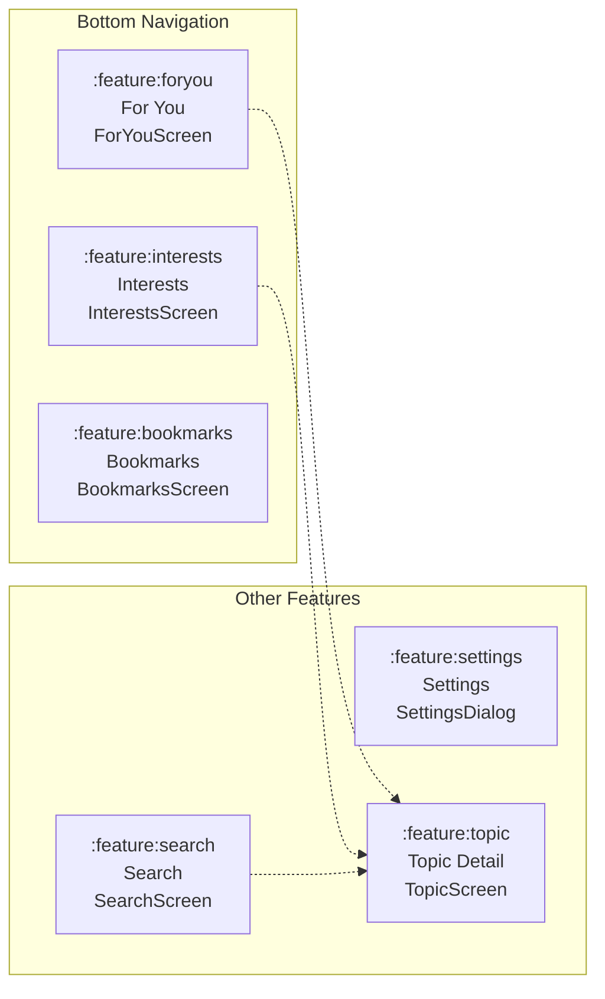
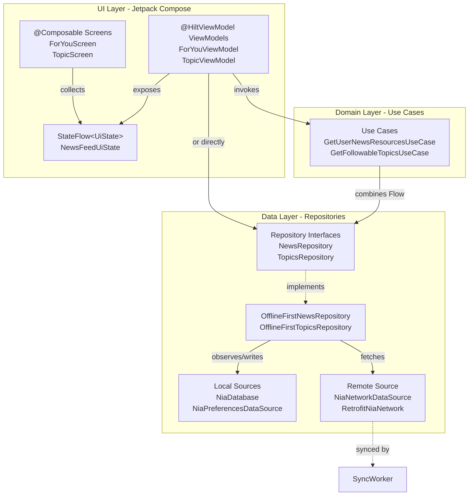

<!-- source: DeepWiki mcp.deepwiki.com · repo android/nowinandroid · page 1 Overview · fetched 2026-10-23 -->

# Overview

Relevant source files

The following files were used as context for generating this wiki page:

- [.google/packaging.yaml](.google/packaging.yaml)
- [README.md](README.md)
- [app/prodRelease-badging.txt](app/prodRelease-badging.txt)
- [app/proguard-rules.pro](app/proguard-rules.pro)
- [app/src/main/AndroidManifest.xml](app/src/main/AndroidManifest.xml)
- [app/src/main/res/mipmap-anydpi-v26/ic_launcher.xml](app/src/main/res/mipmap-anydpi-v26/ic_launcher.xml)
- [app/src/main/res/mipmap-anydpi-v26/ic_launcher_round.xml](app/src/main/res/mipmap-anydpi-v26/ic_launcher_round.xml)
- [docs/ArchitectureLearningJourney.md](docs/ArchitectureLearningJourney.md)
- [docs/images/architecture-1-overall.png](docs/images/architecture-1-overall.png)
- [docs/images/architecture-2-example.png](docs/images/architecture-2-example.png)
- [docs/images/architecture-3-data-layer.png](docs/images/architecture-3-data-layer.png)
- [docs/images/architecture-4-ui-layer.png](docs/images/architecture-4-ui-layer.png)
- [docs/images/screenshots.png](docs/images/screenshots.png)
- [tools/pre-push](tools/pre-push)

**Now in Android** is Google's official reference architecture for modern Android development. Built entirely with Kotlin and Jetpack Compose, this fully functional application demonstrates production-ready patterns for architecture, modularization, testing, and UI implementation. The repository serves as a practical learning resource showing how to structure scalable Android applications using official Android best practices. [README.md:5-17]()

The application provides a real news reader experience for Android development content from the [Now in Android series](https://developer.android.com/series/now-in-android). Users can browse articles, follow topics, search content, and bookmark resources. The app is published on the [Play Store](https://play.google.com/store/apps/details?id=com.google.samples.apps.nowinandroid) (`prodRelease` variant with live backend), while `demoDebug` and `demoRelease` variants use static local data for immediate exploration without backend dependencies. [README.md:18-25](), [README.md:39-41]()

**Key Technologies:** Kotlin, Jetpack Compose (Material 3), Hilt, Room, Retrofit, Kotlin Coroutines & Flow, WorkManager. [.google/packaging.yaml:21-48]()

## System Overview

The codebase operates across three system layers with distinct lifecycles: Build-Time, Runtime, and Background Services.

**System Overview: Build-Time, Runtime, and Background Services**

**Build-time layer:** [gradle/libs.versions.toml]() defines library versions. Convention plugins in `build-logic/convention` standardize module configuration across the project. [README.md:71-74]()

**Runtime layer:** `:app` module contains `MainActivity` (entry point), `NiaApplication` (Hilt initialization with `@HiltAndroidApp`), and `NiaApp` composable (root UI). [app/src/main/AndroidManifest.xml:31-45](). Feature modules like `:feature:foryou:impl` contain screen composables and `@HiltViewModel` ViewModels. Core modules provide repositories (`OfflineFirstNewsRepository`), database (`NiaDatabase` with DAOs), network sources (`NiaNetworkDataSource` interface), and UI components (`NiaTheme`). [docs/ArchitectureLearningJourney.md:19-26]()

**Background layer:** `SyncWorker` in `:sync:work` runs periodic background sync initialized by `Sync.initialize`. [docs/ArchitectureLearningJourney.md:64-71](). `SystemTrayNotifier` in `:core:notifications` handles system notifications.

**Sources:** [README.md:31-41](), [README.md:85-87](), [docs/ArchitectureLearningJourney.md:19-26](), [docs/ArchitectureLearningJourney.md:64-162]()

## What You'll Learn

Now in Android demonstrates production-ready patterns and practices across multiple domains:

| Domain | Key Demonstrations |
|--------|-------------------|
| **Architecture** | Official [Android architecture guidance](https://developer.android.com/topic/architecture) with UI, Domain, and Data layers. Unidirectional data flow using Kotlin `Flow`. [docs/ArchitectureLearningJourney.md:19-41]() |
| **Modularization** | 50+ Gradle modules organized by feature and layer. API/Impl split in `:feature` modules. [docs/ModularizationLearningJourney.md:1-59]() |
| **UI** | Jetpack Compose with Material 3 design. Adaptive layouts for phones, tablets, and foldables. [README.md:124-130]() |
| **Data Management** | Offline-first architecture. Room database (`NiaDatabase`) as single source of truth. [docs/ArchitectureLearningJourney.md:166-172]() |
| **Dependency Injection** | Hilt throughout with `@HiltAndroidApp`, `@HiltViewModel`, and module organization. [README.md:85-87]() |
| **Testing** | No mocking libraries. Test doubles in `:core:testing`, `:core:data-test`. Screenshot testing with Roborazzi. [README.md:88-111]() |
| **Build Configuration** | Version catalog, custom convention plugins in `build-logic/convention`, build variants (`demo`/`prod` flavors). [README.md:61-82]() |

**Sources:** [README.md:8-16](), [README.md:48-59](), [README.md:83-98](), [.google/packaging.yaml:21-48]()

## Application Features

The application provides content from the Now in Android series. Users can browse links to videos and articles, follow topics, and receive notifications. [README.md:22-25]()

### User-Facing Features

| Feature | Description |
|---------|-------------|
| **For You** | Personalized news feed showing articles from followed topics. Includes onboarding UI for topic selection. [docs/ArchitectureLearningJourney.md:42-49]() |
| **Interests** | Browse all available topics. Follow/unfollow to customize the For You feed. [README.md:22-25]() |
| **Bookmarks** | View all bookmarked news resources. |
| **Search** | Full-text search across news resources. |
| **Settings** | Theme selection and dynamic color toggle. |
| **Topic Detail** | Detailed view of a single topic with related news resources. |

**Sources:** [README.md:22-25](), [docs/ArchitectureLearningJourney.md:42-49]()

## High-Level Architecture

### Layer Architecture and Data Flow

The app architecture has three layers: a data layer, a domain layer, and a UI layer. [docs/ArchitectureLearningJourney.md:19-21]()

**Unidirectional Data Flow: UI → Domain → Data**

**Data flow:**
1. **UI Layer**: Composable screens observe `UiState` exposed by ViewModels. ViewModels handle user events. [docs/ArchitectureLearningJourney.md:152-162]()
2. **Domain Layer**: Use cases like `GetUserNewsResourcesUseCase` encapsulate complex business logic by combining multiple repository streams. [docs/ArchitectureLearningJourney.md:144-151]()
3. **Data Layer**: Repository implementations like `OfflineFirstNewsRepository` follow an offline-first pattern. `NiaDatabase` (Room) is the single source of truth. `NiaNetworkDataSource` fetches remote data which is written to Room via `SyncWorker` background sync. [docs/ArchitectureLearningJourney.md:166-189]()

**Sources:** [docs/ArchitectureLearningJourney.md:1-162](), [README.md:48-53]()

## Build System

### Build Variants and Flavors

The app uses product flavors to control content sourcing: [README.md:71-74]()

| Flavor | Purpose | Implementation |
|---------|---------|-------------|
| **demo** | Local exploration | Uses static local data via `DemoNiaNetworkDataSource`. [README.md:75-76]() |
| **prod** | Real usage | Makes network calls to a backend server via `RetrofitNiaNetwork`. [README.md:77-79]() |

**Build Types:**
- `debug`: Standard development.
- `release`: Minified and optimized.
- `benchmark`: Used for startup performance testing and baseline profile generation. [README.md:61-66]()

**Sources:** [README.md:61-82]()

## Testing Strategy

Now in Android avoids mocking libraries, preferring test doubles. [README.md:88-91]()

- **Test Doubles**: Production implementations are replaced with simplified but realistic test doubles using Hilt's testing APIs. [README.md:92-98]()
- **Local Tests**: `testDemoDebug` runs unit and screenshot tests. [README.md:112-115]()
- **Screenshot Tests**: Uses **Roborazzi** to verify UI rendering across different screen sizes. [README.md:123-132]()
- **Instrumented Tests**: `connectedDemoDebugAndroidTest` runs on physical devices or emulators. [README.md:116]()

**Sources:** [README.md:83-132]()

---

## Page Navigation

- **Architecture** (Section 2)
- **Build System** (Section 3)
- **UI Layer** (Section 4)
- **Core Modules** (Section 5)
- **Feature Modules** (Section 6)
- **Background Services** (Section 7)
- **Testing Strategy** (Section 8)
- **Development Guide** (Section 9)
- **Glossary** (Section 10)

---

