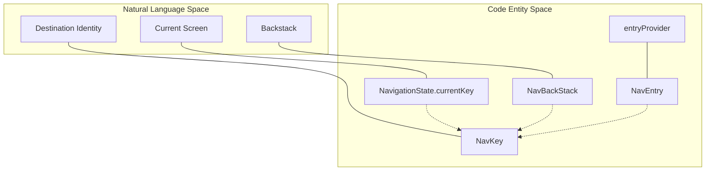
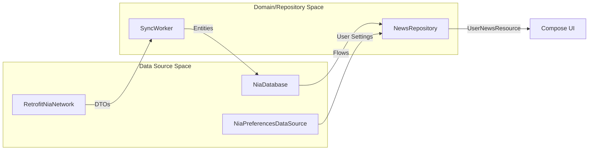

<!-- source: DeepWiki mcp.deepwiki.com · repo android/nowinandroid · page 10 Glossary · fetched 2026-10-23 -->

# Glossary

Relevant source files

The following files were used as context for generating this wiki page:

- [.google/packaging.yaml](.google/packaging.yaml)
- [README.md](README.md)
- [app/proguard-rules.pro](app/proguard-rules.pro)
- [app/src/main/kotlin/com/google/samples/apps/nowinandroid/navigation/TopLevelNavItem.kt](app/src/main/kotlin/com/google/samples/apps/nowinandroid/navigation/TopLevelNavItem.kt)
- [app/src/main/kotlin/com/google/samples/apps/nowinandroid/util/ProfileVerifierLogger.kt](app/src/main/kotlin/com/google/samples/apps/nowinandroid/util/ProfileVerifierLogger.kt)
- [build-logic/convention/src/main/kotlin/com/google/samples/apps/nowinandroid/AndroidCompose.kt](build-logic/convention/src/main/kotlin/com/google/samples/apps/nowinandroid/AndroidCompose.kt)
- [build-logic/convention/src/main/kotlin/com/google/samples/apps/nowinandroid/GradleManagedDevices.kt](build-logic/convention/src/main/kotlin/com/google/samples/apps/nowinandroid/GradleManagedDevices.kt)
- [build-logic/convention/src/main/kotlin/com/google/samples/apps/nowinandroid/KotlinAndroid.kt](build-logic/convention/src/main/kotlin/com/google/samples/apps/nowinandroid/KotlinAndroid.kt)
- [build-logic/convention/src/main/kotlin/com/google/samples/apps/nowinandroid/NiaBuildType.kt](build-logic/convention/src/main/kotlin/com/google/samples/apps/nowinandroid/NiaBuildType.kt)
- [build-logic/convention/src/main/kotlin/com/google/samples/apps/nowinandroid/NiaFlavor.kt](build-logic/convention/src/main/kotlin/com/google/samples/apps/nowinandroid/NiaFlavor.kt)
- [core/common/src/main/kotlin/com/google/samples/apps/nowinandroid/core/common/network/NiaDispatchers.kt](core/common/src/main/kotlin/com/google/samples/apps/nowinandroid/core/common/network/NiaDispatchers.kt)
- [core/common/src/main/kotlin/com/google/samples/apps/nowinandroid/core/common/network/di/CoroutineScopesModule.kt](core/common/src/main/kotlin/com/google/samples/apps/nowinandroid/core/common/network/di/CoroutineScopesModule.kt)
- [core/common/src/main/kotlin/com/google/samples/apps/nowinandroid/core/common/network/di/DispatchersModule.kt](core/common/src/main/kotlin/com/google/samples/apps/nowinandroid/core/common/network/di/DispatchersModule.kt)
- [core/common/src/main/kotlin/com/google/samples/apps/nowinandroid/core/common/result/Result.kt](core/common/src/main/kotlin/com/google/samples/apps/nowinandroid/core/common/result/Result.kt)
- [core/common/src/test/kotlin/com/google/samples/apps/nowinandroid/core/common/result/ResultKtTest.kt](core/common/src/test/kotlin/com/google/samples/apps/nowinandroid/core/common/result/ResultKtTest.kt)
- [core/data/src/main/AndroidManifest.xml](core/data/src/main/AndroidManifest.xml)
- [core/data/src/main/kotlin/com/google/samples/apps/nowinandroid/core/data/util/TimeZoneMonitor.kt](core/data/src/main/kotlin/com/google/samples/apps/nowinandroid/core/data/util/TimeZoneMonitor.kt)
- [core/database/src/main/AndroidManifest.xml](core/database/src/main/AndroidManifest.xml)
- [core/datastore-test/src/main/AndroidManifest.xml](core/datastore-test/src/main/AndroidManifest.xml)
- [core/datastore/src/main/AndroidManifest.xml](core/datastore/src/main/AndroidManifest.xml)
- [core/designsystem/src/main/AndroidManifest.xml](core/designsystem/src/main/AndroidManifest.xml)
- [core/model/src/main/kotlin/com/google/samples/apps/nowinandroid/core/model/data/UserNewsResource.kt](core/model/src/main/kotlin/com/google/samples/apps/nowinandroid/core/model/data/UserNewsResource.kt)
- [core/navigation/src/main/kotlin/com/google/samples/apps/nowinandroid/core/navigation/NavigationState.kt](core/navigation/src/main/kotlin/com/google/samples/apps/nowinandroid/core/navigation/NavigationState.kt)
- [core/navigation/src/main/kotlin/com/google/samples/apps/nowinandroid/core/navigation/Navigator.kt](core/navigation/src/main/kotlin/com/google/samples/apps/nowinandroid/core/navigation/Navigator.kt)
- [core/navigation/src/test/kotlin/com/google/samples/apps/nowinandroid/core/navigation/NavigatorTest.kt](core/navigation/src/test/kotlin/com/google/samples/apps/nowinandroid/core/navigation/NavigatorTest.kt)
- [core/network/src/main/AndroidManifest.xml](core/network/src/main/AndroidManifest.xml)
- [core/testing/src/main/AndroidManifest.xml](core/testing/src/main/AndroidManifest.xml)
- [core/ui/src/main/AndroidManifest.xml](core/ui/src/main/AndroidManifest.xml)
- [docs/images/screenshots.png](docs/images/screenshots.png)

This glossary defines codebase-specific terms, architectural patterns, and domain concepts used throughout the Now in Android (NiA) project. It serves as a technical reference for onboarding engineers to understand the jargon and specific implementations within the repository.

## General Project Terms

### NiA (Now in Android)
The project name and the primary application module. It refers to the official Android reference app designed to showcase best practices in Android development, including Compose, modularization, and offline-first architecture [README.md:10-17]().

### API/Impl Split
An architectural pattern used in feature modules to enforce strict boundaries and improve compilation times.
*   **API module**: Contains only the interfaces, public models, and navigation entry points required by other modules.
*   **Impl module**: Contains the actual implementation, internal ViewModels, and Compose UI code.
*   **Source**: [docs/ModularizationLearningJourney.md]() (referenced in [README.md:57-59]()).

### Offline-first
A strategy where the application is fully functional without a network connection. The "source of truth" is the local database, and the UI observes local data changes while a background process (Sync) updates the local storage from the network [README.md:50-53]().

---

## Build System & Configuration

### Convention Plugins
Custom Gradle plugins located in `build-logic/` that encapsulate shared build logic (e.g., Android, Compose, Hilt, Room). They ensure consistency across the project's many modules.
*   **Implementation**: [build-logic/convention/src/main/kotlin/com/google/samples/apps/nowinandroid/KotlinAndroid.kt:34-58]()

### NiaFlavor
An enumeration defining the product flavors used in the app.
*   `demo`: Uses local static data for rapid UI development [build-logic/convention/src/main/kotlin/com/google/samples/apps/nowinandroid/NiaFlavor.kt:35]().
*   `prod`: Connects to a real backend for production data [build-logic/convention/src/main/kotlin/com/google/samples/apps/nowinandroid/NiaFlavor.kt:36]().

### NiaBuildType
An enumeration defining the build types shared between the `:app` and `:benchmarks` modules.
*   `DEBUG`: Includes a `.debug` application ID suffix [build-logic/convention/src/main/kotlin/com/google/samples/apps/nowinandroid/NiaBuildType.kt:23]().
*   `RELEASE`: The production-ready build [build-logic/convention/src/main/kotlin/com/google/samples/apps/nowinandroid/NiaBuildType.kt:24]().

### BOM (Bill of Materials)
A Gradle feature used to manage library versions centrally, ensuring all dependencies within a group (like Compose) are compatible.
*   **Example**: `androidx-compose-bom` [build-logic/convention/src/main/kotlin/com/google/samples/apps/nowinandroid/AndroidCompose.kt:38-40]().

### KSP (Kotlin Symbol Processing)
A Kotlin-first alternative to kapt used for annotation processing (e.g., with Room and Hilt) to improve build performance.

### Spotless
A code formatting tool enforced via Gradle to ensure a consistent code style across the entire repository [README.md:131-133]().

### Dependency Guard
A tool used to track and verify changes to the dependency tree, preventing accidental inclusion of unwanted libraries.

---

## Navigation & UI State

### NavKey
A type-safe identifier used by the `NavigationState` to track backstack entries. It replaces traditional string-based routes in the `navigation3` implementation.
*   **Definition**: [core/navigation/src/main/kotlin/com/google/samples/apps/nowinandroid/core/navigation/NavigationState.kt:29]()

### entryProvider
A lambda function used to map a `NavKey` to a `NavEntry`. This allows the navigation system to lazily provide the UI for a specific route.
*   **Usage**: [core/navigation/src/main/kotlin/com/google/samples/apps/nowinandroid/core/navigation/NavigationState.kt:85]()

### NiaAppState
A state holder class that manages high-level application logic, such as current navigation destination, window size classes, and network connectivity status.

### UserNewsResource
A domain model representing a news item combined with user-specific metadata, such as whether the user has bookmarked the item or is following the related topics.
*   **Definition**: [core/model/src/main/kotlin/com/google/samples/apps/nowinandroid/core/model/data/UserNewsResource.kt]()

### Natural Language to Navigation Code Mapping
The following diagram bridges navigation concepts to their specific code entities.

**Title: Navigation System Entity Mapping**

*Sources: [core/navigation/src/main/kotlin/com/google/samples/apps/nowinandroid/core/navigation/NavigationState.kt:61-78]()*

---

## Data & Background Tasks

### ChangeListVersions
A data structure stored in `DataStore` that tracks the last synchronized version of different data types (topics, news resources). It is used to perform incremental updates during sync.

### DelegatingWorker
A specialized `ListenableWorker` from `androidx.work` used to coordinate background synchronization by delegating tasks to specific implementations while managing Hilt injection.

### TimeZoneMonitor
A utility that monitors and emits changes to the device's system timezone, ensuring that date-related UI components update immediately.
*   **Interface**: [core/data/src/main/kotlin/com/google/samples/apps/nowinandroid/core/data/util/TimeZoneMonitor.kt:51-53]()
*   **Implementation**: `TimeZoneBroadcastMonitor` [core/data/src/main/kotlin/com/google/samples/apps/nowinandroid/core/data/util/TimeZoneMonitor.kt:56]()

### Data Flow Entity Mapping
The following diagram maps the data layer concepts to the classes implementing them.

**Title: Offline-First Data Flow Mapping**

*Sources: [README.md:88-110](), [core/data/src/main/kotlin/com/google/samples/apps/nowinandroid/core/data/util/TimeZoneMonitor.kt:56-60]()*

---

## Testing & Performance

### Test Doubles
NiA avoids mocking libraries (like Mockito) in favor of handwritten test doubles. These are simplified but functional implementations of interfaces (e.g., `FakeNewsRepository`) used in tests to provide predictable behavior [README.md:91-98]().

### Roborazzi
A library used for screenshot testing. It captures the visual output of Compose components and compares them against "golden" images stored in the repository.
*   **Usage**: [README.md:131-136]()

### GMD (Gradle Managed Devices)
A feature of the Android Gradle Plugin that allows the build system to automatically provision, launch, and tear down emulators for instrumented tests, ensuring a consistent environment.
*   **Configuration**: [build-logic/convention/src/main/kotlin/com/google/samples/apps/nowinandroid/GradleManagedDevices.kt:27-58]()

### Baseline Profiles
A list of classes and methods used by the Android Runtime (ART) during installation to pre-compile critical paths. This reduces app startup time and improves UI smoothness (jank reduction).
*   **Verifier**: `ProfileVerifierLogger` [app/src/main/kotlin/com/google/samples/apps/nowinandroid/util/ProfileVerifierLogger.kt:51]()

---
**Sources:**
* [README.md:10-136]()
* [build-logic/convention/src/main/kotlin/com/google/samples/apps/nowinandroid/KotlinAndroid.kt:34-109]()
* [build-logic/convention/src/main/kotlin/com/google/samples/apps/nowinandroid/NiaFlavor.kt:26-62]()
* [build-logic/convention/src/main/kotlin/com/google/samples/apps/nowinandroid/NiaBuildType.kt:22-25]()
* [build-logic/convention/src/main/kotlin/com/google/samples/apps/nowinandroid/AndroidCompose.kt:29-67]()
* [core/navigation/src/main/kotlin/com/google/samples/apps/nowinandroid/core/navigation/NavigationState.kt:17-102]()
* [core/data/src/main/kotlin/com/google/samples/apps/nowinandroid/core/data/util/TimeZoneMonitor.kt:47-107]()
* [app/src/main/kotlin/com/google/samples/apps/nowinandroid/util/ProfileVerifierLogger.kt:17-70]()
* [build-logic/convention/src/main/kotlin/com/google/samples/apps/nowinandroid/GradleManagedDevices.kt:17-71]()