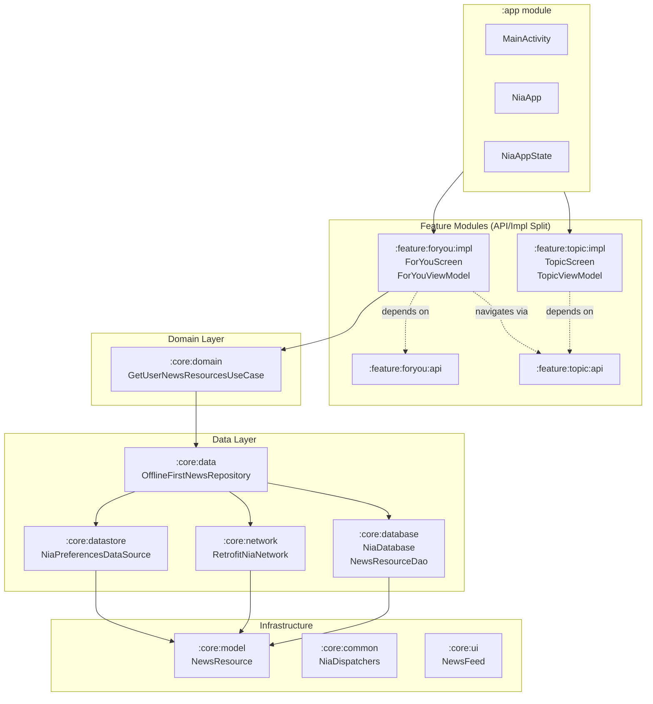
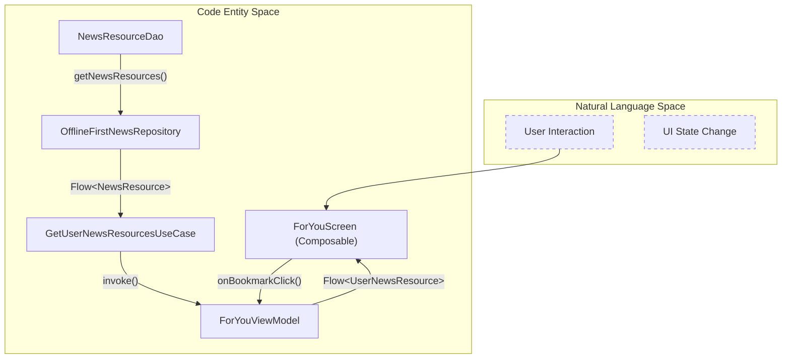

<!-- source: DeepWiki mcp.deepwiki.com · repo android/nowinandroid · page 2 Architecture · fetched 2026-10-23 -->

# Architecture

Relevant source files

The following files were used as context for generating this wiki page:

- [app/build.gradle.kts](app/build.gradle.kts)
- [build-logic/settings.gradle.kts](build-logic/settings.gradle.kts)
- [build.gradle.kts](build.gradle.kts)
- [core/navigation/.gitignore](core/navigation/.gitignore)
- [core/navigation/build.gradle.kts](core/navigation/build.gradle.kts)
- [docs/ArchitectureLearningJourney.md](docs/ArchitectureLearningJourney.md)
- [docs/ModularizationLearningJourney.md](docs/ModularizationLearningJourney.md)
- [docs/images/architecture-1-overall.png](docs/images/architecture-1-overall.png)
- [docs/images/architecture-2-example.png](docs/images/architecture-2-example.png)
- [docs/images/architecture-3-data-layer.png](docs/images/architecture-3-data-layer.png)
- [docs/images/architecture-4-ui-layer.png](docs/images/architecture-4-ui-layer.png)
- [settings.gradle.kts](settings.gradle.kts)

## Purpose and Scope

This document describes the overall application architecture of Now in Android, including its layered structure, modular organization, reactive programming model, and unidirectional data flow patterns. The architecture follows the [official Android architecture guidance](https://developer.android.com/jetpack/guide) and demonstrates modern Android development practices.

For detailed information about specific aspects of the architecture:
- **Module Structure**: Detail on the 60+ Gradle modules, dependency graph, and the API/Impl split pattern. See [Module Structure](#2.1).
- **Data Layer**: Detailed view of repositories, offline-first strategy, Room database, and network data sources. See [Data Layer](#2.2).
- **Domain Layer**: Business logic organization using UseCases to bridge data and UI. See [Domain Layer](#2.3).
- **UI Layer**: Application structure, navigation, and design system using Jetpack Compose. See [UI Layer](#4).

## Architectural Principles

The Now in Android architecture is designed around the following core principles:

| Principle | Implementation |
|-----------|----------------|
| **Layer Separation** | Three distinct layers (UI, Domain, Data) with clear boundaries and unidirectional dependencies [docs/ArchitectureLearningJourney.md:21-26](). |
| **Modularization** | 60+ Gradle modules organized by feature and function, enabling parallel development and build caching [docs/ModularizationLearningJourney.md:9-46](). |
| **Offline-First** | Local storage (Room + DataStore) as the single source of truth with background sync [docs/ArchitectureLearningJourney.md:166-172](). |
| **Reactive Streams** | Kotlin Flow-based data streams with unidirectional data flow (UDF) pattern [docs/ArchitectureLearningJourney.md:31-40](). |
| **API/Impl Pattern** | Feature modules split into `api` (navigation keys) and `impl` (screens, ViewModels) for loose coupling [docs/ModularizationLearningJourney.md:73-81](). |
| **Dependency Injection** | Hilt-based DI for all layers, enabling testability and configuration flexibility [app/build.gradle.kts:24-24](). |
| **Testability** | Comprehensive testing with fake implementations and test doubles instead of mocking frameworks [app/build.gradle.kts:118-137](). |

**Sources:** [docs/ArchitectureLearningJourney.md:1-40](), [docs/ModularizationLearningJourney.md:1-89]()

## Modular Architecture Overview

The application is organized into a large collection of Gradle modules. This modularization strategy balances parallel development, build performance, and maintainability.

### Module Type Diagram: Layer Architecture

**Sources:** [docs/ModularizationLearningJourney.md:11-46](), [settings.gradle.kts:48-83]()

## Three-Layer Architecture

The app implements a strict three-layer architecture as recommended by the [Official Android Architecture Guidance](https://developer.android.com/jetpack/guide).

### Layer Responsibilities

| Layer | Modules | Responsibilities | Key Entities |
|-------|---------|------------------|-------------|
| **UI Layer** | `:app`, `:feature:*:impl`, `:core:ui` | Display data, handle user interactions, and manage UI state. [docs/ArchitectureLearningJourney.md:21-26]() | `ForYouViewModel`, `NiaApp`, `NewsFeed` |
| **Domain Layer** | `:core:domain` | Business logic that is too complex for ViewModels or reused across features. [docs/ArchitectureLearningJourney.md:21-26]() | `GetUserNewsResourcesUseCase` |
| **Data Layer** | `:core:data`, `:core:database`, `:core:network` | Single source of truth. Fetches, stores, and exposes app data. [docs/ArchitectureLearningJourney.md:166-172]() | `OfflineFirstNewsRepository`, `NiaDatabase` |

**Sources:** [docs/ArchitectureLearningJourney.md:19-29](), [docs/ModularizationLearningJourney.md:66-89]()

## Reactive Programming Model

The architecture follows a reactive programming model with **unidirectional data flow (UDF)**.

### Data Flow Pattern
1. **Higher layers react to changes in lower layers**: UI observes streams from ViewModels, which observe Repositories. [docs/ArchitectureLearningJourney.md:35-37]()
2. **Events flow down**: User actions (clicks, swipes) are passed down as function calls. [docs/ArchitectureLearningJourney.md:35-37]()
3. **Data flows up**: Repositories emit data streams (Flows) that are transformed and eventually consumed by the UI. [docs/ArchitectureLearningJourney.md:35-37]()

**Sources:** [docs/ArchitectureLearningJourney.md:31-40](), [docs/ArchitectureLearningJourney.md:147-151]()

## Feature Module Pattern: API/Impl Split

To minimize build times and prevent circular dependencies, feature modules are split into two parts:
- **`:api`**: Contains navigation keys and interfaces that other features need to know about to navigate to this feature. [docs/ModularizationLearningJourney.md:75-75]()
- **`:impl`**: Contains the actual UI implementation, ViewModels, and internal logic. [docs/ModularizationLearningJourney.md:76-76]()

This ensures that a feature's implementation can only depend on another feature's API, not its implementation. [docs/ModularizationLearningJourney.md:80-81]()

**Sources:** [docs/ModularizationLearningJourney.md:72-81](), [app/build.gradle.kts:71-81]()

## Offline-First Strategy

The data layer is designed as an **offline-first** source of truth.
- **Single Source of Truth**: The local database (`NiaDatabase`) is the primary source of data for the UI. [docs/ArchitectureLearningJourney.md:168-168]()
- **Background Sync**: A synchronization mechanism (`SyncWorker`) fetches data from the network (`RetrofitNiaNetwork`) and updates the local database. [docs/ArchitectureLearningJourney.md:91-95]()
- **Reactive Updates**: Because the UI observes the database via `Flow`, it automatically updates whenever the background sync modifies the local data. [docs/ArchitectureLearningJourney.md:131-135]()

**Sources:** [docs/ArchitectureLearningJourney.md:166-182](), [docs/ArchitectureLearningJourney.md:91-143]()

---

