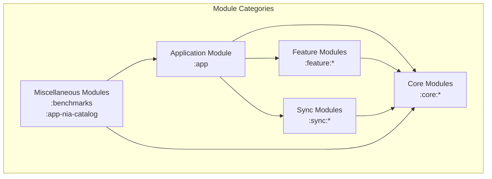
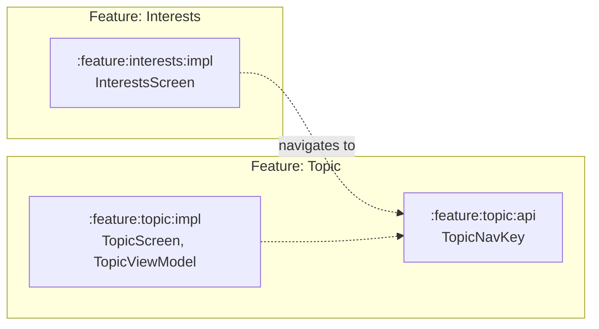
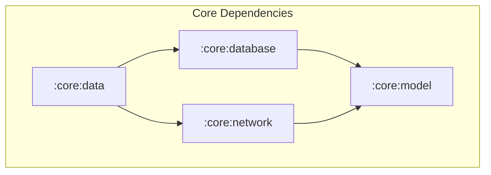

<!-- source: DeepWiki mcp.deepwiki.com · repo android/nowinandroid · page 2.1 Module Structure · fetched 2026-10-23 -->

# Module Structure

<details>
<summary>Relevant source files</summary>

The following files were used as context for generating this wiki page:

- [app/build.gradle.kts](app/build.gradle.kts)
- [build-logic/convention/src/main/kotlin/AndroidApplicationConventionPlugin.kt](build-logic/convention/src/main/kotlin/AndroidApplicationConventionPlugin.kt)
- [build-logic/convention/src/main/kotlin/AndroidLibraryConventionPlugin.kt](build-logic/convention/src/main/kotlin/AndroidLibraryConventionPlugin.kt)
- [build-logic/convention/src/main/kotlin/AndroidTestConventionPlugin.kt](build-logic/convention/src/main/kotlin/AndroidTestConventionPlugin.kt)
- [build-logic/convention/src/main/kotlin/JvmLibraryConventionPlugin.kt](build-logic/convention/src/main/kotlin/JvmLibraryConventionPlugin.kt)
- [build-logic/convention/src/main/kotlin/RootPlugin.kt](build-logic/convention/src/main/kotlin/RootPlugin.kt)
- [build-logic/convention/src/main/kotlin/com/google/samples/apps/nowinandroid/Graph.kt](build-logic/convention/src/main/kotlin/com/google/samples/apps/nowinandroid/Graph.kt)
- [build-logic/settings.gradle.kts](build-logic/settings.gradle.kts)
- [build.gradle.kts](build.gradle.kts)
- [core/navigation/.gitignore](core/navigation/.gitignore)
- [core/navigation/build.gradle.kts](core/navigation/build.gradle.kts)
- [docs/ModularizationLearningJourney.md](docs/ModularizationLearningJourney.md)
- [feature/bookmarks/api/README.md](feature/bookmarks/api/README.md)
- [feature/bookmarks/impl/README.md](feature/bookmarks/impl/README.md)
- [feature/foryou/api/README.md](feature/foryou/api/README.md)
- [feature/foryou/impl/README.md](feature/foryou/impl/README.md)
- [feature/interests/api/README.md](feature/interests/api/README.md)
- [settings.gradle.kts](settings.gradle.kts)

</details>


This document describes the modular organization of the Now in Android codebase, including module types, the API/Impl pattern used for features, dependency rules, and physical repository structure.

For information about the data layer architecture within core modules, see [Data Layer](#2.2). For domain layer use cases, see [Domain Layer](#2.3). For build system configuration of modules, see [Convention Plugins](#3.2).

## Module Categories

The Now in Android application is organized into primary module categories, each serving a distinct architectural purpose:



**Sources:** [docs/ModularizationLearningJourney.md:9-46](), [docs/ModularizationLearningJourney.md:66-89]()

### Module Type Classification

Each module is identified by a Gradle convention plugin that defines its build configuration. These plugins are managed in the `build-logic` project:

| Module Type | Plugin ID | Purpose | Examples |
|-------------|-----------|---------|----------|
| Android Application | `nowinandroid.android.application` | Main application entry point | `:app` |
| Android Feature | `nowinandroid.android.feature` | Feature-specific UI and logic | `:feature:foryou:impl` |
| Android Library | `nowinandroid.android.library` | Shared Android components | `:core:ui`, `:core:data` |
| Android Test | `nowinandroid.android.test` | Test-specific modules | `:benchmarks` |
| JVM Library | `nowinandroid.jvm.library` | Platform-agnostic code | `:core:model` |

**Sources:** [build-logic/convention/src/main/kotlin/com/google/samples/apps/nowinandroid/Graph.kt:95-126](), [build-logic/settings.gradle.kts:42-43]()

## The Application Module

The `:app` module serves as the application entry point and composition root. It binds the rest of the codebase together.

- **MainActivity**: The single Activity hosting the application [docs/ModularizationLearningJourney.md:70]().
- **NiaApp**: Root Composable for UI scaffolding [docs/ModularizationLearningJourney.md:70]().
- **Navigation**: App-level controlled navigation via `NiaNavHost` and `TopLevelDestination` [docs/ModularizationLearningJourney.md:70]().

The `:app` module depends on all feature `impl` modules and required core modules to assemble the final binary.

```mermaid
graph TB
    APP[":app"]
    
    subgraph "Feature Implementations"
        FORYOU_IMPL[":feature:foryou:impl"]
        INTERESTS_IMPL[":feature:interests:impl"]
        BOOKMARKS_IMPL[":feature:bookmarks:impl"]
        SEARCH_IMPL[":feature:search:impl"]
        TOPIC_IMPL[":feature:topic:impl"]
        SETTINGS_IMPL[":feature:settings:impl"]
    end
    
    subgraph "Core Dependencies"
        CORE_DATA[":core:data"]
        CORE_UI[":core:ui"]
        CORE_DESIGN[":core:designsystem"]
        CORE_ANALYTICS[":core:analytics"]
    end
    
    subgraph "Other"
        SYNC_WORK[":sync:work"]
    end
    
    APP -.-> FORYOU_IMPL
    APP -.-> INTERESTS_IMPL
    APP -.-> BOOKMARKS_IMPL
    APP -.-> SEARCH_IMPL
    APP -.-> TOPIC_IMPL
    APP -.-> SETTINGS_IMPL
    APP -.-> CORE_DATA
    APP -.-> CORE_UI
    APP -.-> CORE_DESIGN
    APP -.-> CORE_ANALYTICS
    APP -.-> SYNC_WORK
```



**Sources:** [app/build.gradle.kts:71-89](), [docs/ModularizationLearningJourney.md:68-70]()

## Feature Modules: API/Impl Pattern

Feature modules are split into two submodules to minimize build times and enforce clean boundaries.

### API Module (`:feature:<name>:api`)

The API module contains only navigation contracts and keys that other features use to navigate to this destination.

- **Navigation keys**: For example, `TopicNavKey` [docs/ModularizationLearningJourney.md:120]().
- **Entry Providers**: Navigation keys and functions exposed to other features [docs/ModularizationLearningJourney.md:115-118]().
- **Dependency**: Typically only depends on `:core:navigation` [feature/foryou/impl/README.md:62]().

### Impl Module (`:feature:<name>:impl`)

The implementation module contains the feature's complete functionality.

- **UI Components**: Composable screens like `TopicScreen` or `ForYouScreen` [docs/ModularizationLearningJourney.md:135-136]().
- **ViewModels**: Logic and state management like `TopicViewModel` [docs/ModularizationLearningJourney.md:137]().
- **Internal Logic**: Classes needed only by this specific feature [docs/ModularizationLearningJourney.md:78]().



**Sources:** [docs/ModularizationLearningJourney.md:72-81](), [docs/ModularizationLearningJourney.md:111-138]()

### Dependency Rules for Features

1. **API modules** must not depend on another feature's `api` or `impl` module [docs/ModularizationLearningJourney.md:80]().
2. **Impl modules** should only depend on another feature's `api` module, never its `impl` [docs/ModularizationLearningJourney.md:80]().
3. **Both submodules** should only depend on the `core` modules they require [docs/ModularizationLearningJourney.md:80]().

## Core Module Organization

Core modules provide shared functionality and are organized by concern.

### Data and Infrastructure
- **`:core:data`**: Fetches app data from sources like `TopicsRepository` [docs/ModularizationLearningJourney.md:144]().
- **`:core:network`**: Retrofit configuration and API definitions [docs/ModularizationLearningJourney.md:18]().
- **`:core:database`**: Room database (`NiaDatabase`) and DAOs [docs/ModularizationLearningJourney.md:16]().
- **`:core:datastore`**: User preferences via Proto DataStore [feature/foryou/impl/README.md:32]().
- **`:core:model`**: JVM library containing shared data models [docs/ModularizationLearningJourney.md:17]().

### UI and Design
- **`:core:designsystem`**: Core UI components (`NiaButton`, `NiaTheme`) and icons [docs/ModularizationLearningJourney.md:150-153]().
- **`:core:ui`**: Composite components like `NewsFeed` that depend on the data layer [docs/ModularizationLearningJourney.md:157-161]().



**Sources:** [docs/ModularizationLearningJourney.md:34-38](), [docs/ModularizationLearningJourney.md:140-163]()

## Module Communication and Sync

- **Navigation**: Features communicate via the target feature's `api` module [docs/ModularizationLearningJourney.md:75]().
- **Sync**: The `:sync:work` module handles background data updates using WorkManager [app/build.gradle.kts:89]().
- **Benchmarks**: The `:benchmarks` module is used for Macrobenchmarks and Baseline Profile generation [app/build.gradle.kts:138]().

## Physical Repository Structure

The project uses a hierarchical directory structure reflected in `settings.gradle.kts`:

```
root/
├── app/
├── benchmarks/
├── core/
│   ├── common/
│   ├── data/
│   ├── database/
│   └── ...
├── feature/
│   ├── foryou/
│   │   ├── api/
│   │   └── impl/
│   └── ...
└── sync/
    └── work/
```

**Sources:** [settings.gradle.kts:48-83]()

## Automated Dependency Analysis

The project includes a custom Gradle task to maintain module dependency graphs in `README.md` files.

- **Graph Task**: The `Graph` class recursively searches through projects and configurations like `api`, `implementation`, and `baselineProfile` [build-logic/convention/src/main/kotlin/com/google/samples/apps/nowinandroid/Graph.kt:50-63]().
- **Visuals**: It generates Mermaid-formatted text based on `PluginType` (Application, Feature, Library, JVM) [build-logic/convention/src/main/kotlin/com/google/samples/apps/nowinandroid/Graph.kt:95-126]().
- **Update**: The `graphUpdate` task writes these diagrams directly into the project's documentation [build-logic/convention/src/main/kotlin/com/google/samples/apps/nowinandroid/Graph.kt:138-143]().

**Sources:** [build-logic/convention/src/main/kotlin/com/google/samples/apps/nowinandroid/Graph.kt:41-49](), [build-logic/convention/src/main/kotlin/RootPlugin.kt:29-31]()

---

