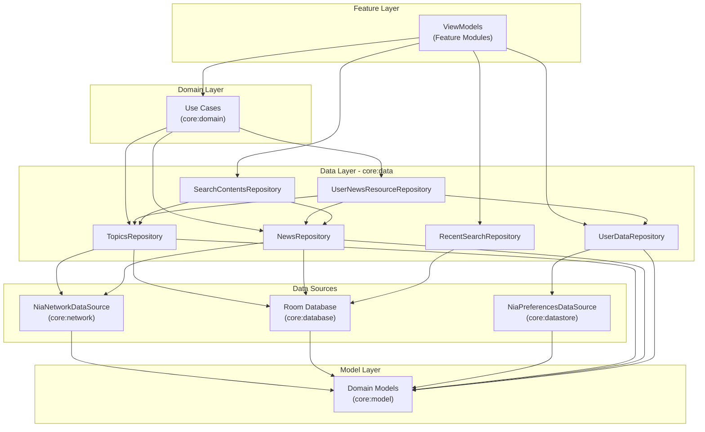
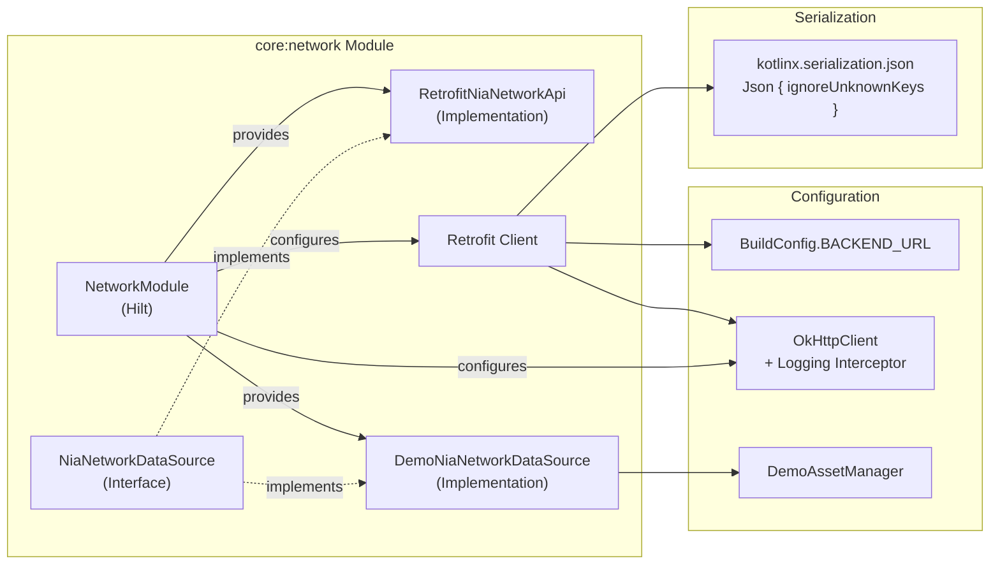
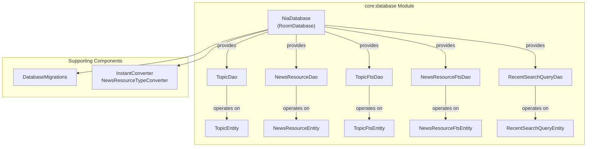
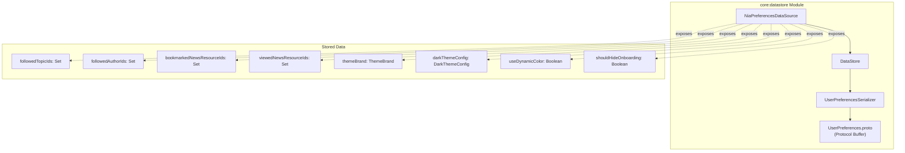
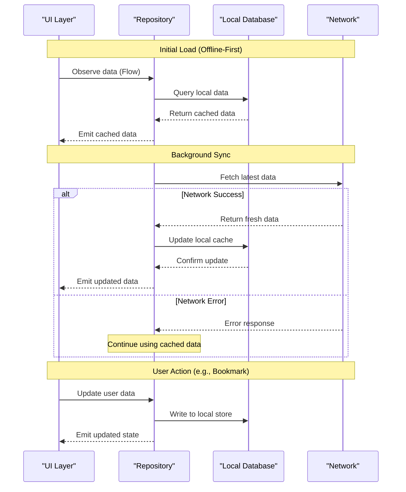
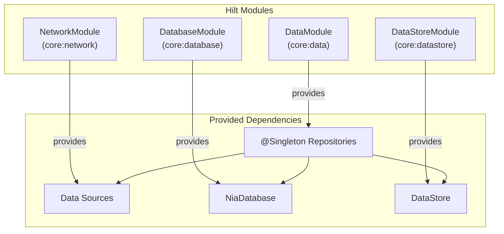

<!-- source: DeepWiki mcp.deepwiki.com · repo android/nowinandroid · page 2.2 Data Layer · fetched 2026-10-23 -->

# Data Layer

<details>
<summary>Relevant source files</summary>

The following files were used as context for generating this wiki page:

- [core/data-test/README.md](core/data-test/README.md)
- [core/data-test/src/main/kotlin/com/google/samples/apps/nowinandroid/core/data/test/repository/FakeNewsRepository.kt](core/data-test/src/main/kotlin/com/google/samples/apps/nowinandroid/core/data/test/repository/FakeNewsRepository.kt)
- [core/data-test/src/main/kotlin/com/google/samples/apps/nowinandroid/core/data/test/repository/FakeTopicsRepository.kt](core/data-test/src/main/kotlin/com/google/samples/apps/nowinandroid/core/data/test/repository/FakeTopicsRepository.kt)
- [core/data-test/src/main/kotlin/com/google/samples/apps/nowinandroid/core/data/test/repository/FakeUserDataRepository.kt](core/data-test/src/main/kotlin/com/google/samples/apps/nowinandroid/core/data/test/repository/FakeUserDataRepository.kt)
- [core/data/README.md](core/data/README.md)
- [core/data/src/main/kotlin/com/google/samples/apps/nowinandroid/core/data/model/NewsResource.kt](core/data/src/main/kotlin/com/google/samples/apps/nowinandroid/core/data/model/NewsResource.kt)
- [core/data/src/main/kotlin/com/google/samples/apps/nowinandroid/core/data/repository/OfflineFirstUserDataRepository.kt](core/data/src/main/kotlin/com/google/samples/apps/nowinandroid/core/data/repository/OfflineFirstUserDataRepository.kt)
- [core/data/src/main/kotlin/com/google/samples/apps/nowinandroid/core/data/repository/UserDataRepository.kt](core/data/src/main/kotlin/com/google/samples/apps/nowinandroid/core/data/repository/UserDataRepository.kt)
- [core/data/src/test/kotlin/com/google/samples/apps/nowinandroid/core/data/model/NetworkEntityTest.kt](core/data/src/test/kotlin/com/google/samples/apps/nowinandroid/core/data/model/NetworkEntityTest.kt)
- [core/data/src/test/kotlin/com/google/samples/apps/nowinandroid/core/data/repository/OfflineFirstNewsRepositoryTest.kt](core/data/src/test/kotlin/com/google/samples/apps/nowinandroid/core/data/repository/OfflineFirstNewsRepositoryTest.kt)
- [core/data/src/test/kotlin/com/google/samples/apps/nowinandroid/core/data/repository/OfflineFirstTopicsRepositoryTest.kt](core/data/src/test/kotlin/com/google/samples/apps/nowinandroid/core/data/repository/OfflineFirstTopicsRepositoryTest.kt)
- [core/data/src/test/kotlin/com/google/samples/apps/nowinandroid/core/data/repository/OfflineFirstUserDataRepositoryTest.kt](core/data/src/test/kotlin/com/google/samples/apps/nowinandroid/core/data/repository/OfflineFirstUserDataRepositoryTest.kt)
- [core/data/src/test/kotlin/com/google/samples/apps/nowinandroid/core/data/testdoubles/TestNewsResourceDao.kt](core/data/src/test/kotlin/com/google/samples/apps/nowinandroid/core/data/testdoubles/TestNewsResourceDao.kt)
- [core/database/src/main/kotlin/com/google/samples/apps/nowinandroid/core/database/dao/NewsResourceDao.kt](core/database/src/main/kotlin/com/google/samples/apps/nowinandroid/core/database/dao/NewsResourceDao.kt)
- [core/database/src/main/kotlin/com/google/samples/apps/nowinandroid/core/database/model/NewsResourceEntity.kt](core/database/src/main/kotlin/com/google/samples/apps/nowinandroid/core/database/model/NewsResourceEntity.kt)
- [core/datastore-proto/README.md](core/datastore-proto/README.md)
- [core/datastore-test/README.md](core/datastore-test/README.md)
- [core/datastore-test/src/main/kotlin/com/google/samples/apps/nowinandroid/core/datastore/test/TestDataStoreModule.kt](core/datastore-test/src/main/kotlin/com/google/samples/apps/nowinandroid/core/datastore/test/TestDataStoreModule.kt)
- [core/datastore/README.md](core/datastore/README.md)
- [core/datastore/src/test/kotlin/com/google/samples/apps/nowinandroid/core/datastore/NiaPreferencesDataSourceTest.kt](core/datastore/src/test/kotlin/com/google/samples/apps/nowinandroid/core/datastore/NiaPreferencesDataSourceTest.kt)
- [core/domain/README.md](core/domain/README.md)
- [core/network/src/main/kotlin/com/google/samples/apps/nowinandroid/core/network/demo/DemoNiaNetworkDataSource.kt](core/network/src/main/kotlin/com/google/samples/apps/nowinandroid/core/network/demo/DemoNiaNetworkDataSource.kt)
- [core/network/src/main/kotlin/com/google/samples/apps/nowinandroid/core/network/model/NetworkNewsResource.kt](core/network/src/main/kotlin/com/google/samples/apps/nowinandroid/core/network/model/NetworkNewsResource.kt)
- [core/network/src/main/kotlin/com/google/samples/apps/nowinandroid/core/network/model/NetworkTopic.kt](core/network/src/main/kotlin/com/google/samples/apps/nowinandroid/core/network/model/NetworkTopic.kt)
- [core/testing/README.md](core/testing/README.md)
- [core/testing/src/main/kotlin/com/google/samples/apps/nowinandroid/core/testing/repository/TestUserDataRepository.kt](core/testing/src/main/kotlin/com/google/samples/apps/nowinandroid/core/testing/repository/TestUserDataRepository.kt)

</details>


## Purpose and Scope

The Data Layer is responsible for managing all application data, providing a clean API for higher layers to access data without needing to know the underlying implementation details. This layer implements the repository pattern to coordinate multiple data sources (network, local database, and preferences) and exposes domain models to feature modules.

For information about how the Data Layer integrates with business logic, see [Domain Layer](). For details about background data synchronization, see [Background Services](). For testing strategies specific to the data layer, see [Unit and Integration Testing]().

Sources: [docs/ModularizationLearningJourney.md:1-234]()

## Architecture Overview

The Data Layer is primarily contained within the `core:data` module, which depends on three data source modules:



The data layer follows an offline-first architecture where repositories coordinate between remote and local data sources, providing a single source of truth through reactive data streams.

Sources: [docs/ModularizationLearningJourney.md:14-46](), [core/data/build.gradle.kts:28-41]()

## Repository Pattern

Repositories in the `core:data` module provide a clean API for data access and abstract away the complexities of coordinating multiple data sources. Each repository is responsible for:

1.  **Data Source Coordination**: Determining whether to fetch from network, database, or both
2.  **Data Synchronization**: Keeping local data in sync with remote sources
3.  **Caching Strategy**: Managing when and how data is cached locally
4.  **Error Handling**: Converting data source errors into domain-level results
5.  **Model Transformation**: Converting data source models to domain models

### Key Repository Classes

| Repository | Responsibility | Primary Data Sources |
|---|---|---|
| `TopicsRepository` | Manages topic data | Network, Database |
| `NewsRepository` | Manages news resource data | Network, Database |
| `UserDataRepository` | Manages user preferences and settings | DataStore |
| `UserNewsResourceRepository` | Aggregates news with user data (bookmarks, follows) | NewsRepository, TopicsRepository, UserDataRepository |
| `SearchContentsRepository` | Provides search functionality | NewsRepository, TopicsRepository |
| `RecentSearchRepository` | Manages search history | Database |

Repositories are typically injected via Hilt as singletons to ensure consistent state across the application.

Sources: [docs/ModularizationLearningJourney.md:140-146](), [core/data/build.gradle.kts:16-41]()

## Data Sources

### Network Data Source (core:network)

The network module provides remote data access using Retrofit with kotlinx-serialization for JSON parsing.



**Key Components:**

-   **`NiaNetworkDataSource`**: Interface defining network operations (e.g., `getTopics()`, `getNewsResources()`)
-   **`RetrofitNiaNetworkApi`**: Concrete implementation using Retrofit.
-   **`DemoNiaNetworkDataSource`**: An alternative implementation that provides static news resources from local JSON assets for development and testing purposes [core/network/src/main/kotlin/com/google/samples/apps/nowinandroid/core/network/demo/DemoNiaNetworkDataSource.kt:39-43](). It reads data from `news.json` and `topics.json` assets [core/network/src/main/kotlin/com/google/samples/apps/nowinandroid/core/network/demo/DemoNiaNetworkDataSource.kt:79-80]().
-   **Backend URL Configuration**: Loaded from `local.properties` file via `BACKEND_URL` property and injected into BuildConfig.
-   **JSON Serialization**: Uses `kotlinx-serialization` with configuration to ignore unknown keys for backward compatibility.
-   **Logging**: OkHttp logging interceptor for debugging network requests.

Sources: [docs/ModularizationLearningJourney.md:174-179](), [core/network/build.gradle.kts:21-65](), [core/network/src/main/kotlin/com/google/samples/apps/nowinandroid/core/network/demo/DemoNiaNetworkDataSource.kt:39-43]()

### Local Database (core:database)

The database module uses Room for local persistence, providing offline-first capabilities and caching.



**Key Components:**

-   **`NiaDatabase`**: Main Room database class, manages all DAOs.
-   **DAOs (Data Access Objects)**: Provide type-safe database operations with Flow-based reactive queries.
-   **Entities**: Room entities representing database tables.
-   **FTS (Full-Text Search) Entities**: Specialized entities for efficient text search using SQLite's FTS4.
-   **Type Converters**: Convert complex types (e.g., `Instant`, enums) to SQLite-compatible types.
-   **Migrations**: Handle schema changes between database versions.

The database schema uses foreign key relationships and junction tables to model many-to-many relationships (e.g., topics associated with news resources).

Sources: [docs/ModularizationLearningJourney.md:200-208]()

### DataStore (core:datastore)

The datastore module uses Proto DataStore for type-safe persistence of user preferences and settings.



**Key Components:**

-   **`NiaPreferencesDataSource`**: High-level API for reading/writing user preferences.
-   **Proto DataStore**: Type-safe preference storage using Protocol Buffers.
-   **`UserPreferences.proto`**: Defines the structure of stored preferences.
-   **`UserPreferencesSerializer`**: Handles serialization/deserialization of protobuf messages.

DataStore provides reactive access to preferences through Kotlin Flows, ensuring UI updates automatically when preferences change. It also handles data migration and provides transactional updates.

Sources: [docs/ModularizationLearningJourney.md:191-197](), [core/datastore/build.gradle.kts:30-33]()

## Data Models (core:model)

The `core:model` module contains pure Kotlin data models representing domain entities. These models are shared across all layers and are designed to be independent of any specific data source implementation.

### Key Model Classes

| Model Class | Purpose | Key Properties |
|---|---|---|
| `Topic` | Represents a topic/category | `id`, `name`, `shortDescription`, `longDescription`, `url`, `imageUrl` |
| `NewsResource` | Represents a news article | `id`, `title`, `content`, `url`, `headerImageUrl`, `publishDate`, `type`, `topics` |
| `UserNewsResource` | News with user-specific data | Extends `NewsResource` with `isSaved`, `hasBeenViewed`, `userFollowedTopics` |
| `FollowableTopic` | Topic with follow status | Combines `Topic` with `isFollowed` boolean |
| `UserData` | User preferences and state | `bookmarkedNewsResourceIds`, `viewedNewsResourceIds`, `followedTopics`, `followedAuthors`, theme settings |
| `SearchResult` | Search result wrapper | `topics: List<FollowableTopic>`, `newsResources: List<UserNewsResource>` |
| `RecentSearchQuery` | Recent search entry | `query`, `queriedDate` |

These models use Kotlin data classes for immutability and provide a stable API contract between the data layer and consuming layers.

Sources: [docs/ModularizationLearningJourney.md:210-217]()

## Data Flow Patterns

The Data Layer implements an offline-first architecture with the following data flow pattern:



### Offline-First Strategy

1.  **Immediate Response**: Repositories emit cached data immediately from the local database.
2.  **Background Refresh**: Simultaneously fetch fresh data from the network.
3.  **Cache Update**: On successful network fetch, update the local cache.
4.  **Reactive Updates**: UI automatically updates through Flow emissions when cache changes.
5.  **Graceful Degradation**: On network failure, continue serving cached data.

### Data Synchronization

Data synchronization occurs through multiple mechanisms:

-   **Repository-Level Sync**: Each repository can independently fetch and cache data. For example, `OfflineFirstTopicsRepository`'s `syncWith` method fetches topics from the network and updates the local `topicDao` [core/data/src/test/kotlin/com/google/samples/apps/nowinandroid/core/data/repository/OfflineFirstTopicsRepositoryTest.kt:83-96](). Similarly, `OfflineFirstNewsRepository` handles news resource synchronization [core/data/src/test/kotlin/com/google/samples/apps/nowinandroid/core/data/repository/OfflineFirstNewsRepositoryTest.kt:133-149]().
-   **WorkManager Integration**: The `sync:work` module triggers periodic background syncs.
-   **User-Triggered Refresh**: Pull-to-refresh gestures trigger explicit sync operations.

### Reactive Data Streams

All repositories expose data through Kotlin `Flow` to enable reactive updates:

```
Repository Methods:
- getTopics(): Flow<List<Topic>>
- getNewsResources(): Flow<List<NewsResource>>
- observeAll(): Flow<UserData>
```

This ensures that any changes to the underlying data (from network sync, user actions, or other sources) automatically propagate to all observers.

Sources: [docs/ModularizationLearningJourney.md:34-41](), [core/data/src/test/kotlin/com/google/samples/apps/nowinandroid/core/data/repository/OfflineFirstTopicsRepositoryTest.kt:83-96](), [core/data/src/test/kotlin/com/google/samples/apps/nowinandroid/core/data/repository/OfflineFirstNewsRepositoryTest.kt:133-149](), Based on architectural patterns shown in high-level diagrams

## Dependency Injection

All data layer components are provided via Hilt dependency injection:



**Dependency Scopes:**

-   **`@Singleton`**: Repositories and data sources are scoped as singletons to maintain consistent state.
-   **`@ApplicationContext`**: Used for Context-dependent components like Room and DataStore.
-   **`@Dispatcher` Qualifiers**: Coroutine dispatchers are injected for proper threading.

Sources: [core/data/build.gradle.kts:17-19](), [core/network/build.gradle.kts:22-24](), [core/datastore/build.gradle.kts:17-20]()

## Testing Infrastructure

The data layer includes dedicated testing support modules:

### core:data-test Module

Provides test implementations of repositories with hooks for controlling behavior in tests:

-   **Test Repositories**: Fake implementations like `FakeNewsRepository` [core/data-test/src/main/kotlin/com/google/samples/apps/nowinandroid/core/data/test/repository/FakeNewsRepository.kt:39-71]() and `FakeTopicsRepository` [core/data-test/src/main/kotlin/com/google/samples/apps/nowinandroid/core/data/test/repository/FakeTopicsRepository.kt:43-62]() that can be configured for testing scenarios.
-   **In-Memory Data**: Uses in-memory data stores instead of real persistence.
-   **Controlled Timing**: Allows tests to control async operations.

### core:datastore-test Module

Provides testing utilities for DataStore:

-   **Test DataStore**: Creates temporary DataStore instances for each test.
-   **Test Serializers**: Provides serializers configured for testing.
-   **Automatic Cleanup**: Cleans up temporary files after tests.

### Testing Strategy

The data layer follows the "test doubles, not mocks" philosophy:

1.  **Unit Tests**: Test individual repositories with fake data sources. For example, `OfflineFirstTopicsRepositoryTest` uses `TestTopicDao` and `TestNiaNetworkDataSource` [core/data/src/test/kotlin/com/google/samples/apps/nowinandroid/core/data/repository/OfflineFirstTopicsRepositoryTest.kt:46-48]().
2.  **Integration Tests**: Test repositories with real Room database (in-memory).
3.  **Flow Testing**: Verify reactive behavior using `turbine` or coroutine test utilities.
4.  **Error Scenarios**: Test network failures, database errors, and edge cases.

Sources: [core/data-test/build.gradle.kts:1-29](), [core/datastore-test/build.gradle.kts:1-29](), [core/testing/build.gradle.kts:25-31](), [core/data/src/test/kotlin/com/google/samples/apps/nowinandroid/core/data/repository/OfflineFirstTopicsRepositoryTest.kt:46-48]()

## Module Dependencies

The following table summarizes the dependencies between data layer modules:

| Module | Type | Depends On | Provided By |
|---|---|---|---|
| `core:data` | Android Library | `core:common`, `core:database`, `core:datastore`, `core:network`, `core:model` | Repositories |
| `core:network` | Android Library | `core:common`, `core:model` | Network data source |
| `core:database` | Android Library | `core:model` | Room database, DAOs |
| `core:datastore` | Android Library | `core:common`, `core:model`, `core:datastore-proto` | DataStore source |
| `core:model` | JVM Library | None | Domain models |
| `core:data-test` | Android Library | `core:data` | Test repositories |
| `core:datastore-test` | Android Library | `core:common`, `core:datastore` | Test DataStore utilities |

**Build Configuration:**

-   All data layer modules use the `nowinandroid.android.library` convention plugin.
-   Testing modules use `nowinandroid.hilt` for dependency injection.
-   Coverage tracking via `nowinandroid.android.library.jacoco` plugin.
-   Network module includes `kotlinx-serialization` plugin.

Sources: [core/data/build.gradle.kts:16-41](), [core/network/build.gradle.kts:21-49](), [core/datastore/build.gradle.kts:17-39](), [core/data-test/build.gradle.kts:16-29]()

---

