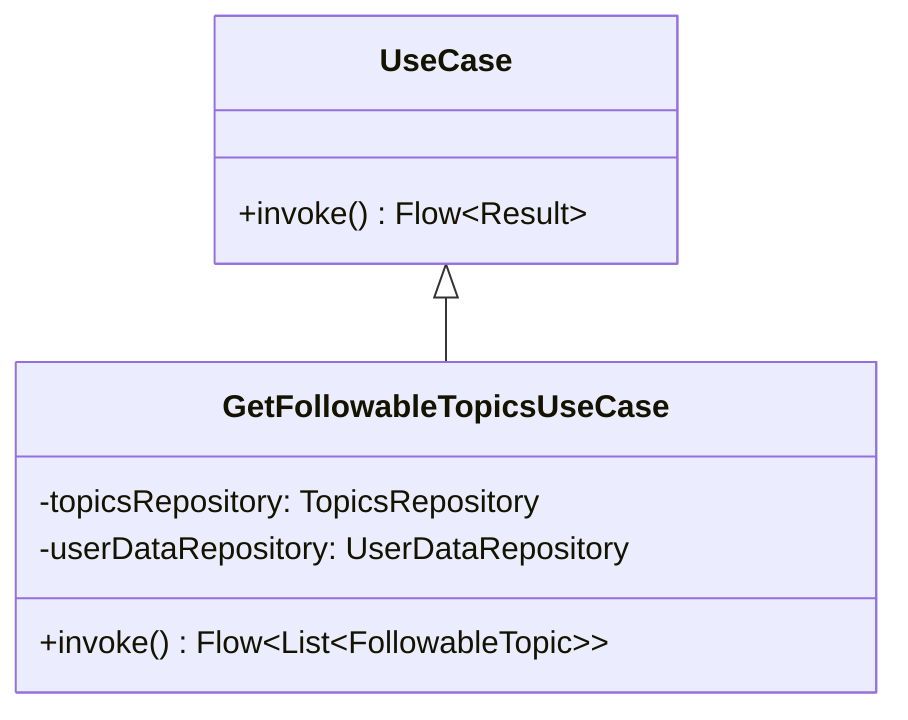
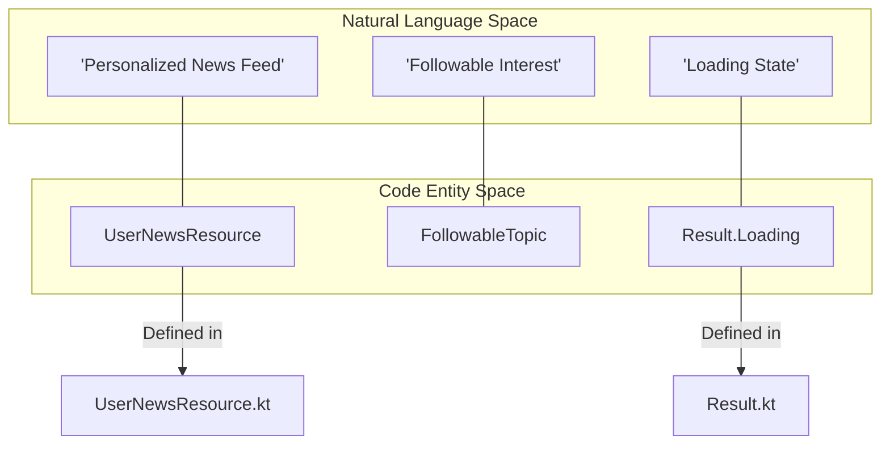
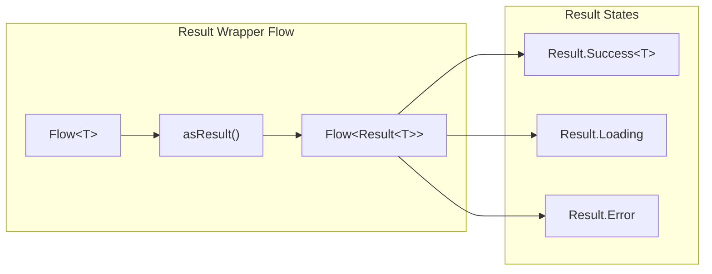
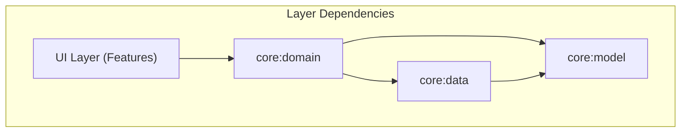

<!-- source: DeepWiki mcp.deepwiki.com · repo android/nowinandroid · page 2.3 Domain Layer · fetched 2026-10-23 -->

# Domain Layer

Relevant source files

The following files were used as context for generating this wiki page:

- [app/src/main/kotlin/com/google/samples/apps/nowinandroid/util/ProfileVerifierLogger.kt](app/src/main/kotlin/com/google/samples/apps/nowinandroid/util/ProfileVerifierLogger.kt)
- [core/common/build.gradle.kts](core/common/build.gradle.kts)
- [core/common/src/main/kotlin/com/google/samples/apps/nowinandroid/core/common/network/NiaDispatchers.kt](core/common/src/main/kotlin/com/google/samples/apps/nowinandroid/core/common/network/NiaDispatchers.kt)
- [core/common/src/main/kotlin/com/google/samples/apps/nowinandroid/core/common/network/di/CoroutineScopesModule.kt](core/common/src/main/kotlin/com/google/samples/apps/nowinandroid/core/common/network/di/CoroutineScopesModule.kt)
- [core/common/src/main/kotlin/com/google/samples/apps/nowinandroid/core/common/network/di/DispatchersModule.kt](core/common/src/main/kotlin/com/google/samples/apps/nowinandroid/core/common/network/di/DispatchersModule.kt)
- [core/common/src/main/kotlin/com/google/samples/apps/nowinandroid/core/common/result/Result.kt](core/common/src/main/kotlin/com/google/samples/apps/nowinandroid/core/common/result/Result.kt)
- [core/common/src/test/kotlin/com/google/samples/apps/nowinandroid/core/common/result/ResultKtTest.kt](core/common/src/test/kotlin/com/google/samples/apps/nowinandroid/core/common/result/ResultKtTest.kt)
- [core/data/src/main/kotlin/com/google/samples/apps/nowinandroid/core/data/util/TimeZoneMonitor.kt](core/data/src/main/kotlin/com/google/samples/apps/nowinandroid/core/data/util/TimeZoneMonitor.kt)
- [core/domain/build.gradle.kts](core/domain/build.gradle.kts)
- [core/domain/src/main/AndroidManifest.xml](core/domain/src/main/AndroidManifest.xml)
- [core/model/build.gradle.kts](core/model/build.gradle.kts)
- [core/model/src/main/kotlin/com/google/samples/apps/nowinandroid/core/model/data/UserNewsResource.kt](core/model/src/main/kotlin/com/google/samples/apps/nowinandroid/core/model/data/UserNewsResource.kt)
- [core/notifications/build.gradle.kts](core/notifications/build.gradle.kts)
- [core/notifications/src/main/res/drawable-anydpi-v24/core_notifications_ic_nia_notification.xml](core/notifications/src/main/res/drawable-anydpi-v24/core_notifications_ic_nia_notification.xml)
- [sync/work/build.gradle.kts](sync/work/build.gradle.kts)

## Purpose and Scope

The domain layer contains use cases that encapsulate business logic by combining and transforming data from multiple repositories. This optional layer sits between the Data Layer (page 2.2) and the UI Layer (page 4), centralizing complex business logic that would otherwise be duplicated across ViewModels.

---

## Overview

The domain layer in Now in Android is implemented in the `core:domain` module [core/domain/build.gradle.kts:23-23]() and follows Clean Architecture principles. Use cases are implemented as classes with a single `operator fun invoke()` method that returns a Kotlin `Flow`.

**Module**: `core:domain`

**Key Characteristics**:

| Characteristic | Description |
|---------------|-------------|
| **Optional** | Not all features require use cases; simple data access goes directly from ViewModels to repositories. |
| **Reactive** | Use cases operate on Kotlin `Flow` for reactive data propagation. |
| **Combinatorial** | Primary purpose is combining data from multiple repositories using flow operators. |
| **Reusable** | Eliminates duplicate logic when the same business logic is needed in multiple ViewModels. |

**Scope Limitation**: Use cases handle read operations only. Write operations (user actions) are typically handled by ViewModels calling repository methods directly to reduce indirection.

**Sources**: [core/domain/build.gradle.kts:1-34](), [core/model/src/main/kotlin/com/google/samples/apps/nowinandroid/core/model/data/UserNewsResource.kt:56-57]()

---

## Use Case Implementation Pattern

### Structure

Use cases in the `core:domain` module follow a consistent structure, utilizing constructor injection and the `invoke` operator.

### Key Implementation Details

| Element | Implementation |
|---------|---------------|
| **Constructor Injection** | Uses `@Inject` annotation for Hilt dependency injection. |
| **Operator Function** | `operator fun invoke()` enables functional invocation syntax (e.g., `useCase()`). |
| **Flow Return Type** | Returns cold `Flow` that ViewModels convert to `StateFlow`. |
| **Combination Logic** | Uses `combine()`, `map()`, and other flow operators to merge repository streams. |
| **Dependencies** | Depends on repository interfaces (from `core:data`) and domain models (from `core:model`). |

**Sources**: [core/domain/build.gradle.kts:26-30](), [core/model/src/main/kotlin/com/google/samples/apps/nowinandroid/core/model/data/UserNewsResource.kt:25-54]()

---

## Primary Use Cases

### GetFollowableTopicsUseCase

This use case bridges the gap between raw topic data and user-specific interaction states.

**Implementation Details**:
- **Constructor Dependencies**: `TopicsRepository` (catalog of topics) and `UserDataRepository` (user's followed topic IDs).
- **Business Logic**: It combines the stream of all topics with the stream of user data. For each `Topic`, it checks if the ID exists in the user's `followedTopics` set to produce a `FollowableTopic` model.

### GetSearchContentsUseCase

Aggregates search results across different data types (e.g., Topics and News Resources).

**Implementation Details**:
- **Logic**: Combines search results from multiple repositories into a single unified search result model.
- **Flow**: Typically triggered by a search query string from the UI, returning a `Flow` of results that updates as the underlying data or query changes.

### GetRecentSearchQueriesUseCase

Provides access to the user's local search history.

**Implementation Details**:
- **Source**: Interacts with a search-specific repository that tracks recent queries.
- **Utility**: Used in the Search feature to provide suggestions and history to the user.

---

## Data Flow and Transformations

The domain layer often performs mapping between data layer models and UI-ready models. A prime example is the creation of `UserNewsResource`.

### Natural Language to Code Entity Mapping

The following diagram maps business concepts to the specific code entities that implement them within the domain and model layers.

**Sources**: [core/model/src/main/kotlin/com/google/samples/apps/nowinandroid/core/model/data/UserNewsResource.kt:25-36](), [core/common/src/main/kotlin/com/google/samples/apps/nowinandroid/core/common/result/Result.kt:24-28]()

### Model Transformation: UserNewsResource

The `UserNewsResource` is a domain-specific model that augments a `NewsResource` with user-specific metadata (bookmarks, viewed status).

| Function/Class | Role |
|----------------|------|
| `UserNewsResource` | Data class holding both content and user state [core/model/src/main/kotlin/com/google/samples/apps/nowinandroid/core/model/data/UserNewsResource.kt:25-36](). |
| `mapToUserNewsResources` | Extension function that transforms a list of `NewsResource` using `UserData` [core/model/src/main/kotlin/com/google/samples/apps/nowinandroid/core/model/data/UserNewsResource.kt:56-57](). |

**Sources**: [core/model/src/main/kotlin/com/google/samples/apps/nowinandroid/core/model/data/UserNewsResource.kt:17-57]()

---

## Handling Asynchronous Results

The domain layer frequently uses a `Result` sealed interface to communicate the state of data fetching to the UI layer.

**Implementation**:
The `asResult()` extension function [core/common/src/main/kotlin/com/google/samples/apps/nowinandroid/core/common/result/Result.kt:30-33]() converts a standard `Flow` into a `Flow<Result<T>>`. It automatically emits `Loading` at the start [core/common/src/main/kotlin/com/google/samples/apps/nowinandroid/core/common/result/Result.kt:31-31]() and catches exceptions to emit `Error` [core/common/src/main/kotlin/com/google/samples/apps/nowinandroid/core/common/result/Result.kt:32-32]().

**Sources**: [core/common/src/main/kotlin/com/google/samples/apps/nowinandroid/core/common/result/Result.kt:17-33]()

---

## Integration and Dependencies

The `core:domain` module acts as a bridge, depending on `core:data` for repositories and `core:model` for shared data structures.

- **Data Access**: Use cases consume repositories defined in `core:data` [core/domain/build.gradle.kts:27-27]().
- **Models**: Both the data and domain layers share the models defined in `core:model` [core/domain/build.gradle.kts:28-28]().
- **Utilities**: Domain logic often relies on `core:common` for dispatchers and result handling [core/common/build.gradle.kts:1-26]().

**Sources**: [core/domain/build.gradle.kts:26-30](), [core/model/build.gradle.kts:1-24](), [core/common/build.gradle.kts:1-26]()

---

