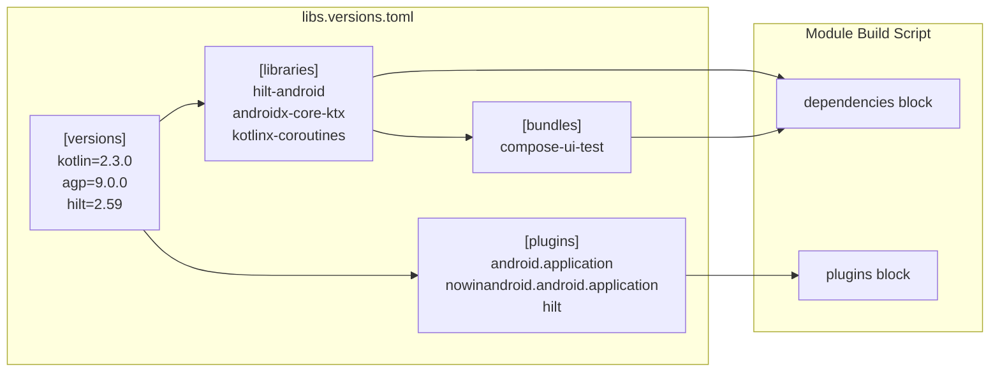

<!-- source: DeepWiki mcp.deepwiki.com · repo android/nowinandroid · page 3 Build System · fetched 2026-10-23 -->

# Build System

<details>
<summary>Relevant source files</summary>

The following files were used as context for generating this wiki page:

- [app-nia-catalog/dependencies/releaseRuntimeClasspath.txt](app-nia-catalog/dependencies/releaseRuntimeClasspath.txt)
- [app/build.gradle.kts](app/build.gradle.kts)
- [app/dependencies/prodReleaseRuntimeClasspath.txt](app/dependencies/prodReleaseRuntimeClasspath.txt)
- [benchmarks/build.gradle.kts](benchmarks/build.gradle.kts)
- [build-logic/settings.gradle.kts](build-logic/settings.gradle.kts)
- [build.gradle.kts](build.gradle.kts)
- [core/designsystem/src/test/screenshots/LoadingWheel/LoadingWheel_animation_20.png](core/designsystem/src/test/screenshots/LoadingWheel/LoadingWheel_animation_20.png)
- [core/navigation/.gitignore](core/navigation/.gitignore)
- [core/navigation/build.gradle.kts](core/navigation/build.gradle.kts)
- [gradle.properties](gradle.properties)
- [gradle/libs.versions.toml](gradle/libs.versions.toml)
- [gradle/wrapper/gradle-wrapper.jar](gradle/wrapper/gradle-wrapper.jar)
- [gradle/wrapper/gradle-wrapper.properties](gradle/wrapper/gradle-wrapper.properties)
- [gradlew](gradlew)
- [gradlew.bat](gradlew.bat)
- [settings.gradle.kts](settings.gradle.kts)

</details>


The Now in Android build system is a Gradle-based build infrastructure designed to support a modular Android application with 50+ modules. It uses a centralized version catalog, custom convention plugins in a composite build, and product flavors to manage complexity while maintaining consistency across the codebase.

For information about CI/CD pipelines and automated builds, see [CI/CD Workflows](#3.4).

## Purpose and Scope

This document covers the Gradle build configuration, dependency management through the version catalog, custom convention plugins, build flavors and variants, and how these components work together to compile and package the application. It does not cover the module structure itself (see [Module Structure](#2.1)) or testing infrastructure (see [Testing Strategy](#8)).

## Gradle Version and Wrapper

The project uses **Gradle 9.4.0** as specified in [gradle/wrapper/gradle-wrapper.properties:4](). The Gradle wrapper scripts ([gradlew:1-249]() and [gradlew.bat:1-94]()) ensure consistent build environments across all development machines and CI environments.

**Key Gradle Configuration** ([gradle.properties:1-67]()):
- JVM heap: 4GB (`-Xmx4g -Xms4g`) [gradle.properties:20-20]()
- Parallel builds enabled: `org.gradle.parallel=true` [gradle.properties:32-32]()
- Configuration cache enabled: `org.gradle.configuration-cache=true` [gradle.properties:41-41]()
- Build cache enabled: `org.gradle.caching=true` [gradle.properties:38-38]()
- Kotlin daemon heap: 4GB with G1GC [gradle.properties:27-27]()

Sources: [gradle/wrapper/gradle-wrapper.properties:1-9](), [gradle.properties:1-67](), [gradlew:1-249]()

## Build System Architecture

The build system consists of four main layers: the version catalog as the single source of truth, convention plugins for shared configuration, individual module build scripts, and the root project coordination.

```mermaid
graph TB
    subgraph "Version Catalog"
        VersionCatalog["libs.versions.toml<br/>Versions, Libraries, Plugins, Bundles"]
    end
    
    subgraph "Build Logic Composite Build"
        ConventionPlugins["build-logic/convention<br/>Custom Gradle Plugins"]
        AndroidApp["AndroidApplicationConventionPlugin"]
        AndroidLib["AndroidLibraryConventionPlugin"]
        AndroidCompose["AndroidApplicationComposeConventionPlugin"]
        Hilt["HiltConventionPlugin"]
        Room["AndroidRoomConventionPlugin"]
        Jacoco["AndroidApplicationJacocoConventionPlugin"]
        Flavors["AndroidApplicationFlavorsConventionPlugin"]
        Firebase["AndroidApplicationFirebaseConventionPlugin"]
        
        ConventionPlugins --> AndroidApp
        ConventionPlugins --> AndroidLib
        ConventionPlugins --> AndroidCompose
        ConventionPlugins --> Hilt
        ConventionPlugins --> Room
        ConventionPlugins --> Jacoco
        ConventionPlugins --> Flavors
        ConventionPlugins --> Firebase
    end
    
    subgraph "Root Project"
        RootBuild["build.gradle.kts<br/>Plugin declarations (apply false)"]
        Settings["settings.gradle.kts<br/>Module inclusion<br/>Plugin management"]
        GradleProps["gradle.properties<br/>Build configuration"]
    end
    
    subgraph "Module Build Scripts"
        AppBuild["app/build.gradle.kts"]
        FeatureBuild["feature/*/build.gradle.kts"]
        CoreBuild["core/*/build.gradle.kts"]
    end
    
    subgraph "Build Outputs"
        APKs["APKs<br/>demoDebug, demoRelease<br/>prodDebug, prodRelease"]
        Baseline["Baseline Profiles"]
        Dependencies["Dependency Lists<br/>prodReleaseRuntimeClasspath.txt"]
    end
    
    VersionCatalog --> ConventionPlugins
    VersionCatalog --> AppBuild
    VersionCatalog --> FeatureBuild
    VersionCatalog --> CoreBuild
    
    Settings --> ConventionPlugins
    Settings --> RootBuild
    
    ConventionPlugins --> AppBuild
    ConventionPlugins --> FeatureBuild
    ConventionPlugins --> CoreBuild
    
    AppBuild --> APKs
    AppBuild --> Baseline
    AppBuild --> Dependencies
```



Sources: [build.gradle.kts:24-43](), [settings.gradle.kts:17-83](), [build-logic/settings.gradle.kts:42-43]()

## Version Catalog System

The version catalog at [gradle/libs.versions.toml:1-216]() serves as the single source of truth for all dependency versions. It uses the TOML format with four main sections: `[versions]`, `[libraries]`, `[plugins]`, and `[bundles]`.

### Version Catalog Structure

**Versions Section** ([gradle/libs.versions.toml:1-66]()):
- Defines version numbers as string references
- Example: `kotlin = "2.3.0"`, `androidGradlePlugin = "9.0.0"` [gradle/libs.versions.toml:49-49](), [gradle/libs.versions.toml:5-5]()
- Enables version reuse across multiple artifacts

**Libraries Section** ([gradle/libs.versions.toml:71-176]()):
- Maps library coordinates to versions
- Format: `group = "...", name = "...", version.ref = "..."`
- Example: `androidx-core-ktx = { group = "androidx.core", name = "core-ktx", version.ref = "androidxCore" }` [gradle/libs.versions.toml:96-96]()

**Plugins Section** ([gradle/libs.versions.toml:178-216]()):
- Declares both external and internal plugins
- External: `android.application`, `kotlin.serialization`, `hilt`
- Internal convention plugins: `nowinandroid.android.application`, `nowinandroid.hilt`

**Bundles Section** ([gradle/libs.versions.toml:68-69]()):
- Groups related dependencies
- Example: `androidx-compose-ui-test = ["androidx-compose-ui-test", "androidx-compose-ui-testManifest"]` [gradle/libs.versions.toml:69-69]()



**Usage in Build Scripts**:
- Libraries: `implementation(libs.androidx.core.ktx)` [app/build.gradle.kts:100-100]()
- Bundles: `androidTestImplementation(libs.bundles.androidx.compose.ui.test)`
- Plugins: `alias(libs.plugins.nowinandroid.android.application)` [app/build.gradle.kts:19-19]()

Sources: [gradle/libs.versions.toml:1-216](), [app/build.gradle.kts:18-29]()

## Convention Plugins

The `build-logic` composite build contains custom Gradle convention plugins that encapsulate common build configurations. These plugins promote DRY principles and maintainability across the project's 50+ modules.

For details, see [Convention Plugins](#3.2).

### Key Convention Plugins

- **AndroidApplicationConventionPlugin**: Configures standard Android application settings including SDK versions, Gradle Managed Devices, and Dependency Guard. [app/build.gradle.kts:19-19]()
- **AndroidLibraryConventionPlugin**: Standard configuration for library modules, including resource prefixes and test runners.
- **HiltConventionPlugin**: Centralizes Hilt and KSP setup for both Android and JVM modules. [app/build.gradle.kts:24-24]()
- **AndroidRoomConventionPlugin**: Configures Room database with KSP and Kotlin code generation.
- **AndroidApplicationComposeConventionPlugin**: Enables and configures Jetpack Compose across application modules. [app/build.gradle.kts:20-20]()

Sources: [app/build.gradle.kts:18-29](), [build-logic/settings.gradle.kts:42-43]()

## Module Build Scripts

Individual modules apply convention plugins and declare specific dependencies. The `:app` module serves as the main application entry point, while feature and core modules use simpler configurations.

### Application Module Build Script

The [app/build.gradle.kts:1-153]() file demonstrates the layered plugin application:

```kotlin
plugins {
    alias(libs.plugins.nowinandroid.android.application)
    alias(libs.plugins.nowinandroid.android.application.compose)
    alias(libs.plugins.nowinandroid.android.application.flavors)
    alias(libs.plugins.nowinandroid.android.application.jacoco)
    alias(libs.plugins.nowinandroid.android.application.firebase)
    alias(libs.plugins.nowinandroid.hilt)
    alias(libs.plugins.google.osslicenses)
    alias(libs.plugins.baselineprofile)
    alias(libs.plugins.roborazzi)
    alias(libs.plugins.kotlin.serialization)
}
```

**Key Configuration**:
- Application ID: `com.google.samples.apps.nowinandroid` [app/build.gradle.kts:33-33]()
- Version code: `8`, Version name: `0.1.2` [app/build.gradle.kts:34-35]()
- Custom test runner: `com.google.samples.apps.nowinandroid.core.testing.NiaTestRunner` [app/build.gradle.kts:38-38]()
- Baseline profile automatic generation for release builds [app/build.gradle.kts:57-57]()
- Dependency Guard on `prodReleaseRuntimeClasspath` [app/build.gradle.kts:151-152]()

**Dependencies** ([app/build.gradle.kts:70-139]()):
- Feature modules: `:feature:foryou:impl`, `:feature:interests:impl`, etc. [app/build.gradle.kts:71-81]()
- Core modules: `:core:ui`, `:core:data`, `:core:designsystem`, etc. [app/build.gradle.kts:83-88]()
- Third-party: Hilt, Compose Material3, Coil, kotlinx-serialization [app/build.gradle.kts:91-111]()

Sources: [app/build.gradle.kts:1-153]()

### Build Output Analysis

The build produces detailed dependency reports. The `prodReleaseRuntimeClasspath.txt` ([app/dependencies/prodReleaseRuntimeClasspath.txt:1-257]()) lists all runtime dependencies for the production release variant.

Sources: [app/dependencies/prodReleaseRuntimeClasspath.txt:1-257]()

## Build Variants and Product Flavors

The build system uses product flavors and build types to support different content sources and build optimizations.

For details, see [Build Flavors and Variants](#3.3).

### Product Flavors

The project defines two flavors under the `contentType` dimension:
1. **demo**: Uses local static data for demonstration. [app/build.gradle.kts:124-129]()
2. **prod**: Connects to the production backend server. [app/dependencies/prodReleaseRuntimeClasspath.txt:1-3]()

### Build Types

- **debug**: Standard development build with `applicationIdSuffix` from `NiaBuildType.DEBUG`. [app/build.gradle.kts:42-44]()
- **release**: Optimized production build with R8 minification and Baseline Profiles enabled. [app/build.gradle.kts:45-58]()

Sources: [app/build.gradle.kts:41-59](), [benchmarks/build.gradle.kts:40-46]()

## Settings and Root Configuration

### Settings File Configuration

The [settings.gradle.kts:1-92]() file configures:

**Plugin Management** ([settings.gradle.kts:17-30]()):
- Includes `build-logic` composite build. [settings.gradle.kts:18-18]()
- Configures repositories (Google, Maven Central, Gradle Plugin Portal). [settings.gradle.kts:19-29]()

**Dependency Resolution** ([settings.gradle.kts:32-44]()):
- Repository mode: `FAIL_ON_PROJECT_REPOS`. [settings.gradle.kts:33-33]()
- Centralized repository configuration for all modules.

**Module Inclusion** ([settings.gradle.kts:48-84]()):
- Includes all core and feature modules.
- Uses type-safe project accessors: `TYPESAFE_PROJECT_ACCESSORS`. [settings.gradle.kts:47-47]()
- Enforces JDK 17+ requirement. [settings.gradle.kts:85-91]()

### Root Build File

The [build.gradle.kts:1-44]() applies all plugins with `apply false` to ensure a consistent classpath across the project:

```kotlin
plugins {
    alias(libs.plugins.android.application) apply false
    alias(libs.plugins.android.library) apply false
    alias(libs.plugins.android.test) apply false
    alias(libs.plugins.compose) apply false
    alias(libs.plugins.hilt) apply false
    alias(libs.plugins.ksp) apply false
    // ...
    alias(libs.plugins.nowinandroid.root)
}
```

Sources: [settings.gradle.kts:1-92](), [build.gradle.kts:1-44]()

## Summary

The Now in Android build system achieves maintainability through:

1. **Centralized dependency management** via version catalog. [gradle/libs.versions.toml:1-216]()
2. **Convention plugins** in composite build to reduce duplication. [build-logic/settings.gradle.kts:1-44]()
3. **Product flavors** to support demo and production environments. [app/build.gradle.kts:21-21]()
4. **Gradle configuration cache** and parallel builds for performance. [gradle.properties:32-42]()
5. **Dependency Guard** to track and validate dependency changes. [app/build.gradle.kts:150-152]()
6. **Baseline profiles** for startup optimization. [app/build.gradle.kts:141-148]()

For more details on specific components, see:
- [Dependency Management](#3.1)
- [Convention Plugins](#3.2)
- [Build Flavors and Variants](#3.3)
- [CI/CD Workflows](#3.4)
- [Code Quality and Coverage](#3.5)

---

