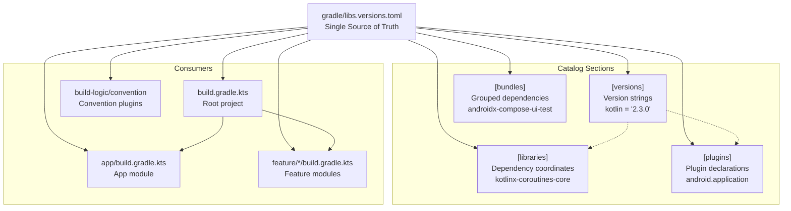
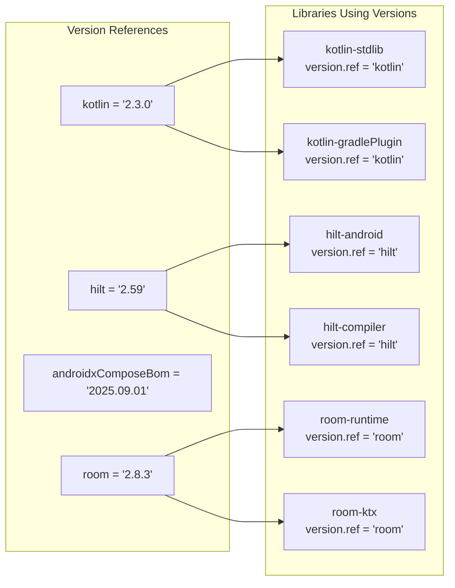
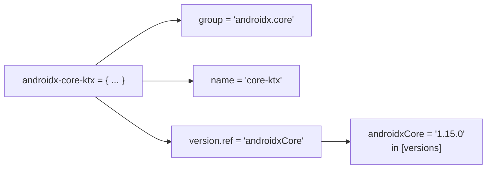
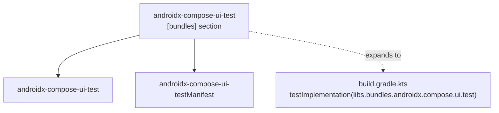
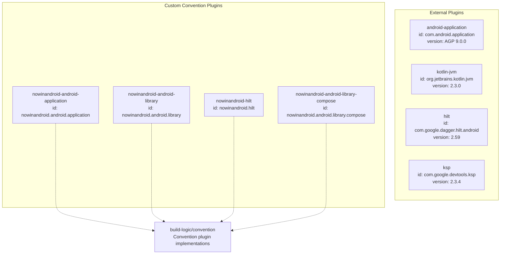
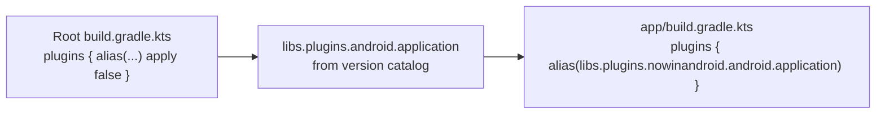
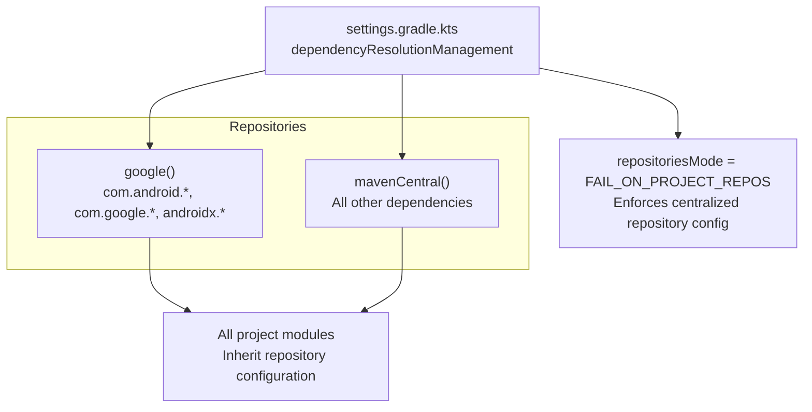
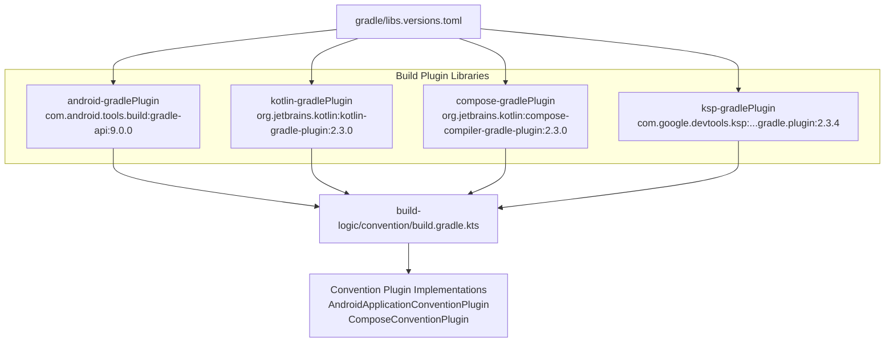
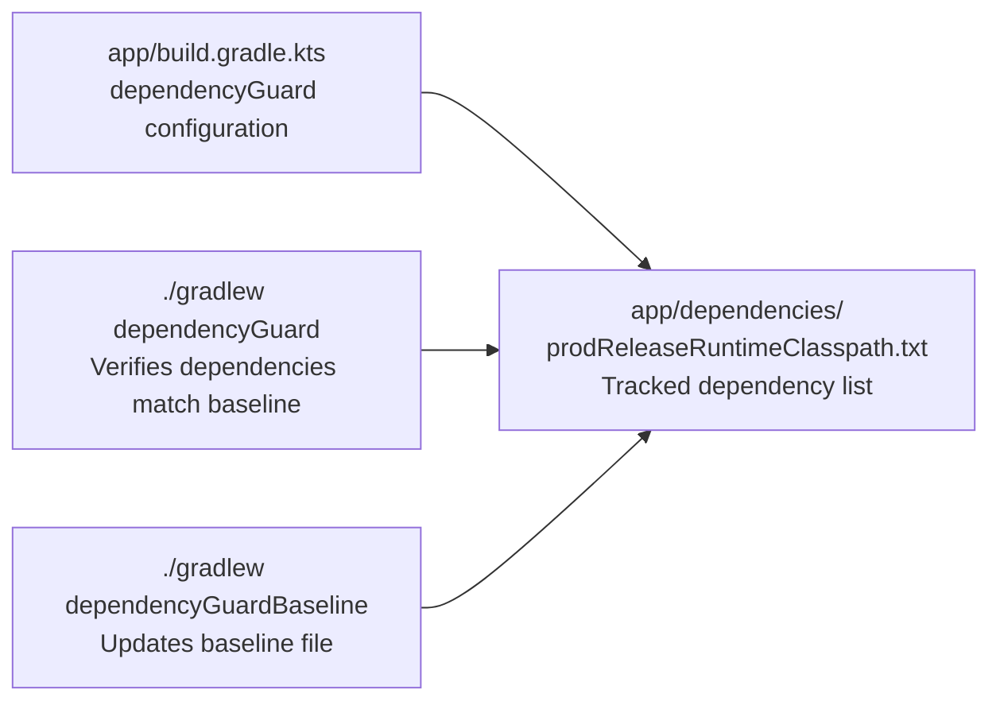
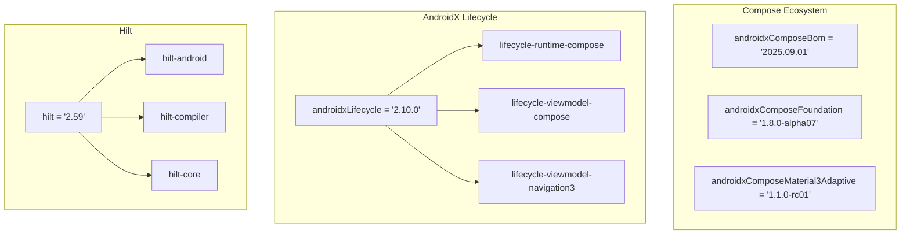

<!-- source: DeepWiki mcp.deepwiki.com · repo android/nowinandroid · page 3.1 Dependency Management · fetched 2026-10-23 -->

# Dependency Management

<details>
<summary>Relevant source files</summary>

The following files were used as context for generating this wiki page:

- [app-nia-catalog/dependencies/releaseRuntimeClasspath.txt](app-nia-catalog/dependencies/releaseRuntimeClasspath.txt)
- [app/build.gradle.kts](app/build.gradle.kts)
- [app/dependencies/prodReleaseRuntimeClasspath.txt](app/dependencies/prodReleaseRuntimeClasspath.txt)
- [benchmarks/build.gradle.kts](benchmarks/build.gradle.kts)
- [build-logic/settings.gradle.kts](build-logic/settings.gradle.kts)
- [build.gradle.kts](build.gradle.kts)
- [core/designsystem/src/test/screenshots/LoadingWheel/LoadingWheel_animation_20.png](core/designsystem/src/test/screenshots/LoadingWheel/LoadingWheel_animation_20.png)
- [core/navigation/.gitignore](core/navigation/.gitignore)
- [core/navigation/build.gradle.kts](core/navigation/build.gradle.kts)
- [gradle.properties](gradle.properties)
- [gradle/libs.versions.toml](gradle/libs.versions.toml)
- [gradle/wrapper/gradle-wrapper.jar](gradle/wrapper/gradle-wrapper.jar)
- [gradle/wrapper/gradle-wrapper.properties](gradle/wrapper/gradle-wrapper.properties)
- [gradlew](gradlew)
- [gradlew.bat](gradlew.bat)
- [settings.gradle.kts](settings.gradle.kts)

</details>


## Purpose and Scope

This page documents the centralized dependency management system used in the Now in Android project. The codebase uses Gradle's Version Catalog feature to declare all library versions, dependency coordinates, and plugin configurations in a single source of truth located at `gradle/libs.versions.toml`. This approach ensures consistent dependency versions across all 60+ modules and simplifies dependency updates.

For information about how these dependencies are applied to modules using convention plugins, see [Convention Plugins](#3.2). For details on how build variants affect dependency resolution, see [Build Flavors and Variants](#3.3).

## Version Catalog Overview

The Now in Android project centralizes dependency management using a Gradle Version Catalog defined in the TOML format. This catalog contains over 570 library versions and serves as the single source of truth for all dependency declarations across the project.



**Sources:** [gradle/libs.versions.toml:1-216](), [settings.gradle.kts:32-44](), [build-logic/settings.gradle.kts:35-39]()

## Version Catalog Structure

### The [versions] Section

The `[versions]` section declares version strings that can be referenced by multiple libraries or plugins. This allows updating a single version number to affect all dependencies that share that version.



Key version declarations include:

| Category | Version Key | Value | Usage |
|----------|-------------|-------|-------|
| Kotlin | `kotlin` | 2.3.0 | Kotlin stdlib, compiler plugin |
| AGP | `androidGradlePlugin` | 9.0.0 | Android Gradle Plugin |
| Compose | `androidxComposeBom` | 2025.09.01 | Compose BOM (Bill of Materials) |
| Hilt | `hilt` | 2.59 | Dependency injection |
| Room | `room` | 2.8.3 | Local database |
| Coroutines | `kotlinxCoroutines` | 1.10.1 | Asynchronous programming |

**Sources:** [gradle/libs.versions.toml:1-66]()

### The [libraries] Section

The `[libraries]` section defines dependency coordinates using the format `group:artifact:version`. Libraries can reference versions from the `[versions]` section using `version.ref`.

**Dependency Coordinate Structure:**



**Example library declarations:**

```toml
androidx-core-ktx = { group = "androidx.core", name = "core-ktx", version.ref = "androidxCore" }
kotlinx-coroutines-core = { group = "org.jetbrains.kotlinx", name = "kotlinx-coroutines-core", version.ref = "kotlinxCoroutines" }
hilt-android = { group = "com.google.dagger", name = "hilt-android", version.ref = "hilt" }
```

**Categories of libraries:**

| Category | Examples | Purpose |
|----------|----------|---------|
| AndroidX Core | `androidx-core-ktx`, `androidx-activity-compose` | Core Android framework |
| Compose | `androidx-compose-material3`, `androidx-compose-ui-tooling` | UI framework |
| Lifecycle | `androidx-lifecycle-viewModelCompose`, `androidx-lifecycle-runtimeCompose` | Lifecycle-aware components |
| Navigation | `androidx-navigation3-runtime`, `androidx-navigation3-ui` | Navigation framework |
| Data Layer | `room-runtime`, `androidx-dataStore`, `retrofit-core` | Data persistence and networking |
| DI | `hilt-android`, `hilt-compiler` | Dependency injection |
| Testing | `junit`, `androidx-test-espresso-core`, `roborazzi` | Test frameworks |
| Build-Logic | `android-gradlePlugin`, `kotlin-gradlePlugin` | For convention plugins |

**Sources:** [gradle/libs.versions.toml:71-177]()

### The [bundles] Section

Bundles group related dependencies that are commonly used together. This reduces boilerplate when declaring dependencies in module build files.



Currently defined bundle:

```toml
[bundles]
androidx-compose-ui-test = ["androidx-compose-ui-test", "androidx-compose-ui-testManifest"]
```

This bundle is used in test configurations to include both the Compose UI test library and its test manifest.

**Sources:** [gradle/libs.versions.toml:68-69]()

### The [plugins] Section

The `[plugins]` section declares both external plugins (from plugin repositories) and custom convention plugins defined in the `build-logic` module.



**External plugins** (lines 178-197):
- `android-application`, `android-library`: Android Gradle Plugin variants
- `kotlin-jvm`, `kotlin-serialization`: Kotlin compiler plugins
- `hilt`, `ksp`, `room`: Code generation and DI
- `firebase-crashlytics`, `firebase-perf`: Firebase services
- `roborazzi`, `baselineprofile`: Testing and performance tools

**Custom convention plugins** (lines 200-216):
- `nowinandroid-android-application`: App module configuration
- `nowinandroid-android-library`: Library module configuration  
- `nowinandroid-android-feature-impl/api`: Feature module conventions
- `nowinandroid-hilt`: Hilt DI setup
- `nowinandroid-android-room`: Room database configuration
- `nowinandroid-android-*-jacoco`: Code coverage configuration

**Sources:** [gradle/libs.versions.toml:178-216]()

## Accessing Dependencies in Build Scripts

### Plugin Declaration Syntax

Plugins are applied using the `alias()` function with the `libs.plugins` accessor:

```kotlin
// build.gradle.kts (root)
plugins {
    alias(libs.plugins.android.application) apply false
    alias(libs.plugins.kotlin.jvm) apply false
    alias(libs.plugins.hilt) apply false
    alias(libs.plugins.nowinandroid.root)
}
```

The `apply false` prevents applying the plugin to the root project while making it available to subprojects.



**Sources:** [build.gradle.kts:24-43](), [app/build.gradle.kts:18-29]()

### Dependency Declaration Syntax

Dependencies are declared using the `libs` accessor with the dot-separated path from the TOML file:

```kotlin
// app/build.gradle.kts
dependencies {
    implementation(libs.androidx.core.ktx)
    implementation(libs.androidx.lifecycle.runtimeCompose)
    implementation(libs.kotlinx.coroutines.guava)
    
    ksp(libs.hilt.compiler)
    
    testImplementation(libs.kotlin.test)
    testImplementation(libs.roborazzi)
    
    androidTestImplementation(libs.androidx.test.espresso.core)
}
```

**Accessor mapping:**
- TOML: `androidx-core-ktx` → Accessor: `libs.androidx.core.ktx`
- TOML: `kotlinx-coroutines-core` → Accessor: `libs.kotlinx.coroutines.core`
- Dashes become dots in the accessor path

**Sources:** [app/build.gradle.kts:70-139]()

### Type-Safe Project Dependencies

The project enables `TYPESAFE_PROJECT_ACCESSORS` which generates type-safe accessors for inter-module dependencies:

```kotlin
// app/build.gradle.kts
dependencies {
    implementation(projects.feature.interests.api)
    implementation(projects.feature.interests.impl)
    implementation(projects.core.ui)
    implementation(projects.core.data)
    implementation(projects.sync.work)
}
```

This is enabled in `settings.gradle.kts` and provides compile-time safety for project references.

**Sources:** [settings.gradle.kts:47](), [app/build.gradle.kts:71-89]()

## Repository Configuration

### Main Project Repositories

Repository configuration is centralized in `settings.gradle.kts` using `dependencyResolutionManagement`:



The `FAIL_ON_PROJECT_REPOS` mode prevents individual modules from declaring their own repositories, ensuring consistency.

**Repository content filtering:**
```kotlin
google {
    content {
        includeGroupByRegex("com\\.android.*")
        includeGroupByRegex("com\\.google.*")
        includeGroupByRegex("androidx.*")
    }
}
```

This optimization ensures that Google's repository is only queried for dependencies from Google/AndroidX groups, speeding up dependency resolution.

**Sources:** [settings.gradle.kts:32-44]()

### Build-Logic Repository Configuration

The `build-logic` module has its own `settings.gradle.kts` that configures repositories and imports the version catalog:

```kotlin
dependencyResolutionManagement {
    repositories {
        google {
            content {
                includeGroupByRegex("com\\.android.*")
                includeGroupByRegex("com\\.google.*")
                includeGroupByRegex("androidx.*")
            }
        }
        mavenCentral()
    }
    versionCatalogs {
        create("libs") {
            from(files("../gradle/libs.versions.toml"))
        }
    }
}
```

This allows convention plugins in `build-logic` to access the same version catalog as the main project.

**Sources:** [build-logic/settings.gradle.kts:24-40]()

## Build-Logic Integration

The custom convention plugins in the `build-logic` module depend on Gradle plugins, which are declared in the version catalog's `[libraries]` section with special entries:



These are declared with the `-gradlePlugin` suffix to distinguish them from the runtime libraries:

```toml
android-gradlePlugin = { group = "com.android.tools.build", name = "gradle-api", version.ref = "androidGradlePlugin" }
kotlin-gradlePlugin = { group = "org.jetbrains.kotlin", name = "kotlin-gradle-plugin", version.ref = "kotlin" }
compose-gradlePlugin = { module = "org.jetbrains.kotlin:compose-compiler-gradle-plugin", version.ref = "kotlin" }
ksp-gradlePlugin = { group = "com.google.devtools.ksp", name = "com.google.devtools.ksp.gradle.plugin", version.ref = "ksp" }
```

**Sources:** [gradle/libs.versions.toml:167-176](), [build-logic/settings.gradle.kts:35-39]()

## Dependency Guard Integration

The project uses the Dependency Guard plugin to track and verify resolved dependencies. This creates a baseline of the runtime classpath which must be explicitly updated when dependencies change.



Configuration in the app module:

```kotlin
dependencyGuard {
    configuration("prodReleaseRuntimeClasspath")
}
```

The baseline file lists all resolved dependencies for the specified configuration. When dependencies change, the build fails until the baseline is updated.

**Sources:** [app/build.gradle.kts:150-152](), [app/dependencies/prodReleaseRuntimeClasspath.txt:1-257]()

## Gradle Properties Configuration

The `gradle.properties` file contains build configuration that affects dependency resolution:

| Property | Value | Impact |
|----------|-------|--------|
| `org.gradle.parallel` | `true` | Enables parallel module builds |
| `org.gradle.caching` | `true` | Enables build cache |
| `org.gradle.configuration-cache` | `true` | Enables configuration cache for faster builds |
| `org.gradle.jvmargs` | `-Xmx4g -Xms4g` | Allocates 4GB heap for Gradle daemon |
| `kotlin.daemon.jvmargs` | `-Xmx4g -Xms4g` | Allocates 4GB heap for Kotlin daemon |
| `android.useAndroidX` | `true` | Uses AndroidX libraries |

These settings optimize build performance and enable modern Gradle features.

**Sources:** [gradle.properties:1-66]()

## Version Synchronization Strategy

The project keeps related dependencies synchronized using shared version variables:



This strategy ensures that:
- All Compose libraries use compatible versions
- Lifecycle components are synchronized
- Hilt dependencies match across compilation and runtime
- Test libraries match their corresponding runtime libraries

**Sources:** [gradle/libs.versions.toml:1-66]()

## Summary of Key Files

| File | Purpose |
|------|---------|
| `gradle/libs.versions.toml` | Central version catalog defining all dependencies |
| `settings.gradle.kts` | Repository configuration and module includes |
| `build.gradle.kts` | Root project plugin declarations |
| `build-logic/settings.gradle.kts` | Build-logic repository config and catalog import |
| `gradle.properties` | Build performance and behavior configuration |
| `app/dependencies/*.txt` | Dependency Guard baseline files |

---

