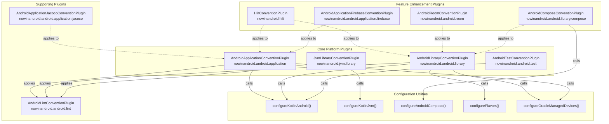
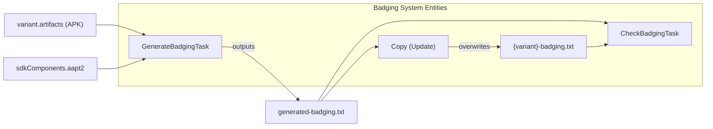
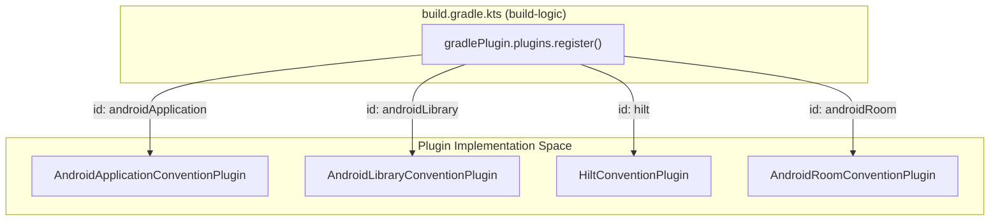

<!-- source: DeepWiki mcp.deepwiki.com · repo android/nowinandroid · page 3.2 Convention Plugins · fetched 2026-10-23 -->

# Convention Plugins

Relevant source files

The following files were used as context for generating this wiki page:

- [build-logic/README.md](build-logic/README.md)
- [build-logic/convention/build.gradle.kts](build-logic/convention/build.gradle.kts)
- [build-logic/convention/src/main/kotlin/AndroidApplicationConventionPlugin.kt](build-logic/convention/src/main/kotlin/AndroidApplicationConventionPlugin.kt)
- [build-logic/convention/src/main/kotlin/AndroidApplicationFirebaseConventionPlugin.kt](build-logic/convention/src/main/kotlin/AndroidApplicationFirebaseConventionPlugin.kt)
- [build-logic/convention/src/main/kotlin/AndroidLibraryConventionPlugin.kt](build-logic/convention/src/main/kotlin/AndroidLibraryConventionPlugin.kt)
- [build-logic/convention/src/main/kotlin/AndroidRoomConventionPlugin.kt](build-logic/convention/src/main/kotlin/AndroidRoomConventionPlugin.kt)
- [build-logic/convention/src/main/kotlin/AndroidTestConventionPlugin.kt](build-logic/convention/src/main/kotlin/AndroidTestConventionPlugin.kt)
- [build-logic/convention/src/main/kotlin/HiltConventionPlugin.kt](build-logic/convention/src/main/kotlin/HiltConventionPlugin.kt)
- [build-logic/convention/src/main/kotlin/JvmLibraryConventionPlugin.kt](build-logic/convention/src/main/kotlin/JvmLibraryConventionPlugin.kt)
- [build-logic/convention/src/main/kotlin/RootPlugin.kt](build-logic/convention/src/main/kotlin/RootPlugin.kt)
- [build-logic/convention/src/main/kotlin/com/google/samples/apps/nowinandroid/AndroidCompose.kt](build-logic/convention/src/main/kotlin/com/google/samples/apps/nowinandroid/AndroidCompose.kt)
- [build-logic/convention/src/main/kotlin/com/google/samples/apps/nowinandroid/Badging.kt](build-logic/convention/src/main/kotlin/com/google/samples/apps/nowinandroid/Badging.kt)
- [build-logic/convention/src/main/kotlin/com/google/samples/apps/nowinandroid/GradleManagedDevices.kt](build-logic/convention/src/main/kotlin/com/google/samples/apps/nowinandroid/GradleManagedDevices.kt)
- [build-logic/convention/src/main/kotlin/com/google/samples/apps/nowinandroid/KotlinAndroid.kt](build-logic/convention/src/main/kotlin/com/google/samples/apps/nowinandroid/KotlinAndroid.kt)
- [build-logic/convention/src/main/kotlin/com/google/samples/apps/nowinandroid/NiaFlavor.kt](build-logic/convention/src/main/kotlin/com/google/samples/apps/nowinandroid/NiaFlavor.kt)
- [lint/build.gradle.kts](lint/build.gradle.kts)

## Purpose and Scope

Convention plugins are custom Gradle plugins located in the `build-logic/convention` directory that standardize build configuration across all modules in the Now in Android project. These plugins encapsulate common build logic, reducing duplication and ensuring consistency in settings like SDK versions, compiler options, and dependency injection setup.

For information about the centralized dependency versions used by these plugins, see [Dependency Management](3.1). For details on build flavors and variants configured by these plugins, see [Build Flavors and Variants](3.3).

**Sources:** [build-logic/convention/src/main/kotlin/AndroidApplicationConventionPlugin.kt:29-49](), [build-logic/convention/src/main/kotlin/AndroidLibraryConventionPlugin.kt:32-66]()

---

## Convention Plugin Architecture

The convention plugin system consists of a set of composable plugins that can be applied to different module types. Each plugin applies specific configurations and can depend on other convention plugins to build up complete build configurations.

### Plugin Hierarchy

**Sources:** [build-logic/convention/src/main/kotlin/AndroidApplicationConventionPlugin.kt:29-49](), [build-logic/convention/src/main/kotlin/AndroidLibraryConventionPlugin.kt:32-66](), [build-logic/convention/src/main/kotlin/HiltConventionPlugin.kt:24-50]()

---

## Core Platform Plugins

### AndroidApplicationConventionPlugin

Configures Android application modules (`:app`). This plugin sets up the foundation for the main application entry point.

**Plugin ID:** `nowinandroid.android.application`

**Applied Plugins:**
- `com.android.application` [AndroidApplicationConventionPlugin.kt:32]()
- `nowinandroid.android.lint` [AndroidApplicationConventionPlugin.kt:33]()
- `com.dropbox.dependency-guard` [AndroidApplicationConventionPlugin.kt:34]()

**Configuration:**
- Calls `configureKotlinAndroid()` to set up Kotlin compilation [AndroidApplicationConventionPlugin.kt:37]()
- Sets `targetSdk = 36` [AndroidApplicationConventionPlugin.kt:38]()
- Disables animations in tests [AndroidApplicationConventionPlugin.kt:39]()
- Configures Gradle managed devices via `configureGradleManagedDevices()` [AndroidApplicationConventionPlugin.kt:40]()
- Sets up APK printing tasks via `configurePrintApksTask()` [AndroidApplicationConventionPlugin.kt:43]()
- Configures badging verification via `configureBadgingTasks()` [AndroidApplicationConventionPlugin.kt:44]()

**Sources:** [build-logic/convention/src/main/kotlin/AndroidApplicationConventionPlugin.kt:29-49]()

---

### AndroidLibraryConventionPlugin

Configures Android library modules (`:core:*`, `:feature:*:impl`). This is the most commonly used convention plugin in the project.

**Plugin ID:** `nowinandroid.android.library`

**Applied Plugins:**
- `com.android.library` [AndroidLibraryConventionPlugin.kt:35]()
- `nowinandroid.android.lint` [AndroidLibraryConventionPlugin.kt:36]()

**Configuration:**
- Calls `configureKotlinAndroid()` to set up Kotlin compilation [AndroidLibraryConventionPlugin.kt:39]()
- Sets `targetSdk = 36` across test options and lint [AndroidLibraryConventionPlugin.kt:40-41]()
- Sets `testInstrumentationRunner = "androidx.test.runner.AndroidJUnitRunner"` [AndroidLibraryConventionPlugin.kt:42]()
- Disables animations in tests [AndroidLibraryConventionPlugin.kt:43]()
- Configures product flavors via `configureFlavors()` [AndroidLibraryConventionPlugin.kt:44]()
- Configures Gradle managed devices [AndroidLibraryConventionPlugin.kt:45]()
- Sets automatic resource prefix based on module path [AndroidLibraryConventionPlugin.kt:48-50]()
- Adds `kotlin.test` and `androidx.tracing.ktx` dependencies [AndroidLibraryConventionPlugin.kt:58-62]()

**Resource Prefix Convention:**
Resources in `:core:module1` must be prefixed with `core_module1_`. This is automatically derived from the module path using a regex that joins distinct path segments with underscores [AndroidLibraryConventionPlugin.kt:48-50]().

**Sources:** [build-logic/convention/src/main/kotlin/AndroidLibraryConventionPlugin.kt:32-66]()

---

### AndroidTestConventionPlugin

Configures standalone Android test modules.

**Plugin ID:** `nowinandroid.android.test`

**Applied Plugins:**
- `com.android.test` [AndroidTestConventionPlugin.kt:28]()

**Configuration:**
- Calls `configureKotlinAndroid()` for Kotlin setup [AndroidTestConventionPlugin.kt:31]()
- Sets `targetSdk = 36` [AndroidTestConventionPlugin.kt:32]()
- Configures Gradle managed devices [AndroidTestConventionPlugin.kt:33]()

**Sources:** [build-logic/convention/src/main/kotlin/AndroidTestConventionPlugin.kt:25-37]()

---

### JvmLibraryConventionPlugin

Configures pure JVM library modules (`:core:model`). These modules do not depend on Android APIs.

**Plugin ID:** `nowinandroid.jvm.library`

**Applied Plugins:**
- `org.jetbrains.kotlin.jvm` [JvmLibraryConventionPlugin.kt:28]()
- `nowinandroid.android.lint` [JvmLibraryConventionPlugin.kt:29]()

**Configuration:**
- Calls `configureKotlinJvm()` for JVM-specific Kotlin setup [JvmLibraryConventionPlugin.kt:31]()
- Adds `kotlin.test` dependency [JvmLibraryConventionPlugin.kt:34]()

**Sources:** [build-logic/convention/src/main/kotlin/JvmLibraryConventionPlugin.kt:25-38]()

---

## Feature Enhancement Plugins

### HiltConventionPlugin

Configures Hilt dependency injection for both Android and JVM modules.

**Plugin ID:** `nowinandroid.hilt`

**Applied Plugins:**
- `com.google.devtools.ksp` [HiltConventionPlugin.kt:27]()

**Configuration:**
The plugin adapts based on the type of module:

**For JVM Modules** (detected via `org.jetbrains.kotlin.jvm` plugin):
- Adds `hilt.core` implementation dependency [HiltConventionPlugin.kt:37]()

**For Android Modules** (detected via `com.android.base` plugin):
- Applies `dagger.hilt.android.plugin` [HiltConventionPlugin.kt:43]()
- Adds `hilt.android` implementation dependency [HiltConventionPlugin.kt:45]()

**Common Configuration:**
- Adds `hilt.compiler` and `kotlin.metadata` as KSP processors [HiltConventionPlugin.kt:30-31]()

**Sources:** [build-logic/convention/src/main/kotlin/HiltConventionPlugin.kt:24-50]()

---

### AndroidRoomConventionPlugin

Configures Room database setup for modules that use local persistence.

**Plugin ID:** `nowinandroid.android.room`

**Applied Plugins:**
- `androidx.room` [AndroidRoomConventionPlugin.kt:30]()
- `com.google.devtools.ksp` [AndroidRoomConventionPlugin.kt:31]()

**Configuration:**
- Enables Kotlin code generation: `room.generateKotlin = true` [AndroidRoomConventionPlugin.kt:34]()
- Sets schema directory to `$projectDir/schemas` [AndroidRoomConventionPlugin.kt:41]()
- Adds Room dependencies: `room.runtime`, `room.ktx`, `room.compiler` [AndroidRoomConventionPlugin.kt:45-47]()

**Sources:** [build-logic/convention/src/main/kotlin/AndroidRoomConventionPlugin.kt:26-51]()

---

### AndroidApplicationFirebaseConventionPlugin

Configures Firebase services for the application module.

**Plugin ID:** `nowinandroid.android.application.firebase`

**Applied Plugins:**
- `com.google.gms.google-services` [AndroidApplicationFirebaseConventionPlugin.kt:30]()
- `com.google.firebase.firebase-perf` [AndroidApplicationFirebaseConventionPlugin.kt:31]()
- `com.google.firebase.crashlytics` [AndroidApplicationFirebaseConventionPlugin.kt:32]()

**Dependencies:**
- `firebase-bom` - Firebase Bill of Materials [AndroidApplicationFirebaseConventionPlugin.kt:36]()
- `firebase.analytics`, `firebase.performance`, `firebase.crashlytics` [AndroidApplicationFirebaseConventionPlugin.kt:37-48]()

**Sources:** [build-logic/convention/src/main/kotlin/AndroidApplicationFirebaseConventionPlugin.kt:27-63]()

---

## Configuration Utilities

### Kotlin Configuration

#### configureKotlinAndroid()

Configures Kotlin compilation for Android modules.

**SDK Configuration:**
- `compileSdk = 36` [KotlinAndroid.kt:38]()
- `minSdk = 23` [KotlinAndroid.kt:41]()
- Java 11 source/target compatibility [KotlinAndroid.kt:47-48]()
- Enables core library desugaring [KotlinAndroid.kt:49]()

**Kotlin Compiler Options:**
- JVM target: `JVM_11` [KotlinAndroid.kt:88]()
- Treats warnings as errors (configurable via `warningsAsErrors` Gradle property) [KotlinAndroid.kt:80-89]()
- Enables experimental coroutines APIs: `-opt-in=kotlinx.coroutines.ExperimentalCoroutinesApi` [KotlinAndroid.kt:92]()
- Enables consistent data class copy visibility: `-Xconsistent-data-class-copy-visibility` [KotlinAndroid.kt:106]()

**Sources:** [build-logic/convention/src/main/kotlin/com/google/samples/apps/nowinandroid/KotlinAndroid.kt:34-58](), [KotlinAndroid.kt:77-109]()

---

### Compose Configuration

#### configureAndroidCompose()

Configures Jetpack Compose for modules that use Compose UI.

**Build Features:**
- Enables Compose: `compose = true` [AndroidCompose.kt:34]()

**Compose Compiler Configuration:**
- **Metrics/Reports:** Enabled via `enableComposeCompilerMetrics` and `enableComposeCompilerReports` Gradle properties [AndroidCompose.kt:55-61]()
- **Stability Configuration:** Uses root `compose_compiler_config.conf` file [AndroidCompose.kt:64-65]()

**Sources:** [build-logic/convention/src/main/kotlin/com/google/samples/apps/nowinandroid/AndroidCompose.kt:29-67]()

---

### Badging Verification System

Configures APK badging verification for application modules via `configureBadgingTasks`.

**System Flow:**

**Task Roles:**
1. **`GenerateBadgingTask`**: Executes `aapt2 dump badging` on the APK to extract manifest details [Badging.kt:60-71]().
2. **`CheckBadgingTask`**: Compares the generated badging file with a "golden" file in the project directory [Badging.kt:96-104]().
3. **Update Task**: A standard `Copy` task that promotes the generated file to be the new golden file [Badging.kt:129-133]().

**Sources:** [build-logic/convention/src/main/kotlin/com/google/samples/apps/nowinandroid/Badging.kt:44-145]()

---

### Gradle Managed Devices

Configures a set of standard virtual devices for consistent testing environments via `configureGradleManagedDevices`.

| Device Name | API Level | System Image |
| :--- | :--- | :--- |
| Pixel 4 | 30 | aosp-atd |
| Pixel 6 | 31 | aosp |
| Pixel C | 30 | aosp-atd |

**Sources:** [build-logic/convention/src/main/kotlin/com/google/samples/apps/nowinandroid/GradleManagedDevices.kt:30-32]()

---

## Plugin Registration

Plugins are registered in `build-logic/convention/build.gradle.kts` using the `gradlePlugin` block.

**Sources:** [build-logic/convention/build.gradle.kts:60-127]()

---

