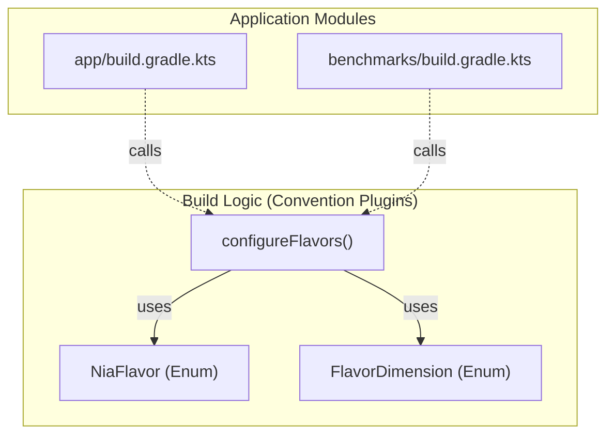
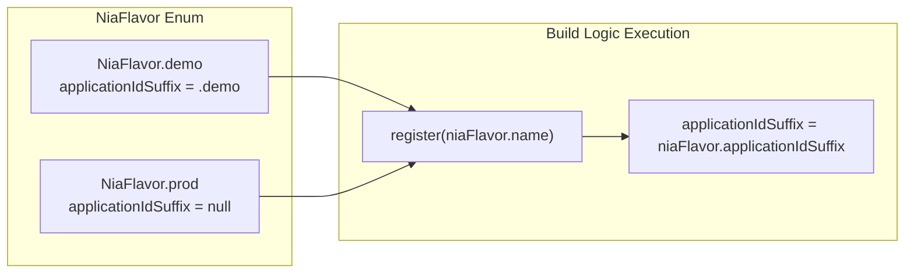
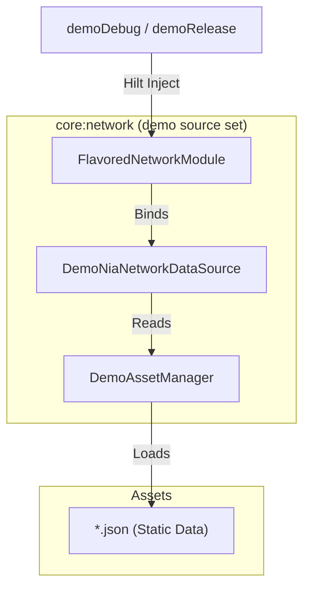
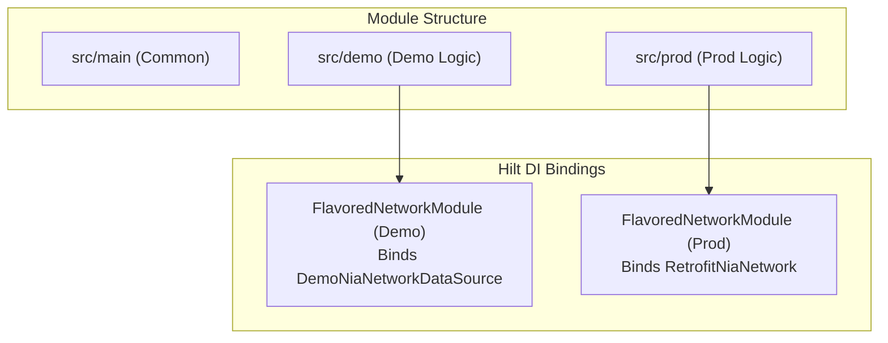

<!-- source: DeepWiki mcp.deepwiki.com · repo android/nowinandroid · page 3.3 Build Flavors and Variants · fetched 2026-10-23 -->

# Build Flavors and Variants

Relevant source files

The following files were used as context for generating this wiki page:

- [app/benchmark-rules.pro](app/benchmark-rules.pro)
- [app/src/prod/AndroidManifest.xml](app/src/prod/AndroidManifest.xml)
- [build-logic/convention/src/main/kotlin/AndroidApplicationFlavorsConventionPlugin.kt](build-logic/convention/src/main/kotlin/AndroidApplicationFlavorsConventionPlugin.kt)
- [build-logic/convention/src/main/kotlin/com/google/samples/apps/nowinandroid/AndroidCompose.kt](build-logic/convention/src/main/kotlin/com/google/samples/apps/nowinandroid/AndroidCompose.kt)
- [build-logic/convention/src/main/kotlin/com/google/samples/apps/nowinandroid/GradleManagedDevices.kt](build-logic/convention/src/main/kotlin/com/google/samples/apps/nowinandroid/GradleManagedDevices.kt)
- [build-logic/convention/src/main/kotlin/com/google/samples/apps/nowinandroid/KotlinAndroid.kt](build-logic/convention/src/main/kotlin/com/google/samples/apps/nowinandroid/KotlinAndroid.kt)
- [build-logic/convention/src/main/kotlin/com/google/samples/apps/nowinandroid/NiaBuildType.kt](build-logic/convention/src/main/kotlin/com/google/samples/apps/nowinandroid/NiaBuildType.kt)
- [build-logic/convention/src/main/kotlin/com/google/samples/apps/nowinandroid/NiaFlavor.kt](build-logic/convention/src/main/kotlin/com/google/samples/apps/nowinandroid/NiaFlavor.kt)
- [core/analytics/src/main/AndroidManifest.xml](core/analytics/src/main/AndroidManifest.xml)
- [core/data/src/main/AndroidManifest.xml](core/data/src/main/AndroidManifest.xml)
- [core/database/src/main/AndroidManifest.xml](core/database/src/main/AndroidManifest.xml)
- [core/datastore-test/src/main/AndroidManifest.xml](core/datastore-test/src/main/AndroidManifest.xml)
- [core/datastore/src/main/AndroidManifest.xml](core/datastore/src/main/AndroidManifest.xml)
- [core/designsystem/src/main/AndroidManifest.xml](core/designsystem/src/main/AndroidManifest.xml)
- [core/network/src/main/AndroidManifest.xml](core/network/src/main/AndroidManifest.xml)
- [core/testing/src/main/AndroidManifest.xml](core/testing/src/main/AndroidManifest.xml)
- [core/ui/src/main/AndroidManifest.xml](core/ui/src/main/AndroidManifest.xml)

## Purpose and Scope

This document describes the product flavor and build variant configuration in Now in Android. It covers the two product flavors (`demo` and `prod`), build types (`debug`, `release`, `benchmark`), and how they combine to create build variants with different data sources and configurations. 

For information about the Gradle plugin that applies these configurations, see [Convention Plugins](3.2). For CI/CD automation that builds different variants, see [CI/CD Workflows](3.4).

---

## Overview

Now in Android uses Gradle's product flavor system to create different versions of the application with distinct data sources and behaviors. The application defines:

- **One flavor dimension**: `contentType` [build-logic/convention/src/main/kotlin/com/google/samples/apps/nowinandroid/NiaFlavor.kt:27-28]()
- **Two product flavors**: `demo` and `prod` [build-logic/convention/src/main/kotlin/com/google/samples/apps/nowinandroid/NiaFlavor.kt:35-36]()
- **Three build types**: `debug`, `release`, and `benchmark` [build-logic/convention/src/main/kotlin/com/google/samples/apps/nowinandroid/NiaBuildType.kt:22-25]()
- **Multiple build variants**: Combinations like `demoDebug`, `prodRelease`, etc.

The primary purpose of flavors is to enable development and testing with static local data (`demo`) while maintaining a production variant (`prod`) that connects to real backend services.

**Flavor Configuration Architecture**

Sources: [build-logic/convention/src/main/kotlin/com/google/samples/apps/nowinandroid/NiaFlavor.kt:26-62](), [build-logic/convention/src/main/kotlin/com/google/samples/apps/nowinandroid/NiaBuildType.kt:22-25]()

---

## Product Flavors

### Flavor Definition

The codebase defines two product flavors under a single dimension using the `NiaFlavor` enum:

| Flavor | Dimension | Application ID Suffix | Purpose |
|--------|-----------|----------------------|---------|
| `demo` | `contentType` | `.demo` | Static local data for development and testing |
| `prod` | `contentType` | none | Production backend data for release |

The flavor configuration is centralized in `NiaFlavor.kt`:

Sources: [build-logic/convention/src/main/kotlin/com/google/samples/apps/nowinandroid/NiaFlavor.kt:34-37](), [build-logic/convention/src/main/kotlin/com/google/samples/apps/nowinandroid/NiaFlavor.kt:49-59]()

### Demo Flavor

The `demo` flavor provides a completely offline experience using static JSON data embedded in the application's assets. This enables:

- **Deterministic testing**: Screenshot tests and UI tests run against stable data.
- **Offline development**: No backend infrastructure required.
- **Stable benchmarks**: Performance measurements aren't affected by network variability.

**Demo Flavor Data Flow**

Sources: [build-logic/convention/src/main/kotlin/com/google/samples/apps/nowinandroid/NiaFlavor.kt:30-32](), [core/network/src/demo/kotlin/com/google/samples/apps/nowinandroid/core/network/di/FlavoredNetworkModule.kt:26-32]()

### Prod Flavor

The `prod` flavor connects to a production backend server via Retrofit to fetch real-time data. This is the flavor used for Play Store releases.

Sources: [core/network/src/prod/kotlin/com/google/samples/apps/nowinandroid/core/network/di/FlavoredNetworkModule.kt:26-32]()

---

## Build Types

### Build Type Configuration

The app module defines build types with specific configurations for different development and release scenarios:

| Build Type | Minification | Application ID Suffix | Purpose |
|------------|--------------|----------------------|---------|
| `debug` | No | `.debug` | Development |
| `release` | Yes (R8) | none | Production builds |
| `benchmark` | No | none | Macrobenchmark testing |

The suffixes are defined in the `NiaBuildType` enum.

Sources: [build-logic/convention/src/main/kotlin/com/google/samples/apps/nowinandroid/NiaBuildType.kt:22-25]()

**Benchmark Build Type**

The `benchmark` build type is used for performance testing. It typically disables obfuscation via `benchmark-rules.pro` to ensure that Baseline Profiles generate correct symbols.

Sources: [app/benchmark-rules.pro:1-6]()

---

## Build Variants

Build variants are created by combining product flavors with build types.

| Variant | Flavor | Build Type | Data Source | Use Case |
|---------|--------|------------|-------------|----------|
| `demoDebug` | demo | debug | Local JSON | Development with stable data |
| `demoRelease` | demo | release | Local JSON | Release testing with stable data |
| `prodDebug` | prod | debug | Backend API | Development with real data |
| `prodRelease` | prod | release | Backend API | Production Play Store release |

**Gradle Managed Devices**

Variants are tested using Gradle Managed Devices, which are configured centrally to ensure consistency across environments.

Sources: [build-logic/convention/src/main/kotlin/com/google/samples/apps/nowinandroid/GradleManagedDevices.kt:27-58]()

---

## Flavor-Specific Source Sets

Gradle's source set system allows different implementations based on the active flavor. The most significant use case is network data source binding through Hilt.

### Source Set Structure

Both flavor-specific source sets define a `FlavoredNetworkModule` at the same package path but with different implementations. This allows the application to depend on the `NiaNetworkDataSource` interface while the concrete implementation is swapped at build time.

Sources: [core/network/src/demo/kotlin/com/google/samples/apps/nowinandroid/core/network/di/FlavoredNetworkModule.kt:26-32](), [core/network/src/prod/kotlin/com/google/samples/apps/nowinandroid/core/network/di/FlavoredNetworkModule.kt:26-32]()

---

## Flavor Configuration API

### `configureFlavors` Function

The `configureFlavors()` function in `NiaFlavor.kt` is the central API for applying flavor configuration across modules. It:
1. Iterates through `FlavorDimension` entries to set `flavorDimensions`. [build-logic/convention/src/main/kotlin/com/google/samples/apps/nowinandroid/NiaFlavor.kt:44-46]()
2. Iterates through `NiaFlavor` entries to register `productFlavors`. [build-logic/convention/src/main/kotlin/com/google/samples/apps/nowinandroid/NiaFlavor.kt:49-50]()
3. Sets the `applicationIdSuffix` for the `demo` flavor if the extension is an `ApplicationExtension`. [build-logic/convention/src/main/kotlin/com/google/samples/apps/nowinandroid/NiaFlavor.kt:53-57]()

Sources: [build-logic/convention/src/main/kotlin/com/google/samples/apps/nowinandroid/NiaFlavor.kt:39-62]()

### Kotlin Configuration

All flavors and variants benefit from shared Kotlin configurations, such as targeting JVM 11 and enabling experimental coroutines APIs.

Sources: [build-logic/convention/src/main/kotlin/com/google/samples/apps/nowinandroid/KotlinAndroid.kt:34-58](), [build-logic/convention/src/main/kotlin/com/google/samples/apps/nowinandroid/KotlinAndroid.kt:87-93]()

---

## Summary

The Now in Android build flavor system provides:

1. **Two product flavors** (`demo`, `prod`) under the `contentType` dimension.
2. **Flavor-specific source sets** for dependency injection bindings.
3. **Build variants** combining flavors with build types.
4. **Centralized configuration** via the `configureFlavors()` API and `NiaFlavor` enum.
5. **Standardized JVM/Kotlin options** applied across all variants.

Sources: [build-logic/convention/src/main/kotlin/com/google/samples/apps/nowinandroid/NiaFlavor.kt:1-62](), [build-logic/convention/src/main/kotlin/com/google/samples/apps/nowinandroid/KotlinAndroid.kt:34-58]()

---

