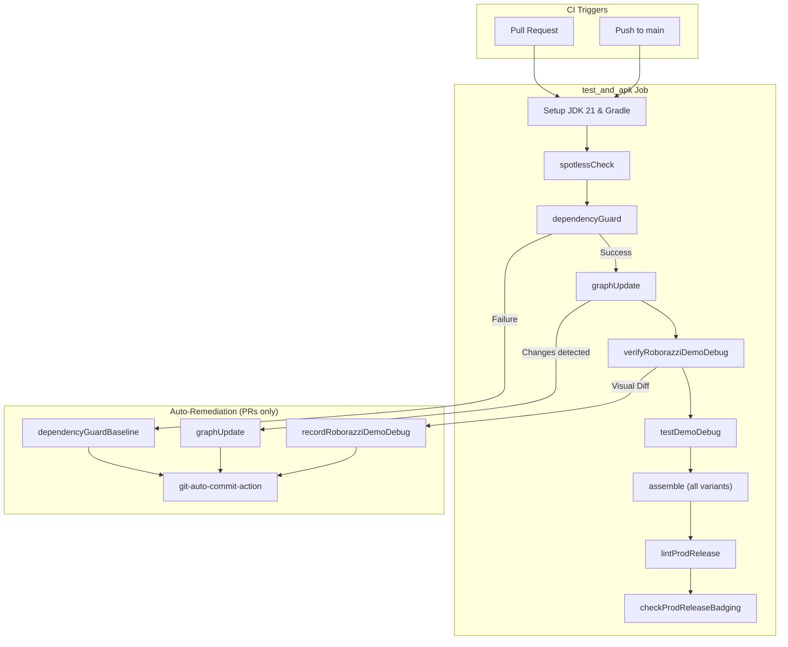
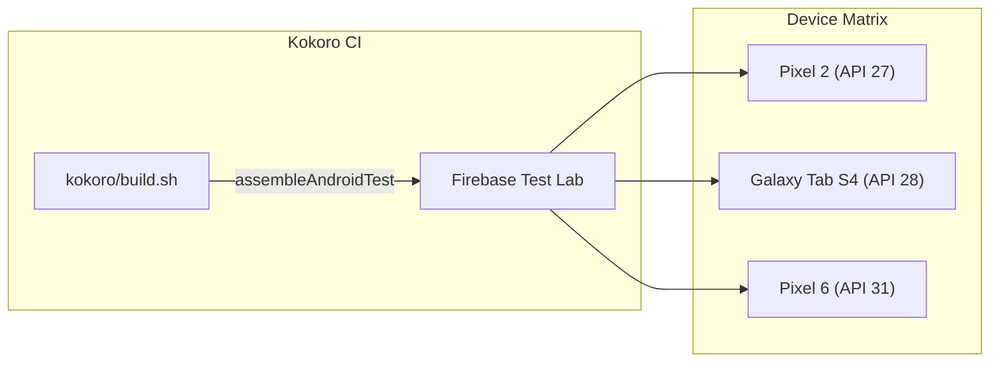

<!-- source: DeepWiki mcp.deepwiki.com · repo android/nowinandroid · page 3.4 CI/CD Workflows · fetched 2026-10-23 -->

# CI/CD Workflows

Relevant source files

The following files were used as context for generating this wiki page:

- [.github/ci-gradle.properties](.github/ci-gradle.properties)
- [.github/pull_request_template.md](.github/pull_request_template.md)
- [.github/renovate.json](.github/renovate.json)
- [.github/workflows/Build.yaml](.github/workflows/Build.yaml)
- [.github/workflows/NightlyBaselineProfiles.yaml](.github/workflows/NightlyBaselineProfiles.yaml)
- [.github/workflows/Release.yml](.github/workflows/Release.yml)
- [.run/spotlessApply.run.xml](.run/spotlessApply.run.xml)
- [AGENT.md](AGENT.md)
- [AGENTS.md](AGENTS.md)
- [benchmarks/src/main/kotlin/com/google/samples/apps/nowinandroid/startup/StartupBenchmark.kt](benchmarks/src/main/kotlin/com/google/samples/apps/nowinandroid/startup/StartupBenchmark.kt)
- [build-logic/gradle.properties](build-logic/gradle.properties)
- [build_android_release.sh](build_android_release.sh)
- [kokoro/build.sh](kokoro/build.sh)
- [kokoro/continuous.cfg](kokoro/continuous.cfg)
- [kokoro/nightly.cfg](kokoro/nightly.cfg)
- [kokoro/nightly.sh](kokoro/nightly.sh)
- [kokoro/presubmit.cfg](kokoro/presubmit.cfg)

## Purpose and Scope

This document describes the continuous integration and continuous delivery (CI/CD) workflows implemented using GitHub Actions and Kokoro. These workflows automate building, testing, quality verification, and releasing the Now in Android application. The system integrates automated feedback loops for dependency management, visual regression, and performance optimization.

The CI/CD infrastructure consists of:
- **Build.yaml**: Main CI workflow for pull requests and main branch commits.
- **Release.yml**: Release automation triggered by version tags.
- **NightlyBaselineProfiles.yaml**: Scheduled baseline profile generation.
- **Kokoro (build.sh)**: Internal Google CI process for Firebase Test Lab integration.
- **Automated Feedback Loop**: Logic for auto-remediating Dependency Guard baselines and Roborazzi screenshots.

---

## Workflow Overview

### Workflow Triggers and Concurrency

The CI/CD system uses distinct triggers to balance rapid developer feedback with resource-intensive tasks like baseline profile generation.

| Workflow | Triggers | Concurrency Group | Purpose |
|----------|----------|-------------------|---------|
| `Build.yaml` | `push` to `main`, `pull_request`, `workflow_dispatch` | `build-${{ github.ref }}` | Comprehensive quality verification. |
| `Release.yml` | `push` with tag `v*`, `workflow_dispatch` | None | Build release APKs with baseline profiles. |
| `NightlyBaselineProfiles.yaml` | `schedule` (4:42 AM daily), `workflow_dispatch` | None | Generate baseline profiles for all variants. |

**Concurrency Control**: [.github/workflows/Build.yaml:10-12]() implements automatic cancellation of in-progress runs when new commits are pushed to the same branch, preventing resource waste.

Sources: [.github/workflows/Build.yaml:1-12](), [.github/workflows/Release.yml:3-7](), [.github/workflows/NightlyBaselineProfiles.yaml:3-6]()

---

## Build Workflow (Build.yaml)

The `Build.yaml` workflow is the primary CI pipeline. It consists of two parallel jobs: `test_and_apk` for local testing and builds, and `androidTest` for instrumented testing.

### Workflow Architecture and Data Flow

Sources: [.github/workflows/Build.yaml:14-191]()

### Quality Checks with Auto-Correction

The workflow implements an intelligent auto-correction system. When running on pull requests (not forks), the workflow automatically generates corrected baselines and commits them back to the PR branch.

#### Dependency Guard
[.github/workflows/Build.yaml:53-78]() verifies runtime classpath dependencies. If changes are detected, it executes `./gradlew dependencyGuardBaseline` and commits the resulting `**/dependencies/*.txt` files. This prevents dependency drift and ensures changes are explicitly tracked in the git history.

#### Roborazzi Screenshots
[.github/workflows/Build.yaml:103-131]() handles visual regression. It first runs `./gradlew verifyRoborazziDemoDebug`. If the visual check fails, it runs `./gradlew recordRoborazziDemoDebug` to generate new reference images (`*/*.png`) and auto-commits them.

#### Module Graph Updates
[.github/workflows/Build.yaml:80-101]() maintains module dependency graphs in README files using `./gradlew graphUpdate`.

### Fork Protection and Security
To prevent unauthorized commits, auto-remediation is disabled for forks:
- **Fork Check**: [.github/workflows/Build.yaml:61](), [.github/workflows/Build.yaml:91](), [.github/workflows/Build.yaml:111]() verify `github.event.pull_request.head.repo.full_name == github.repository`.
- **Permissions**: The job requires `contents: write` and `pull-requests: write` [.github/workflows/Build.yaml:19-21]().

Sources: [.github/workflows/Build.yaml:53-131]()

---

## Release and Baseline Profiles

The release process integrates performance optimization via Baseline Profiles, ensuring the app is AOT (Ahead-of-Time) compiled for critical user journeys.

### Release Workflow (Release.yml)
Triggered by tags, this workflow builds the production APK.
1. **GMD Setup**: Configures a Gradle Managed Device using `:benchmarks:pixel6Api33Setup` [.github/workflows/Release.yml:51]().
2. **Optimized Build**: Runs `./gradlew :app:assembleDemoRelease` with `-Pandroid.testInstrumentationRunnerArguments.androidx.benchmark.enabledRules=BaselineProfile` [.github/workflows/Release.yml:57-58]().
3. **Artifacts**: Uploads the resulting `app-demo-release.apk` to a new GitHub Release [.github/workflows/Release.yml:74-83]().

### Nightly Baseline Profiles
The `NightlyBaselineProfiles.yaml` workflow [.github/workflows/NightlyBaselineProfiles.yaml:1-67]() runs daily to ensure profiles remain accurate as the codebase evolves. It builds all variants using the `baselineprofile` rule [.github/workflows/NightlyBaselineProfiles.yaml:64]().

### Baseline Profile Implementation
The actual profile generation logic resides in the `benchmarks` module. For example, `StartupBenchmark` defines the startup profile:
[benchmarks/src/main/kotlin/com/google/samples/apps/nowinandroid/startup/StartupBenchmark.kt:28-36]()

Sources: [.github/workflows/Release.yml:50-83](), [.github/workflows/NightlyBaselineProfiles.yaml:1-67](), [benchmarks/src/main/kotlin/com/google/samples/apps/nowinandroid/startup/StartupBenchmark.kt:28-36]()

---

## Kokoro and Firebase Test Lab

For internal Google testing, Now in Android uses Kokoro to run tests on physical devices via Firebase Test Lab (FTL).

### Kokoro Build Script (build.sh)
The script `kokoro/build.sh` orchestrates the FTL execution:
- **Environment**: Sets up Java 17 and Android SDK [kokoro/build.sh:31-41]().
- **Test Preparation**: Assembles the Android Test APK and Debug APK [kokoro/build.sh:50-51]().
- **Parallel Execution**: Uses `run_firebase_test_lab` to run tests across multiple devices in parallel [kokoro/build.sh:54-95]().

### Device Matrix
The `kokoro/nightly.sh` script defines a comprehensive device matrix for physical testing:
[kokoro/nightly.sh:24-29]()
- **Devices**: Pixel 2 (API 27), Galaxy Tab S4 (API 28), Samsung A10 (API 29), Pixel 5 (API 30), Pixel 6 (API 31).

Sources: [kokoro/build.sh:1-98](), [kokoro/nightly.sh:1-32]()

---

## CI Environment Configuration

### Gradle Properties
The project uses a specific `gradle.properties` for CI to optimize performance and stability:
[.github/ci-gradle.properties:17-29]()
- `org.gradle.parallel=true`: Enables parallel project execution.
- `org.gradle.workers.max=2`: Limits worker count to prevent OOM in CI runners.
- `org.gradle.configuration-cache=true`: Speeds up the configuration phase.
- `warningsAsErrors=false`: CI is lenient with warnings to avoid breaking builds on dependency updates.

### Build Artifacts
Workflows upload several key artifacts for post-build analysis:
- **APKs**: `**/build/outputs/apk/**/*.apk` [.github/workflows/Build.yaml:143]().
- **Test Results**: JUnit XML reports [.github/workflows/Build.yaml:150]().
- **Roborazzi Diffs**: `*_compare.png` files for visual inspection [.github/workflows/Build.yaml:157]().
- **Lint Reports**: HTML and SARIF formats [.github/workflows/Build.yaml:167-188]().

Sources: [.github/ci-gradle.properties:1-30](), [.github/workflows/Build.yaml:139-191]()

---

