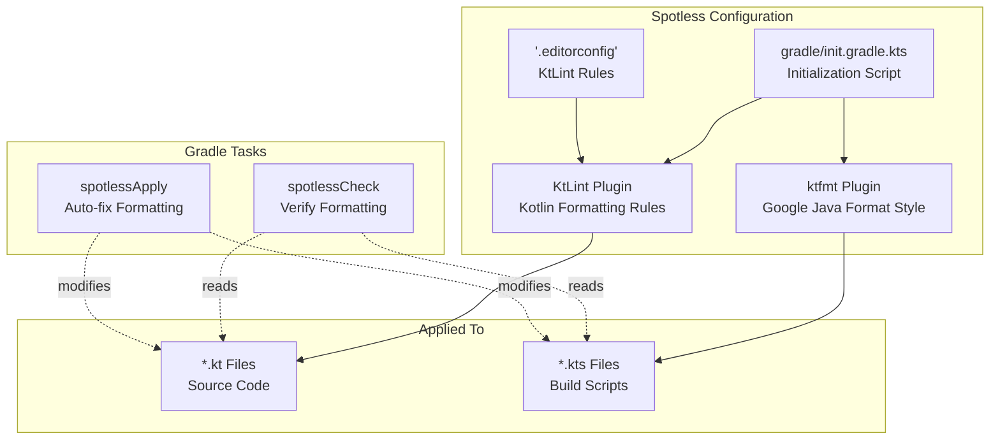
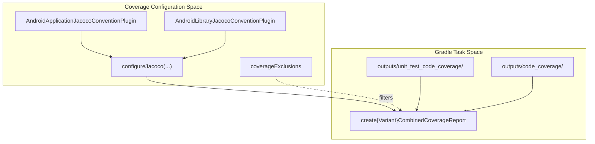
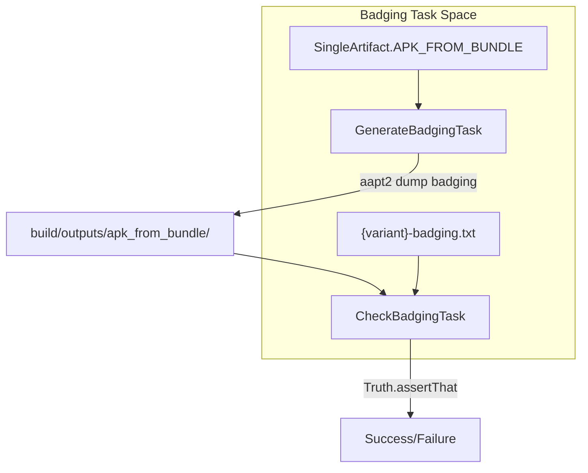

<!-- source: DeepWiki mcp.deepwiki.com · repo android/nowinandroid · page 3.5 Code Quality and Coverage · fetched 2026-10-23 -->

# Code Quality and Coverage

<details>
<summary>Relevant source files</summary>

The following files were used as context for generating this wiki page:

- [.editorconfig](.editorconfig)
- [build-logic/convention/src/main/kotlin/AndroidApplicationComposeConventionPlugin.kt](build-logic/convention/src/main/kotlin/AndroidApplicationComposeConventionPlugin.kt)
- [build-logic/convention/src/main/kotlin/AndroidApplicationJacocoConventionPlugin.kt](build-logic/convention/src/main/kotlin/AndroidApplicationJacocoConventionPlugin.kt)
- [build-logic/convention/src/main/kotlin/AndroidLibraryComposeConventionPlugin.kt](build-logic/convention/src/main/kotlin/AndroidLibraryComposeConventionPlugin.kt)
- [build-logic/convention/src/main/kotlin/AndroidLibraryJacocoConventionPlugin.kt](build-logic/convention/src/main/kotlin/AndroidLibraryJacocoConventionPlugin.kt)
- [build-logic/convention/src/main/kotlin/AndroidLintConventionPlugin.kt](build-logic/convention/src/main/kotlin/AndroidLintConventionPlugin.kt)
- [build-logic/convention/src/main/kotlin/com/google/samples/apps/nowinandroid/Jacoco.kt](build-logic/convention/src/main/kotlin/com/google/samples/apps/nowinandroid/Jacoco.kt)
- [build-logic/convention/src/main/kotlin/com/google/samples/apps/nowinandroid/PrintTestApks.kt](build-logic/convention/src/main/kotlin/com/google/samples/apps/nowinandroid/PrintTestApks.kt)
- [core/datastore/src/test/kotlin/com/google/samples/apps/nowinandroid/core/datastore/IntToStringIdsMigrationTest.kt](core/datastore/src/test/kotlin/com/google/samples/apps/nowinandroid/core/datastore/IntToStringIdsMigrationTest.kt)
- [core/datastore/src/test/kotlin/com/google/samples/apps/nowinandroid/core/datastore/ListToMapMigrationTest.kt](core/datastore/src/test/kotlin/com/google/samples/apps/nowinandroid/core/datastore/ListToMapMigrationTest.kt)
- [core/model/src/main/kotlin/com/google/samples/apps/nowinandroid/core/model/data/DarkThemeConfig.kt](core/model/src/main/kotlin/com/google/samples/apps/nowinandroid/core/model/data/DarkThemeConfig.kt)
- [core/model/src/main/kotlin/com/google/samples/apps/nowinandroid/core/model/data/ThemeBrand.kt](core/model/src/main/kotlin/com/google/samples/apps/nowinandroid/core/model/data/ThemeBrand.kt)
- [lint/README.md](lint/README.md)
- [lint/src/main/kotlin/com/google/samples/apps/nowinandroid/lint/NiaIssueRegistry.kt](lint/src/main/kotlin/com/google/samples/apps/nowinandroid/lint/NiaIssueRegistry.kt)
- [lint/src/main/kotlin/com/google/samples/apps/nowinandroid/lint/TestMethodNameDetector.kt](lint/src/main/kotlin/com/google/samples/apps/nowinandroid/lint/TestMethodNameDetector.kt)
- [lint/src/main/resources/META-INF/services/com.android.tools.lint.client.api.IssueRegistry](lint/src/main/resources/META-INF/services/com.android.tools.lint.client.api.IssueRegistry)
- [lint/src/test/kotlin/com/google/samples/apps/nowinandroid/lint/TestMethodNameDetectorTest.kt](lint/src/test/kotlin/com/google/samples/apps/nowinandroid/lint/TestMethodNameDetectorTest.kt)
- [lint/src/test/kotlin/com/google/samples/apps/nowinandroid/lint/designsystem/DesignSystemDetectorTest.kt](lint/src/test/kotlin/com/google/samples/apps/nowinandroid/lint/designsystem/DesignSystemDetectorTest.kt)
- [ui-test-hilt-manifest/README.md](ui-test-hilt-manifest/README.md)

</details>


This document describes the build-time code quality tools and test coverage infrastructure used in the Now in Android codebase. These systems ensure consistent code formatting, track dependency changes, verify Android manifest integrity, and measure test coverage across unit and instrumented tests.

For information about the actual tests being run (unit tests, screenshot tests, benchmarks), see [Testing Strategy](#8). For details on the CI/CD workflows that execute these checks, see [CI/CD Workflows](#3.4).

## Overview

The Now in Android project employs multiple automated quality gates that run both locally and in CI:

| Tool | Purpose | Configuration Location | Gradle Task |
|------|---------|----------------------|-------------|
| **Spotless** | Code formatting (Kotlin, KTS) | `gradle/init.gradle.kts` | `spotlessCheck` / `spotlessApply` |
| **Dependency Guard** | Dependency change tracking | Per-module `dependencies/*.txt` | `dependencyGuard` / `dependencyGuardBaseline` |
| **Android Lint** | Static analysis | `AndroidLintConventionPlugin.kt` | `lintProdRelease` / `lintRelease` |
| **Badging** | Manifest verification | `Badging.kt` convention plugin | `checkProdReleaseBadging` |
| **JaCoCo** | Test coverage reporting | `Jacoco.kt` convention plugin | `createDemoDebugCombinedCoverageReport` |

All checks run automatically in the CI pipeline defined in [.github/workflows/Build.yaml]().

Sources: [.github/workflows/Build.yaml](), [build-logic/convention/src/main/kotlin/AndroidLintConventionPlugin.kt:25-42](), [build-logic/convention/src/main/kotlin/com/google/samples/apps/nowinandroid/Jacoco.kt:62-140]()

## Code Formatting with Spotless

Spotless enforces consistent code formatting across Kotlin (`.kt`) and Kotlin script (`.kts`) files. The configuration is defined in an initialization script that applies to all subprojects. It utilizes `.editorconfig` to configure `ktlint` rules, such as allowing trailing commas [*.editorconfig:4-6]() and ignoring naming conventions for `@Composable` or `@Test` annotated functions [*.editorconfig:7]().

### Configuration



### Usage

The Spotless check runs early in the CI pipeline:

[.github/workflows/Build.yaml:50-51]()

```bash
# Verify formatting
./gradlew spotlessCheck --init-script gradle/init.gradle.kts --no-configuration-cache

# Auto-fix formatting issues locally
./gradlew spotlessApply --init-script gradle/init.gradle.kts --no-configuration-cache
```

Sources: [.github/workflows/Build.yaml:50-51](), [.editorconfig:1-18]()

## Android Lint and Custom Rules

### Configuration

Android Lint performs static analysis on the codebase. The configuration is centralized in `AndroidLintConventionPlugin`, which enables XML and SARIF reports and ensures dependencies are checked [build-logic/convention/src/main/kotlin/AndroidLintConventionPlugin.kt:44-49]().

The project includes a custom lint module (`:lint`) that defines Nia-specific rules via the `NiaIssueRegistry` [lint/src/main/kotlin/com/google/samples/apps/nowinandroid/lint/NiaIssueRegistry.kt:24-41]().

### Custom Detectors

The project implements specialized detectors to enforce architectural and testing standards:

*   **DesignSystemDetector**: Ensures that Material Design components are not used directly, favoring the project's internal `Nia` design system components (e.g., `NiaButton` instead of `Button`) [lint/src/test/kotlin/com/google/samples/apps/nowinandroid/lint/designsystem/DesignSystemDetectorTest.kt:52-112]().
*   **TestMethodNameDetector**:
    *   **Prefix Check**: Identifies and removes unnecessary `test` prefixes in unit tests [lint/src/main/kotlin/com/google/samples/apps/nowinandroid/lint/TestMethodNameDetector.kt:60-77]().
    *   **Format Check**: Enforces the `given_when_then` or `when_then` naming convention specifically for Android instrumented tests [lint/src/main/kotlin/com/google/samples/apps/nowinandroid/lint/TestMethodNameDetector.kt:79-91]().

### CI Execution

Lint runs on specific modules after tests complete [.github/workflows/Build.yaml:159-160](). Results are uploaded in SARIF format for GitHub's code scanning feature [.github/workflows/Build.yaml:169-188]().

Sources: [build-logic/convention/src/main/kotlin/AndroidLintConventionPlugin.kt:25-42](), [lint/src/main/kotlin/com/google/samples/apps/nowinandroid/lint/NiaIssueRegistry.kt:24-30](), [lint/src/main/kotlin/com/google/samples/apps/nowinandroid/lint/TestMethodNameDetector.kt:42-126]()

## JaCoCo Code Coverage

JaCoCo measures code coverage by combining data from local unit tests (`.exec` files) and instrumented tests (`.ec` files) [build-logic/convention/src/main/kotlin/com/google/samples/apps/nowinandroid/Jacoco.kt:111-117]().

### Configuration Logic

The coverage system is applied to modules via `AndroidApplicationJacocoConventionPlugin` [build-logic/convention/src/main/kotlin/AndroidApplicationJacocoConventionPlugin.kt:26-36]() and `AndroidLibraryJacocoConventionPlugin` [build-logic/convention/src/main/kotlin/AndroidLibraryJacocoConventionPlugin.kt:26-36](). Both delegate to `configureJacoco`.



### Coverage Implementation Details

*   **Exclusions**: Specific classes like `R.class`, `BuildConfig`, and Hilt-generated classes are excluded to prevent skewed metrics [build-logic/convention/src/main/kotlin/com/google/samples/apps/nowinandroid/Jacoco.kt:39-47]().
*   **Task Generation**: The `create{Variant}CombinedCoverageReport` task uses `ScopedArtifacts.Scope.PROJECT` to gather all class files [build-logic/convention/src/main/kotlin/com/google/samples/apps/nowinandroid/Jacoco.kt:120-127]().
*   **Robolectric**: Coverage is enabled for Robolectric by setting `isIncludeNoLocationClasses = true` [build-logic/convention/src/main/kotlin/com/google/samples/apps/nowinandroid/Jacoco.kt:133]().

### APK Location for Testing

To facilitate CI processing of test artifacts, the `PrintApkLocationTask` is used to identify the location of generated test APKs based on the presence of source files in `androidTest` [build-logic/convention/src/main/kotlin/com/google/samples/apps/nowinandroid/PrintTestApks.kt:40-69]().

Sources: [build-logic/convention/src/main/kotlin/com/google/samples/apps/nowinandroid/Jacoco.kt:39-140](), [build-logic/convention/src/main/kotlin/AndroidApplicationJacocoConventionPlugin.kt:26-36](), [build-logic/convention/src/main/kotlin/com/google/samples/apps/nowinandroid/PrintTestApks.kt:72-107]()

## Dependency Guard

Dependency Guard tracks changes to the dependency tree of each module. Each module maintains baseline files listing its dependencies in the `dependencies/` directory.

### CI Behavior

The CI workflow has intelligent handling for dependency changes [.github/workflows/Build.yaml:53-78]():
1. **Verification**: Runs `dependencyGuard` to check for changes.
2. **Remediation**: If verification fails on a main repository PR, it automatically runs `dependencyGuardBaseline` and commits the updated files with the message "🤖 Updates baselines for Dependency Guard".

Sources: [.github/workflows/Build.yaml:53-78]()

## Badging Verification

Badging verification ensures the Android manifest produces consistent output by comparing the `aapt2 dump badging` command output against a golden baseline file.

### Implementation

The system is implemented in `Badging.kt`. It registers tasks for each variant to generate, check, and update badging files [build-logic/convention/src/main/kotlin/com/google/samples/apps/nowinandroid/Badging.kt:112-159]().



Sources: [build-logic/convention/src/main/kotlin/com/google/samples/apps/nowinandroid/Badging.kt:44-159](), [.github/workflows/Build.yaml:190-191]()

## CI Integration Summary

The complete quality check workflow in CI executes in the following order:

1.  **Fast Feedback**: `spotlessCheck`, `dependencyGuard`.
2.  **Tests**: Unit tests and Screenshot tests (Roborazzi).
3.  **Static Analysis**: Android Lint and Badging checks.
4.  **Coverage**: Combined report generation (on API 30).

Sources: [.github/workflows/Build.yaml:1-287]()

---

