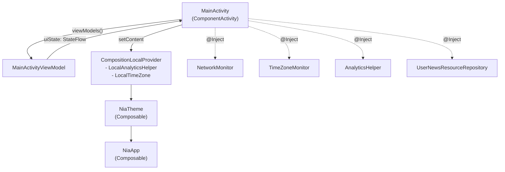
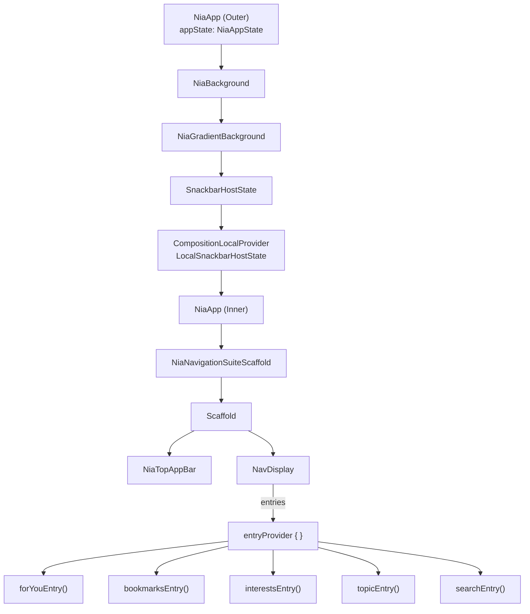
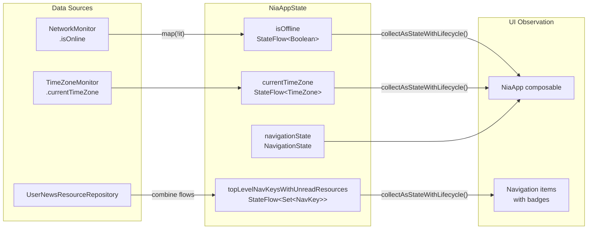
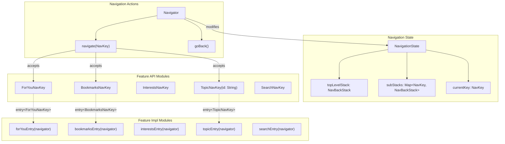
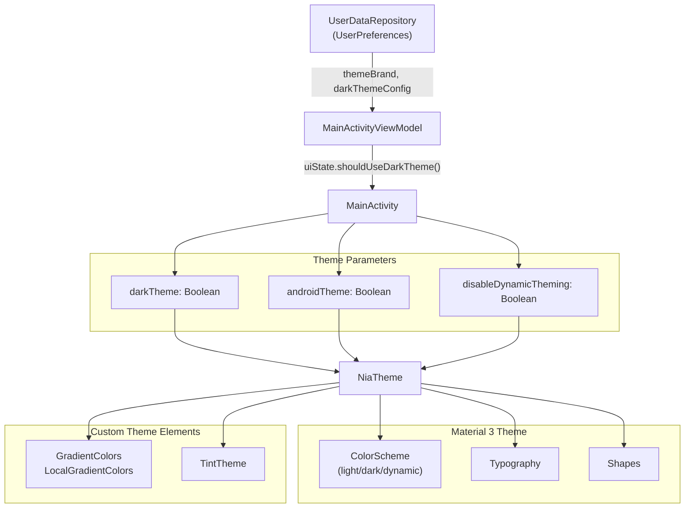

<!-- source: DeepWiki mcp.deepwiki.com · repo android/nowinandroid · page 4 UI Layer · fetched 2026-10-23 -->

# UI Layer

Relevant source files

The following files were used as context for generating this wiki page:

- [app/src/main/kotlin/com/google/samples/apps/nowinandroid/ui/NiaApp.kt](app/src/main/kotlin/com/google/samples/apps/nowinandroid/ui/NiaApp.kt)
- [app/src/main/kotlin/com/google/samples/apps/nowinandroid/ui/NiaAppState.kt](app/src/main/kotlin/com/google/samples/apps/nowinandroid/ui/NiaAppState.kt)
- [app/src/testDemo/kotlin/com/google/samples/apps/nowinandroid/ui/NiaAppStateTest.kt](app/src/testDemo/kotlin/com/google/samples/apps/nowinandroid/ui/NiaAppStateTest.kt)
- [docs/ArchitectureLearningJourney.md](docs/ArchitectureLearningJourney.md)
- [docs/images/architecture-1-overall.png](docs/images/architecture-1-overall.png)
- [docs/images/architecture-2-example.png](docs/images/architecture-2-example.png)
- [docs/images/architecture-3-data-layer.png](docs/images/architecture-3-data-layer.png)
- [docs/images/architecture-4-ui-layer.png](docs/images/architecture-4-ui-layer.png)

## Purpose and Scope

The UI Layer encompasses the presentation components, navigation infrastructure, and state management patterns that render the Now in Android application. This includes the main application scaffolding, design system, reusable UI components, and feature screen compositions built with Jetpack Compose.

For information about individual feature module implementations and their ViewModels, see [Feature Modules](#6). For build-time UI configurations and Compose compiler settings, see [Convention Plugins](#3.2).

## Application Entry Point and Composition Root

The application UI initializes through a hierarchy: `MainActivity` → `NiaApp` composable → Feature screens.

### MainActivity

`MainActivity` serves as the Android `ComponentActivity` entry point and handles system-level UI concerns:

- **Edge-to-edge display**: Configures system bar styles based on theme using `enableEdgeToEdge()` [app/src/main/kotlin/com/google/samples/apps/nowinandroid/MainActivity.kt:115-124]().
- **Splash screen**: Keeps splash visible until `MainActivityViewModel` signals data is ready [app/src/main/kotlin/com/google/samples/apps/nowinandroid/MainActivity.kt:108-113]().
- **Theme initialization**: Observes user preferences and system dark mode to configure `NiaTheme` [app/src/main/kotlin/com/google/samples/apps/nowinandroid/MainActivity.kt:84-104]().
- **Dependency injection**: Provides `NetworkMonitor`, `TimeZoneMonitor`, `AnalyticsHelper`, and `UserNewsResourceRepository` via Hilt [app/src/main/kotlin/com/google/samples/apps/nowinandroid/MainActivity.kt:56-75]().
- **Performance monitoring**: Initializes `JankStats` for performance tracking [app/src/main/kotlin/com/google/samples/apps/nowinandroid/MainActivity.kt:159-167]().

**Sources:** [app/src/main/kotlin/com/google/samples/apps/nowinandroid/MainActivity.kt:56-167]()

### NiaApp Composable

The `NiaApp` composable defines the application's visual structure and handles top-level UI orchestration:

- **Outer Layer**: Applies `NiaBackground` and conditional `NiaGradientBackground` based on the current navigation key [app/src/main/kotlin/com/google/samples/apps/nowinandroid/ui/NiaApp.kt:89-133]().
- **Inner Layer**: Uses `NiaNavigationSuiteScaffold` for adaptive navigation (bottom bar/rail/drawer) and `NavDisplay` to render the navigation stack [app/src/main/kotlin/com/google/samples/apps/nowinandroid/ui/NiaApp.kt:141-279]().

**Sources:** [app/src/main/kotlin/com/google/samples/apps/nowinandroid/ui/NiaApp.kt:89-279]()

## State Management

### NiaAppState

`NiaAppState` is a `@Stable` class that manages app-level reactive state and navigation. It is created by `rememberNiaAppState()` [app/src/main/kotlin/com/google/samples/apps/nowinandroid/ui/NiaAppState.kt:42-67]().

| Property | Type | Purpose |
|----------|------|---------|
| `navigationState` | `NavigationState` | Current navigation stack and top-level destinations [app/src/main/kotlin/com/google/samples/apps/nowinandroid/ui/NiaAppState.kt:71]() |
| `isOffline` | `StateFlow<Boolean>` | Connectivity status derived from `NetworkMonitor` [app/src/main/kotlin/com/google/samples/apps/nowinandroid/ui/NiaAppState.kt:77-83]() |
| `topLevelNavKeysWithUnreadResources` | `StateFlow<Set<NavKey>>` | Tracks navigation items with unread content [app/src/main/kotlin/com/google/samples/apps/nowinandroid/ui/NiaAppState.kt:88-100]() |
| `currentTimeZone` | `StateFlow<TimeZone>` | Current device timezone from `TimeZoneMonitor` [app/src/main/kotlin/com/google/samples/apps/nowinandroid/ui/NiaAppState.kt:102-107]() |

**Sources:** [app/src/main/kotlin/com/google/samples/apps/nowinandroid/ui/NiaAppState.kt:41-108]()

## Navigation System

Navigation uses the experimental Navigation3 library with a declarative `EntryProvider` pattern.

### Core Navigation Components

- **NavigationState**: Manages the navigation stack [app/src/main/kotlin/com/google/samples/apps/nowinandroid/ui/NiaAppState.kt:71]().
- **Navigator**: Provides navigation actions like `navigate` and `goBack` [app/src/testDemo/kotlin/com/google/samples/apps/nowinandroid/ui/NiaAppStateTest.kt:80]().
- **EntryProvider**: DSL for declaring navigation entries aggregated in `NiaApp` [app/src/main/kotlin/com/google/samples/apps/nowinandroid/ui/NiaApp.kt:259-265]().

### Navigation Architecture

**Sources:** [app/src/main/kotlin/com/google/samples/apps/nowinandroid/ui/NiaApp.kt:257-271](), [app/src/main/kotlin/com/google/samples/apps/nowinandroid/ui/NiaAppState.kt:27-28]()

For details on adaptive navigation and list-detail patterns, see [Navigation and Adaptive UI](#4.2).

## Design System

The design system provides the Material 3 theme and primitive components.

### NiaTheme

`NiaTheme` determines the color scheme, typography, and shapes. It supports dark mode, dynamic color (Material You), and custom gradient backgrounds [app/src/main/kotlin/com/google/samples/apps/nowinandroid/ui/NiaApp.kt:99-105]().

For details, see [Design System](#4.3).

## Core UI Components

The `core:ui` module provides reusable components like `NewsResourceCard` used across multiple features [docs/ArchitectureLearningJourney.md:157]().

| Component | Purpose |
|-----------|---------|
| `NiaTopAppBar` | Top app bar with actions [app/src/main/kotlin/com/google/samples/apps/nowinandroid/ui/NiaApp.kt:230](). |
| `NiaNavigationSuiteScaffold` | Adaptive navigation container [app/src/main/kotlin/com/google/samples/apps/nowinandroid/ui/NiaApp.kt:162](). |
| `NiaBackground` | Primary app background [app/src/main/kotlin/com/google/samples/apps/nowinandroid/ui/NiaApp.kt:98](). |

For a full catalog, see [Core UI Components](#4.4).

## Child Pages

- [Application Structure](#4.1) — MainActivity, NiaApp, and app-level state management.
- [Navigation and Adaptive UI](#4.2) — Navigation3 system and responsive layouts.
- [Design System](#4.3) — NiaTheme, Material 3, and dynamic color.
- [Core UI Components](#4.4) — Reusable composables and the component catalog.

---

