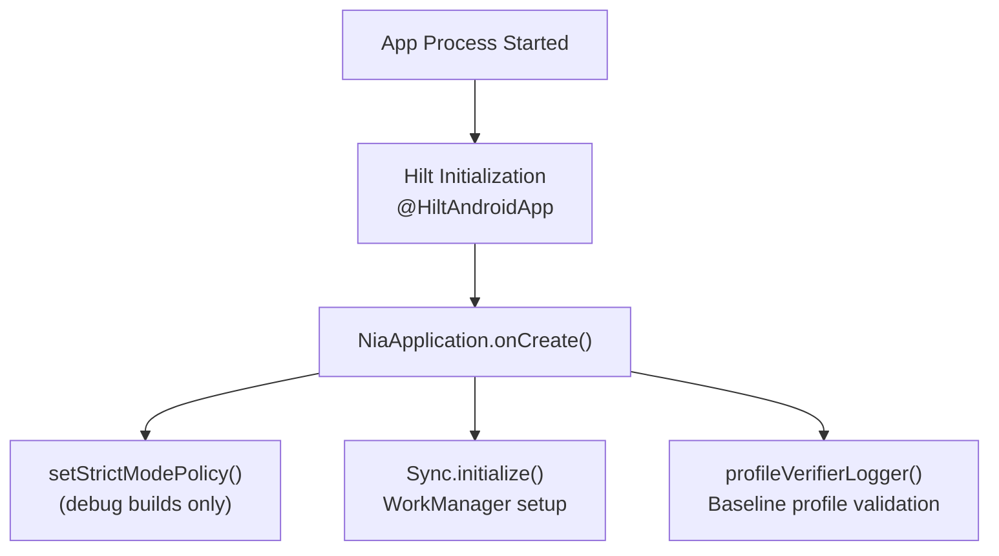
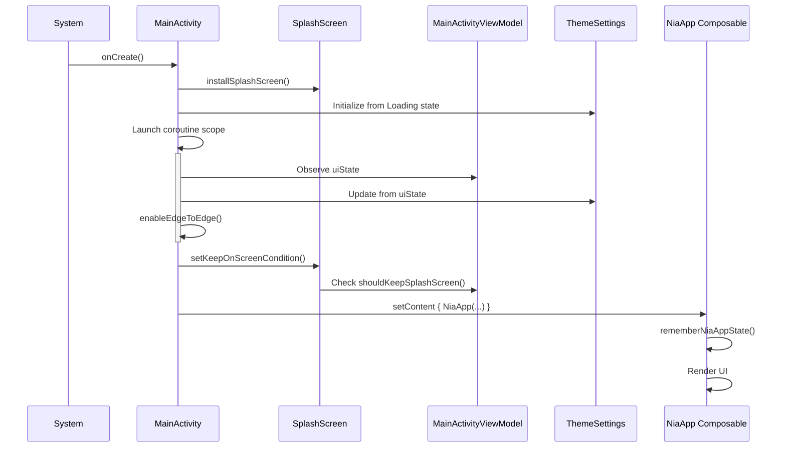
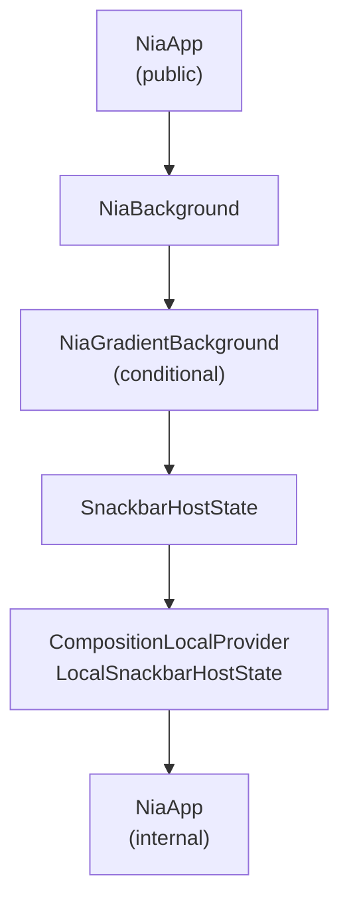
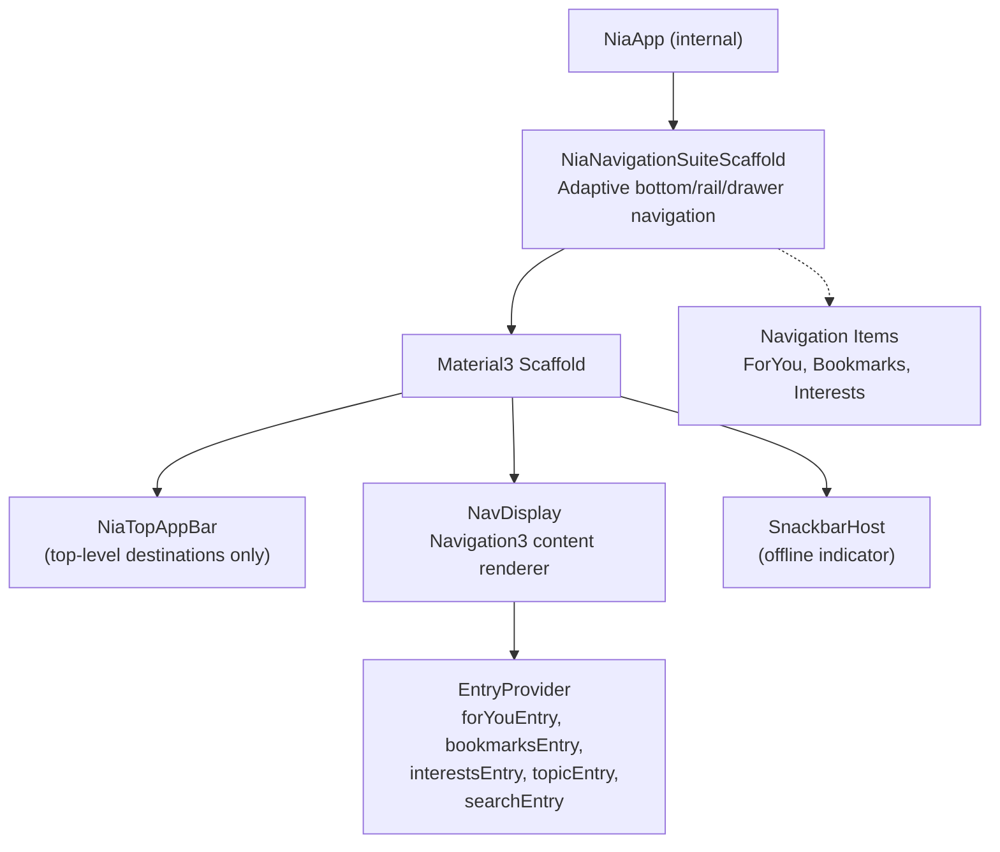
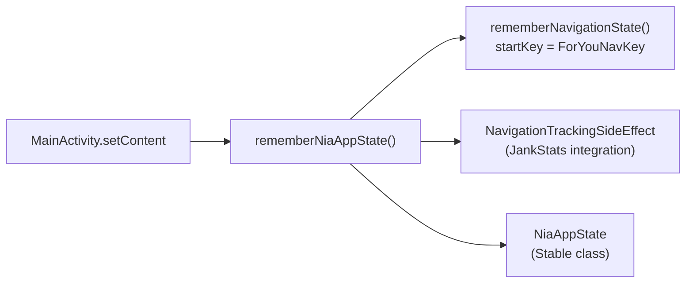

<!-- source: DeepWiki mcp.deepwiki.com · repo android/nowinandroid · page 4.1 Application Structure · fetched 2026-10-23 -->

# Application Structure

<details>
<summary>Relevant source files</summary>

The following files were used as context for generating this wiki page:

- [app/prodRelease-badging.txt](app/prodRelease-badging.txt)
- [app/src/main/AndroidManifest.xml](app/src/main/AndroidManifest.xml)
- [app/src/main/kotlin/com/google/samples/apps/nowinandroid/MainActivity.kt](app/src/main/kotlin/com/google/samples/apps/nowinandroid/MainActivity.kt)
- [app/src/main/kotlin/com/google/samples/apps/nowinandroid/MainActivityViewModel.kt](app/src/main/kotlin/com/google/samples/apps/nowinandroid/MainActivityViewModel.kt)
- [app/src/main/kotlin/com/google/samples/apps/nowinandroid/NiaApplication.kt](app/src/main/kotlin/com/google/samples/apps/nowinandroid/NiaApplication.kt)
- [app/src/main/kotlin/com/google/samples/apps/nowinandroid/ui/NiaApp.kt](app/src/main/kotlin/com/google/samples/apps/nowinandroid/ui/NiaApp.kt)
- [app/src/main/kotlin/com/google/samples/apps/nowinandroid/ui/NiaAppState.kt](app/src/main/kotlin/com/google/samples/apps/nowinandroid/ui/NiaAppState.kt)
- [app/src/main/kotlin/com/google/samples/apps/nowinandroid/util/UiExtensions.kt](app/src/main/kotlin/com/google/samples/apps/nowinandroid/util/UiExtensions.kt)
- [app/src/main/res/mipmap-anydpi-v26/ic_launcher.xml](app/src/main/res/mipmap-anydpi-v26/ic_launcher.xml)
- [app/src/main/res/mipmap-anydpi-v26/ic_launcher_round.xml](app/src/main/res/mipmap-anydpi-v26/ic_launcher_round.xml)
- [app/src/testDemo/kotlin/com/google/samples/apps/nowinandroid/ui/NiaAppStateTest.kt](app/src/testDemo/kotlin/com/google/samples/apps/nowinandroid/ui/NiaAppStateTest.kt)
- [core/data/src/test/kotlin/com/google/samples/apps/nowinandroid/core/data/testdoubles/TestNiaNetworkDataSource.kt](core/data/src/test/kotlin/com/google/samples/apps/nowinandroid/core/data/testdoubles/TestNiaNetworkDataSource.kt)
- [core/network/src/demo/kotlin/com/google/samples/apps/nowinandroid/core/network/di/FlavoredNetworkModule.kt](core/network/src/demo/kotlin/com/google/samples/apps/nowinandroid/core/network/di/FlavoredNetworkModule.kt)
- [core/network/src/main/kotlin/JvmUnitTestDemoAssetManager.kt](core/network/src/main/kotlin/JvmUnitTestDemoAssetManager.kt)
- [core/network/src/main/kotlin/com/google/samples/apps/nowinandroid/core/network/demo/DemoAssetManager.kt](core/network/src/main/kotlin/com/google/samples/apps/nowinandroid/core/network/demo/DemoAssetManager.kt)
- [core/network/src/main/kotlin/com/google/samples/apps/nowinandroid/core/network/di/NetworkModule.kt](core/network/src/main/kotlin/com/google/samples/apps/nowinandroid/core/network/di/NetworkModule.kt)
- [core/network/src/prod/kotlin/com/google/samples/apps/nowinandroid/core/network/di/FlavoredNetworkModule.kt](core/network/src/prod/kotlin/com/google/samples/apps/nowinandroid/core/network/di/FlavoredNetworkModule.kt)
- [core/network/src/test/kotlin/com/google/samples/apps/nowinandroid/core/network/demo/DemoNiaNetworkDataSourceTest.kt](core/network/src/test/kotlin/com/google/samples/apps/nowinandroid/core/network/demo/DemoNiaNetworkDataSourceTest.kt)
- [feature/bookmarks/impl/src/main/kotlin/com/google/samples/apps/nowinandroid/feature/bookmarks/impl/navigation/BookmarksEntryProvider.kt](feature/bookmarks/impl/src/main/kotlin/com/google/samples/apps/nowinandroid/feature/bookmarks/impl/navigation/BookmarksEntryProvider.kt)
- [feature/foryou/impl/src/main/kotlin/com/google/samples/apps/nowinandroid/feature/foryou/impl/navigation/ForYouEntryProvider.kt](feature/foryou/impl/src/main/kotlin/com/google/samples/apps/nowinandroid/feature/foryou/impl/navigation/ForYouEntryProvider.kt)
- [feature/interests/impl/src/main/kotlin/com/google/samples/apps/nowinandroid/feature/interests/impl/navigation/InterestsEntryProvider.kt](feature/interests/impl/src/main/kotlin/com/google/samples/apps/nowinandroid/feature/interests/impl/navigation/InterestsEntryProvider.kt)
- [feature/interests/impl/src/test/kotlin/com/google/samples/apps/nowinandroid/interests/impl/InterestsListDetailScreenTest.kt](feature/interests/impl/src/test/kotlin/com/google/samples/apps/nowinandroid/interests/impl/InterestsListDetailScreenTest.kt)
- [feature/search/impl/src/main/kotlin/com/google/samples/apps/nowinandroid/feature/search/impl/navigation/SearchEntryProvider.kt](feature/search/impl/src/main/kotlin/com/google/samples/apps/nowinandroid/feature/search/impl/navigation/SearchEntryProvider.kt)
- [feature/topic/impl/src/main/kotlin/com/google/samples/apps/nowinandroid/feature/topic/impl/navigation/TopicEntryProvider.kt](feature/topic/impl/src/main/kotlin/com/google/samples/apps/nowinandroid/feature/topic/impl/navigation/TopicEntryProvider.kt)
- [tools/pre-push](tools/pre-push)

</details>


This document describes the top-level structure of the Now in Android application, focusing on the application entry points, main activity, root composable hierarchy, and state management. It covers `NiaApplication`, `MainActivity`, `NiaApp` composable, and `NiaAppState`.

For information about the navigation system and adaptive UI patterns, see [Navigation and Adaptive UI](#4.2). For details about the theme and design system, see [Design System](#4.3).

---

## Overview

Now in Android follows a single-activity architecture pattern where the application lifecycle is managed by three primary components:

| Component | Type | Responsibility |
|-----------|------|----------------|
| `NiaApplication` | Application class | Dependency injection, sync initialization, image loading configuration |
| `MainActivity` | ComponentActivity | Theme management, splash screen, content composition, deep link entry |
| `NiaApp` | Composable | Root UI scaffold, navigation, app-level state |
| `NiaAppState` | State holder | Navigation state, network status, unread resources tracking |

---

## Application Class: NiaApplication

### Purpose and Lifecycle

`NiaApplication` serves as the Android `Application` subclass and is the first code executed when the app starts. It is responsible for global initialization tasks.

**Initialization Flow Diagram**



**Sources:** [app/src/main/kotlin/com/google/samples/apps/nowinandroid/NiaApplication.kt:1-74]()

### Key Features

The `NiaApplication` class at [app/src/main/kotlin/com/google/samples/apps/nowinandroid/NiaApplication.kt:33-73]() is annotated with `@HiltAndroidApp`, which triggers Hilt's code generation for dependency injection across the entire application.

**Injected Dependencies:**
- `imageLoader: dagger.Lazy<ImageLoader>` - Lazy-initialized Coil image loader [app/src/main/kotlin/com/google/samples/apps/nowinandroid/NiaApplication.kt:36]().
- `profileVerifierLogger: ProfileVerifierLogger` - Validates baseline profile installation [app/src/main/kotlin/com/google/samples/apps/nowinandroid/NiaApplication.kt:39]().

**Key Responsibilities:**

1. **Image Loading Configuration**: Implements `ImageLoaderFactory` interface at [app/src/main/kotlin/com/google/samples/apps/nowinandroid/NiaApplication.kt:34]() to provide a custom `ImageLoader` instance configured with SVG support and appropriate caching policies (see [core/network/src/main/kotlin/com/google/samples/apps/nowinandroid/core/network/di/NetworkModule.kt:75-94]()).
2. **Background Sync**: Initializes the `Sync` system at [app/src/main/kotlin/com/google/samples/apps/nowinandroid/NiaApplication.kt:47]() which sets up WorkManager for periodic data synchronization.
3. **StrictMode (Debug)**: Enables strict mode policy at [app/src/main/kotlin/com/google/samples/apps/nowinandroid/NiaApplication.kt:66-71]() in debug builds to detect main thread violations such as network or disk access.

**Sources:** [app/src/main/kotlin/com/google/samples/apps/nowinandroid/NiaApplication.kt:30-73](), [core/network/src/main/kotlin/com/google/samples/apps/nowinandroid/core/network/di/NetworkModule.kt:75-94]()

---

## MainActivity: Single Activity Entry Point

### Activity Configuration

`MainActivity` is the sole activity in the application and is declared in the manifest at [app/src/main/AndroidManifest.xml:42-59](). It handles deep links and serves as the host for all Compose UI.

**Manifest Configuration and Deep Links:**
The activity supports deep linking via intent filters for the `https://www.nowinandroid.apps.samples.google.com` host [app/src/main/AndroidManifest.xml:50-58]().

```xml
<activity
    android:name=".MainActivity"
    android:configChanges="uiMode"
    android:exported="true">
```

The `android:configChanges="uiMode"` attribute prevents activity recreation when switching between light and dark themes, allowing smooth theme transitions without restarting the activity [app/src/main/AndroidManifest.xml:44]().

**Sources:** [app/src/main/AndroidManifest.xml:42-59]()

### Dependency Injection

`MainActivity` is annotated with `@AndroidEntryPoint` at [app/src/main/kotlin/com/google/samples/apps/nowinandroid/MainActivity.kt:55](), enabling Hilt to inject dependencies:

| Dependency | Type | Usage |
|------------|------|-------|
| `lazyStats` | `dagger.Lazy<JankStats>` | Performance monitoring during foreground state [app/src/main/kotlin/com/google/samples/apps/nowinandroid/MainActivity.kt:62]() |
| `networkMonitor` | `NetworkMonitor` | Observes connectivity status [app/src/main/kotlin/com/google/samples/apps/nowinandroid/MainActivity.kt:65]() |
| `timeZoneMonitor` | `TimeZoneMonitor` | Tracks system time zone changes [app/src/main/kotlin/com/google/samples/apps/nowinandroid/MainActivity.kt:68]() |
| `analyticsHelper` | `AnalyticsHelper` | Logs analytics events [app/src/main/kotlin/com/google/samples/apps/nowinandroid/MainActivity.kt:71]() |
| `userNewsResourceRepository` | `UserNewsResourceRepository` | User-specific data for unread tracking [app/src/main/kotlin/com/google/samples/apps/nowinandroid/MainActivity.kt:74]() |

**Sources:** [app/src/main/kotlin/com/google/samples/apps/nowinandroid/MainActivity.kt:56-75]()

### Initialization Sequence



**Sources:** [app/src/main/kotlin/com/google/samples/apps/nowinandroid/MainActivity.kt:78-157]()

### Theme Management and Splash Screen

The activity manages dynamic theme configuration through a `ThemeSettings` data class at [app/src/main/kotlin/com/google/samples/apps/nowinandroid/MainActivity.kt:186-190](). The `Theme.Nia.Splash` theme is used initially [app/src/main/AndroidManifest.xml:39]().

The splash screen remains visible until the `MainActivityViewModel` UI state is loaded, controlled by `setKeepOnScreenCondition` at [app/src/main/kotlin/com/google/samples/apps/nowinandroid/MainActivity.kt:133]().

The theme settings are reactively updated by combining system dark mode state with user preferences from `MainActivityViewModel` at [app/src/main/kotlin/com/google/samples/apps/nowinandroid/MainActivity.kt:93-127](). When dark theme changes, the edge-to-edge system bar styling is updated accordingly using `enableEdgeToEdge` [app/src/main/kotlin/com/google/samples/apps/nowinandroid/MainActivity.kt:115-124]().

**Sources:** [app/src/main/kotlin/com/google/samples/apps/nowinandroid/MainActivity.kt:78-157](), [app/src/main/kotlin/com/google/samples/apps/nowinandroid/MainActivity.kt:186-190](), [app/src/main/AndroidManifest.xml:39]()

### Jank Stats Integration

Performance monitoring is controlled via lifecycle callbacks at [app/src/main/kotlin/com/google/samples/apps/nowinandroid/MainActivity.kt:159-167]():

```kotlin
override fun onResume() {
    super.onResume()
    lazyStats.get().isTrackingEnabled = true
}

override fun onPause() {
    super.onPause()
    lazyStats.get().isTrackingEnabled = false
}
```

This ensures jank tracking is only active when the app is visible.

**Sources:** [app/src/main/kotlin/com/google/samples/apps/nowinandroid/MainActivity.kt:159-167]()

---

## NiaApp Composable: Root UI Hierarchy

### Public API (Entry Point)

The public `NiaApp` composable at [app/src/main/kotlin/com/google/samples/apps/nowinandroid/ui/NiaApp.kt:89-133]() serves as the entry point called from `MainActivity.setContent()`. It establishes the visual foundation of the application.

**Component Hierarchy:**



**Sources:** [app/src/main/kotlin/com/google/samples/apps/nowinandroid/ui/NiaApp.kt:89-133]()

### Background and Gradient Management

The gradient background is conditionally applied based on the current destination at [app/src/main/kotlin/com/google/samples/apps/nowinandroid/ui/NiaApp.kt:95-104]():

- When on the "For You" screen (`ForYouNavKey`): Full gradient with colors from `LocalGradientColors.current`.
- On other screens: Empty gradient (transparent background).

**Sources:** [app/src/main/kotlin/com/google/samples/apps/nowinandroid/ui/NiaApp.kt:95-104]()

### Offline State Handling

The app monitors connectivity and displays an indefinite snackbar when offline at [app/src/main/kotlin/com/google/samples/apps/nowinandroid/ui/NiaApp.kt:108-119]():

```kotlin
val isOffline by appState.isOffline.collectAsStateWithLifecycle()

LaunchedEffect(isOffline) {
    if (isOffline) {
        snackbarHostState.showSnackbar(
            message = notConnectedMessage,
            duration = Indefinite,
        )
    }
}
```

**Sources:** [app/src/main/kotlin/com/google/samples/apps/nowinandroid/ui/NiaApp.kt:108-119]()

### Internal NiaApp: Scaffold and Navigation

The internal `NiaApp` composable at [app/src/main/kotlin/com/google/samples/apps/nowinandroid/ui/NiaApp.kt:141-279]() constructs the adaptive navigation scaffold and content area.

**Scaffold Structure Diagram:**



**Sources:** [app/src/main/kotlin/com/google/samples/apps/nowinandroid/ui/NiaApp.kt:141-279]()

### Navigation Suite Items

Top-level navigation items are configured at [app/src/main/kotlin/com/google/samples/apps/nowinandroid/ui/NiaApp.kt:163-188](). Each item displays:
- Selected/unselected icons.
- Text label.
- Optional notification dot for unread resources [app/src/main/kotlin/com/google/samples/apps/nowinandroid/ui/NiaApp.kt:180]().

The notification dot is rendered using a custom `Modifier.notificationDot()` at [app/src/main/kotlin/com/google/samples/apps/nowinandroid/ui/NiaApp.kt:281-298]().

**Sources:** [app/src/main/kotlin/com/google/samples/apps/nowinandroid/ui/NiaApp.kt:163-188](), [app/src/main/kotlin/com/google/samples/apps/nowinandroid/ui/NiaApp.kt:281-298]()

### Entry Provider Pattern

Feature screens are registered using the `entryProvider` DSL at [app/src/main/kotlin/com/google/samples/apps/nowinandroid/ui/NiaApp.kt:259-265]():

```kotlin
val entryProvider = entryProvider {
    forYouEntry(navigator)
    bookmarksEntry(navigator)
    interestsEntry(navigator)
    topicEntry(navigator)
    searchEntry(navigator)
}
```

Each entry function (e.g., `forYouEntry` at [feature/foryou/impl/src/main/kotlin/com/google/samples/apps/nowinandroid/feature/foryou/impl/navigation/ForYouEntryProvider.kt:26-32]()) maps a `NavKey` to its corresponding composable screen.

**Sources:** [app/src/main/kotlin/com/google/samples/apps/nowinandroid/ui/NiaApp.kt:259-265](), [feature/foryou/impl/src/main/kotlin/com/google/samples/apps/nowinandroid/feature/foryou/impl/navigation/ForYouEntryProvider.kt:26-32](), [feature/interests/impl/src/main/kotlin/com/google/samples/apps/nowinandroid/feature/interests/impl/navigation/InterestsEntryProvider.kt:32-51]()

---

## NiaAppState: State Management

### Purpose and Creation

`NiaAppState` is a stable state holder class defined at [app/src/main/kotlin/com/google/samples/apps/nowinandroid/ui/NiaAppState.kt:69-108]() that centralizes app-level state management. It is created via the `rememberNiaAppState` composable function at [app/src/main/kotlin/com/google/samples/apps/nowinandroid/ui/NiaAppState.kt:41-67]().

**Creation Process:**



**Sources:** [app/src/main/kotlin/com/google/samples/apps/nowinandroid/ui/NiaAppState.kt:41-67]()

### State Properties

**1. Offline Status (`isOffline`)**

Defined at [app/src/main/kotlin/com/google/samples/apps/nowinandroid/ui/NiaAppState.kt:77-83](), this `StateFlow<Boolean>` inverts the online status from `NetworkMonitor`.

**2. Unread Resources (`topLevelNavKeysWithUnreadResources`)**

Defined at [app/src/main/kotlin/com/google/samples/apps/nowinandroid/ui/NiaAppState.kt:88-100](), this combines data from `UserNewsResourceRepository` to determine which top-level destinations have unread content:

```kotlin
val topLevelNavKeysWithUnreadResources: StateFlow<Set<NavKey>> =
    userNewsResourceRepository.observeAllForFollowedTopics()
        .combine(userNewsResourceRepository.observeAllBookmarked()) { forYouNewsResources, bookmarkedNewsResources ->
            setOfNotNull(
                ForYouNavKey.takeIf { forYouNewsResources.any { !it.hasBeenViewed } },
                BookmarksNavKey.takeIf { bookmarkedNewsResources.any { !it.hasBeenViewed } },
            )
        }
        .stateIn(...)
```

**3. Current Time Zone (`currentTimeZone`)**

Defined at [app/src/main/kotlin/com/google/samples/apps/nowinandroid/ui/NiaAppState.kt:102-107](), this `StateFlow<TimeZone>` observes time zone changes from the system `TimeZoneMonitor`.

**Sources:** [app/src/main/kotlin/com/google/samples/apps/nowinandroid/ui/NiaAppState.kt:77-107]()

---

## Global Dependency and Analytics

### Composition Locals

The application uses several composition locals to provide dependencies:

| Composition Local | Type | Provided By | Usage |
|-------------------|------|-------------|-------|
| `LocalAnalyticsHelper` | `AnalyticsHelper` | `MainActivity` [app/src/main/kotlin/com/google/samples/apps/nowinandroid/MainActivity.kt:145]() | Analytics event logging |
| `LocalTimeZone` | `TimeZone` | `MainActivity` [app/src/main/kotlin/com/google/samples/apps/nowinandroid/MainActivity.kt:146]() | Date/time formatting |
| `LocalSnackbarHostState` | `SnackbarHostState` | `NiaApp` [app/src/main/kotlin/com/google/samples/apps/nowinandroid/ui/NiaApp.kt:120]() | Snackbar coordination |

**Sources:** [app/src/main/kotlin/com/google/samples/apps/nowinandroid/MainActivity.kt:144-146](), [app/src/main/kotlin/com/google/samples/apps/nowinandroid/ui/NiaApp.kt:120]()

### Firebase Analytics Deactivation

Firebase analytics is deactivated by default in the `AndroidManifest.xml` via `meta-data` [app/src/main/AndroidManifest.xml:61-65]():

```xml
<meta-data android:name="firebase_analytics_collection_deactivated" android:value="true" />
<meta-data android:name="google_analytics_adid_collection_enabled" android:value="false" />
```

This configuration is typically overridden in the `prod` flavor build configuration.

**Sources:** [app/src/main/AndroidManifest.xml:61-65]()

---

