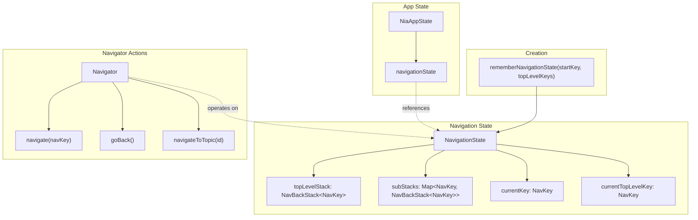
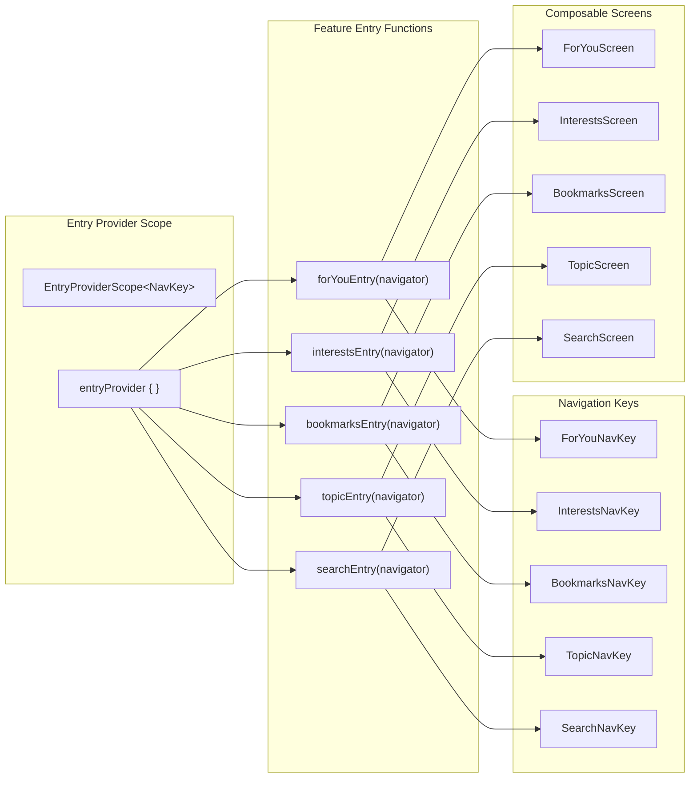
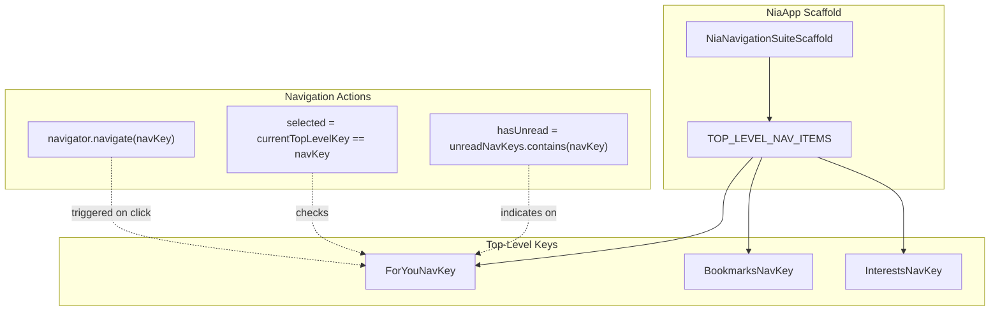
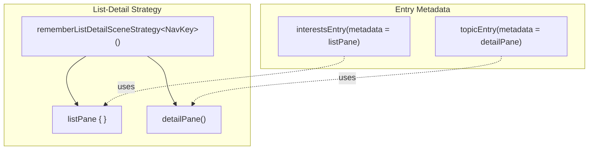

<!-- source: DeepWiki mcp.deepwiki.com · repo android/nowinandroid · page 4.2 Navigation and Adaptive UI · fetched 2026-10-23 -->

# Navigation and Adaptive UI

<details>
<summary>Relevant source files</summary>

The following files were used as context for generating this wiki page:

- [app/src/androidTest/kotlin/com/google/samples/apps/nowinandroid/ui/NavigationTest.kt](app/src/androidTest/kotlin/com/google/samples/apps/nowinandroid/ui/NavigationTest.kt)
- [app/src/main/kotlin/com/google/samples/apps/nowinandroid/MainActivity.kt](app/src/main/kotlin/com/google/samples/apps/nowinandroid/MainActivity.kt)
- [app/src/main/kotlin/com/google/samples/apps/nowinandroid/navigation/TopLevelNavItem.kt](app/src/main/kotlin/com/google/samples/apps/nowinandroid/navigation/TopLevelNavItem.kt)
- [app/src/main/kotlin/com/google/samples/apps/nowinandroid/ui/NiaApp.kt](app/src/main/kotlin/com/google/samples/apps/nowinandroid/ui/NiaApp.kt)
- [app/src/main/kotlin/com/google/samples/apps/nowinandroid/ui/NiaAppState.kt](app/src/main/kotlin/com/google/samples/apps/nowinandroid/ui/NiaAppState.kt)
- [app/src/testDemo/kotlin/com/google/samples/apps/nowinandroid/ui/NiaAppStateTest.kt](app/src/testDemo/kotlin/com/google/samples/apps/nowinandroid/ui/NiaAppStateTest.kt)
- [core/navigation/src/main/kotlin/com/google/samples/apps/nowinandroid/core/navigation/NavigationState.kt](core/navigation/src/main/kotlin/com/google/samples/apps/nowinandroid/core/navigation/NavigationState.kt)
- [core/navigation/src/main/kotlin/com/google/samples/apps/nowinandroid/core/navigation/Navigator.kt](core/navigation/src/main/kotlin/com/google/samples/apps/nowinandroid/core/navigation/Navigator.kt)
- [core/navigation/src/test/kotlin/com/google/samples/apps/nowinandroid/core/navigation/NavigatorTest.kt](core/navigation/src/test/kotlin/com/google/samples/apps/nowinandroid/core/navigation/NavigatorTest.kt)
- [core/ui/src/main/kotlin/com/google/samples/apps/nowinandroid/core/ui/NewsResourceCard.kt](core/ui/src/main/kotlin/com/google/samples/apps/nowinandroid/core/ui/NewsResourceCard.kt)
- [core/ui/src/main/res/values/strings.xml](core/ui/src/main/res/values/strings.xml)
- [feature/bookmarks/impl/src/main/kotlin/com/google/samples/apps/nowinandroid/feature/bookmarks/impl/navigation/BookmarksEntryProvider.kt](feature/bookmarks/impl/src/main/kotlin/com/google/samples/apps/nowinandroid/feature/bookmarks/impl/navigation/BookmarksEntryProvider.kt)
- [feature/foryou/impl/src/main/kotlin/com/google/samples/apps/nowinandroid/feature/foryou/impl/navigation/ForYouEntryProvider.kt](feature/foryou/impl/src/main/kotlin/com/google/samples/apps/nowinandroid/feature/foryou/impl/navigation/ForYouEntryProvider.kt)
- [feature/interests/impl/src/main/kotlin/com/google/samples/apps/nowinandroid/feature/interests/impl/navigation/InterestsEntryProvider.kt](feature/interests/impl/src/main/kotlin/com/google/samples/apps/nowinandroid/feature/interests/impl/navigation/InterestsEntryProvider.kt)
- [feature/interests/impl/src/test/kotlin/com/google/samples/apps/nowinandroid/interests/impl/InterestsListDetailScreenTest.kt](feature/interests/impl/src/test/kotlin/com/google/samples/apps/nowinandroid/interests/impl/InterestsListDetailScreenTest.kt)
- [feature/search/impl/src/main/kotlin/com/google/samples/apps/nowinandroid/feature/search/impl/navigation/SearchEntryProvider.kt](feature/search/impl/src/main/kotlin/com/google/samples/apps/nowinandroid/feature/search/impl/navigation/SearchEntryProvider.kt)
- [feature/topic/impl/src/main/kotlin/com/google/samples/apps/nowinandroid/feature/topic/impl/navigation/TopicEntryProvider.kt](feature/topic/impl/src/main/kotlin/com/google/samples/apps/nowinandroid/feature/topic/impl/navigation/TopicEntryProvider.kt)

</details>


## Purpose and Scope

This document describes the navigation system and adaptive UI implementation in Now in Android. It covers how the app uses the `androidx.navigation3` library with a custom `Navigator` pattern, how feature modules integrate through entry providers, and how the UI adapts to different screen sizes using Material 3 Adaptive APIs. 

For information about the overall application structure and state management, see [Application Structure](#4.1). For details on the design system and theming, see [Design System](#4.3).

---

## Navigation Architecture Overview

The navigation system in Now in Android uses a centralized state-based approach built on `androidx.navigation3`. The core pattern separates navigation state management from UI rendering, with feature modules providing entry definitions through an entry provider pattern.

### Core Navigation Components

The navigation system consists of three primary components:

| Component | Class | Responsibility |
|-----------|-------|----------------|
| Navigation State | `NavigationState` | Maintains back stack, current destination, and top-level keys. |
| Navigator | `Navigator` | Provides navigation actions (navigate, goBack). |
| Entry Providers | `*EntryProvider.kt` functions | Define navigation destinations and their composable UI. |

**Sources:** [core/navigation/src/main/kotlin/com/google/samples/apps/nowinandroid/core/navigation/NavigationState.kt:61-65](), [app/src/main/kotlin/com/google/samples/apps/nowinandroid/ui/NiaAppState.kt:27-28]()

### Navigation State Management



The `NavigationState` is created in `rememberNiaAppState()` using `rememberNavigationState` [app/src/main/kotlin/com/google/samples/apps/nowinandroid/ui/NiaAppState.kt:48](). It maintains a `topLevelStack` for primary destinations and a map of `subStacks` for nested navigation within each top-level key [core/navigation/src/main/kotlin/com/google/samples/apps/nowinandroid/core/navigation/NavigationState.kt:61-65]().

**Sources:** [app/src/main/kotlin/com/google/samples/apps/nowinandroid/ui/NiaAppState.kt:41-67](), [core/navigation/src/main/kotlin/com/google/samples/apps/nowinandroid/core/navigation/NavigationState.kt:61-78]()

### Entry Provider Pattern

Feature modules expose navigation entries through extension functions on `EntryProviderScope<NavKey>`. This pattern allows features to remain decoupled while integrating into the app's navigation graph.



In `NiaApp`, the `entryProvider` DSL combines all feature entries [app/src/main/kotlin/com/google/samples/apps/nowinandroid/ui/NiaApp.kt:259-265](). These entries are then converted to `NavEntry` objects via `NavigationState.toEntries` [core/navigation/src/main/kotlin/com/google/samples/apps/nowinandroid/core/navigation/NavigationState.kt:84-102]().

**Sources:** [app/src/main/kotlin/com/google/samples/apps/nowinandroid/ui/NiaApp.kt:259-265](), [feature/foryou/impl/src/main/kotlin/com/google/samples/apps/nowinandroid/feature/foryou/impl/navigation/ForYouEntryProvider.kt:26-32](), [core/navigation/src/main/kotlin/com/google/samples/apps/nowinandroid/core/navigation/NavigationState.kt:84-102]()

---

## Navigation Hierarchy

### Top-Level Destinations

The app defines three top-level destinations that persist in the navigation bar, defined in `TOP_LEVEL_NAV_ITEMS` [app/src/main/kotlin/com/google/samples/apps/nowinandroid/ui/NiaApp.kt:86]():

| NavKey | Screen | Responsibility |
|--------|--------|----------------|
| `ForYouNavKey` | `ForYouScreen` | Personalized news feed and onboarding. |
| `BookmarksNavKey` | `BookmarksScreen` | Saved news resources. |
| `InterestsNavKey(null)` | `InterestsScreen` | Topic browsing and selection. |



**Sources:** [app/src/main/kotlin/com/google/samples/apps/nowinandroid/ui/NiaApp.kt:162-188](), [app/src/testDemo/kotlin/com/google/samples/apps/nowinandroid/ui/NiaAppStateTest.kt:118-122]()

### Detail Destinations

Detail destinations are pushed onto the sub-stacks from top-level screens:

- **Topic Detail**: Navigated via `TopicNavKey(id)` [feature/topic/impl/src/main/kotlin/com/google/samples/apps/nowinandroid/feature/topic/impl/navigation/TopicEntryProvider.kt:25]().
- **Search**: Navigated via `SearchNavKey` [app/src/main/kotlin/com/google/samples/apps/nowinandroid/feature/search/impl/navigation/searchEntry.kt]().
- **Settings**: Displayed as a `SettingsDialog` rather than a full screen destination [app/src/main/kotlin/com/google/samples/apps/nowinandroid/ui/NiaApp.kt:153-155]().

**Sources:** [feature/topic/impl/src/main/kotlin/com/google/samples/apps/nowinandroid/feature/topic/impl/navigation/TopicEntryProvider.kt:32-48](), [app/src/main/kotlin/com/google/samples/apps/nowinandroid/ui/NiaApp.kt:153-155]()

---

## Adaptive UI System

The adaptive UI system uses Material 3 Adaptive APIs to provide optimal layouts for different screen sizes.

### WindowAdaptiveInfo

`WindowAdaptiveInfo` is provided to the root `NiaApp` composable via `currentWindowAdaptiveInfo()` [app/src/main/kotlin/com/google/samples/apps/nowinandroid/ui/NiaApp.kt:93](). This information determines the navigation suite type (Bar, Rail, or Drawer) and layout strategies.

**Sources:** [app/src/main/kotlin/com/google/samples/apps/nowinandroid/ui/NiaApp.kt:90-94](), [app/src/main/kotlin/com/google/samples/apps/nowinandroid/ui/NiaApp.kt:189]()

### List-Detail Adaptive Pattern

The Interests and Topic features implement a list-detail adaptive layout using `rememberListDetailSceneStrategy` [app/src/main/kotlin/com/google/samples/apps/nowinandroid/ui/NiaApp.kt:43]().



- **List Pane**: Defined in `interestsEntry` using `ListDetailSceneStrategy.listPane` [feature/interests/impl/src/main/kotlin/com/google/samples/apps/nowinandroid/feature/interests/impl/navigation/InterestsEntryProvider.kt:34]().
- **Detail Pane**: Defined in `topicEntry` using `ListDetailSceneStrategy.detailPane()` [feature/topic/impl/src/main/kotlin/com/google/samples/apps/nowinandroid/feature/topic/impl/navigation/TopicEntryProvider.kt:34]().

On expanded screens, both are visible. On compact screens, the app navigates from the list to the detail screen.

**Sources:** [app/src/main/kotlin/com/google/samples/apps/nowinandroid/ui/NiaApp.kt:257-270](), [feature/interests/impl/src/main/kotlin/com/google/samples/apps/nowinandroid/feature/interests/impl/navigation/InterestsEntryProvider.kt:33-37](), [feature/topic/impl/src/main/kotlin/com/google/samples/apps/nowinandroid/feature/topic/impl/navigation/TopicEntryProvider.kt:33-34]()

---

## Navigation Suite Scaffold

The `NiaNavigationSuiteScaffold` [app/src/main/kotlin/com/google/samples/apps/nowinandroid/ui/NiaApp.kt:70]() provides adaptive navigation UI:

- **Compact**: Shows a `NavigationBar` at the bottom.
- **Medium/Expanded**: Shows a `NavigationRail` or `NavigationDrawer` on the side.

The `navigationSuiteItems` DSL [app/src/main/kotlin/com/google/samples/apps/nowinandroid/ui/NiaApp.kt:164]() iterates through `TOP_LEVEL_NAV_ITEMS` to build the UI, including unread resource indicators [app/src/main/kotlin/com/google/samples/apps/nowinandroid/ui/NiaApp.kt:183]().

**Sources:** [app/src/main/kotlin/com/google/samples/apps/nowinandroid/ui/NiaApp.kt:162-190](), [app/src/main/kotlin/com/google/samples/apps/nowinandroid/ui/NiaAppState.kt:88-100]()

---

## Feature Navigation Integration

### Entry Provider Implementation Pattern

Each feature module registers its destinations using the `entry` function. Entry providers receive a `Navigator` instance to perform actions.

```mermaid
graph TB
    subgraph "Interests Entry Provider"
        IE["interestsEntry(navigator)"]
        IE_ENT["entry&lt;InterestsNavKey&gt;"]
        IE_SCR["InterestsScreen(onTopicClick)"]
    end
    
    subgraph "Topic Entry Provider"
        TE["topicEntry(navigator)"]
        TE_ENT["entry&lt;TopicNavKey&gt;"]
        TE_SCR["TopicScreen(onBackClick)"]
    end
    
    IE --> IE_ENT
    IE_ENT --> IE_SCR
    IE_SCR -.navigator::navigateToTopic.-> TE
    
    TE --> TE_ENT
    TE_ENT --> TE_SCR
    TE_SCR -.navigator.goBack().-> IE
```

**Sources:** [feature/interests/impl/src/main/kotlin/com/google/samples/apps/nowinandroid/feature/interests/impl/navigation/InterestsEntryProvider.kt:32-51](), [feature/topic/impl/src/main/kotlin/com/google/samples/apps/nowinandroid/feature/topic/impl/navigation/TopicEntryProvider.kt:32-48]()

---

## Back Stack and State Management

### Sub-Stack Behavior

`NavigationState` maintains independent back stacks for each top-level destination [core/navigation/src/main/kotlin/com/google/samples/apps/nowinandroid/core/navigation/NavigationState.kt:43](). This ensures that if a user navigates into a detail screen (e.g., Topic Detail) under "Interests", switching to "For You" and back to "Interests" restores the Topic Detail screen.

**Sources:** [core/navigation/src/main/kotlin/com/google/samples/apps/nowinandroid/core/navigation/NavigationState.kt:42-52](), [app/src/androidTest/kotlin/com/google/samples/apps/nowinandroid/ui/NavigationTest.kt:118-129]()

### State Preservation

The `NavigationState.toEntries` function uses `rememberSaveableStateHolderNavEntryDecorator` and `rememberViewModelStoreNavEntryDecorator` [core/navigation/src/main/kotlin/com/google/samples/apps/nowinandroid/core/navigation/NavigationState.kt:89-90](). This preserves the `ViewModel` and UI state of destinations even when they are not currently visible in the active sub-stack.

**Sources:** [core/navigation/src/main/kotlin/com/google/samples/apps/nowinandroid/core/navigation/NavigationState.kt:84-102]()

---

## Testing Navigation and Adaptive Behavior

### Navigation State Tests

`NiaAppStateTest` verifies that navigation updates correctly reflect in the app state [app/src/testDemo/kotlin/com/google/samples/apps/nowinandroid/ui/NiaAppStateTest.kt:78-104]().

### Instrumented Navigation Tests

`NavigationTest` in the `app` module verifies high-level flows:
- **First Screen**: Asserts `ForYouScreen` is the start destination [app/src/androidTest/kotlin/com/google/samples/apps/nowinandroid/ui/NavigationTest.kt:103-108]().
- **State Restoration**: Verifies that switching tabs restores the previous content [app/src/androidTest/kotlin/com/google/samples/apps/nowinandroid/ui/NavigationTest.kt:118-129]().
- **Top-Level Constraints**: Verifies that top-level destinations do not show an "Up" arrow [app/src/androidTest/kotlin/com/google/samples/apps/nowinandroid/ui/NavigationTest.kt:158-169]().

**Sources:** [app/src/androidTest/kotlin/com/google/samples/apps/nowinandroid/ui/NavigationTest.kt:62-169](), [app/src/testDemo/kotlin/com/google/samples/apps/nowinandroid/ui/NiaAppStateTest.kt:78-123]()

---

