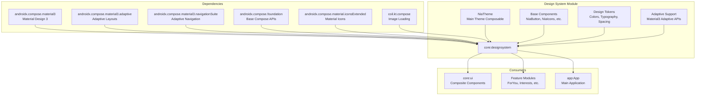
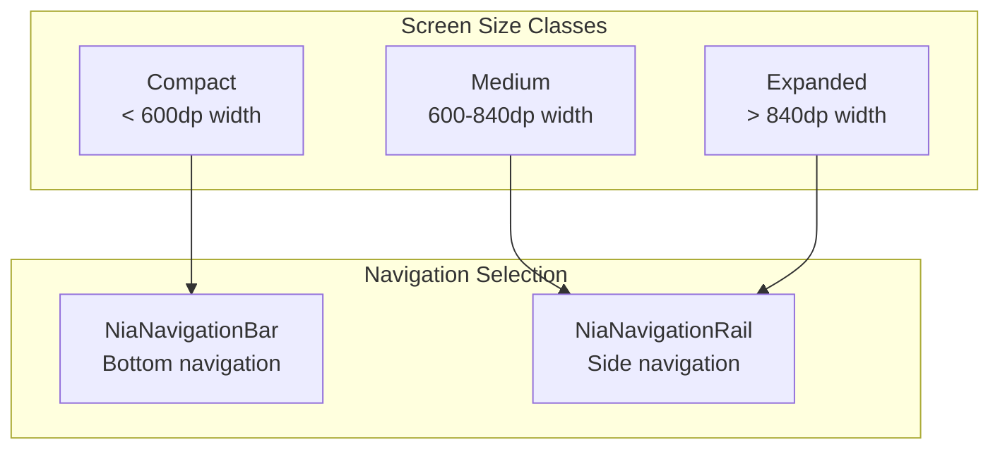

<!-- source: DeepWiki mcp.deepwiki.com · repo android/nowinandroid · page 4.3 Design System · fetched 2026-10-23 -->

# Design System

Relevant source files

The following files were used as context for generating this wiki page:

- [app/src/benchmark/res/values-night/colors.xml](app/src/benchmark/res/values-night/colors.xml)
- [app/src/benchmark/res/values/colors.xml](app/src/benchmark/res/values/colors.xml)
- [app/src/debug/res/values-night/colors.xml](app/src/debug/res/values-night/colors.xml)
- [app/src/debug/res/values/colors.xml](app/src/debug/res/values/colors.xml)
- [app/src/main/ic_launcher-playstore.png](app/src/main/ic_launcher-playstore.png)
- [app/src/main/res/drawable/ic_launcher_background.xml](app/src/main/res/drawable/ic_launcher_background.xml)
- [app/src/main/res/drawable/ic_launcher_foreground.xml](app/src/main/res/drawable/ic_launcher_foreground.xml)
- [app/src/main/res/drawable/ic_splash.xml](app/src/main/res/drawable/ic_splash.xml)
- [app/src/main/res/values-night/colors.xml](app/src/main/res/values-night/colors.xml)
- [app/src/main/res/values-night/themes.xml](app/src/main/res/values-night/themes.xml)
- [app/src/main/res/values/colors.xml](app/src/main/res/values/colors.xml)
- [app/src/main/res/values/themes.xml](app/src/main/res/values/themes.xml)
- [benchmarks/src/main/kotlin/com/google/samples/apps/nowinandroid/foryou/ScrollForYouFeedBenchmark.kt](benchmarks/src/main/kotlin/com/google/samples/apps/nowinandroid/foryou/ScrollForYouFeedBenchmark.kt)
- [compose_compiler_config.conf](compose_compiler_config.conf)
- [core/data-test/src/main/kotlin/com/google/samples/apps/nowinandroid/core/data/test/DefaultZoneIdTimeZoneMonitor.kt](core/data-test/src/main/kotlin/com/google/samples/apps/nowinandroid/core/data/test/DefaultZoneIdTimeZoneMonitor.kt)
- [core/designsystem/src/main/kotlin/com/google/samples/apps/nowinandroid/core/designsystem/component/Button.kt](core/designsystem/src/main/kotlin/com/google/samples/apps/nowinandroid/core/designsystem/component/Button.kt)
- [core/designsystem/src/main/kotlin/com/google/samples/apps/nowinandroid/core/designsystem/component/IconButton.kt](core/designsystem/src/main/kotlin/com/google/samples/apps/nowinandroid/core/designsystem/component/IconButton.kt)
- [core/designsystem/src/main/kotlin/com/google/samples/apps/nowinandroid/core/designsystem/component/Tag.kt](core/designsystem/src/main/kotlin/com/google/samples/apps/nowinandroid/core/designsystem/component/Tag.kt)
- [core/designsystem/src/main/kotlin/com/google/samples/apps/nowinandroid/core/designsystem/component/TopAppBar.kt](core/designsystem/src/main/kotlin/com/google/samples/apps/nowinandroid/core/designsystem/component/TopAppBar.kt)
- [core/designsystem/src/main/kotlin/com/google/samples/apps/nowinandroid/core/designsystem/theme/Type.kt](core/designsystem/src/main/kotlin/com/google/samples/apps/nowinandroid/core/designsystem/theme/Type.kt)
- [core/designsystem/src/main/res/drawable/core_designsystem_ic_placeholder_default.xml](core/designsystem/src/main/res/drawable/core_designsystem_ic_placeholder_default.xml)
- [core/designsystem/src/test/kotlin/com/google/samples/apps/nowinandroid/core/designsystem/ThemeTest.kt](core/designsystem/src/test/kotlin/com/google/samples/apps/nowinandroid/core/designsystem/ThemeTest.kt)
- [core/testing/src/main/kotlin/com/google/samples/apps/nowinandroid/core/testing/util/TestTimeZoneMonitor.kt](core/testing/src/main/kotlin/com/google/samples/apps/nowinandroid/core/testing/util/TestTimeZoneMonitor.kt)
- [core/ui/src/main/kotlin/com/google/samples/apps/nowinandroid/core/ui/LocalTimeZone.kt](core/ui/src/main/kotlin/com/google/samples/apps/nowinandroid/core/ui/LocalTimeZone.kt)

The Design System in Now in Android is a foundational module that provides a Material3-based theming system, base UI components, design tokens, and icons. It establishes visual consistency across the application and enables adaptive layouts for different screen sizes and device types.

This page covers the design system infrastructure in the `core:designsystem` module, including theme configuration, typography, and background management.

## Module Overview

The design system is implemented as a standalone Android library module at [core/designsystem/build.gradle.kts:1-49](). It serves as the foundational layer for all UI components in the application.

**Sources:** [core/designsystem/build.gradle.kts:1-49](), [core/ui/build.gradle.kts:26-38]()

## Theme System

The theme system is built on Material 3 and provides the `NiaTheme` composable as the primary entry point for theming the application. It handles the switching between light and dark modes, as well as dynamic color support on Android 12+.

### Typography

The application uses a custom typography set defined in `NiaTypography`. This set overrides Material 3 defaults to provide a specific look for titles, labels, and body text.

| Material 3 Style | Weight | Size | Line Height | Usage in NiA |
| :--- | :--- | :--- | :--- | :--- |
| `displayLarge` | Normal | 57.sp | 64.sp | Large Hero Text |
| `titleLarge` | Bold | 22.sp | 28.sp | Main Headers [core/designsystem/src/main/kotlin/com/google/samples/apps/nowinandroid/core/designsystem/theme/Type.kt:85-96]() |
| `labelLarge` | Medium | 14.sp | 20.sp | Buttons [core/designsystem/src/main/kotlin/com/google/samples/apps/nowinandroid/core/designsystem/theme/Type.kt:143-154]() |
| `labelMedium` | Medium | 12.sp | 16.sp | Navigation Items [core/designsystem/src/main/kotlin/com/google/samples/apps/nowinandroid/core/designsystem/theme/Type.kt:156-167]() |
| `labelSmall` | Medium | 10.sp | 14.sp | Tags/Chips [core/designsystem/src/main/kotlin/com/google/samples/apps/nowinandroid/core/designsystem/theme/Type.kt:169-180]() |

**Sources:** [core/designsystem/src/main/kotlin/com/google/samples/apps/nowinandroid/core/designsystem/theme/Type.kt:32-181]()

### Dynamic Color and Theme Switching

NiA supports dynamic color theming which extracts colors from the user's wallpaper. The app's `Theme.Nia` parent is set to `android:Theme.Material.Light.NoActionBar` [app/src/main/res/values/themes.xml:21-24]().

- **Dark Mode**: Managed via `values-night` resource qualifiers [app/src/main/res/values-night/themes.xml:19]().
- **Build Variants**: Launcher icons are tinted differently across `debug` and `benchmark` builds to help developers distinguish between versions [app/src/debug/res/values/colors.xml:20-21](), [app/src/benchmark/res/values/colors.xml:20-21]().

## Background and Surface Management

NiA uses specialized background composables to provide a consistent visual depth.

- **NiaBackground**: Provides the standard surface color for the application.
- **NiaGradientBackground**: Used for specific screens like "For You" to provide a branded visual style.
- **Splash Screen**: The app uses the `Theme.Nia.Splash` theme which utilizes the `androidx.core:core-splashscreen` API [app/src/main/res/values/themes.xml:33-36]().

## Compose Compiler Stability Configuration

To optimize performance and avoid unnecessary recompositions, the project uses a `compose_compiler_config.conf` file. This tells the Compose Compiler to treat specific classes as stable, even if they are in external modules.

Key stable definitions include:
- All data models in `com.google.samples.apps.nowinandroid.core.model.data.*` [compose_compiler_config.conf:7]().
- Java standard library time classes like `java.time.ZoneId` and `java.time.ZoneOffset` [compose_compiler_config.conf:10-11]().

**Sources:** [compose_compiler_config.conf:1-12]()

## Base Components

The design system provides a set of base UI components that follow Material 3 design patterns.

### Top App Bar

The `NiaTopAppBar` is a wrapper around `CenterAlignedTopAppBar` [core/designsystem/src/main/kotlin/com/google/samples/apps/nowinandroid/core/designsystem/component/TopAppBar.kt:41-51](). It standardizes the styling of navigation and action icons using `MaterialTheme.colorScheme.onSurface` [core/designsystem/src/main/kotlin/com/google/samples/apps/nowinandroid/core/designsystem/component/TopAppBar.kt:59-68]().

### Adaptive Design Support

The design system provides support for adaptive layouts that respond to different screen sizes.

**Sources:** [app/src/testDemo/kotlin/com/google/samples/apps/nowinandroid/ui/NiaAppScreenSizesScreenshotTests.kt:152-230]()

## UI Catalog Application

The design system includes a dedicated catalog application (`app-nia-catalog`) for showcasing and testing components in isolation.

The catalog application:
- Provides a standalone environment for component development.
- Uses the `demo` flavor for static content [app-nia-catalog/build.gradle.kts:40-72]().
- Enables rapid iteration on design system components.

**Sources:** [app-nia-catalog/build.gradle.kts:1-77]()

## Testing and Visual Regression

NiA uses **Roborazzi** for screenshot testing to ensure the design system remains visually consistent. Tests are performed across multiple themes and screen sizes.

- **Theme Consistency**: Tests in `ThemeTest.kt` verify that color schemes are applied correctly.
- **Screen Sizes**: `NiaAppScreenSizesScreenshotTests` captures the UI in Compact, Medium, and Expanded configurations [app/src/testDemo/kotlin/com/google/samples/apps/nowinandroid/ui/NiaAppScreenSizesScreenshotTests.kt:59-65]().

**Sources:** [core/designsystem/src/test/kotlin/com/google/samples/apps/nowinandroid/core/designsystem/ThemeTest.kt](), [app/src/testDemo/kotlin/com/google/samples/apps/nowinandroid/ui/NiaAppScreenSizesScreenshotTests.kt:59-65]()

---

