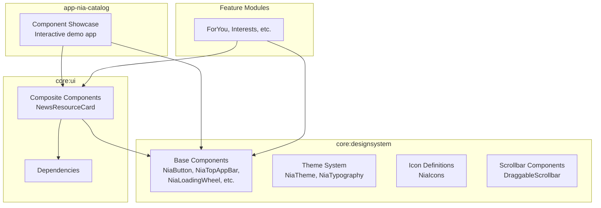
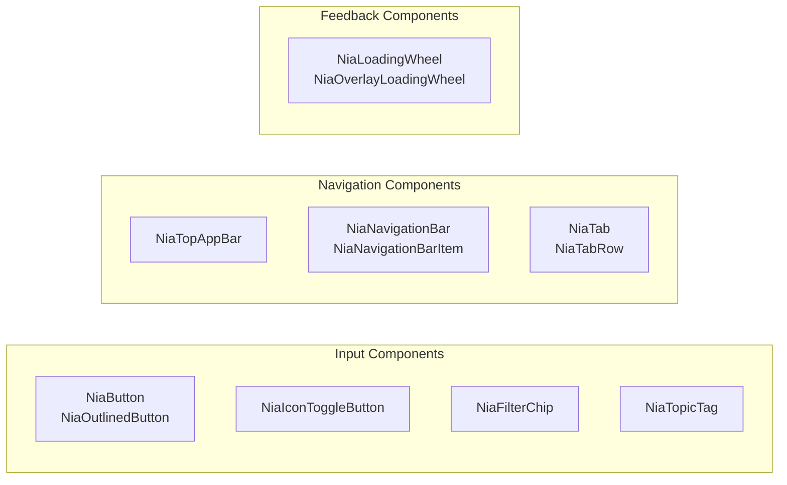

<!-- source: DeepWiki mcp.deepwiki.com · repo android/nowinandroid · page 4.4 Core UI Components · fetched 2026-10-23 -->

# Core UI Components

Relevant source files

The following files were used as context for generating this wiki page:

- [app-nia-catalog/README.md](app-nia-catalog/README.md)
- [app-nia-catalog/build.gradle.kts](app-nia-catalog/build.gradle.kts)
- [app-nia-catalog/src/main/kotlin/com/google/samples/apps/niacatalog/ui/Catalog.kt](app-nia-catalog/src/main/kotlin/com/google/samples/apps/niacatalog/ui/Catalog.kt)
- [app/src/androidTest/kotlin/com/google/samples/apps/nowinandroid/ui/NavigationTest.kt](app/src/androidTest/kotlin/com/google/samples/apps/nowinandroid/ui/NavigationTest.kt)
- [core/common/README.md](core/common/README.md)
- [core/data-test/build.gradle.kts](core/data-test/build.gradle.kts)
- [core/data/build.gradle.kts](core/data/build.gradle.kts)
- [core/database/README.md](core/database/README.md)
- [core/database/build.gradle.kts](core/database/build.gradle.kts)
- [core/datastore-test/build.gradle.kts](core/datastore-test/build.gradle.kts)
- [core/datastore/build.gradle.kts](core/datastore/build.gradle.kts)
- [core/designsystem/README.md](core/designsystem/README.md)
- [core/designsystem/build.gradle.kts](core/designsystem/build.gradle.kts)
- [core/designsystem/src/main/kotlin/com/google/samples/apps/nowinandroid/core/designsystem/component/Chip.kt](core/designsystem/src/main/kotlin/com/google/samples/apps/nowinandroid/core/designsystem/component/Chip.kt)
- [core/designsystem/src/main/kotlin/com/google/samples/apps/nowinandroid/core/designsystem/component/LoadingWheel.kt](core/designsystem/src/main/kotlin/com/google/samples/apps/nowinandroid/core/designsystem/component/LoadingWheel.kt)
- [core/designsystem/src/main/kotlin/com/google/samples/apps/nowinandroid/core/designsystem/component/Navigation.kt](core/designsystem/src/main/kotlin/com/google/samples/apps/nowinandroid/core/designsystem/component/Navigation.kt)
- [core/designsystem/src/main/kotlin/com/google/samples/apps/nowinandroid/core/designsystem/component/Tabs.kt](core/designsystem/src/main/kotlin/com/google/samples/apps/nowinandroid/core/designsystem/component/Tabs.kt)
- [core/designsystem/src/main/kotlin/com/google/samples/apps/nowinandroid/core/designsystem/component/scrollbar/AppScrollbars.kt](core/designsystem/src/main/kotlin/com/google/samples/apps/nowinandroid/core/designsystem/component/scrollbar/AppScrollbars.kt)
- [core/designsystem/src/main/kotlin/com/google/samples/apps/nowinandroid/core/designsystem/component/scrollbar/LazyScrollbarUtilities.kt](core/designsystem/src/main/kotlin/com/google/samples/apps/nowinandroid/core/designsystem/component/scrollbar/LazyScrollbarUtilities.kt)
- [core/designsystem/src/main/kotlin/com/google/samples/apps/nowinandroid/core/designsystem/component/scrollbar/Scrollbar.kt](core/designsystem/src/main/kotlin/com/google/samples/apps/nowinandroid/core/designsystem/component/scrollbar/Scrollbar.kt)
- [core/designsystem/src/main/kotlin/com/google/samples/apps/nowinandroid/core/designsystem/component/scrollbar/ScrollbarExt.kt](core/designsystem/src/main/kotlin/com/google/samples/apps/nowinandroid/core/designsystem/component/scrollbar/ScrollbarExt.kt)
- [core/designsystem/src/main/kotlin/com/google/samples/apps/nowinandroid/core/designsystem/component/scrollbar/ThumbExt.kt](core/designsystem/src/main/kotlin/com/google/samples/apps/nowinandroid/core/designsystem/component/scrollbar/ThumbExt.kt)
- [core/designsystem/src/main/kotlin/com/google/samples/apps/nowinandroid/core/designsystem/icon/NiaIcons.kt](core/designsystem/src/main/kotlin/com/google/samples/apps/nowinandroid/core/designsystem/icon/NiaIcons.kt)
- [core/model/README.md](core/model/README.md)
- [core/network/README.md](core/network/README.md)
- [core/network/build.gradle.kts](core/network/build.gradle.kts)
- [core/testing/build.gradle.kts](core/testing/build.gradle.kts)
- [core/ui/build.gradle.kts](core/ui/build.gradle.kts)
- [core/ui/src/main/kotlin/com/google/samples/apps/nowinandroid/core/ui/DevicePreviews.kt](core/ui/src/main/kotlin/com/google/samples/apps/nowinandroid/core/ui/DevicePreviews.kt)
- [core/ui/src/main/kotlin/com/google/samples/apps/nowinandroid/core/ui/InterestsItem.kt](core/ui/src/main/kotlin/com/google/samples/apps/nowinandroid/core/ui/InterestsItem.kt)
- [core/ui/src/main/kotlin/com/google/samples/apps/nowinandroid/core/ui/NewsFeed.kt](core/ui/src/main/kotlin/com/google/samples/apps/nowinandroid/core/ui/NewsFeed.kt)
- [core/ui/src/main/kotlin/com/google/samples/apps/nowinandroid/core/ui/NewsResourceCard.kt](core/ui/src/main/kotlin/com/google/samples/apps/nowinandroid/core/ui/NewsResourceCard.kt)
- [core/ui/src/main/res/values/strings.xml](core/ui/src/main/res/values/strings.xml)

## Purpose and Scope

This page documents the reusable Compose UI components available in the Now in Android application. These components are organized into two core modules: `core:designsystem` for base design system components and `core:ui` for higher-level composite components. The components follow Material 3 design principles and support theming, dynamic color, and accessibility.

For information about the theming system (colors, typography, and theme configuration), see [Design System](#4.3). For navigation and app-level UI structure, see [Application Structure](#4.1).

## Module Organization

The UI components are divided between two modules based on their level of abstraction and dependencies:

**Module Responsibilities:**

| Module | Purpose | Key Dependencies |
|--------|---------|-----------------|
| `core:designsystem` | Base components, theme, typography, icons, scrollbars | Compose Material 3, Foundation |
| `core:ui` | Composite components, domain-specific widgets | `core:designsystem`, `core:model`, `core:analytics` |
| `app-nia-catalog` | Interactive component showcase application | `core:designsystem`, `core:ui` |

**Sources:** [core/designsystem/build.gradle.kts:16-48](), [core/ui/build.gradle.kts:16-38](), [app-nia-catalog/build.gradle.kts:34-72]()

## Base Components (core:designsystem)

The `core:designsystem` module provides foundational UI components that are used throughout the application. These components are theme-aware and follow Material 3 design patterns.

### Scrollbar Components

The design system includes a custom scrollbar implementation designed for high-performance scrolling in large lists.

**Key Classes:**
- `ScrollbarState`: Manages the thumb position and size as percentages of the track [core/designsystem/src/main/kotlin/com/google/samples/apps/nowinandroid/core/designsystem/component/scrollbar/Scrollbar.kt:76-100]().
- `DraggableScrollbar`: A scrollbar that allows fast scrolling by dragging the thumb [core/designsystem/src/main/kotlin/com/google/samples/apps/nowinandroid/core/designsystem/component/scrollbar/AppScrollbars.kt:77-97]().
- `DecorativeScrollbar`: A non-interactive scrollbar used for visual feedback of list position [core/designsystem/src/main/kotlin/com/google/samples/apps/nowinandroid/core/designsystem/component/scrollbar/AppScrollbars.kt:107-125]().

**State Integration:**
The system provides extension functions to derive `ScrollbarState` from standard Compose lazy layouts:
- `LazyListState.scrollbarState()` [core/designsystem/src/main/kotlin/com/google/samples/apps/nowinandroid/core/designsystem/component/scrollbar/ScrollbarExt.kt:41-95]()
- `LazyGridState.scrollbarState()` [core/designsystem/src/main/kotlin/com/google/samples/apps/nowinandroid/core/designsystem/component/scrollbar/ScrollbarExt.kt:104-168]()
- `LazyStaggeredGridState.scrollbarState()` [core/designsystem/src/main/kotlin/com/google/samples/apps/nowinandroid/core/designsystem/component/scrollbar/ScrollbarExt.kt:178-180]()

**Sources:** [core/designsystem/src/main/kotlin/com/google/samples/apps/nowinandroid/core/designsystem/component/scrollbar/Scrollbar.kt:1-206](), [core/designsystem/src/main/kotlin/com/google/samples/apps/nowinandroid/core/designsystem/component/scrollbar/AppScrollbars.kt:1-125]()

### Component Catalog

**Sources:** [core/designsystem/src/main/kotlin/com/google/samples/apps/nowinandroid/core/designsystem/component/LoadingWheel.kt:28-45](), [core/designsystem/src/main/kotlin/com/google/samples/apps/nowinandroid/core/designsystem/component/Navigation.kt:37-65](), [core/designsystem/src/main/kotlin/com/google/samples/apps/nowinandroid/core/designsystem/component/Chip.kt:38-60]()

### Navigation Components

**NiaNavigationBar** and **NiaNavigationBarItem** implement bottom navigation patterns using Material 3 `NavigationBar` and `NavigationBarItem`.

**Navigation Item Properties:**
- `icon` and `selectedIcon` slots.
- `label` text slot.
- `selected` state.
- Support for `alwaysShowLabel` configuration [core/designsystem/src/main/kotlin/com/google/samples/apps/nowinandroid/core/designsystem/component/Navigation.kt:60-100]().

**Sources:** [core/designsystem/src/main/kotlin/com/google/samples/apps/nowinandroid/core/designsystem/component/Navigation.kt:37-100]()

## Composite Components (core:ui)

The `core:ui` module contains higher-level components that compose base components with domain models.

### NewsResourceCard

**NewsResourceCardExpanded** is the primary card component for displaying news articles and resources.

**Key Features:**
- **Drag and Drop Support**: The title uses `dragAndDropSource` to share content via `DragAndDropTransferData` [core/ui/src/main/kotlin/com/google/samples/apps/nowinandroid/core/ui/NewsResourceCard.kt:141-149]().
- **Accessibility**: Uses custom `semantics` with `onClick` labels for better screen reader support [core/ui/src/main/kotlin/com/google/samples/apps/nowinandroid/core/ui/NewsResourceCard.kt:120-122]().
- **Dynamic Content**: Displays a `NotificationDot` if the resource has not been viewed [core/ui/src/main/kotlin/com/google/samples/apps/nowinandroid/core/ui/NewsResourceCard.kt:156-162]().

**Sources:** [core/ui/src/main/kotlin/com/google/samples/apps/nowinandroid/core/ui/NewsResourceCard.kt:89-176]()

### InterestsItem and NewsFeed

- **InterestsItem**: A standard row component for displaying topics in the Interests screen, supporting follow/unfollow actions and navigation to topic details.
- **NewsFeed**: A list-based composable that handles the rendering of a collection of `UserNewsResource` items using `NewsResourceCardExpanded`.

**Sources:** [core/ui/src/main/kotlin/com/google/samples/apps/nowinandroid/core/ui/InterestsItem.kt:1-50](), [core/ui/src/main/kotlin/com/google/samples/apps/nowinandroid/core/ui/NewsFeed.kt:1-100]()

## Device Previews

The project utilizes specialized preview annotations to ensure UI consistency across various device configurations.

**Common Previews:**
- `DevicePreviews`: Multi-device preview annotation for phone, tablet, and foldable [core/ui/src/main/kotlin/com/google/samples/apps/nowinandroid/core/ui/DevicePreviews.kt:30-45]().

**Sources:** [core/ui/src/main/kotlin/com/google/samples/apps/nowinandroid/core/ui/DevicePreviews.kt:25-45]()

## Component Catalog Application (app-nia-catalog)

The `app-nia-catalog` module provides an interactive showcase of all UI components for development and design review.

**Build Configuration:**
- **Application ID**: `com.google.samples.apps.niacatalog` [app-nia-catalog/build.gradle.kts:41]().
- **Flavor Strategy**: Uses `missingDimensionStrategy` to default to the `demo` flavor for modules requiring a content dimension [app-nia-catalog/build.gradle.kts:47]().
- **Dependencies**: Depends on `core:designsystem` and `core:ui` to render the catalog [app-nia-catalog/build.gradle.kts:70-71]().

**Sources:** [app-nia-catalog/build.gradle.kts:34-77](), [app-nia-catalog/src/main/kotlin/com/google/samples/apps/niacatalog/ui/Catalog.kt:1-100]()

## Testing and Navigation Verification

UI components are verified through navigation tests and screenshot tests.

**Navigation Verification:**
`NavigationTest` ensures that top-level destinations (For You, Saved, Interests) correctly display and maintain state [app/src/androidTest/kotlin/com/google/samples/apps/nowinandroid/ui/NavigationTest.kt:102-167]().

**Sources:** [app/src/androidTest/kotlin/com/google/samples/apps/nowinandroid/ui/NavigationTest.kt:62-167]()

---

