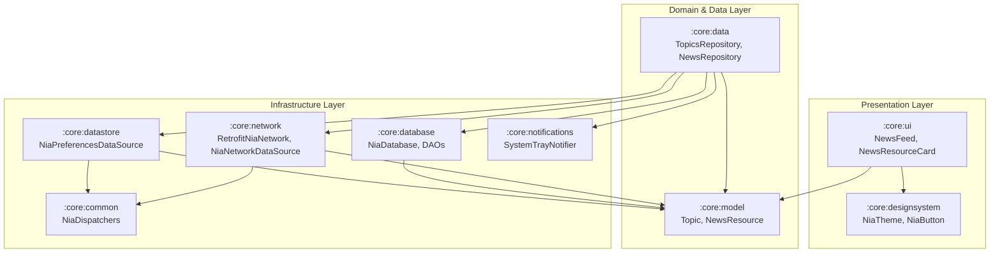
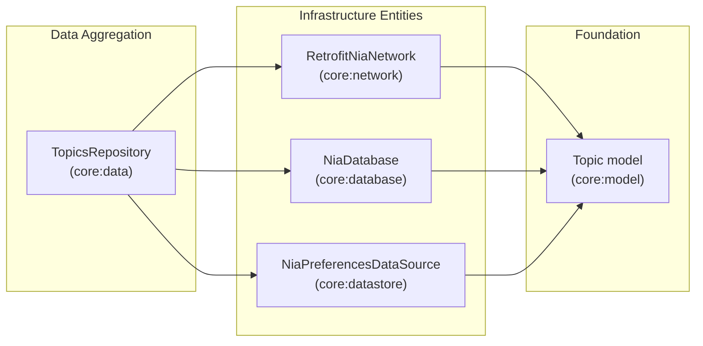

<!-- source: DeepWiki mcp.deepwiki.com · repo android/nowinandroid · page 5 Core Modules · fetched 2026-10-23 -->

# Core Modules

<details>
<summary>Relevant source files</summary>

The following files were used as context for generating this wiki page:

- [app-nia-catalog/build.gradle.kts](app-nia-catalog/build.gradle.kts)
- [core/data-test/README.md](core/data-test/README.md)
- [core/data-test/build.gradle.kts](core/data-test/build.gradle.kts)
- [core/data/README.md](core/data/README.md)
- [core/data/build.gradle.kts](core/data/build.gradle.kts)
- [core/database/build.gradle.kts](core/database/build.gradle.kts)
- [core/datastore-proto/README.md](core/datastore-proto/README.md)
- [core/datastore-test/README.md](core/datastore-test/README.md)
- [core/datastore-test/build.gradle.kts](core/datastore-test/build.gradle.kts)
- [core/datastore/README.md](core/datastore/README.md)
- [core/datastore/build.gradle.kts](core/datastore/build.gradle.kts)
- [core/designsystem/build.gradle.kts](core/designsystem/build.gradle.kts)
- [core/domain/README.md](core/domain/README.md)
- [core/network/build.gradle.kts](core/network/build.gradle.kts)
- [core/testing/README.md](core/testing/README.md)
- [core/testing/build.gradle.kts](core/testing/build.gradle.kts)
- [core/ui/build.gradle.kts](core/ui/build.gradle.kts)

</details>


Core modules provide foundational functionality and shared infrastructure used across the Now in Android application. These Android library modules encapsulate specific technical concerns (networking, persistence, UI components) and business logic (data repositories, domain models) that are reused by feature modules and the app module. Core modules may depend on other core modules but must not depend on feature or app modules, maintaining clear architectural boundaries.

For information about specific data layer patterns and repositories, see [Data Layer](#2.2). For UI components and the design system, see [Design System](#4.3) and [Core UI Components](#4.4). This page focuses on the organization and purpose of core modules as architectural blocks.

## Core Module Principles

Core modules follow these architectural constraints:

- **Shared Functionality**: Contain auxiliary code and dependencies shared between multiple modules.
- **Dependency Direction**: May depend on other core modules, but never on feature or app modules.
- **Single Responsibility**: Each module addresses a specific technical or domain concern.
- **Reusability**: Designed to be consumed by multiple feature modules without coupling.

## Module Organization

The core modules are organized into functional categories, as visualized in the dependency graph:



**Diagram: Core Module Dependency Structure**

Sources: [core/data/README.md:13-48](), [core/datastore/README.md:13-25](), [core/network/build.gradle.kts:37-39]()

## Core Modules Overview

### Presentation Layer Modules

| Module | Purpose | Key Classes | Build Configuration |
|--------|---------|-------------|---------------------|
| `:core:designsystem` | Design system with base UI components, Material 3 theme, and typography | `NiaTheme`, `NiaButton`, `NiaIcons` | [core/designsystem/build.gradle.kts:1-49]() |
| `:core:ui` | Composite UI components that combine design system elements with domain models | `NewsFeed`, `NewsResourceCard` | [core/ui/build.gradle.kts:1-39]() |

The `:core:designsystem` module exposes Material 3 components [core/designsystem/build.gradle.kts:31-38]() and includes screenshot testing support via `:core:screenshotTesting` [core/designsystem/build.gradle.kts:47](). The `:core:ui` module depends on both designsystem and model [core/ui/build.gradle.kts:29-30]().

Sources: [core/designsystem/build.gradle.kts:1-49](), [core/ui/build.gradle.kts:1-39]()

### Domain & Data Layer Modules

| Module | Purpose | Key Classes | Build Configuration |
|--------|---------|-------------|---------------------|
| `:core:model` | Pure JVM data models used throughout the app | `Topic`, `NewsResource`, `UserData` | [core/data/README.md:22-22]() |
| `:core:data` | Repository implementations aggregating multiple data sources | `TopicsRepository`, `NewsRepository` | [core/data/build.gradle.kts:1-42]() |

The `:core:data` module serves as the primary data layer, depending on network, database, and datastore modules [core/data/build.gradle.kts:29-32]() and exposing unified repository interfaces.

Sources: [core/data/build.gradle.kts:1-42](), [core/data/README.md:27-32]()

### Infrastructure Layer Modules

| Module | Purpose | Key Classes | Detail Link |
|--------|---------|-------------|-------------|
| `:core:network` | Remote data source using Retrofit | `RetrofitNiaNetwork`, `NiaNetworkDataSource` | [Network Module](#5.1) |
| `:core:database` | Local persistence using Room | `NiaDatabase`, `NewsResourceDao` | [Database Module](#5.2) |
| `:core:datastore` | User preferences using Proto DataStore | `NiaPreferencesDataSource` | [DataStore Module](#5.3) |
| `:core:notifications` | System notifications and deep linking | `SystemTrayNotifier` | [Notifications](#5.4) |
| `:core:common` | Common utilities and Coroutine dispatchers | `NiaDispatchers` | [core/datastore/build.gradle.kts:35]() |

Sources: [core/network/build.gradle.kts:1-66](), [core/database/build.gradle.kts:1-37](), [core/datastore/build.gradle.kts:1-40]()

## Module Dependency Patterns

This diagram illustrates the layered dependency structure from code entities to infrastructure:



**Diagram: Entity Dependency Flow**

Sources: [core/data/README.md:27-32](), [core/datastore/README.md:22-24]()

## Network Module Configuration

The `:core:network` module uses `kotlinx-serialization` [core/network/build.gradle.kts:25]() for JSON parsing. It configures a dynamic `BACKEND_URL` read from `local.properties` [core/network/build.gradle.kts:51-57]() and injected via `BuildConfig` [core/network/build.gradle.kts:59-65]().

For detailed network module architecture, see [Network Module](#5.1).

Sources: [core/network/build.gradle.kts:51-65]()

## DataStore Configuration

The `:core:datastore` module uses Proto DataStore for type-safe preference storage. It depends on `:core:datastore-proto` for generated protocol buffer classes [core/datastore/build.gradle.kts:32]().

The module includes ProGuard rules to ensure Proto classes are handled correctly [core/datastore/build.gradle.kts:25]():

```kotlin
android {
    defaultConfig {
        consumerProguardFiles("consumer-proguard-rules.pro")
    }
}
```

For detailed DataStore implementation patterns, see [DataStore Module](#5.3).

Sources: [core/datastore/build.gradle.kts:24-32]()

## Testing Infrastructure Modules

Specialized testing modules provide reusable test infrastructure:

| Module | Purpose | Key Components |
|--------|---------|----------------|
| `:core:testing` | Shared test utilities and rules | `NiaTestRunner`, `TestDispatchersModule` |
| `:core:datastore-test` | DataStore testing utilities | `TestDataStoreModule` |
| `:core:data-test` | Test repository implementations | `FakeNewsRepository`, `FakeTopicsRepository` |

The `:core:testing` module exposes production core modules like `data` and `notifications` as API dependencies [core/testing/build.gradle.kts:29-31](), allowing tests to use production interfaces with test doubles.

For comprehensive testing strategy, see [Unit and Integration Testing](#8.1).

Sources: [core/testing/build.gradle.kts:1-38](), [core/datastore-test/build.gradle.kts:1-30]()

## UI Catalog Application

The `:app-nia-catalog` module is a standalone application used to showcase the design system in isolation [app-nia-catalog/build.gradle.kts:41](). It depends only on `:core:designsystem` and `:core:ui` [app-nia-catalog/build.gradle.kts:70-71]().

The catalog uses a `missingDimensionStrategy` to default to the `demo` flavor for content dependencies [app-nia-catalog/build.gradle.kts:47]().

Sources: [app-nia-catalog/build.gradle.kts:1-77]()

---

