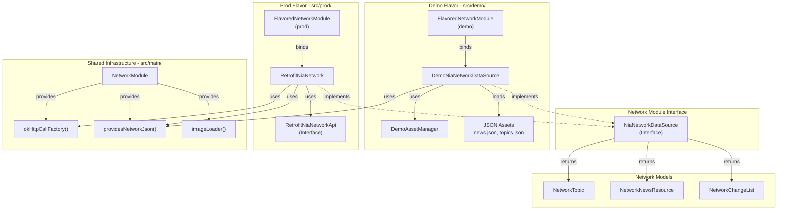
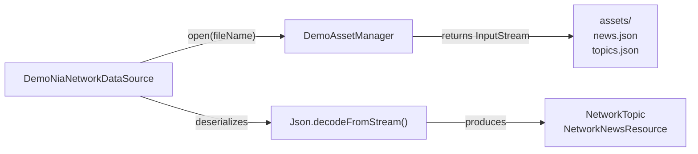
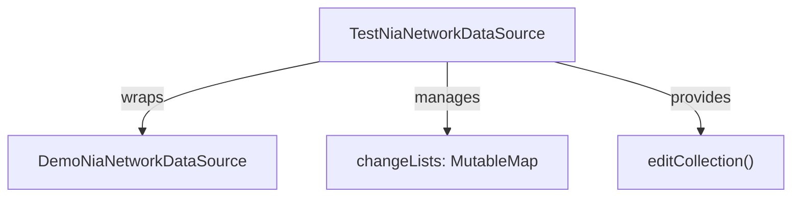

<!-- source: DeepWiki mcp.deepwiki.com · repo android/nowinandroid · page 5.1 Network Module · fetched 2026-10-23 -->

# Network Module

Relevant source files

The following files were used as context for generating this wiki page:

- [app/src/main/kotlin/com/google/samples/apps/nowinandroid/NiaApplication.kt](app/src/main/kotlin/com/google/samples/apps/nowinandroid/NiaApplication.kt)
- [core/data-test/src/main/kotlin/com/google/samples/apps/nowinandroid/core/data/test/repository/FakeNewsRepository.kt](core/data-test/src/main/kotlin/com/google/samples/apps/nowinandroid/core/data/test/repository/FakeNewsRepository.kt)
- [core/data-test/src/main/kotlin/com/google/samples/apps/nowinandroid/core/data/test/repository/FakeTopicsRepository.kt](core/data-test/src/main/kotlin/com/google/samples/apps/nowinandroid/core/data/test/repository/FakeTopicsRepository.kt)
- [core/data/src/test/kotlin/com/google/samples/apps/nowinandroid/core/data/testdoubles/TestNiaNetworkDataSource.kt](core/data/src/test/kotlin/com/google/samples/apps/nowinandroid/core/data/testdoubles/TestNiaNetworkDataSource.kt)
- [core/network/lint.xml](core/network/lint.xml)
- [core/network/src/demo/kotlin/com/google/samples/apps/nowinandroid/core/network/di/FlavoredNetworkModule.kt](core/network/src/demo/kotlin/com/google/samples/apps/nowinandroid/core/network/di/FlavoredNetworkModule.kt)
- [core/network/src/main/kotlin/JvmUnitTestDemoAssetManager.kt](core/network/src/main/kotlin/JvmUnitTestDemoAssetManager.kt)
- [core/network/src/main/kotlin/com/google/samples/apps/nowinandroid/core/network/demo/DemoAssetManager.kt](core/network/src/main/kotlin/com/google/samples/apps/nowinandroid/core/network/demo/DemoAssetManager.kt)
- [core/network/src/main/kotlin/com/google/samples/apps/nowinandroid/core/network/demo/DemoNiaNetworkDataSource.kt](core/network/src/main/kotlin/com/google/samples/apps/nowinandroid/core/network/demo/DemoNiaNetworkDataSource.kt)
- [core/network/src/main/kotlin/com/google/samples/apps/nowinandroid/core/network/di/NetworkModule.kt](core/network/src/main/kotlin/com/google/samples/apps/nowinandroid/core/network/di/NetworkModule.kt)
- [core/network/src/main/kotlin/com/google/samples/apps/nowinandroid/core/network/retrofit/RetrofitNiaNetwork.kt](core/network/src/main/kotlin/com/google/samples/apps/nowinandroid/core/network/retrofit/RetrofitNiaNetwork.kt)
- [core/network/src/prod/kotlin/com/google/samples/apps/nowinandroid/core/network/di/FlavoredNetworkModule.kt](core/network/src/prod/kotlin/com/google/samples/apps/nowinandroid/core/network/di/FlavoredNetworkModule.kt)
- [core/network/src/test/kotlin/com/google/samples/apps/nowinandroid/core/network/demo/DemoNiaNetworkDataSourceTest.kt](core/network/src/test/kotlin/com/google/samples/apps/nowinandroid/core/network/demo/DemoNiaNetworkDataSourceTest.kt)

## Purpose and Overview

The Network Module (`core:network`) provides the networking infrastructure for the Now in Android application. It defines the contract for fetching remote data and provides two implementations: a **demo** implementation using static local JSON files and a **production** implementation using Retrofit to communicate with a real backend API. This dual implementation strategy enables development and testing without requiring a live backend server.

This module is responsible for:
- Defining the `NiaNetworkDataSource` interface that abstracts network operations.
- Providing demo and production implementations via build flavors.
- Configuring HTTP clients (OkHttp) and serialization (Kotlinx Serialization).
- Exposing network DTOs (Data Transfer Objects) that are consumed by the Data Layer.
- Setting up image loading infrastructure with Coil.

For information about how this module is consumed by repositories, see [Data Layer](#2.2). For details about build flavors, see [Build Flavors and Variants](#3.3).

**Sources:** [core/network/src/main/kotlin/com/google/samples/apps/nowinandroid/core/network/di/NetworkModule.kt:1-95](), [core/network/src/demo/kotlin/com/google/samples/apps/nowinandroid/core/network/di/FlavoredNetworkModule.kt:1-33](), [core/network/src/prod/kotlin/com/google/samples/apps/nowinandroid/core/network/di/FlavoredNetworkModule.kt:1-33]()

---

## Architecture and Design

The Network Module follows a **strategy pattern** with build flavor-based implementation selection. The core abstraction is the `NiaNetworkDataSource` interface, which has two concrete implementations selected at compile time via Gradle product flavors.

### Module Structure

**Sources:** [core/network/src/demo/kotlin/com/google/samples/apps/nowinandroid/core/network/di/FlavoredNetworkModule.kt:28-32](), [core/network/src/prod/kotlin/com/google/samples/apps/nowinandroid/core/network/di/FlavoredNetworkModule.kt:28-32](), [core/network/src/main/kotlin/com/google/samples/apps/nowinandroid/core/network/retrofit/RetrofitNiaNetwork.kt:75-104]()

---

## Network Data Source Interface

The `NiaNetworkDataSource` interface defines the contract for all network operations. It provides methods for fetching topics, news resources, and their corresponding change lists for synchronization purposes.

### Interface Methods

| Method | Return Type | Purpose |
|--------|-------------|---------|
| `getTopics(ids: List<String>?)` | `List<NetworkTopic>` | Fetch topics, optionally filtered by IDs |
| `getNewsResources(ids: List<String>?)` | `List<NetworkNewsResource>` | Fetch news resources, optionally filtered by IDs |
| `getTopicChangeList(after: Int?)` | `List<NetworkChangeList>` | Fetch topic changes after a specific version |
| `getNewsResourceChangeList(after: Int?)` | `List<NetworkChangeList>` | Fetch news resource changes after a specific version |

The change list methods enable incremental synchronization by tracking which items have been added, modified, or deleted since a given version number.

**Sources:** [core/network/src/main/kotlin/com/google/samples/apps/nowinandroid/core/network/demo/DemoNiaNetworkDataSource.kt:45-55](), [core/network/src/main/kotlin/com/google/samples/apps/nowinandroid/core/network/retrofit/RetrofitNiaNetwork.kt:93-103]()

---

## Demo Implementation

The `DemoNiaNetworkDataSource` class provides a fake implementation that loads static data from JSON files bundled in the app's assets folder. This enables development and testing without a backend server.

### Demo Data Source Flow

### Implementation Details

The `DemoNiaNetworkDataSource` class is injected with three dependencies:
- `@Dispatcher(IO) ioDispatcher: CoroutineDispatcher` - For background execution [core/network/src/main/kotlin/com/google/samples/apps/nowinandroid/core/network/demo/DemoNiaNetworkDataSource.kt:40]().
- `networkJson: Json` - Kotlinx Serialization instance [core/network/src/main/kotlin/com/google/samples/apps/nowinandroid/core/network/demo/DemoNiaNetworkDataSource.kt:41]().
- `assets: DemoAssetManager` - Abstraction for loading asset files [core/network/src/main/kotlin/com/google/samples/apps/nowinandroid/core/network/demo/DemoNiaNetworkDataSource.kt:42]().

**Key implementation points:**

1. **Asset Loading:** The `getDataFromJsonFile()` method [core/network/src/main/kotlin/com/google/samples/apps/nowinandroid/core/network/demo/DemoNiaNetworkDataSource.kt:61-76]() loads and deserializes JSON files from assets.
2. **API 23 Workaround:** For Android M (API 23) and below, a workaround converts the stream to a string before deserialization using `BufferedReader::readText` to avoid serialization exceptions [core/network/src/main/kotlin/com/google/samples/apps/nowinandroid/core/network/demo/DemoNiaNetworkDataSource.kt:64-74]().
3. **Change List Generation:** Change lists are generated by mapping items to indexed change records using `mapToChangeList` [core/network/src/main/kotlin/com/google/samples/apps/nowinandroid/core/network/demo/DemoNiaNetworkDataSource.kt:88-96]().

### Test Support

The `JvmUnitTestDemoAssetManager` provides asset loading support for JVM unit tests by reading from the merged assets directory configured by the Gradle Android plugin [core/network/src/main/kotlin/JvmUnitTestDemoAssetManager.kt:28-41]().

**Sources:** [core/network/src/main/kotlin/com/google/samples/apps/nowinandroid/core/network/demo/DemoNiaNetworkDataSource.kt:39-82](), [core/network/src/main/kotlin/com/google/samples/apps/nowinandroid/core/network/demo/DemoAssetManager.kt:21-23](), [core/network/src/main/kotlin/JvmUnitTestDemoAssetManager.kt:28-41]()

---

## Production Implementation

The production implementation `RetrofitNiaNetwork` uses Retrofit to communicate with the NiA backend.

### Retrofit Configuration

The implementation defines a private interface `RetrofitNiaNetworkApi` for endpoint declarations:

| Endpoint | Method | Parameters | Return Type |
|----------|--------|------------|-------------|
| `topics` | `GET` | `ids: List<String>?` | `NetworkResponse<List<NetworkTopic>>` |
| `newsresources` | `GET` | `ids: List<String>?` | `NetworkResponse<List<NetworkTopic>>` |
| `changelists/topics` | `GET` | `after: Int?` | `List<NetworkChangeList>` |
| `changelists/newsresources` | `GET` | `after: Int?` | `List<NetworkChangeList>` |

**Sources:** [core/network/src/main/kotlin/com/google/samples/apps/nowinandroid/core/network/retrofit/RetrofitNiaNetwork.kt:39-59]()

### BACKEND_URL and Initialization

The backend URL is sourced from `BuildConfig.BACKEND_URL` [core/network/src/main/kotlin/com/google/samples/apps/nowinandroid/core/network/retrofit/RetrofitNiaNetwork.kt:61](). 

The `Retrofit` instance is built using:
- **Call Factory:** A `dagger.Lazy<Call.Factory>` is used to prevent OkHttp initialization on the main thread [core/network/src/main/kotlin/com/google/samples/apps/nowinandroid/core/network/retrofit/RetrofitNiaNetwork.kt:85]().
- **Converter:** `kotlinx.serialization` is integrated via `asConverterFactory` [core/network/src/main/kotlin/com/google/samples/apps/nowinandroid/core/network/retrofit/RetrofitNiaNetwork.kt:86-88]().

### HTTP Client Configuration

The `okHttpCallFactory()` in `NetworkModule` provides the underlying `OkHttpClient`:
- Includes `HttpLoggingInterceptor` for debug builds [core/network/src/main/kotlin/com/google/samples/apps/nowinandroid/core/network/di/NetworkModule.kt:57-64]().
- Uses Kotlin's `trace` function for performance tracking during initialization [core/network/src/main/kotlin/com/google/samples/apps/nowinandroid/core/network/di/NetworkModule.kt:55]().

**Sources:** [core/network/src/main/kotlin/com/google/samples/apps/nowinandroid/core/network/retrofit/RetrofitNiaNetwork.kt:75-91](), [core/network/src/main/kotlin/com/google/samples/apps/nowinandroid/core/network/di/NetworkModule.kt:55-66]()

---

## Dependency Injection

The network module uses Hilt for dependency injection with two separate modules:

### NetworkModule (Shared)

Provides common dependencies available to all flavors:

| Provider | Scope | Description |
|----------|-------|-------------|
| `providesNetworkJson()` | `@Singleton` | Configures `Json` with `ignoreUnknownKeys = true` [core/network/src/main/kotlin/com/google/samples/apps/nowinandroid/core/network/di/NetworkModule.kt:43-45](). |
| `providesDemoAssetManager()` | `@Singleton` | Provides access to Android assets [core/network/src/main/kotlin/com/google/samples/apps/nowinandroid/core/network/di/NetworkModule.kt:49-51](). |
| `okHttpCallFactory()` | `@Singleton` | Provides the `OkHttpClient` as a `Call.Factory` [core/network/src/main/kotlin/com/google/samples/apps/nowinandroid/core/network/di/NetworkModule.kt:55-66](). |
| `imageLoader()` | `@Singleton` | Provides a Coil `ImageLoader` with SVG support [core/network/src/main/kotlin/com/google/samples/apps/nowinandroid/core/network/di/NetworkModule.kt:77-94](). |

### FlavoredNetworkModule (Flavor-Specific)

Binds the appropriate `NiaNetworkDataSource` implementation based on the build flavor:

- **Demo flavor:** Binds `DemoNiaNetworkDataSource` [core/network/src/demo/kotlin/com/google/samples/apps/nowinandroid/core/network/di/FlavoredNetworkModule.kt:31]().
- **Prod flavor:** Binds `RetrofitNiaNetwork` [core/network/src/prod/kotlin/com/google/samples/apps/nowinandroid/core/network/di/FlavoredNetworkModule.kt:31]().

**Sources:** [core/network/src/main/kotlin/com/google/samples/apps/nowinandroid/core/network/di/NetworkModule.kt:37-95](), [core/network/src/demo/kotlin/com/google/samples/apps/nowinandroid/core/network/di/FlavoredNetworkModule.kt:28-32](), [core/network/src/prod/kotlin/com/google/samples/apps/nowinandroid/core/network/di/FlavoredNetworkModule.kt:28-32]()

---

## Image Loading Infrastructure

The network module provides a configured `ImageLoader` from the Coil library, used application-wide.

### ImageLoader Configuration

Key features of the provided ImageLoader [core/network/src/main/kotlin/com/google/samples/apps/nowinandroid/core/network/di/NetworkModule.kt:77-94]():

| Configuration | Purpose |
|---------------|---------|
| `callFactory` | Uses the `okHttpCallFactory` for network requests [core/network/src/main/kotlin/com/google/samples/apps/nowinandroid/core/network/di/NetworkModule.kt:83](). |
| `components` | Adds `SvgDecoder.Factory()` for SVG support [core/network/src/main/kotlin/com/google/samples/apps/nowinandroid/core/network/di/NetworkModule.kt:84](). |
| `respectCacheHeaders(false)` | Disables respecting cache headers to handle problematic images [core/network/src/main/kotlin/com/google/samples/apps/nowinandroid/core/network/di/NetworkModule.kt:87](). |
| `logger(DebugLogger())` | Enables Coil logging in debug builds [core/network/src/main/kotlin/com/google/samples/apps/nowinandroid/core/network/di/NetworkModule.kt:90](). |

The `NiaApplication` class injects this `ImageLoader` and provides it via `newImageLoader()` [app/src/main/kotlin/com/google/samples/apps/nowinandroid/NiaApplication.kt:34-51]().

**Sources:** [core/network/src/main/kotlin/com/google/samples/apps/nowinandroid/core/network/di/NetworkModule.kt:75-94](), [app/src/main/kotlin/com/google/samples/apps/nowinandroid/NiaApplication.kt:34-51]()

---

## Integration and Testing

### Data Layer Integration

Repositories such as `FakeNewsRepository` and `FakeTopicsRepository` in the `core:data-test` module inject `DemoNiaNetworkDataSource` directly to provide offline data for testing and the demo flavor.

- `FakeNewsRepository` maps `NetworkNewsResource` to `NewsResource` [core/data-test/src/main/kotlin/com/google/samples/apps/nowinandroid/core/data/test/repository/FakeNewsRepository.kt:39-67]().
- `FakeTopicsRepository` maps `NetworkTopic` to `Topic` [core/data-test/src/main/kotlin/com/google/samples/apps/nowinandroid/core/data/test/repository/FakeTopicsRepository.kt:39-55]().

### Test Doubles

The `TestNiaNetworkDataSource` is a specialized test double that wraps `DemoNiaNetworkDataSource`. It allows for manual manipulation of change lists to simulate server-side updates during synchronization tests [core/data/src/test/kotlin/com/google/samples/apps/nowinandroid/core/data/testdoubles/TestNiaNetworkDataSource.kt:36-92]().

**Sources:** [core/data-test/src/main/kotlin/com/google/samples/apps/nowinandroid/core/data/test/repository/FakeNewsRepository.kt:39-71](), [core/data-test/src/main/kotlin/com/google/samples/apps/nowinandroid/core/data/test/repository/FakeTopicsRepository.kt:39-62](), [core/data/src/test/kotlin/com/google/samples/apps/nowinandroid/core/data/testdoubles/TestNiaNetworkDataSource.kt:36-92]()

---

