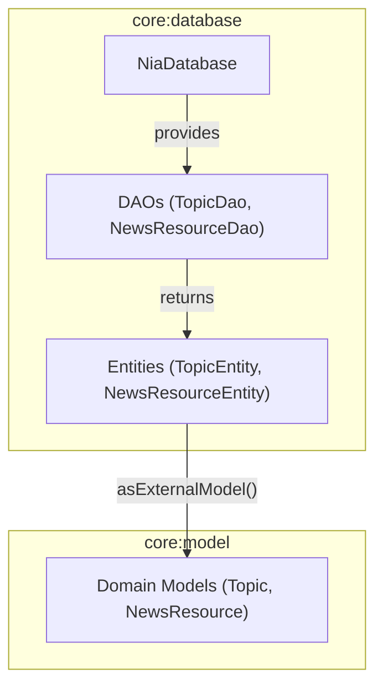
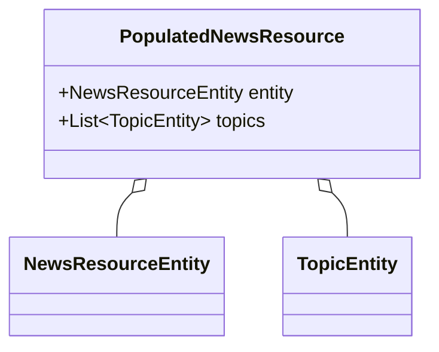
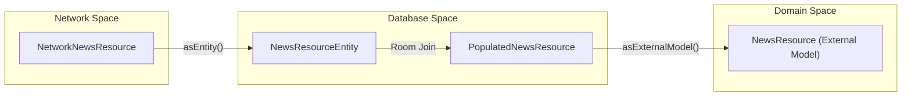

<!-- source: DeepWiki mcp.deepwiki.com · repo android/nowinandroid · page 5.2 Database Module · fetched 2026-10-23 -->

# Database Module

Relevant source files

The following files were used as context for generating this wiki page:

- [core/data/src/main/kotlin/com/google/samples/apps/nowinandroid/core/data/model/NewsResource.kt](core/data/src/main/kotlin/com/google/samples/apps/nowinandroid/core/data/model/NewsResource.kt)
- [core/data/src/test/kotlin/com/google/samples/apps/nowinandroid/core/data/model/NetworkEntityTest.kt](core/data/src/test/kotlin/com/google/samples/apps/nowinandroid/core/data/model/NetworkEntityTest.kt)
- [core/data/src/test/kotlin/com/google/samples/apps/nowinandroid/core/data/testdoubles/TestNewsResourceDao.kt](core/data/src/test/kotlin/com/google/samples/apps/nowinandroid/core/data/testdoubles/TestNewsResourceDao.kt)
- [core/database/src/androidTest/kotlin/com/google/samples/apps/nowinandroid/core/database/dao/DatabaseTest.kt](core/database/src/androidTest/kotlin/com/google/samples/apps/nowinandroid/core/database/dao/DatabaseTest.kt)
- [core/database/src/androidTest/kotlin/com/google/samples/apps/nowinandroid/core/database/dao/NewsResourceDaoTest.kt](core/database/src/androidTest/kotlin/com/google/samples/apps/nowinandroid/core/database/dao/NewsResourceDaoTest.kt)
- [core/database/src/androidTest/kotlin/com/google/samples/apps/nowinandroid/core/database/dao/TopicDaoTest.kt](core/database/src/androidTest/kotlin/com/google/samples/apps/nowinandroid/core/database/dao/TopicDaoTest.kt)
- [core/database/src/main/kotlin/com/google/samples/apps/nowinandroid/core/database/dao/NewsResourceDao.kt](core/database/src/main/kotlin/com/google/samples/apps/nowinandroid/core/database/dao/NewsResourceDao.kt)
- [core/database/src/main/kotlin/com/google/samples/apps/nowinandroid/core/database/di/DaosModule.kt](core/database/src/main/kotlin/com/google/samples/apps/nowinandroid/core/database/di/DaosModule.kt)
- [core/database/src/main/kotlin/com/google/samples/apps/nowinandroid/core/database/di/DatabaseModule.kt](core/database/src/main/kotlin/com/google/samples/apps/nowinandroid/core/database/di/DatabaseModule.kt)
- [core/database/src/main/kotlin/com/google/samples/apps/nowinandroid/core/database/model/NewsResourceEntity.kt](core/database/src/main/kotlin/com/google/samples/apps/nowinandroid/core/database/model/NewsResourceEntity.kt)
- [core/network/src/main/kotlin/com/google/samples/apps/nowinandroid/core/network/model/NetworkNewsResource.kt](core/network/src/main/kotlin/com/google/samples/apps/nowinandroid/core/network/model/NetworkNewsResource.kt)
- [core/network/src/main/kotlin/com/google/samples/apps/nowinandroid/core/network/model/NetworkTopic.kt](core/network/src/main/kotlin/com/google/samples/apps/nowinandroid/core/network/model/NetworkTopic.kt)

## Purpose and Scope

The Database Module (`core:database`) provides local data persistence for the Now in Android application using Room, an abstraction layer over SQLite. This module implements the offline-first architecture by storing news resources, topics, and related data locally, enabling the app to function without network connectivity.

The database module is responsible for:
- Defining database schema through Room entities.
- Providing Data Access Objects (DAOs) for CRUD operations.
- Managing database migrations and schema versioning.
- Exposing reactive data streams (`Flow`) to the data layer.

**Sources:** [core/database/build.gradle.kts:1-37](), [core/database/src/main/kotlin/com/google/samples/apps/nowinandroid/core/database/NiaDatabase.kt:1-50]()

---

## Module Configuration

The database module is an Android library configured with Room persistence and KSP (Kotlin Symbol Processing).

### Dependencies and Structure

The module has a direct dependency on `core:model` to map database entities to external domain models used throughout the app.

**Sources:** [core/database/build.gradle.kts:29-36](), [core/database/src/main/kotlin/com/google/samples/apps/nowinandroid/core/database/model/NewsResourceEntity.kt:44-53]()

---

## Database Architecture

The `NiaDatabase` class serves as the main access point for the persisted data. It is annotated with `@Database` and manages entities and DAOs.

### Entities and Schema

Entities are Kotlin data classes representing SQLite tables.

| Entity | Table Name | Purpose |
|--------|------------|---------|
| `NewsResourceEntity` | `news_resources` | Stores news article metadata. |
| `TopicEntity` | `topics` | Stores topic information (Compose, Android, etc.). |
| `NewsResourceTopicCrossRef` | `news_resources_topics` | Junction table for the many-to-many relationship between news and topics. |
| `RecentSearchQueryEntity` | `recent_search_queries` | Stores user search history. |

**Sources:** [core/database/src/main/kotlin/com/google/samples/apps/nowinandroid/core/database/model/NewsResourceEntity.kt:28-42](), [core/database/src/main/kotlin/com/google/samples/apps/nowinandroid/core/database/model/TopicEntity.kt:27-38](), [core/database/src/main/kotlin/com/google/samples/apps/nowinandroid/core/database/model/NewsResourceTopicCrossRef.kt:25-38]()

### Relationships (Populated Models)

Room uses "Populated" models to handle relationships. For example, `PopulatedNewsResource` combines a `NewsResourceEntity` with its associated `TopicEntity` list via the cross-reference table.

**Sources:** [core/database/src/main/kotlin/com/google/samples/apps/nowinandroid/core/database/model/PopulatedNewsResource.kt:26-37]()

---

## Data Access Objects (DAOs)

DAOs provide the API for interacting with the database. Most methods return `Flow` to enable reactive UI updates.

### NewsResourceDao
Handles complex queries for news resources, including filtering by topics or specific IDs.

- `getNewsResources(...)`: Returns a `Flow<List<PopulatedNewsResource>>`. It uses a complex SQL query with `CASE` statements to handle optional filtering. [core/database/src/main/kotlin/com/google/samples/apps/nowinandroid/core/database/dao/NewsResourceDao.kt:41-66]()
- `upsertNewsResources(...)`: Uses the `@Upsert` annotation to insert or update news resources atomically. [core/database/src/main/kotlin/com/google/samples/apps/nowinandroid/core/database/dao/NewsResourceDao.kt:103-103]()

### TopicDao
Manages topic data and synchronization.

- `getTopicEntities()`: Returns all topics as a `Flow`. [core/database/src/main/kotlin/com/google/samples/apps/nowinandroid/core/database/dao/TopicDao.kt:33-35]()
- `insertOrIgnoreTopics(...)`: Used during sync to add new topics without overwriting existing local modifications if any. [core/database/src/main/kotlin/com/google/samples/apps/nowinandroid/core/database/dao/TopicDao.kt:57-59]()

**Sources:** [core/database/src/main/kotlin/com/google/samples/apps/nowinandroid/core/database/dao/NewsResourceDao.kt:35-120](), [core/database/src/main/kotlin/com/google/samples/apps/nowinandroid/core/database/dao/TopicDao.kt:26-77]()

---

## Dependency Injection

Hilt provides the database and DAOs to the rest of the application.

- `DatabaseModule`: Provides the singleton `NiaDatabase` instance using `Room.databaseBuilder`. [core/database/src/main/kotlin/com/google/samples/apps/nowinandroid/core/database/di/DatabaseModule.kt:31-41]()
- `DaosModule`: Provides individual DAO instances (e.g., `providesTopicsDao`, `providesNewsResourceDao`) by calling methods on the `NiaDatabase` instance. [core/database/src/main/kotlin/com/google/samples/apps/nowinandroid/core/database/di/DaosModule.kt:32-57]()

---

## Data Mapping and Flow

Data enters the database from the network via repositories and is transformed into entities.

**Sources:** [core/data/src/main/kotlin/com/google/samples/apps/nowinandroid/core/data/model/NewsResource.kt:27-35](), [core/database/src/main/kotlin/com/google/samples/apps/nowinandroid/core/database/model/PopulatedNewsResource.kt:39-50]()

---

## Testing Strategy

The module uses instrumented tests (`androidTest`) to verify DAO behavior against a real SQLite instance.

### DAO Test Pattern
Tests extend `DatabaseTest`, which sets up an in-memory database before each test.

1. **Setup:** Create an in-memory `NiaDatabase` using `Room.inMemoryDatabaseBuilder`. [core/database/src/androidTest/kotlin/com/google/samples/apps/nowinandroid/core/database/dao/DatabaseTest.kt:33-43]()
2. **Execution:** Use `runTest` to call suspending DAO methods. [core/database/src/androidTest/kotlin/com/google/samples/apps/nowinandroid/core/database/dao/NewsResourceDaoTest.kt:32-64]()
3. **Verification:** Use `first()` on the returned `Flow` to assert the state of the database. [core/database/src/androidTest/kotlin/com/google/samples/apps/nowinandroid/core/database/dao/TopicDaoTest.kt:31-37]()

### Test Doubles
For unit testing repositories in the `:core:data` module, a `TestNewsResourceDao` is used. This double implements the `NewsResourceDao` interface using `MutableStateFlow` to simulate database behavior without a real SQLite dependency.

**Sources:** [core/database/src/androidTest/kotlin/com/google/samples/apps/nowinandroid/core/database/dao/DatabaseTest.kt:26-47](), [core/data/src/test/kotlin/com/google/samples/apps/nowinandroid/core/data/testdoubles/TestNewsResourceDao.kt:35-120]()

---

