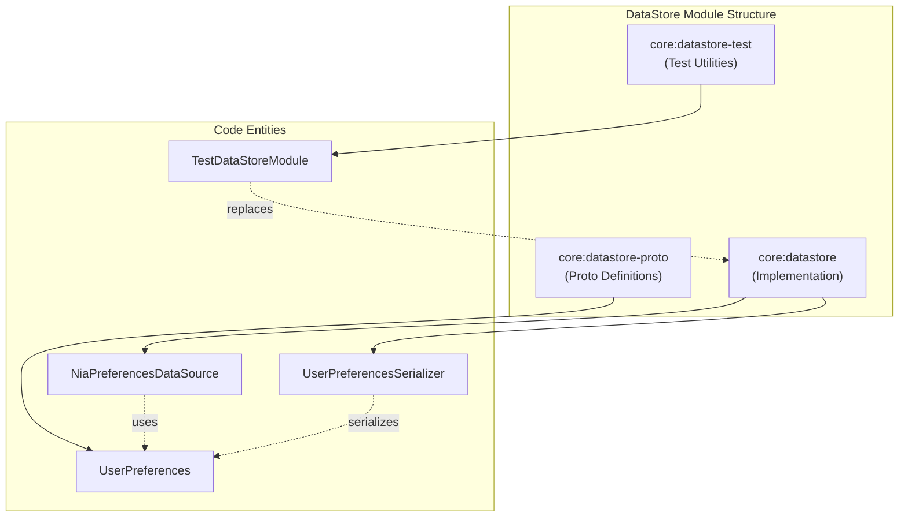
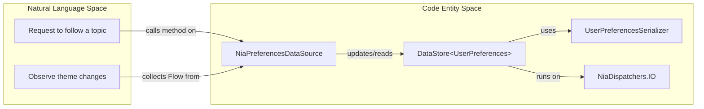

<!-- source: DeepWiki mcp.deepwiki.com · repo android/nowinandroid · page 5.3 DataStore Module · fetched 2026-10-23 -->

# DataStore Module

<details>
<summary>Relevant source files</summary>

The following files were used as context for generating this wiki page:

- [core/analytics/src/prod/kotlin/com/google/samples/apps/nowinandroid/core/analytics/AnalyticsModule.kt](core/analytics/src/prod/kotlin/com/google/samples/apps/nowinandroid/core/analytics/AnalyticsModule.kt)
- [core/analytics/src/prod/kotlin/com/google/samples/apps/nowinandroid/core/analytics/FirebaseAnalyticsHelper.kt](core/analytics/src/prod/kotlin/com/google/samples/apps/nowinandroid/core/analytics/FirebaseAnalyticsHelper.kt)
- [core/data/src/test/kotlin/com/google/samples/apps/nowinandroid/core/data/repository/OfflineFirstNewsRepositoryTest.kt](core/data/src/test/kotlin/com/google/samples/apps/nowinandroid/core/data/repository/OfflineFirstNewsRepositoryTest.kt)
- [core/data/src/test/kotlin/com/google/samples/apps/nowinandroid/core/data/repository/OfflineFirstTopicsRepositoryTest.kt](core/data/src/test/kotlin/com/google/samples/apps/nowinandroid/core/data/repository/OfflineFirstTopicsRepositoryTest.kt)
- [core/data/src/test/kotlin/com/google/samples/apps/nowinandroid/core/data/repository/OfflineFirstUserDataRepositoryTest.kt](core/data/src/test/kotlin/com/google/samples/apps/nowinandroid/core/data/repository/OfflineFirstUserDataRepositoryTest.kt)
- [core/datastore-proto/build.gradle.kts](core/datastore-proto/build.gradle.kts)
- [core/datastore-test/src/main/kotlin/com/google/samples/apps/nowinandroid/core/datastore/test/TestDataStoreModule.kt](core/datastore-test/src/main/kotlin/com/google/samples/apps/nowinandroid/core/datastore/test/TestDataStoreModule.kt)
- [core/datastore/src/main/kotlin/com/google/samples/apps/nowinandroid/core/datastore/di/DataStoreModule.kt](core/datastore/src/main/kotlin/com/google/samples/apps/nowinandroid/core/datastore/di/DataStoreModule.kt)
- [core/datastore/src/test/kotlin/com/google/samples/apps/nowinandroid/core/datastore/NiaPreferencesDataSourceTest.kt](core/datastore/src/test/kotlin/com/google/samples/apps/nowinandroid/core/datastore/NiaPreferencesDataSourceTest.kt)
- [sync/work/src/demo/kotlin/com/google/samples/apps/nowinandroid/sync/di/SyncModule.kt](sync/work/src/demo/kotlin/com/google/samples/apps/nowinandroid/sync/di/SyncModule.kt)
- [sync/work/src/prod/kotlin/com/google/samples/apps/nowinandroid/sync/di/SyncModule.kt](sync/work/src/prod/kotlin/com/google/samples/apps/nowinandroid/sync/di/SyncModule.kt)

</details>


## Purpose and Scope

The DataStore module provides persistent storage for user preferences and application settings using Protocol Buffers (protobuf) and Jetpack DataStore. This module stores user-specific data including followed topics, bookmarked news resources, theme preferences, and synchronization metadata used to track incremental updates from the network.

This document covers the `core:datastore`, `core:datastore-proto`, and `core:datastore-test` modules.

**Sources:** [core/datastore/src/main/kotlin/com/google/samples/apps/nowinandroid/core/datastore/di/DataStoreModule.kt:42-59](), [core/datastore-proto/build.gradle.kts:1-44]()

---

## Module Organization

The DataStore functionality is split across three modules to separate implementation, data definitions, and testing infrastructure.

| Module | Purpose | Key Classes |
|--------|---------|-------------|
| `core:datastore` | Main implementation and DataStore access | `NiaPreferencesDataSource`, `UserPreferencesSerializer`, `DataStoreModule` |
| `core:datastore-proto` | Protocol Buffer schema and generated classes | `UserPreferences`, `ThemeBrandProto`, `DarkThemeConfigProto` |
| `core:datastore-test` | Test utilities and in-memory fakes | `TestDataStoreModule`, `InMemoryDataStore` |



**Diagram: DataStore Module Entity Association**

**Sources:** [core/datastore/src/main/kotlin/com/google/samples/apps/nowinandroid/core/datastore/di/DataStoreModule.kt:27-28](), [core/datastore-test/src/main/kotlin/com/google/samples/apps/nowinandroid/core/datastore/test/TestDataStoreModule.kt:30-34]()

---

## Protocol Buffer Schema

The DataStore module uses Protocol Buffers for type-safe, efficient serialization. The schema is defined in `.proto` files and compiled into Kotlin lite classes.

### UserPreferences

The `UserPreferences` proto stores all user-specific application state. Key fields include:
- **Followed Topics**: Stored as a map for O(1) lookups.
- **Bookmarks**: Tracks bookmarked news resource IDs.
- **Theme Settings**: Stores `ThemeBrand` and `DarkThemeConfig`.
- **Sync Versions**: Tracks `topicChangeListVersion` and `newsResourceChangeListVersion` to support incremental synchronization.

**Sources:** [core/datastore/src/main/kotlin/com/google/samples/apps/nowinandroid/core/datastore/di/DataStoreModule.kt:49-58](), [core/datastore-proto/build.gradle.kts:22-39]()

---

## Data Flow and Implementation

The `NiaPreferencesDataSource` acts as the primary entry point for the rest of the application to interact with stored preferences.



**Diagram: Preference Data Flow**

### UserPreferencesSerializer
This class defines how the `UserPreferences` proto is written to and read from disk. It is passed to the `DataStoreFactory` during initialization.

### NiaPreferencesDataSource
A wrapper around the `DataStore<UserPreferences>` that provides a clean API for the data layer. It handles mapping proto-specific types to domain models and provides `Flow` streams for reactive updates.

**Sources:** [core/datastore/src/main/kotlin/com/google/samples/apps/nowinandroid/core/datastore/di/DataStoreModule.kt:44-58](), [core/data/src/test/kotlin/com/google/samples/apps/nowinandroid/core/data/repository/OfflineFirstUserDataRepositoryTest.kt:49-55]()

---

## Migration Strategies

The module implements migrations to handle schema evolutions. These are passed to the `DataStoreFactory` in `DataStoreModule`.

### IntToStringIdsMigration
This migration handles the transition of entity IDs from integers to strings, ensuring backward compatibility with older versions of the app where IDs were represented as `Int`.

### ListToMapMigration
Earlier versions of the proto used repeated lists for followed IDs. Migrating these to maps allows for O(1) membership checks, which is more efficient for large sets of followed topics or bookmarks.

**Sources:** [core/datastore/src/main/kotlin/com/google/samples/apps/nowinandroid/core/datastore/di/DataStoreModule.kt:53-55]()

---

## Hilt Dependency Injection

The `DataStoreModule` provides the singleton instance of `DataStore<UserPreferences>`. It uses the `IO` dispatcher for disk operations and an `ApplicationScope` for the coroutine scope.

```kotlin
@Provides
@Singleton
internal fun providesUserPreferencesDataStore(
    @ApplicationContext context: Context,
    @Dispatcher(IO) ioDispatcher: CoroutineDispatcher,
    @ApplicationScope scope: CoroutineScope,
    userPreferencesSerializer: UserPreferencesSerializer,
): DataStore<UserPreferences> =
    DataStoreFactory.create(
        serializer = userPreferencesSerializer,
        scope = CoroutineScope(scope.coroutineContext + ioDispatcher),
        migrations = listOf(
            IntToStringIdsMigration,
        ),
    ) {
        context.dataStoreFile("user_preferences.pb")
    }
```

**Sources:** [core/datastore/src/main/kotlin/com/google/samples/apps/nowinandroid/core/datastore/di/DataStoreModule.kt:42-58]()

---

## Testing Infrastructure

### TestDataStoreModule
In instrumented or unit tests, the `TestDataStoreModule` replaces the production `DataStoreModule`. It uses `TestInstallIn` to swap the implementation with an `InMemoryDataStore`.

### InMemoryDataStore
The `InMemoryDataStore` provides a non-persistent implementation of the `DataStore` interface. This allows tests to run in isolation without side effects on the device's physical storage and without the overhead of disk I/O.

**Sources:** [core/datastore-test/src/main/kotlin/com/google/samples/apps/nowinandroid/core/datastore/test/TestDataStoreModule.kt:30-40](), [core/data/src/test/kotlin/com/google/samples/apps/nowinandroid/core/data/repository/OfflineFirstTopicsRepositoryTest.kt:58-59]()

---

