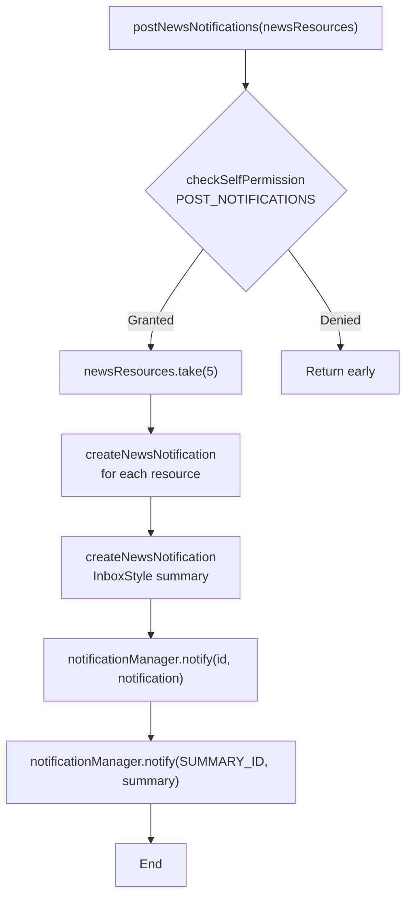
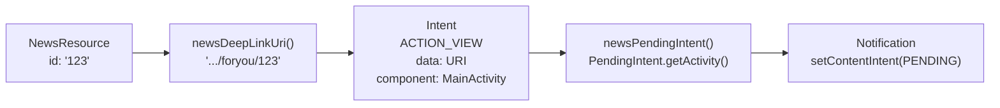
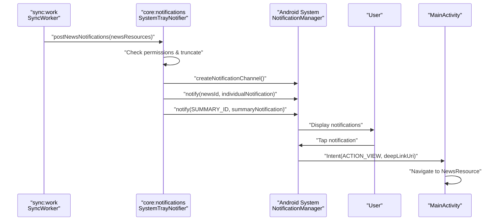

<!-- source: DeepWiki mcp.deepwiki.com · repo android/nowinandroid · page 5.4 Notifications · fetched 2026-10-23 -->

# Notifications

<details>
<summary>Relevant source files</summary>

The following files were used as context for generating this wiki page:

- [core/common/build.gradle.kts](core/common/build.gradle.kts)
- [core/domain/build.gradle.kts](core/domain/build.gradle.kts)
- [core/domain/src/main/AndroidManifest.xml](core/domain/src/main/AndroidManifest.xml)
- [core/notifications/build.gradle.kts](core/notifications/build.gradle.kts)
- [core/notifications/src/main/AndroidManifest.xml](core/notifications/src/main/AndroidManifest.xml)
- [core/notifications/src/main/kotlin/com/google/samples/apps/nowinandroid/core/notifications/SystemTrayNotifier.kt](core/notifications/src/main/kotlin/com/google/samples/apps/nowinandroid/core/notifications/SystemTrayNotifier.kt)
- [core/notifications/src/main/res/drawable-anydpi-v24/core_notifications_ic_nia_notification.xml](core/notifications/src/main/res/drawable-anydpi-v24/core_notifications_ic_nia_notification.xml)
- [core/notifications/src/main/res/drawable-hdpi/core_notifications_ic_nia_notification.png](core/notifications/src/main/res/drawable-hdpi/core_notifications_ic_nia_notification.png)
- [core/notifications/src/main/res/drawable-mdpi/core_notifications_ic_nia_notification.png](core/notifications/src/main/res/drawable-mdpi/core_notifications_ic_nia_notification.png)
- [core/notifications/src/main/res/drawable-xhdpi/core_notifications_ic_nia_notification.png](core/notifications/src/main/res/drawable-xhdpi/core_notifications_ic_nia_notification.png)
- [core/notifications/src/main/res/drawable-xxhdpi/core_notifications_ic_nia_notification.png](core/notifications/src/main/res/drawable-xxhdpi/core_notifications_ic_nia_notification.png)
- [core/notifications/src/main/res/values/strings.xml](core/notifications/src/main/res/values/strings.xml)
- [sync/work/build.gradle.kts](sync/work/build.gradle.kts)
- [sync/work/src/main/kotlin/com/google/samples/apps/nowinandroid/sync/initializers/SyncWorkHelpers.kt](sync/work/src/main/kotlin/com/google/samples/apps/nowinandroid/sync/initializers/SyncWorkHelpers.kt)

</details>


The `core:notifications` module provides notification functionality for displaying news updates in the system tray. This module handles Android notification management, including notification channels, deep linking to app content, and permission handling. For background synchronization that triggers notifications, see [Background Services](#7).

**Sources:** [core/notifications/src/main/kotlin/com/google/samples/apps/nowinandroid/core/notifications/SystemTrayNotifier.kt:1-168]()

## Module Overview

The notifications module exposes a `Notifier` interface and provides `SystemTrayNotifier` as its implementation. The module is designed to be injected into other modules (particularly `core:data` and `sync:work`) to post system tray notifications when new news resources become available.

**Key Responsibilities:**
- Create and manage Android notification channels [core/notifications/src/main/kotlin/com/google/samples/apps/nowinandroid/core/notifications/SystemTrayNotifier.kt:137-149]()
- Post grouped notifications for news updates [core/notifications/src/main/kotlin/com/google/samples/apps/nowinandroid/core/notifications/SystemTrayNotifier.kt:60-104]()
- Generate deep links for navigation to news content [core/notifications/src/main/kotlin/com/google/samples/apps/nowinandroid/core/notifications/SystemTrayNotifier.kt:151-168]()
- Handle notification permissions (Android 13+) [core/notifications/src/main/kotlin/com/google/samples/apps/nowinandroid/core/notifications/SystemTrayNotifier.kt:63-65]()
- Create notification groups with summary notifications [core/notifications/src/main/kotlin/com/google/samples/apps/nowinandroid/core/notifications/SystemTrayNotifier.kt:79-93]()

**Sources:** [core/notifications/src/main/kotlin/com/google/samples/apps/nowinandroid/core/notifications/SystemTrayNotifier.kt:40-51](), [core/notifications/build.gradle.kts:1-31]()

## Module Dependencies

```mermaid
graph TB
    subgraph ["Sync Layer"]
        ["sync:work"]
    end
    
    subgraph ["Data Layer"]
        ["core:data"]
    end
    
    subgraph ["Core Modules"]
        CORE_NOTIFICATIONS["core:notifications<br/>Notifier interface<br/>SystemTrayNotifier"]
        CORE_MODEL["core:model<br/>NewsResource"]
    end
    
    subgraph ["App Layer"]
        MAIN_ACTIVITY["MainActivity<br/>Handles deep links"]
    end
    
    ["sync:work"] --> CORE_NOTIFICATIONS
    ["core:data"] --> CORE_NOTIFICATIONS
    CORE_NOTIFICATIONS --> CORE_MODEL
    MAIN_ACTIVITY -.->|"Receives deep links"| CORE_NOTIFICATIONS
```

**Module Dependencies Diagram**

The notifications module is a dependency of both `core:data` and `sync:work`, allowing these modules to post notifications when new content is available. The module depends on `core:model` for the `NewsResource` data class.

**Sources:** [sync/work/build.gradle.kts:37](), [core/notifications/build.gradle.kts:26-28]()

## SystemTrayNotifier Implementation

The `SystemTrayNotifier` class is a singleton implementation of the `Notifier` interface, responsible for creating and displaying Android system tray notifications.

### Class Structure

| Component | Type | Purpose |
|-----------|------|---------|
| `SystemTrayNotifier` | Class | Main implementation, posts news notifications [core/notifications/src/main/kotlin/com/google/samples/apps/nowinandroid/core/notifications/SystemTrayNotifier.kt:56]() |
| `Notifier` | Interface | Abstract notification contract |
| `postNewsNotifications()` | Method | Posts notifications for a list of news resources [core/notifications/src/main/kotlin/com/google/samples/apps/nowinandroid/core/notifications/SystemTrayNotifier.kt:60]() |
| `createNewsNotification()` | Extension Function | Creates configured notification builder [core/notifications/src/main/kotlin/com/google/samples/apps/nowinandroid/core/notifications/SystemTrayNotifier.kt:121]() |
| `ensureNotificationChannelExists()` | Extension Function | Creates notification channel on Android O+ [core/notifications/src/main/kotlin/com/google/samples/apps/nowinandroid/core/notifications/SystemTrayNotifier.kt:137]() |
| `newsPendingIntent()` | Extension Function | Creates deep link pending intent [core/notifications/src/main/kotlin/com/google/samples/apps/nowinandroid/core/notifications/SystemTrayNotifier.kt:151]() |

**Sources:** [core/notifications/src/main/kotlin/com/google/samples/apps/nowinandroid/core/notifications/SystemTrayNotifier.kt:55-58]()

### Notification Posting Flow



**Notification Posting Flow**

The notification flow first checks for permissions (required on Android 13+), truncates the list to a maximum of 5 notifications, creates individual notifications for each news resource, and posts them along with a summary notification.

**Sources:** [core/notifications/src/main/kotlin/com/google/samples/apps/nowinandroid/core/notifications/SystemTrayNotifier.kt:60-104]()

### Key Constants

```kotlin
// From SystemTrayNotifier.kt:40-50
private const val MAX_NUM_NOTIFICATIONS = 5
private const val TARGET_ACTIVITY_NAME = "com.google.samples.apps.nowinandroid.MainActivity"
private const val NEWS_NOTIFICATION_REQUEST_CODE = 0
private const val NEWS_NOTIFICATION_SUMMARY_ID = 1
private const val NEWS_NOTIFICATION_CHANNEL_ID = ""
private const val NEWS_NOTIFICATION_GROUP = "NEWS_NOTIFICATIONS"
private const val DEEP_LINK_SCHEME_AND_HOST = "https://www.nowinandroid.apps.samples.google.com"
private const val DEEP_LINK_FOR_YOU_PATH = "foryou"
private const val DEEP_LINK_BASE_PATH = "$DEEP_LINK_SCHEME_AND_HOST/$DEEP_LINK_FOR_YOU_PATH"
const val DEEP_LINK_NEWS_RESOURCE_ID_KEY = "linkedNewsResourceId"
const val DEEP_LINK_URI_PATTERN = "$DEEP_LINK_BASE_PATH/{$DEEP_LINK_NEWS_RESOURCE_ID_KEY}"
```

**Sources:** [core/notifications/src/main/kotlin/com/google/samples/apps/nowinandroid/core/notifications/SystemTrayNotifier.kt:40-50]()

## Notification Structure

### Notification Channels

The module creates a notification channel for Android O (API 26) and above:

| Property | Value | Source |
|----------|-------|--------|
| Channel ID | `NEWS_NOTIFICATION_CHANNEL_ID` ("") | [core/notifications/src/main/kotlin/com/google/samples/apps/nowinandroid/core/notifications/SystemTrayNotifier.kt:44]() |
| Channel Name | `R.string.core_notifications_news_notification_channel_name` | [core/notifications/src/main/res/values/strings.xml:18]() |
| Importance | `NotificationManager.IMPORTANCE_DEFAULT` | [core/notifications/src/main/kotlin/com/google/samples/apps/nowinandroid/core/notifications/SystemTrayNotifier.kt:143]() |
| Description | `R.string.core_notifications_news_notification_channel_description` | [core/notifications/src/main/res/values/strings.xml:19]() |

The channel creation happens lazily via `ensureNotificationChannelExists()` when a notification is posted.

**Sources:** [core/notifications/src/main/kotlin/com/google/samples/apps/nowinandroid/core/notifications/SystemTrayNotifier.kt:137-149]()

### Grouped Notifications

```mermaid
graph TB
    subgraph ["Notification Group: NEWS_NOTIFICATIONS"]
        SUMMARY["Summary Notification<br/>ID: 1<br/>setGroupSummary(true)"]
        NOTIF1["News Notification 1<br/>ID: newsResource[0].id.hashCode()"]
        NOTIF2["News Notification 2<br/>ID: newsResource[1].id.hashCode()"]
        NOTIF_N["... (up to 5 total)"]
    end
    
    SUMMARY -.->|"Groups"| NOTIF1
    SUMMARY -.->|"Groups"| NOTIF2
    SUMMARY -.->|"Groups"| NOTIF_N
```

**Notification Grouping Structure**

Notifications are grouped using `NEWS_NOTIFICATION_GROUP` with a summary notification that uses `InboxStyle` to display news titles. Each individual notification has a unique ID based on the news resource ID hash.

**Sources:** [core/notifications/src/main/kotlin/com/google/samples/apps/nowinandroid/core/notifications/SystemTrayNotifier.kt:75-103](), [core/notifications/src/main/kotlin/com/google/samples/apps/nowinandroid/core/notifications/SystemTrayNotifier.kt:109-116]()

### Individual Notification Content

Each notification contains:

| Component | Source |
|-----------|--------|
| Small Icon | `R.drawable.core_notifications_ic_nia_notification` [core/notifications/src/main/res/drawable-anydpi-v24/core_notifications_ic_nia_notification.xml:17]() |
| Content Title | `newsResource.title` [core/notifications/src/main/kotlin/com/google/samples/apps/nowinandroid/core/notifications/SystemTrayNotifier.kt:72]() |
| Content Text | `newsResource.content` [core/notifications/src/main/kotlin/com/google/samples/apps/nowinandroid/core/notifications/SystemTrayNotifier.kt:73]() |
| Content Intent | Deep link `PendingIntent` to news resource [core/notifications/src/main/kotlin/com/google/samples/apps/nowinandroid/core/notifications/SystemTrayNotifier.kt:74]() |
| Group | `NEWS_NOTIFICATION_GROUP` [core/notifications/src/main/kotlin/com/google/samples/apps/nowinandroid/core/notifications/SystemTrayNotifier.kt:75]() |

**Sources:** [core/notifications/src/main/kotlin/com/google/samples/apps/nowinandroid/core/notifications/SystemTrayNotifier.kt:69-78]()

## Deep Linking

The notifications module implements a deep linking system that allows tapping a notification to navigate directly to the associated news resource in `MainActivity`.

### Deep Link URI Pattern

```
https://www.nowinandroid.apps.samples.google.com/foryou/{linkedNewsResourceId}
```

**Components:**
- **Scheme and Host:** `https://www.nowinandroid.apps.samples.google.com` [core/notifications/src/main/kotlin/com/google/samples/apps/nowinandroid/core/notifications/SystemTrayNotifier.kt:46]()
- **Base Path:** `/foryou` [core/notifications/src/main/kotlin/com/google/samples/apps/nowinandroid/core/notifications/SystemTrayNotifier.kt:47]()
- **Parameter:** `linkedNewsResourceId` [core/notifications/src/main/kotlin/com/google/samples/apps/nowinandroid/core/notifications/SystemTrayNotifier.kt:49]()

**Sources:** [core/notifications/src/main/kotlin/com/google/samples/apps/nowinandroid/core/notifications/SystemTrayNotifier.kt:46-50]()

### Deep Link Creation Flow



**Deep Link Creation Process**

The `newsDeepLinkUri()` extension function constructs the deep link URI for a news resource, and `newsPendingIntent()` wraps it in a `PendingIntent` that targets `MainActivity`.

**Sources:** [core/notifications/src/main/kotlin/com/google/samples/apps/nowinandroid/core/notifications/SystemTrayNotifier.kt:151-168]()

## Permission Handling

Starting with Android 13 (API 33), posting notifications requires the `POST_NOTIFICATIONS` runtime permission, which is declared in the module manifest.

```xml
<uses-permission android:name="android.permission.POST_NOTIFICATIONS"/>
```

**Sources:** [core/notifications/src/main/AndroidManifest.xml:18]()

### Permission Check

```kotlin
// From SystemTrayNotifier.kt:63-65
if (checkSelfPermission(this, permission.POST_NOTIFICATIONS) != PERMISSION_GRANTED) {
    return
}
```

The `postNewsNotifications()` method performs this check and returns early if permission is denied.

**Sources:** [core/notifications/src/main/kotlin/com/google/samples/apps/nowinandroid/core/notifications/SystemTrayNotifier.kt:63-65]()

## Integration with Sync

Background synchronization triggers notifications via `SyncWorkHelpers` (located in `sync:work`). When a sync operation completes and identifies new news resources that the user should be notified about, it calls the `Notifier`.

The `sync:work` module includes `core:notifications` as a dependency to facilitate this interaction.

**Sources:** [sync/work/build.gradle.kts:37](), [sync/work/src/main/kotlin/com/google/samples/apps/nowinandroid/sync/initializers/SyncWorkHelpers.kt]()

## Notification Lifecycle Summary



**Sources:** [core/notifications/src/main/kotlin/com/google/samples/apps/nowinandroid/core/notifications/SystemTrayNotifier.kt:60-104](), [core/notifications/src/main/kotlin/com/google/samples/apps/nowinandroid/core/notifications/SystemTrayNotifier.kt:151-165]()

---

