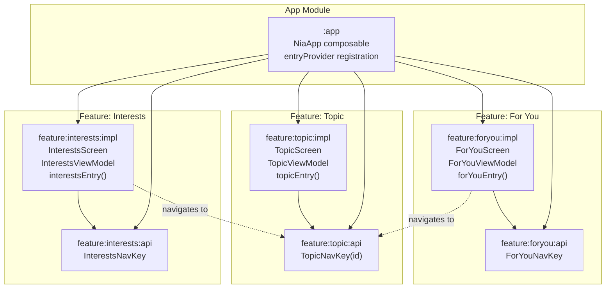
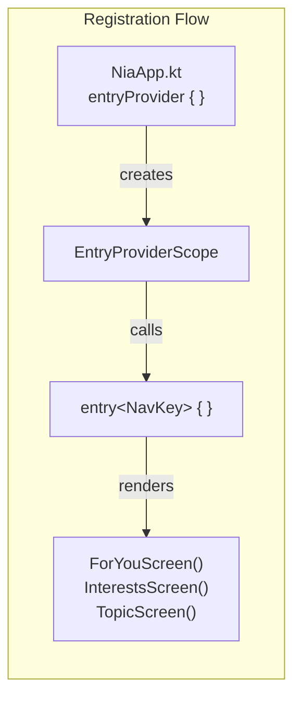

<!-- source: DeepWiki mcp.deepwiki.com · repo android/nowinandroid · page 6 Feature Modules · fetched 2026-10-23 -->

# Feature Modules

<details>
<summary>Relevant source files</summary>

The following files were used as context for generating this wiki page:

- [app/build.gradle.kts](app/build.gradle.kts)
- [build-logic/settings.gradle.kts](build-logic/settings.gradle.kts)
- [build.gradle.kts](build.gradle.kts)
- [core/navigation/.gitignore](core/navigation/.gitignore)
- [core/navigation/build.gradle.kts](core/navigation/build.gradle.kts)
- [feature/bookmarks/api/build.gradle.kts](feature/bookmarks/api/build.gradle.kts)
- [feature/bookmarks/impl/build.gradle.kts](feature/bookmarks/impl/build.gradle.kts)
- [feature/bookmarks/impl/src/main/AndroidManifest.xml](feature/bookmarks/impl/src/main/AndroidManifest.xml)
- [feature/foryou/api/build.gradle.kts](feature/foryou/api/build.gradle.kts)
- [feature/foryou/api/src/main/AndroidManifest.xml](feature/foryou/api/src/main/AndroidManifest.xml)
- [feature/foryou/api/src/main/res/values/strings.xml](feature/foryou/api/src/main/res/values/strings.xml)
- [feature/foryou/impl/build.gradle.kts](feature/foryou/impl/build.gradle.kts)
- [feature/interests/api/build.gradle.kts](feature/interests/api/build.gradle.kts)
- [feature/interests/api/src/main/AndroidManifest.xml](feature/interests/api/src/main/AndroidManifest.xml)
- [feature/interests/impl/build.gradle.kts](feature/interests/impl/build.gradle.kts)
- [feature/search/api/build.gradle.kts](feature/search/api/build.gradle.kts)
- [feature/search/impl/build.gradle.kts](feature/search/impl/build.gradle.kts)
- [feature/topic/api/build.gradle.kts](feature/topic/api/build.gradle.kts)
- [feature/topic/impl/build.gradle.kts](feature/topic/impl/build.gradle.kts)
- [feature/topic/impl/src/main/kotlin/com/google/samples/apps/nowinandroid/feature/topic/impl/TopicScreen.kt](feature/topic/impl/src/main/kotlin/com/google/samples/apps/nowinandroid/feature/topic/impl/TopicScreen.kt)
- [settings.gradle.kts](settings.gradle.kts)

</details>


## Purpose and Scope

Feature modules encapsulate complete user-facing functionality in independent, isolated modules. Each feature module represents a distinct screen or user flow in the Now in Android application, such as the For You feed, Interests browser, or Topic detail view. This page explains how feature modules are structured using the API/Impl pattern, how they register with the navigation system, and how they communicate with each other while maintaining loose coupling.

For information about the navigation system that features integrate with, see [Navigation and Adaptive UI](#4.2). For details on the overall module structure and dependency rules, see [Module Structure](#2.1).

## API/Impl Split Pattern

Each feature is divided into two modules: an API module and an implementation module. This pattern enforces loose coupling and enables features to navigate to each other without creating circular dependencies.

### Module Roles

| Module Type | Purpose | Contains | Dependencies |
|-------------|---------|----------|--------------|
| `:feature:*:api` | Public interface | `NavKey` definitions, navigation functions | Core modules only |
| `:feature:*:impl` | Implementation | Screens, ViewModels, UI logic | API module + other feature APIs |

**API Module** - Defines the contract for navigating to a feature:
- Navigation key definitions (e.g., `ForYouNavKey`).
- Public constants and interfaces.
- Uses `nowinandroid.android.feature.api` convention plugin [feature/foryou/api/build.gradle.kts:18]().

**Implementation Module** - Contains the actual feature:
- Composable screens and ViewModels.
- Entry provider functions that register with navigation.
- Uses `nowinandroid.android.feature.impl` convention plugin [feature/foryou/impl/build.gradle.kts:18]().

### Dependency Flow



**Sources:** 
- [app/build.gradle.kts:71-81]()
- [feature/foryou/impl/build.gradle.kts:32-33]()
- [feature/interests/impl/build.gradle.kts:29-30]()

## Feature Registration with Navigation

Features register themselves with the navigation system through entry provider functions. These functions are called during app initialization to establish the mapping between navigation keys and composable screens.

### Entry Provider Pattern

Each feature implementation module provides an extension function on `EntryProviderScope` that registers its screen. This is centralized in the `:app` module.



**Sources:** 
- [feature/foryou/impl/build.gradle.kts:32]()
- [feature/interests/impl/build.gradle.kts:30]()

## Inter-Feature Navigation

Features navigate to other features by depending on their API modules. The implementation of a feature (e.g., `foryou:impl`) depends on the API of another (e.g., `topic:api`) to access its navigation keys and parameters.

### Navigation Dependencies in Build Logic

The `:app` module acts as the orchestrator, depending on both `api` and `impl` modules for all features to wire the navigation graph.

[app/build.gradle.kts:71-81]()
```kotlin
dependencies {
    implementation(projects.feature.interests.api)
    implementation(projects.feature.interests.impl)
    implementation(projects.feature.foryou.api)
    implementation(projects.feature.foryou.impl)
    // ... other features
}
```

**Sources:** 
- [app/build.gradle.kts:71-81]()
- [feature/foryou/impl/build.gradle.kts:32-33]()
- [feature/search/impl/build.gradle.kts:29-31]()

## Feature Details

For detailed documentation on specific features, refer to the following child pages:

### [For You Feature](#6.1)
Details the landing experience of the app, including the onboarding flow, topic following, and the personalized news feed.
- **Key Components:** `ForYouScreen`, `ForYouViewModel`, `OnboardingUiState`.
- **Navigation:** `ForYouEntryProvider`.

### [Interests Feature](#6.2)
Explains the topic browsing experience and how the app uses adaptive layouts for a list-detail view on larger screens.
- **Key Components:** `InterestsScreen`, `InterestsViewModel`, `InterestsListDetailScreenTest`.
- **Navigation:** `InterestsEntryProvider`.

### [Other Features](#6.3)
Covers supplemental features including Bookmarks, Search, Settings, and the specific Topic detail view.
- **Key Components:** `BookmarksScreen`, `SearchScreen` with `SearchViewModel`, `SettingsDialog`, and `TopicScreen`.

## Adaptive Layout Integration

Features integrate with the adaptive UI system by providing metadata during registration. For example, the Interests and Topic features use `ListDetailSceneStrategy` to coordinate how they appear on compact vs. expanded screens.

[feature/interests/impl/build.gradle.kts:32-35]()
```kotlin
dependencies {
    implementation(libs.androidx.compose.material3.adaptive)
    implementation(libs.androidx.compose.material3.adaptive.layout)
    implementation(libs.androidx.compose.material3.adaptive.navigation)
}
```

**Sources:** 
- [feature/interests/impl/build.gradle.kts:32-35]()
- [feature/topic/impl/build.gradle.kts:31]()

## Feature Module Dependencies

Feature implementation modules follow strict dependency rules to maintain architectural boundaries:

| Dependency Type | Example | Purpose |
|----------------|---------|---------|
| Own API | `:feature:foryou:impl` → `:feature:foryou:api` | Access own navigation key |
| Other Feature APIs | `:feature:foryou:impl` → `:feature:topic:api` | Navigate to other features |
| Core Presentation | `:feature:*:impl` → `:core:ui`, `:core:designsystem` | UI components and theming |
| Core Domain | `:feature:*:impl` → `:core:domain` | Use cases for business logic |

**Sources:**
- [feature/foryou/impl/build.gradle.kts:29-34]()
- [feature/interests/impl/build.gradle.kts:28-31]()
- [feature/search/impl/build.gradle.kts:28-31]()

---

